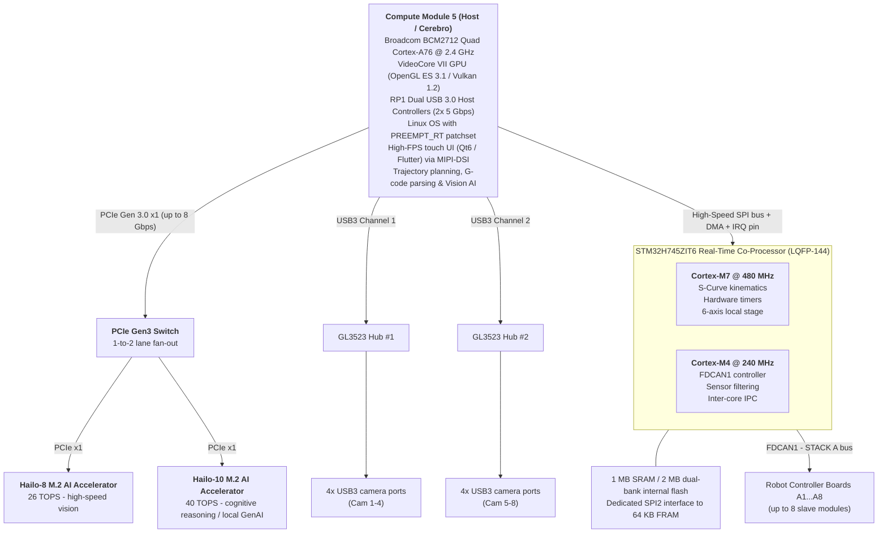
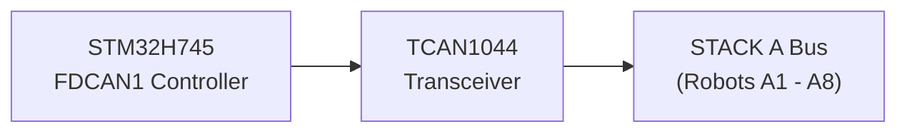
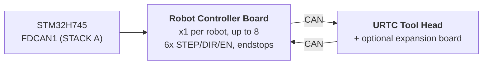

<!-- =============================================================================
HYDRA-UMC - Universal Machines Controller: board design, bootloaders and the CM5 SPI bridge
Copyright (C) JuanenRac (Electro Hobby 3D) <electrohobby3d@gmail.com>
GPL-3.0-or-later - see LICENSE
============================================================================= -->

<p align="center">
  
</p>

# 🚀 HYDRA-UMC

<p align="center">🇺🇸 <b>English</b> | <a href="README_spa.md">🇪🇸 Español</a> | <a href="README_fra.md">🇫🇷 Français</a> | <a href="README_ita.md">🇮🇹 Italiano</a> | <a href="README_deu.md">🇩🇪 Deutsch</a> | <a href="README_zho.md">🇨🇳 简体中文</a> | <a href="README_jpn.md">🇯🇵 日本語</a> | <a href="README_por.md">🇵🇹 Português</a></p>

### 🤖 The Ultimate Dual-Core Micro-Factory & Multi-Robot Controller Platform (V1.0 - Dual PCIe Hailo-8 + Hailo-10 AI Accelerators & Dual USB 3.0 Hubs)

<p align="center">
  
  
  
  
  
  
  
</p>

---

> **Safety and security status:** this ecosystem is not a certified safety system. There is no hardware E-STOP path, no firmware-enforced limits or interlocks and no verified motion command yet; firmware images are checked with CRC-32 and an Ed25519 signature, and a release build refuses the published development keys (the tool heads and expansion boards behind the relay still run URTC bootloaders, which take a shared-key HMAC-SHA256 instead of a signature); TLS and mutual TLS are optional and off by default; no custom board has been populated or tested yet. Read the [security baseline](https://github.com/JuanenRac/HYDRA-UMC-DOCS/blob/main/docs/SECURITY_BASELINE.md) and the [threat model](https://github.com/JuanenRac/HYDRA-UMC-DOCS/blob/main/docs/THREAT_MODEL.md) before relying on any statement here for the safety of a person.

---

## 📋 At a glance

| | |
|---|---|
| Version | `0.2.3` |
| Maturity | Scaffolding |
| Tests | 154 (`python -m unittest discover -s tests -p 'test_*.py'`) |
| Stack | STM32H745 (dual-core) / STM32G474 / FreeRTOS (AMP) / CMSIS-DSP / FDCAN (classic CAN mode) |
| Target | A microcontroller board (the firmware); built on a PC |
| On real hardware | Not yet: no run on real hardware is recorded for this version |

**Jump to:** [Overview](#-overview) · [Architecture](#-architecture) · [Features](#-features) · [Security & Safety](#-security--safety) · [Interfaces](#-interfaces) · [Configuration](#-configuration) · [Quick start](#-quick-start) · [Testing](#-testing) · [Troubleshooting](#-troubleshooting) · [Repository Structure](#-repository-structure) · [Related Projects](#-related-projects)

## 🚦 Project status

Each line is one part of this repository and the light says how far it is today. It is written from what the repository can show (tests, builds, runs), not from what is planned.

🟢 Done and verified · 🟡 Works, with known limits · 🟠 Partly done or not verified yet · 🔴 Not done or not working

| Area | State | What it means here |
|---|---|---|
| Software | 🟠 | Structure and first pieces only; most of the work is still to do |
| Tests | 🟡 | 154 automated tests, run on every change |
| Real hardware | 🔴 | Not yet: no run on real hardware is recorded for this version |
| Documentation | 🟡 | README in eight languages, checked against the manifest on every change |

## 🎯 Overview

**HYDRA-UMC** (Universal Machines Controller) is a distributed control platform and HMI architecture, still at an early firmware stage, designed for multi-axis cellular robotics, micro-factories, automated manufacturing, and complex toolhead orchestration. 

Designed as a **Heterogeneous Host + Real-Time Co-Processor Architecture**, HYDRA-UMC is meant to decouple high-level user interface rendering, computer vision, AI inference, and cloud connectivity from real-time step generation, fieldbus management, and power electronics actuation (planned: step generation and actuation are not written yet).

> **Design status:** the sections below describe the intended design of the board and its firmware. What exists today is limited to the bootloaders, the CM4 and G474 communication applications and the CM5-side SPI bridge (see the *Safety status* box near the end and the status table in `docs/architecture.md`). Wherever a sentence below speaks in the present tense about motion generation, S-curve profiles, PID loops, safety interlocks, an E-STOP, power-loss handling, object detection or any other behaviour of the final board, read it as planned: none of it has run on a populated board.

### 🤖 Micro-Factory Capabilities (design targets):
* 📡 **Distributed Multi-Robot Network:** Planned: coordination of up to 8 distributed slave robotic modules (3, 4, 5, and 6-DOF first; scaling up to 7, 8, 9-DOF and Dual-Robot architectures in future releases) connected over a single physical CAN bus.
* 🧠 **Dual Embedded Neural Coprocessing:** An onboard PCIe Gen3 switch fans the CM5's single PCIe lane out to 2 M.2 AI accelerators - a Hailo-8 (26 TOPS) driving multi-stream YOLOv8/YOLO11 (planned; no detector runs yet) object detection, defect inspection, and real-time PnP fiducial alignment across all 8 cameras, plus a Hailo-10 (40 TOPS) running local, on-device cognitive reasoning and GenAI (quantized LLM/VLA models) without a cloud round-trip.
* 📐 **Local 6-Axis Stage:** Direct step/dir/enable pulse generation for 6 local axes (X, Y1, Y2, Z, E0, E1) for auxiliary needs: additional robots, ATC (Automatic Tool Changer) revolvers, conveyor belt synchronization, or XYZ table gantries.
* 🎯 **JuanenPNP & JuanenCNC Integration:** Directly compatible with Pick-and-Place systems (LumenPNP hardware structures) and CNC units equipped with 10W optical laser modules for PCB prototyping and SMD placement.
* 👁️ **Octal Camera Vision & Inspection Matrix:** Integrated dual USB 3.0 controllers driving 8x dedicated USB camera ports for real-time OpenCV pick-and-place optical alignment, thermal inspection, and remote stream monitoring.
* ⚡ **Actuation Matrix & Thermal Management:** Controls 16 industrial low-side MOSFET channels (8 electropneumatic valves + 8 vacuum pumps/venturi generators) and high-current bed drivers for SMD reflow soldering or 3D printing beds.
* 🚜 **JuanenBOT Mobile Platforms:** Scalable communication architecture capable of interfacing with heavy-duty 48V 4-wheeled transport platforms (50x50x50 cm frames with omnidirectional/mecanum wheels for 100 kg payloads).

## 🧩 Role in HYDRA-UMC

**HYDRA-UMC** is the design of the Universal Machines Controller: a Compute Module 5 host, an STM32H745 real-time co-processor and up to eight Robot Controller Boards on one CAN bus, meant to run robot cells and micro-factories. What exists today is the three bootloaders (signed images, anti-rollback), the CM4 and G474 communication applications and the CM5-side SPI bridge; the rest is design, and no board has been built.

## 🏛️ Architecture

<p align="center">
  
</p>

<details>
<summary>Text version of the diagram (Mermaid)</summary>







</details>

## ✨ Features

The detailed specification of the design (eleven subsystems, from the host computer to the tool head) is a separate document; each line below opens its section:

- [HOST COMPUTING SUBSYSTEM (HMI & HIGH-LEVEL)](docs/HARDWARE_SPECIFICATION.md#2--host-computing-subsystem-hmi--high-level)
- [PCIE AI ACCELERATOR SUBSYSTEM (HAILO-8 + HAILO-10 DUAL NPU)](docs/HARDWARE_SPECIFICATION.md#3--pcie-ai-accelerator-subsystem-hailo-8--hailo-10-dual-npu)
- [DUAL USB 3.0 VISION SUBSYSTEM (8x CAMERA PORTS)](docs/HARDWARE_SPECIFICATION.md#4--dual-usb-30-vision-subsystem-8x-camera-ports)
- [REAL-TIME CO-PROCESSING SUBSYSTEM (DESIGN)](docs/HARDWARE_SPECIFICATION.md#5--real-time-co-processing-subsystem-design)
- [DISTRIBUTED FIELDBUS COMMUNICATION (SINGLE CAN BUS; FDCAN PERIPHERAL IN CLASSIC MODE)](docs/HARDWARE_SPECIFICATION.md#6--distributed-fieldbus-communication-single-can-bus-fdcan-peripheral-in-classic-mode)
- [ULTRA-FAST NON-VOLATILE MEMORY (SPI FRAM)](docs/HARDWARE_SPECIFICATION.md#7--ultra-fast-non-volatile-memory-spi-fram)
- [LOCAL MOTION, ACTUATION & SENSOR SUITE](docs/HARDWARE_SPECIFICATION.md#8--local-motion-actuation--sensor-suite)
- [POWER DISTRIBUTION & REGULATION](docs/HARDWARE_SPECIFICATION.md#9--power-distribution--regulation)
- [INTER-PROCESSOR COMMUNICATION (IPC)](docs/HARDWARE_SPECIFICATION.md#10--inter-processor-communication-ipc)
- [4-LAYER PCB HARDWARE SPECIFICATIONS](docs/HARDWARE_SPECIFICATION.md#11--4-layer-pcb-hardware-specifications)
- [ROBOT CONTROLLER BOARDS & URTC TOOL HEAD (DISTRIBUTED TIER)](docs/HARDWARE_SPECIFICATION.md#12--robot-controller-boards--urtc-tool-head-distributed-tier)

## 🔒 Security & Safety

| Threat | Defence | Where |
|---|---|---|
| A forged or edited firmware image | A fixed 64-byte header (magic, version, hardware id, size, vector words, CRC-32) is followed by the image and a 64-byte Ed25519 signature over header and image; the bootloader checks the signature first and believes nothing in the header before it verifies | `image_header.h`, `tools/image_header.py` |
| An old signed image sent again (rollback) | A new image must be strictly newer than the installed one (major, minor and patch are compared); an older one is accepted only with a downgrade token, an Ed25519 signature over the installed and target versions and the image digest; the firmware holds no constant that allows a downgrade | `image_header.h`, `ImageHeader_CheckRollback` |
| Images built with the development keys | Without `HYDRA_FW_UPDATE_PUBKEY_HEX` and `HYDRA_FW_HMAC_KEY_HEX` the bootloaders carry development keys whose private part is published in the repository; the build warns, and with `HYDRA_UMC_RELEASE=1` it refuses to build; the board holds only the public key, the private seed stays with the owner | `build_firmware.sh` |
| A board that hangs | The G474 bootloader arms the independent watchdog (IWDG) as the very first action of `main()`, before `HAL_Init()`, so a hang during start-up resets the chip | `src/mcu_stm32g474/boot/bootloader_main.c` |
| The local HTTP service of the SPI bridge reached by someone else | It listens on 127.0.0.1 by default, accepts a firmware body of at most 4 MiB, and holds no signing key: the signature comes in the request, made on the machine that holds the private seed; it has no TLS and no sign-in of its own, so whatever relays to it must decide who may flash | `src/cm5_host/spi_bridge/spi_bridge/http_service.py` |

**What it never does today:** provide an emergency stop, software limits, interlocks, the power-loss dump to FRAM or any motion command; Secure Boot and read-out protection of the flash are not claimed. Read the safety box at the top before relying on anything here.

## 🔌 Interfaces

| Topic or route | What it carries |
|---|---|
| CAN, FDCAN1 in classic mode | one bus (STACK A) from the STM32H745 to up to eight Robot Controller Boards; the identifiers of the relay protocol are listed once in `tools/can_ids.py` and checked by `tests/test_can_ids.py` |
| SPI + DMA + IRQ pin, 128-byte frames | the CM5 to the STM32H745: fixed `SpiOtaFrame` frames that match the C struct byte for byte; the bridge runs at 10 MHz by default |
| `GET /version`, `GET /counters`, `POST /flash` on 127.0.0.1:8765 | the local service of the SPI bridge: a board's version, the error counters of its CAN controller, and a streamed flash (newline-delimited JSON) of an image with its Ed25519 signature; `relay=1` reaches a URTC tool head through its Robot Controller Board |
| `tools/image_header.py sign \| keygen \| pubkey` | the host reference of the signed image header: it makes the signatures and downgrade tokens that the bootloaders check, and `tests/image_header_vectors.h` is generated from it so that the C and Python sides cannot drift |

## ⚙️ Configuration

The firmware is configured when it is built, through environment variables; the SPI bridge takes its settings from its command line.

| Variable | Default | What it sets |
|---|---|---|
| `HYDRA_FW_UPDATE_PUBKEY_HEX` | development key | 64 hexadecimal digits: the Ed25519 public key that an update must be signed for |
| `HYDRA_FW_HMAC_KEY_HEX` | development key | 64 hexadecimal digits kept outside the repository: the key of the local integrity check of the installed application |
| `HYDRA_UMC_RELEASE` | `0` | with `1` the build refuses to use the development keys |
| `HYDRA_UMC_SKIP_HOST_TESTS`, `HOST_CC` | `0`, the system compiler | skip the host logic tests of step 1b, or name the C compiler they use |
| `python -m spi_bridge run --spi-speed-hz --host --port --collector-url` | `10000000`, `127.0.0.1`, `8765` | the SPI clock, where the local HTTP service listens, and the address of the HYDRA-UMC-TELEMETRY-COLLECTOR that the bridge can report to (at most one report a second) |

## 🚀 Quick start

Building the firmware needs the Arm GNU Toolchain (`arm-none-eabi-gcc` 10.3 or newer), `git` and `python`; the host tests need only a plain C compiler and Python. Windows has `build_firmware.bat`.

```bash
./build_firmware.sh                                  # builds every MCU target and runs the host tests (step 1b)
./build_firmware.sh g474                             # only the Robot Controller Board; h745 builds only the Kinematic Brain
python tools/verify_firmware_inventory.py            # read-only check of the committed six-component firmware inventory
python -m unittest discover -s tests -p 'test_*.py'  # the Python tests of the firmware sources, the image header and the CAN identifiers
```

### DEVELOPMENT ENVIRONMENT

What this project's own development machines actually have installed and
verified working (`build_firmware.sh`/`build_firmware.bat`, `g474`/`h745`/
default targets, 0 errors) - not a theoretical list:

* 🔧 **ARM GNU Toolchain** (`arm-none-eabi-gcc` 10.3+) - compiles every MCU
  firmware target. No STM32CubeIDE/CubeMX project files are used or
  required to build - `build_firmware.sh`/`build_firmware.bat` fetches ST's
  own HAL/CMSIS sources fresh from their official GitHub repos and drives
  the compiler directly, same philosophy the sibling `URTC` repo's own
  `build_firmware.sh`/`build_firmware.bat` already established.
* 🧩 **VS Code + extensions** (`.vscode/extensions.json` lists all of
  these): [STM32 VS Code Extension](https://marketplace.visualstudio.com/items?itemName=stmicroelectronics.stm32-vscode-extension)
  (project/build/debug integration), **Cortex-Debug** (SWD/JTAG debugging -
  independent of `build_firmware.sh`, useful once real hardware exists),
  **CMake Tools** (for `src/cm5_host/hmi_qt6/`'s own CMake project),
  **C/C++** (IntelliSense across every firmware/host source file),
  **Python** (`ai_inference/` pipeline scripts), **Hex Editor** (inspecting
  `.bin` firmware output), **YAML** (`video_streamer/`'s own MediaMTX
  config). Open the repo, accept the recommended-extensions prompt, and use
  **Terminal → Run Task** for the pre-wired build tasks
  (`.vscode/tasks.json`).
* 🗂️ **git** - both for this repo itself and for `build_firmware.sh`'s own
  pinned-tag vendoring of ST's HAL/CMSIS packages (cached under `build/`,
  gitignored, re-fetched on `--clean`).

## 🧪 Testing

154 automated tests run with `python -m unittest discover -s tests -p 'test_*.py'`. They are 87 tests of the CM5 SPI bridge plus 67 of the firmware sources, the signed image header and the CAN identifiers (the SPI bridge ones run with `PYTHONPATH=src/cm5_host/spi_bridge:src/cm5_host/spi_bridge/tests` and `-s src/cm5_host/spi_bridge/tests`). The C logic of the bootloaders and of the relay is checked by 19 more programs compiled with a plain host C compiler, in step 1b of `build_firmware.sh`. None of them needs a board.

The CI runs `HYDRA_UMC_CI=1 python tools/ci_validate.py`, which checks the manifest, the documents, the eight READMEs and the pictures.

## 🏗️ Build & Release

**Linux/Mac:**
```bash
./build_firmware.sh          # builds every MCU target (Robot Controller Board + Kinematic Brain, both cores)
./build_firmware.sh g474     # Robot Controller Board only
./build_firmware.sh h745     # Kinematic Brain only (both cores)
./build_firmware.sh --clean  # wipe the vendored HAL/CMSIS cache first
```

**Windows:**
```bat
build_firmware.bat          :: builds every MCU target (Robot Controller Board + Kinematic Brain, both cores)
build_firmware.bat g474     :: Robot Controller Board only
build_firmware.bat h745     :: Kinematic Brain only (both cores)
build_firmware.bat --clean  :: wipe the vendored HAL/CMSIS cache first
```

`build_firmware.bat` is the same build as `build_firmware.sh` translated to
batch (same steps, same pinned HAL/CMSIS versions, same pass/warn/fail
reporting) - run end to end on a real Windows machine with the [Arm GNU
Toolchain](https://developer.arm.com/downloads/-/arm-gnu-toolchain-downloads)
installed and `arm-none-eabi-gcc` on `PATH`: every HAL module, both
bootloaders, and every application compiled and linked clean, and
`firmware_manifest.json` regenerated with CRC32s matching the Linux/Mac
build's own output. Requires the same tools as the Linux/Mac script: the Arm
GNU Toolchain, `git` (to fetch ST's own HAL/CMSIS sources), and `python` for
the manifest step.

**Manual build (either OS, without the script):** the script automates
exactly the steps in `docs/COMPILE_STM32G474.TXT` and
`docs/COMPILE_STM32H745.TXT` - fetch the pinned HAL/CMSIS/FreeRTOS sources
listed at the top of `build_firmware.sh`/`build_firmware.bat`, compile each
target's HAL modules and startup/system files with `arm-none-eabi-gcc`
(flags/module lists are listed in that same script), then link each
bootloader and application against its own linker script (`*.ld`, next to
its source) with `arm-none-eabi-gcc`/`-Wl,--gc-sections` and convert with
`arm-none-eabi-objcopy` to `.bin`/`.hex`. Those two `docs/COMPILE_*.TXT`
files are the authoritative, step-by-step reference if you'd rather not run
either script - the scripts exist to automate them, not replace them as the
source of truth.

Output lands in `firmware/`, which is committed and pushed to this
repo (same convention as URTC's own `firmware/` output folder) so that
HYDRA-UMC-STUDIO's GitHub-download feature can actually find real
`.bin` files there via `firmware_manifest.json` - it is NOT gitignored.
See `docs/COMPILE_STM32G474.TXT` and `docs/COMPILE_STM32H745.TXT` for
exactly what each step does and why - and each firmware folder's own
`README.md` for current status. The **bootloaders** for all 3 targets
(G474, H745 CM7, H745 CM4) are real, working CAN-OTA/SPI-OTA
implementations (CRC-32 + Ed25519 signature verify-into-backup-before-copy-to-main,
same anti-bricking discipline as URTC's own bootloader) - compiling clean
end to end, not yet verified against real hardware. The **applications**
are still verified-compiling FreeRTOS GPIO-toggle smoke tests, not yet the
real motion/vision/relay firmware. See `docs/architecture.md` (especially
section 6's status table and section 8's known, accepted security
limitations) for exactly what's real vs. still open.

> **Safety status:** this repository does not contain an E-STOP path, software limits, safety interlocks, the power-loss (PVD) dump to FRAM, or any motion command yet. Wherever the sections above (or another project in the ecosystem) describe them, that is the intended design: nothing may rely on it for safety until it is implemented and tested on a real board. What the applications do today: the CM4 and G474 ones run the STACK A AXIS_STATUS poll/response and the Tier 2/3 relay tunnel; the CM7 one is still a GPIO-toggle smoke test.

All six firmware components (three bootloaders and three applications, one pair per chip or core) have their own version. Building never changes it: `build_firmware.sh` and `.bat` only report it. Raising versions is the explicit `python bump_firmware_versions.py` (`--list` shows them), and `python show_component_version.py` prints the version a component has.

## 🩺 Troubleshooting

| You see | Because | Do |
|---|---|---|
| "bootloaders accept updates signed with the DEVELOPMENT seed, which is public" | The build had no `HYDRA_FW_UPDATE_PUBKEY_HEX` (or no `HYDRA_FW_HMAC_KEY_HEX`) | Fine for a bench; for any board that someone else can reach, make a key pair with `python tools/image_header.py keygen`, build with the public key and build releases with `HYDRA_UMC_RELEASE=1` |
| "arm-none-eabi-gcc not found" | The Arm GNU Toolchain is not installed or not on `PATH` | Install it (the script tries `apt` on Linux) and run the build again; the host tests of step 1b need only a plain C compiler |
| The SPI bridge fails to open the device, or `SPI transfer returned ... bytes` | The real transport needs `spidev` and `gpiod` on a CM5 with the SPI device enabled, and an STM32H745 on the other end; neither exists yet, so the bridge was only exercised against fakes | Use the fake transport of the tests until a board exists |
| `build_firmware.sh` ends with FAIL at a host test | The copies of a source that the three bootloaders share have drifted apart, or `tests/image_header_vectors.h` is older than `tools/image_header.py` | Run `python tools/gen_image_header_vectors.py` and `python -m unittest discover -s tests` to see which copy differs |

## 📂 Repository Structure

<p align="center">
  
</p>

<details>
<summary>Text version of the tree</summary>

```text
HYDRA-UMC/
├── src/
│   ├── cm5_host/                    Linux userspace apps that run ON TOP of os/'s own image
│   ├── mcu_stm32h745/               Kinematic Brain firmware (Tier 0) - dual-core
│   └── mcu_stm32g474/               Robot Controller Board firmware (Tier 1) - single-core, + its own boot/
├── .vscode/                         Recommended extensions + build tasks - see "Development Environment" below
├── docs/                            architecture, build references, pin allocations, CAN protocol, datasheets
├── hardware/                        the two board designs; no schematic yet
├── tests/                           Host tests: C logic of the bootloaders and the relay (stubs/ stands in for the HAL, image_header_vectors.h holds the reference vectors) and Python tests of the tools
├── os/                              CM5 OS image - base OS choice, systemd units, first-boot provisioning
├── images/                          README banner + icon + splashscreen (SVG)
├── tools/                           project tools and CI checks
├── firmware/                        Committed build output (.bin/.hex/.elf + manifest) - NOT gitignored, same convention as URTC's own output folder, see "Building the Firmware" below
├── .github/                         CI workflow and issue templates
├── build_firmware.sh                Builds every MCU firmware target above from a clean checkout (Linux/Mac)
├── build_firmware.bat               Same build, Windows (see "Building the Firmware" below)
├── build-test.sh / build-test.bat   Non-versioning build/compile check
├── generate_manifest.py             Regenerates firmware/firmware_manifest.json (versions/CRC32) after a full build
├── bump_version.py                  explicit version bump
├── bump_firmware_versions.py        Raises the six component versions, explicitly
├── show_component_version.py        Prints the version a component already has
├── bump_manifest_version.py         Syncs hydra-umc.project.json's version to the native one (--sync)
├── CHANGELOG.md                     what changed in each version
├── hydra-umc.project.json           manifest: version, maturity, family
└── test.sh                          non-mutating build check
```

</details>

## 🗺️ Roadmap & Known limits

What exists today is limited to the three bootloaders, the CM4 and G474 communication applications and the CM5-side SPI bridge; the rest of the specification is design. No custom board has been populated or tested, the two board folders hold no schematic yet, and the applications are FreeRTOS smoke tests that toggle a pin, not the motion, vision and relay firmware. The bootloaders and the bridge were tested on a host computer, never on the real chips.

## 🌍 Languages

This README and the documents of the repository exist in eight languages: English, Spanish, German, French, Italian, Japanese, Chinese and Portuguese (Portugal). They are written together and checked in the CI so that the eight files have the same sections and the same links. This repository has no screen or message catalogue of its own, so there are no interface strings to translate.

## 🔗 Related Projects

This project is part of the HYDRA-UMC robotics ecosystem by the same author (JuanenRac / Electro Hobby 3D). Worth knowing about, since a request might actually be about one of these rather than this repository.

**Directly Related** — projects that plug straight into this firmware
- **[URTC](https://github.com/JuanenRac/URTC)** — firmware for the physical Universal Robot Tool Controller PCB, 25+ tool profiles over CAN bus; the tool head firmware every robot arm this board drives mounts, one hop further over its own CAN downlink.
- **[HYDRA-UMC-OS](https://github.com/JuanenRac/HYDRA-UMC-OS)** — reproducible Raspberry Pi OS product layer for the CM5: read-only agent, validated config/profiles, WiFi first-contact provisioning; the OS this board's own CM5 host runs.
- **[HYDRA-UMC-SERVER](https://github.com/JuanenRac/HYDRA-UMC-SERVER)** — the real headless backend (REST/WebSocket) every control client actually talks to; its own `spi_bridge` service talks to this firmware over the real CM5↔STM32H745 SPI-OTA connection.
- **[HYDRA-UMC-VISION-NODE](https://github.com/JuanenRac/HYDRA-UMC-VISION-NODE)** — integration hub for the Hailo-8 vision pipeline, with a real per-stage hardware-readiness check; no perception or E-STOP loop against this firmware exists yet.
- **[HYDRA-UMC-SAFETY-ZONES](https://github.com/JuanenRac/HYDRA-UMC-SAFETY-ZONES)** — v0 zone-breach, calibration-freshness and E-STOP-request logic that takes object positions from a file; no detector feeds it and no physical E-STOP is wired to it yet.
- **[HYDRA-UMC-VISUAL-SERVOING-API](https://github.com/JuanenRac/HYDRA-UMC-VISUAL-SERVOING-API)** — Position-Based Visual Servoing correction law with authorisation gated on the zone state; no camera pose estimation yet.
- **[HYDRA-UMC-ORCHESTRATOR](https://github.com/JuanenRac/HYDRA-UMC-ORCHESTRATOR)** — integration hub with a real gRPC/Protobuf health-report contract and mission state machine; coordinates multiple HYDRA-UMC units as a swarm.
- **[HYDRA-UMC-TWIN](https://github.com/JuanenRac/HYDRA-UMC-TWIN)** — integration hub for the digital-twin engine, with a real version-compatibility sync contract; meant to replicate this firmware's kinematics once they exist.
- **[URTC-SMART-RACK](https://github.com/JuanenRac/URTC-SMART-RACK)** — firmware for a board-mounting rack with real tool-ID decoding and Smart Idle pre-heating logic; shares the same tool CAN bus as this firmware.
- **[URTC-VISION-TOOL](https://github.com/JuanenRac/URTC-VISION-TOOL)** — firmware plus a real Python vision companion for a thermal/RGB inspection tool head; shares the same tool CAN bus as this firmware.

**Also Part of the Ecosystem**

*Core Hardware & Platform*
- **[HYDRA-UMC-SDK](https://github.com/JuanenRac/HYDRA-UMC-SDK)** — the shared JSON-Schema contract and software job-gate boundary every bridge validates its commands against (not a certified safety function).
- **[HYDRA-UMC-CONNECTOR-HUB](https://github.com/JuanenRac/HYDRA-UMC-CONNECTOR-HUB)** — declarative adapter-manifest registry and validator for external-machine connectors; extends the SDK's own contract idea to external machines without replacing the industrial-gateway projects.

*Core Backend & Clients*
- **[HYDRA-UMC-STUDIO](https://github.com/JuanenRac/HYDRA-UMC-STUDIO)** — web control dashboard with real-time multi-robot 3D visualization.
- **[HYDRA-UMC-SUITE](https://github.com/JuanenRac/HYDRA-UMC-SUITE)** — desktop (PySide6) swarm command center for multiple servers at once, packaged as a standalone executable.
- **[HYDRA-UMC-ANDROID-CONTROL](https://github.com/JuanenRac/HYDRA-UMC-ANDROID-CONTROL)** — native Android control app with biometric login and a paired Wear OS companion.
- **[HYDRA-UMC-IOS-CONTROL](https://github.com/JuanenRac/HYDRA-UMC-IOS-CONTROL)** — iOS/iPadOS control app (Flutter) with real-time WebSocket sync.
- **[HYDRA-UMC-DSI](https://github.com/JuanenRac/HYDRA-UMC-DSI)** — native touch UI for the onboard 7" DSI touchscreen, embedded on the CM5 itself.
- **[HYDRA-UMC-EDITOR-URDF](https://github.com/JuanenRac/HYDRA-UMC-EDITOR-URDF)** — desktop graphical URDF creator/editor that pushes finished models into STUDIO's own catalog.
- **[HYDRA-UMC-EDITOR-STL](https://github.com/JuanenRac/HYDRA-UMC-EDITOR-STL)** — desktop STL model editor, transforming/replacing/removing/adding real parts in the same model catalog HYDRA-UMC-EDITOR-URDF also edits.
- **[HYDRA-UMC-BRIDGE-AMR](https://github.com/JuanenRac/HYDRA-UMC-BRIDGE-AMR)** — coordination boundary for AGV/AMR fleets via a VDA 5050 MQTT publisher (tested against an emulated fleet only).
- **[HYDRA-UMC-BRIDGE-CNC](https://github.com/JuanenRac/HYDRA-UMC-BRIDGE-CNC)** — high-level CNC-cell coordinator with GRBL status/control-byte access (tested against an emulator only).
- **[HYDRA-UMC-BRIDGE-DROIDS](https://github.com/JuanenRac/HYDRA-UMC-BRIDGE-DROIDS)** — coordination boundary for legged/humanoid droids, with a Boston Dynamics Spot command sender (tested against an emulator only).
- **[HYDRA-UMC-BRIDGE-LASER](https://github.com/JuanenRac/HYDRA-UMC-BRIDGE-LASER)** — laser-cell coordinator reading 3 key/enclosure/interlock GPIO signals (tested against a fake chip only; it cannot arm or fire a laser).
- **[HYDRA-UMC-BRIDGE-OPENPNP](https://github.com/JuanenRac/HYDRA-UMC-BRIDGE-OPENPNP)** — safe high-level board-flow coordinator for OpenPnP pick-and-place.
- **[HYDRA-UMC-BRIDGE-PRINTER3D](https://github.com/JuanenRac/HYDRA-UMC-BRIDGE-PRINTER3D)** — safe coordination boundary for Moonraker/Klipper 3D printers, with real gated job commands.
- **[HYDRA-UMC-BRIDGE-ROS2](https://github.com/JuanenRac/HYDRA-UMC-BRIDGE-ROS2)** — coordinator with a lazily imported rclpy ROS 2 transport (not yet run against a ROS 2 installation).
- **[HYDRA-UMC-BRIDGE-UAV](https://github.com/JuanenRac/HYDRA-UMC-BRIDGE-UAV)** — coordination boundary for camera-equipped UAVs, with a MAVLink command sender (tested against an emulator only).

*URTC Tool Platform*
- **[URTC-FLASHER](https://github.com/JuanenRac/URTC-FLASHER)** — desktop GUI flashing tool for URTC boards, CAN-OTA plus full-chip SWD/JTAG.
- **[URTC-TESTER](https://github.com/JuanenRac/URTC-TESTER)** — desktop live CAN-bus diagnostic tool for URTC boards, one panel per tool profile.
- **[URTC-WEB-STUDIO](https://github.com/JuanenRac/URTC-WEB-STUDIO)** — browser-based alternative to URTC-TESTER via the Web Serial API, no local install needed.
- **[URTC-GATEWAY](https://github.com/JuanenRac/URTC-GATEWAY)** — gateway in front of the URTC CAN bus: an allowed list of identifiers, a rate limit and a session key; software tested on a computer, not yet on a real bus.

*Vision AI Node (Hailo-8)*
- **[HYDRA-UMC-DETECTION-HEF](https://github.com/JuanenRac/HYDRA-UMC-DETECTION-HEF)** — real compiled-model registry with Hailo-architecture/checksum safe-load verification.
- **[HYDRA-UMC-VISION-STREAMER](https://github.com/JuanenRac/HYDRA-UMC-VISION-STREAMER)** — real GStreamer pipeline + MediaMTX config generator with a real HailoRT integration boundary.

*Cognitive AI Node (Hailo-10)*
- **[HYDRA-UMC-COGNITIVE-NODE](https://github.com/JuanenRac/HYDRA-UMC-COGNITIVE-NODE)** — integration hub for the Hailo-10 cognitive pipeline (LLM/VLA/voice orchestration).
- **[HYDRA-UMC-VLA-ENGINE](https://github.com/JuanenRac/HYDRA-UMC-VLA-ENGINE)** — real action-token encoding/decoding and trajectory generation for a Vision-Language-Action model.
- **[HYDRA-UMC-VOICE-UI](https://github.com/JuanenRac/HYDRA-UMC-VOICE-UI)** — real voice front-end (VAD + intent parser) with a bounded, confirmation-gated Watch relay.
- **[HYDRA-UMC-SEMANTIC-PLANNER](https://github.com/JuanenRac/HYDRA-UMC-SEMANTIC-PLANNER)** — real rule-based task decomposition and semantic error recovery over MCU error codes.
- **[HYDRA-UMC-DOCS-QA](https://github.com/JuanenRac/HYDRA-UMC-DOCS-QA)** — real stdlib-only TF-IDF document search over this ecosystem's own Markdown docs.

*Orchestration & Swarm*
- **[HYDRA-UMC-JOB-DISPATCHER](https://github.com/JuanenRac/HYDRA-UMC-JOB-DISPATCHER)** — real priority-based job queue with deduplication, over a real HTTP API.
- **[HYDRA-UMC-NODE-HEALING](https://github.com/JuanenRac/HYDRA-UMC-NODE-HEALING)** — real gRPC-based fleet health watchdog with retry/backoff and identity-mismatch detection.
- **[HYDRA-UMC-PATH-PLANNER-3D](https://github.com/JuanenRac/HYDRA-UMC-PATH-PLANNER-3D)** — real RRT-based 3D path planner with real obstacle/workspace collision validation.
- **[HYDRA-UMC-SWARM-SYNC](https://github.com/JuanenRac/HYDRA-UMC-SWARM-SYNC)** — real CRDT LWW-Element-Map state sync, property-tested for multi-cell convergence.

*Digital Twin & Simulation*
- **[HYDRA-UMC-HIL-BRIDGE](https://github.com/JuanenRac/HYDRA-UMC-HIL-BRIDGE)** — hardware-in-the-loop router with a software collision interlock between simulation and real hardware (tested without real hardware).
- **[HYDRA-UMC-PHYSICS-REPLICA](https://github.com/JuanenRac/HYDRA-UMC-PHYSICS-REPLICA)** — real forward kinematics and joint-limit validation over a real URDF subset.
- **[HYDRA-UMC-SYNTHETIC-DATA-GEN](https://github.com/JuanenRac/HYDRA-UMC-SYNTHETIC-DATA-GEN)** — real procedural 2D scene generator with YOLO/COCO annotation export.

*Data & Analytics*
- **[HYDRA-UMC-DATALAKE](https://github.com/JuanenRac/HYDRA-UMC-DATALAKE)** — real sqlite3-backed time-series store with a real ingest/query HTTP API.
- **[HYDRA-UMC-ANOMALY-DETECTOR](https://github.com/JuanenRac/HYDRA-UMC-ANOMALY-DETECTOR)** — real FFT + statistical baseline anomaly detector with drift monitoring.
- **[HYDRA-UMC-PRODUCTION-REPORTS](https://github.com/JuanenRac/HYDRA-UMC-PRODUCTION-REPORTS)** — real OEE/availability calculation over DATALAKE history, with reproducible CSV export.
- **[HYDRA-UMC-TELEMETRY-COLLECTOR](https://github.com/JuanenRac/HYDRA-UMC-TELEMETRY-COLLECTOR)** — real CAN/WebSocket ingestion pipeline into DATALAKE, with sequence deduplication.

*Industrial Gateway*
- **[HYDRA-UMC-GATEWAY-INDUSTRIAL](https://github.com/JuanenRac/HYDRA-UMC-GATEWAY-INDUSTRIAL)** — integration hub relaying to industrial protocols, with a real command allowlist/backpressure layer.
- **[HYDRA-UMC-OPCUA-SERVER](https://github.com/JuanenRac/HYDRA-UMC-OPCUA-SERVER)** — real OPC-UA address space, verified with a real binary-protocol client session.
- **[HYDRA-UMC-MQTT-BROKER](https://github.com/JuanenRac/HYDRA-UMC-MQTT-BROKER)** — real MQTT broker with optional per-client authentication and topic ACLs.
- **[HYDRA-UMC-MTCONNECT-ADAPTER](https://github.com/JuanenRac/HYDRA-UMC-MTCONNECT-ADAPTER)** — real MTConnect `/probe` and `/current` XML endpoints with degraded-mode output.

*Complementary Tools & Ecosystem Operations*
- **[HYDRA-UMC-DASHBOARD-AI](https://github.com/JuanenRac/HYDRA-UMC-DASHBOARD-AI)** — Smart Summaries and Anomaly Highlighting panels over DATALAKE/ANOMALY-DETECTOR, with an honest statistical fallback.
- **[HYDRA-UMC-TOOL-CLI](https://github.com/JuanenRac/HYDRA-UMC-TOOL-CLI)** — fleet CLI with a real, stable exit-code contract, a genuine live client of HYDRA-UMC-SERVER's own API.
- **[HYDRA-UMC-WATCH](https://github.com/JuanenRac/HYDRA-UMC-WATCH)** — WearOS companion app with haptic alert patterns and a paired-phone voice relay (not yet run on a physical watch).
- **[HYDRA-UMC-UPDATER](https://github.com/JuanenRac/HYDRA-UMC-UPDATER)** — administrative desktop tool that discovers, clones and updates every repo in this ecosystem.
- **[HYDRA-UMC-OS-REBUILDER](https://github.com/JuanenRac/HYDRA-UMC-OS-REBUILDER)** — Windows/Linux desktop tool that builds a ready-to-flash CM5 image pre-loaded with the ecosystem's most current versions, with Raspberry-Pi-Imager-style first-boot Wi-Fi/user/SSH configuration.
- **[HYDRA-UMC-OPS-AGENT](https://github.com/JuanenRac/HYDRA-UMC-OPS-AGENT)** — maintenance-incident coordinator: a low-privilege edge role collects a sanitized inventory/health snapshot, a control-plane role renders it read-only and asks an AI provider to suggest a diagnosis - never applies a patch or deploys anything.
- **[HYDRA-UMC-DOCS](https://github.com/JuanenRac/HYDRA-UMC-DOCS)** — the documentation and tooling hub of the ecosystem: architecture, interfaces, security baseline, capability matrix and a project catalogue generated from every manifest.

## 📚 Documentation

Where to read more:

* [docs/SOURCE_MAP.md](docs/SOURCE_MAP.md) - every file of the repository with a line on what it does
* [docs/HARDWARE_SPECIFICATION.md](docs/HARDWARE_SPECIFICATION.md) - the specification of the design: eleven subsystems, from the host computer to the tool head (one file per language)
* [Security baseline of the ecosystem](https://github.com/JuanenRac/HYDRA-UMC-DOCS/blob/main/docs/SECURITY_BASELINE.md)
* [Threat model of the ecosystem](https://github.com/JuanenRac/HYDRA-UMC-DOCS/blob/main/docs/THREAT_MODEL.md)
* [Changelog of this repository](CHANGELOG.md)
* [License of this repository](LICENSE.md)

## 🤝 Contributing & Community

* Before a pull request run `HYDRA_UMC_CI=1 py -3 tools/ci_validate.py` (or `HYDRA_UMC_CI=1 python3 tools/ci_validate.py`): it must print `CI_VALIDATION=PASS`. Do not run `build.sh` or `build.bat` for this check; building is not a check.
* The eight READMEs are written from one source in HYDRA-UMC-DOCS; do not edit them by hand. Change the source and write them again with `tools/make_readmes.py`.
* Do not state in a README what has not run: say "simulated" or "not tried on hardware" where that is the truth.
* See [CONTRIBUTING.md](CONTRIBUTING.md), the [code of conduct](CODE_OF_CONDUCT.md), [SECURITY.md](SECURITY.md) and [SUPPORT.md](SUPPORT.md).

## 👤 AUTHOR

**JuanenRac (Electro Hobby 3D)** · electrohobby3d@gmail.com

## 📜 LICENSE

GPL-3.0-or-later - [LICENSE](LICENSE).
