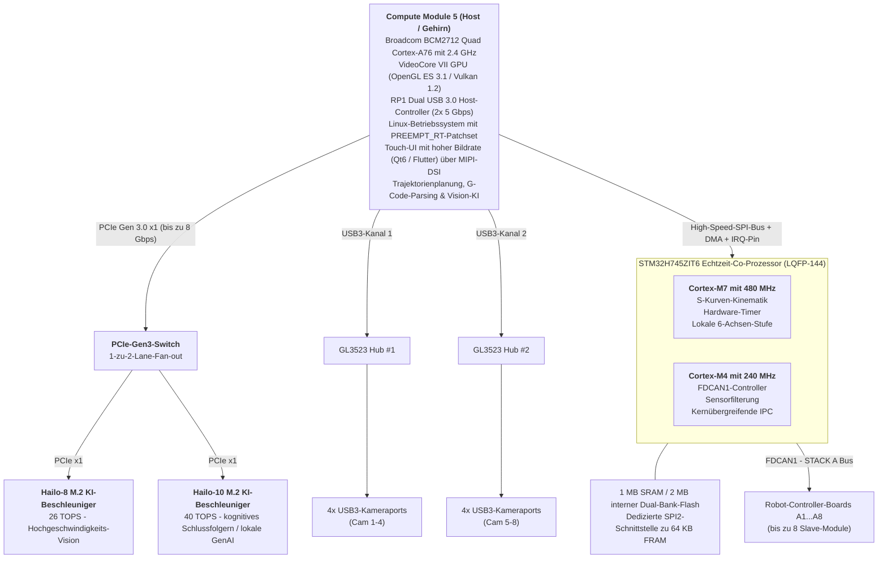
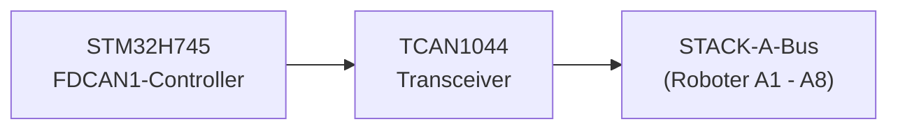
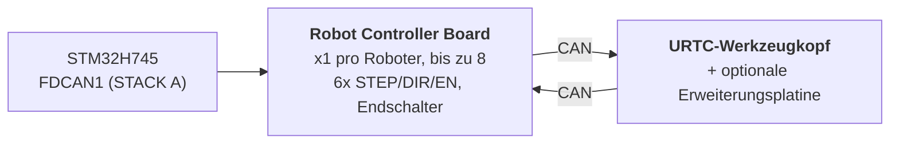

<!-- =============================================================================
HYDRA-UMC - Universal Machines Controller: board design, bootloaders and the CM5 SPI bridge
Copyright (C) JuanenRac (Electro Hobby 3D) <electrohobby3d@gmail.com>
GPL-3.0-or-later - see LICENSE
============================================================================= -->

<p align="center">
  
</p>

# 🚀 HYDRA-UMC

<p align="center"><a href="README.md">🇺🇸 English</a> | <a href="README_spa.md">🇪🇸 Español</a> | <a href="README_fra.md">🇫🇷 Français</a> | <a href="README_ita.md">🇮🇹 Italiano</a> | 🇩🇪 <b>Deutsch</b> | <a href="README_zho.md">🇨🇳 简体中文</a> | <a href="README_jpn.md">🇯🇵 日本語</a> | <a href="README_por.md">🇵🇹 Português</a></p>

### 🤖 Die ultimative Dual-Core-Mikrofabrik- und Multi-Roboter-Steuerungsplattform (V1.0 - Doppelter PCIe-Hailo-8+Hailo-10-KI-Beschleuniger und Doppel-USB-3.0-Hubs)

<p align="center">
  
  
  
  
  
  
  
</p>

---

> **Stand von Sicherheit (Safety) und Security:** Dieses Ökosystem ist kein zertifiziertes Sicherheitssystem. Es gibt noch keinen Hardware-E-STOP-Pfad, keine von der Firmware durchgesetzten Grenzen oder Verriegelungen und keinen verifizierten Bewegungsbefehl; Firmware-Images werden mit CRC-32 und einer Ed25519-Signatur geprüft, und ein Release-Build verweigert die veröffentlichten Entwicklungsschlüssel (die Werkzeugköpfe und Erweiterungsplatinen hinter dem Relais laufen noch mit URTC-Bootloadern, die statt einer Signatur ein HMAC-SHA256 mit gemeinsamem Schlüssel verwenden); TLS und gegenseitiges TLS sind optional und standardmäßig aus; noch keine eigene Platine wurde bestückt oder getestet. Lesen Sie die [Sicherheitsbasis](https://github.com/JuanenRac/HYDRA-UMC-DOCS/blob/main/docs/SECURITY_BASELINE.md) und das [Bedrohungsmodell](https://github.com/JuanenRac/HYDRA-UMC-DOCS/blob/main/docs/THREAT_MODEL.md), bevor Sie sich für die Sicherheit einer Person auf eine Aussage hier verlassen.

---

## 📋 Auf einen Blick

| | |
|---|---|
| Version | `0.2.3` |
| Reifegrad | Gerüst |
| Tests | 154 (`python -m unittest discover -s tests -p 'test_*.py'`) |
| Technik | STM32H745 (dual-core) / STM32G474 / FreeRTOS (AMP) / CMSIS-DSP / FDCAN (classic CAN mode) |
| Ziel | Eine Mikrocontroller-Platine (die Firmware); wird auf einem PC gebaut |
| Auf echter Hardware | Noch nicht: für diese Version ist kein Lauf auf echter Hardware vermerkt |

**Springe zu:** [Überblick](#-überblick) · [Architektur](#-architektur) · [Funktionen](#-funktionen) · [Sicherheit und Schutz](#-sicherheit-und-schutz) · [Schnittstellen](#-schnittstellen) · [Konfiguration](#-konfiguration) · [Schnellstart](#-schnellstart) · [Tests](#-tests) · [Fehlerbehebung](#-fehlerbehebung) · [Struktur des Repositorys](#-struktur-des-repositorys) · [Verwandte Projekte](#-verwandte-projekte)

## 🚦 Projektstatus

Jede Zeile ist ein Teil dieses Repositorys, und die Ampel sagt, wie weit er heute ist. Sie beruht auf dem, was das Repository zeigen kann (Tests, Builds, Läufe), nicht auf dem, was geplant ist.

🟢 Fertig und überprüft · 🟡 Funktioniert, mit bekannten Grenzen · 🟠 Teilweise fertig oder noch nicht überprüft · 🔴 Nicht gemacht oder funktioniert nicht

| Bereich | Stand | Was das hier bedeutet |
|---|---|---|
| Software | 🟠 | Nur Struktur und erste Teile; der größte Teil der Arbeit steht noch aus |
| Tests | 🟡 | 154 automatische Tests, bei jeder Änderung ausgeführt |
| Echte Hardware | 🔴 | Noch nicht: für diese Version ist kein Lauf auf echter Hardware vermerkt |
| Dokumentation | 🟡 | README in acht Sprachen, bei jeder Änderung gegen das Manifest geprüft |

## 🎯 Überblick

**HYDRA-UMC** (Universal Machines Controller) ist eine verteilte Steuerungsplattform und HMI-Architektur, firmwareseitig noch in einer frühen Phase, vorgesehen für Multi-Achsen-Zellenrobotik, Mikrofabriken, automatisierte Fertigung und komplexe Werkzeugkopf-Orchestrierung.

Entworfen als **heterogene Host + Echtzeit-Co-Prozessor-Architektur**, soll HYDRA-UMC das High-Level-Rendering der Benutzeroberfläche, Computer Vision, KI-Inferenz und Cloud-Konnektivität von der Echtzeit-Schritterzeugung, der Feldbusverwaltung und der Ansteuerung der Leistungselektronik entkoppeln (geplant: Schritterzeugung und Ansteuerung sind noch nicht geschrieben).

> **Entwurfsstand:** Die folgenden Abschnitte beschreiben den vorgesehenen Entwurf der Platine und ihrer Firmware. Heute existieren nur die Bootloader, die Kommunikationsanwendungen von CM4 und G474 und die SPI-Brücke auf der CM5-Seite (siehe den Kasten *Sicherheitsstatus* gegen Ende und die Statustabelle in `docs/architecture.md`). Wo ein Satz unten im Präsens von Bewegungserzeugung, S-Kurven-Profilen, PID-Regelkreisen, Sicherheitsverriegelungen, einem E-STOP, Stromausfallbehandlung, Objekterkennung oder irgendeinem anderen Verhalten der fertigen Platine spricht, ist er als geplant zu lesen: nichts davon ist auf einer bestückten Platine gelaufen.

### 🤖 Mikrofabrik-Fähigkeiten (Entwurfsziele):
* 📡 **Verteiltes Multi-Roboter-Netzwerk:** Geplant: Koordination von bis zu 8 verteilten robotischen Slave-Modulen (zunächst 3, 4, 5 und 6 Achsen; Skalierung auf 7, 8, 9 Achsen und Dual-Roboter-Architekturen in zukünftigen Versionen), die über einen einzigen physischen CAN-Bus verbunden sind.
* 🧠 **Doppeltes eingebettetes neuronales Coprocessing:** Ein Onboard-PCIe-Gen3-Switch verteilt die einzige PCIe-Lane des CM5 auf 2 M.2-KI-Beschleuniger - einen Hailo-8 (26 TOPS) für Multi-Stream-YOLOv8/YOLO11 (geplant; läuft noch nicht)-Objekterkennung, Fehlerinspektion und Echtzeit-PnP-Fiducial-Ausrichtung über alle 8 Kameras, plus einen Hailo-10 (40 TOPS) für lokales, geräteseitiges kognitives Schlussfolgern und GenAI (quantisierte LLM-/VLA-Modelle) ohne Cloud-Umweg.
* 📐 **Lokale 6-Achsen-Stufe:** Direkte Step/Dir/Enable-Impulserzeugung für 6 lokale Achsen (X, Y1, Y2, Z, E0, E1) für Zusatzbedarfe: zusätzliche Roboter, ATC-Revolver (automatischer Werkzeugwechsler), Förderbandsynchronisation oder XYZ-Tischportale.
* 🎯 **JuanenPNP- und JuanenCNC-Integration:** Direkt kompatibel mit Pick-and-Place-Systemen (LumenPNP-Hardwarestrukturen) und CNC-Einheiten, die mit 10W-optischen Lasermodulen für PCB-Prototyping und SMD-Bestückung ausgestattet sind.
* 👁️ **Octal-Kamera-Vision- und Inspektionsmatrix:** Integrierte doppelte USB-3.0-Controller, die 8x dedizierte USB-Kameraports für Echtzeit-OpenCV-Pick-and-Place-optische Ausrichtung, Wärmeinspektion und Fernstream-Überwachung ansteuern.
* ⚡ **Ansteuerungsmatrix und Wärmemanagement:** Steuert 16 industrielle Low-Side-MOSFET-Kanäle (8 elektropneumatische Ventile + 8 Vakuumpumpen/Venturi-Generatoren) sowie Hochstrom-Bett-Treiber für SMD-Reflow-Löten oder 3D-Druckbetten.
* 🚜 **JuanenBOT-Mobilplattformen:** Skalierbare Kommunikationsarchitektur, die eine Schnittstelle zu robusten 48V-4-Rad-Transportplattformen ermöglicht (50x50x50 cm Rahmen mit omnidirektionalen/Mecanum-Rädern für 100 kg Nutzlast).

## 🧩 Rolle in HYDRA-UMC

**HYDRA-UMC** ist der Entwurf des Universal Machines Controller: ein Compute-Module-5-Host, ein Echtzeit-Koprozessor STM32H745 und bis zu acht Robot Controller Boards an einem CAN-Bus, gedacht für Roboterzellen und Mikrofabriken. Heute gibt es die drei Bootloader (signierte Images, Anti-Rollback), die Kommunikationsanwendungen von CM4 und G474 und die SPI-Brücke auf der CM5-Seite; der Rest ist Entwurf, und keine Platine wurde gebaut.

## 🏛️ Architektur

<p align="center">
  
</p>

<details>
<summary>Textversion des Diagramms (Mermaid)</summary>







</details>

## ✨ Funktionen

Die ausführliche Spezifikation des Entwurfs (elf Subsysteme, vom Host-Rechner bis zum Werkzeugkopf) ist ein eigenes Dokument; jede Zeile unten öffnet ihren Abschnitt:

- [HOST-COMPUTING-SUBSYSTEM (HMI & HOCHNIVEAU)](docs/HARDWARE_SPECIFICATION_deu.md#2--host-computing-subsystem-hmi--hochniveau)
- [PCIE-KI-BESCHLEUNIGER-SUBSYSTEM (DOPPELTE HAILO-8+HAILO-10-NPU)](docs/HARDWARE_SPECIFICATION_deu.md#3--pcie-ki-beschleuniger-subsystem-doppelte-hailo-8hailo-10-npu)
- [DOPPEL-USB-3.0-VISION-SUBSYSTEM (8x KAMERAPORTS)](docs/HARDWARE_SPECIFICATION_deu.md#4--doppel-usb-30-vision-subsystem-8x-kameraports)
- [ECHTZEIT-CO-PROCESSING-SUBSYSTEM (ENTWURF)](docs/HARDWARE_SPECIFICATION_deu.md#5--echtzeit-co-processing-subsystem-entwurf)
- [VERTEILTE FELDBUS-KOMMUNIKATION (EIN CAN-BUS; FDCAN-PERIPHERIE IM KLASSISCHEN MODUS)](docs/HARDWARE_SPECIFICATION_deu.md#6--verteilte-feldbus-kommunikation-ein-can-bus-fdcan-peripherie-im-klassischen-modus)
- [ULTRASCHNELLER NICHTFLÜCHTIGER SPEICHER (SPI FRAM)](docs/HARDWARE_SPECIFICATION_deu.md#7--ultraschneller-nichtflüchtiger-speicher-spi-fram)
- [LOKALE BEWEGUNGS-, ANSTEUERUNGS- UND SENSOR-SUITE](docs/HARDWARE_SPECIFICATION_deu.md#8--lokale-bewegungs--ansteuerungs--und-sensor-suite)
- [STROMVERTEILUNG UND -REGELUNG](docs/HARDWARE_SPECIFICATION_deu.md#9--stromverteilung-und--regelung)
- [INTERPROZESSOR-KOMMUNIKATION (IPC)](docs/HARDWARE_SPECIFICATION_deu.md#10--interprozessor-kommunikation-ipc)
- [HARDWARE-SPEZIFIKATIONEN DER 4-LAGEN-LEITERPLATTE](docs/HARDWARE_SPECIFICATION_deu.md#11--hardware-spezifikationen-der-4-lagen-leiterplatte)
- [ROBOT-CONTROLLER-BOARDS UND URTC-WERKZEUGKOPF (VERTEILTE EBENE)](docs/HARDWARE_SPECIFICATION_deu.md#12--robot-controller-boards-und-urtc-werkzeugkopf-verteilte-ebene)

## 🔒 Sicherheit und Schutz

| Bedrohung | Abwehr | Wo |
|---|---|---|
| Ein gefälschtes oder bearbeitetes Firmware-Image | Auf einen festen 64-Byte-Header (Magic, Version, Hardware-ID, Größe, Vektorwörter, CRC-32) folgen das Image und eine 64-Byte-Ed25519-Signatur über Header und Image; der Bootloader prüft zuerst die Signatur und glaubt nichts im Header, bevor sie verifiziert | `image_header.h`, `tools/image_header.py` |
| Ein altes signiertes Image, das erneut gesendet wird (Rollback) | Ein neues Image muss strikt neuer sein als das installierte (Major, Minor und Patch werden verglichen); ein älteres wird nur mit einem Downgrade-Token akzeptiert, einer Ed25519-Signatur über installierte und Zielversion und den Image-Digest; die Firmware enthält keine Konstante, die ein Downgrade erlaubt | `image_header.h`, `ImageHeader_CheckRollback` |
| Mit den Entwicklungsschlüsseln gebaute Images | Ohne `HYDRA_FW_UPDATE_PUBKEY_HEX` und `HYDRA_FW_HMAC_KEY_HEX` tragen die Bootloader Entwicklungsschlüssel, deren privater Teil im Repository veröffentlicht ist; der Build warnt, und mit `HYDRA_UMC_RELEASE=1` weigert er sich zu bauen; die Platine hält nur den öffentlichen Schlüssel, der private Seed bleibt beim Eigentümer | `build_firmware.sh` |
| Eine Platine, die hängt | Der G474-Bootloader schärft den unabhängigen Watchdog (IWDG) als allererste Aktion von `main()`, vor `HAL_Init()`, sodass ein Hänger beim Start den Chip zurücksetzt | `src/mcu_stm32g474/boot/bootloader_main.c` |
| Der lokale HTTP-Dienst der SPI-Brücke wird von jemand anderem erreicht | Er lauscht standardmäßig auf 127.0.0.1, nimmt einen Firmware-Body von höchstens 4 MiB an und hält keinen Signierschlüssel: Die Signatur kommt in der Anfrage, erstellt auf dem Rechner mit dem privaten Seed; er hat weder TLS noch eigene Anmeldung, wer an ihn weiterleitet, muss also entscheiden, wer flashen darf | `src/cm5_host/spi_bridge/spi_bridge/http_service.py` |

**Was es heute nie tut:** einen Not-Halt, Software-Grenzen, Verriegelungen, den Sicherungsabzug in den FRAM bei Spannungsverlust oder irgendeinen Bewegungsbefehl bereitstellen; Secure Boot und Ausleseschutz des Flashs werden nicht behauptet. Lies den Sicherheitskasten oben, bevor du dich auf etwas hier verlässt.

## 🔌 Schnittstellen

| Topic oder Route | Was es trägt |
|---|---|
| CAN, FDCAN1 in classic mode | ein Bus (STACK A) vom STM32H745 zu bis zu acht Robot Controller Boards; die Kennungen des Relay-Protokolls stehen einmal in `tools/can_ids.py` und werden von `tests/test_can_ids.py` geprüft |
| SPI + DMA + IRQ pin, 128-byte frames | von der CM5 zum STM32H745: feste `SpiOtaFrame`-Frames, die der C-Struktur Byte für Byte entsprechen; die Brücke läuft standardmäßig mit 10 MHz |
| `GET /version`, `GET /counters`, `POST /flash` on 127.0.0.1:8765 | der lokale Dienst der SPI-Brücke: die Version einer Platine, die Fehlerzähler ihres CAN-Controllers und ein Flash als Strom (zeilengetrenntes JSON) eines Images mit seiner Ed25519-Signatur; `relay=1` erreicht einen URTC-Werkzeugkopf über sein Robot Controller Board |
| `tools/image_header.py sign \| keygen \| pubkey` | die Host-Referenz des signierten Image-Headers: Sie erzeugt die Signaturen und Downgrade-Token, die die Bootloader prüfen, und `tests/image_header_vectors.h` wird daraus erzeugt, damit C- und Python-Seite nicht auseinanderlaufen |

## ⚙️ Konfiguration

Die Firmware wird beim Bauen über Umgebungsvariablen konfiguriert; die SPI-Brücke nimmt ihre Einstellungen von der Befehlszeile.

| Variable | Standard | Was sie festlegt |
|---|---|---|
| `HYDRA_FW_UPDATE_PUBKEY_HEX` | Entwicklungsschlüssel | 64 Hexadezimalziffern: der öffentliche Ed25519-Schlüssel, für den ein Update signiert sein muss |
| `HYDRA_FW_HMAC_KEY_HEX` | Entwicklungsschlüssel | 64 Hexadezimalziffern außerhalb des Repositorys: der Schlüssel der lokalen Integritätsprüfung der installierten Anwendung |
| `HYDRA_UMC_RELEASE` | `0` | mit `1` weigert sich der Build, die Entwicklungsschlüssel zu verwenden |
| `HYDRA_UMC_SKIP_HOST_TESTS`, `HOST_CC` | `0`, der System-Compiler | überspringt die Host-Logiktests von Schritt 1b oder benennt den C-Compiler, den sie verwenden |
| `python -m spi_bridge run --spi-speed-hz --host --port --collector-url` | `10000000`, `127.0.0.1`, `8765` | der SPI-Takt, wo der lokale HTTP-Dienst lauscht, und die Adresse des HYDRA-UMC-TELEMETRY-COLLECTOR, an den die Brücke berichten kann (höchstens ein Bericht pro Sekunde) |

## 🚀 Schnellstart

Das Bauen der Firmware braucht die Arm-GNU-Toolchain (`arm-none-eabi-gcc` 10.3 oder neuer), `git` und `python`; die Host-Tests brauchen nur einen gewöhnlichen C-Compiler und Python. Unter Windows gibt es `build_firmware.bat`.

```bash
./build_firmware.sh                                  # builds every MCU target and runs the host tests (step 1b)
./build_firmware.sh g474                             # only the Robot Controller Board; h745 builds only the Kinematic Brain
python tools/verify_firmware_inventory.py            # read-only check of the committed six-component firmware inventory
python -m unittest discover -s tests -p 'test_*.py'  # the Python tests of the firmware sources, the image header and the CAN identifiers
```

### ENTWICKLUNGSUMGEBUNG

Was die eigenen Entwicklungsmaschinen dieses Projekts tatsächlich installiert
und funktionierend verifiziert haben
(`build_firmware.sh`/`build_firmware.bat`, Ziele `g474`/`h745`/Standard, 0
Fehler) - keine theoretische Liste:

* 🔧 **ARM GNU Toolchain** (`arm-none-eabi-gcc` 10.3+) - kompiliert jedes
  MCU-Firmware-Ziel. Es werden keine STM32CubeIDE-/CubeMX-Projektdateien
  verwendet oder für den Build benötigt -
  `build_firmware.sh`/`build_firmware.bat` holt STs eigene HAL-/CMSIS-Quellen
  frisch von deren offiziellen GitHub-Repositories und steuert den Compiler
  direkt an, dieselbe Philosophie, die bereits das eigene
  `build_firmware.sh`/`build_firmware.bat` des Schwester-Repositorys `URTC`
  etabliert hat.
* 🧩 **VS Code + Erweiterungen** (`.vscode/extensions.json` listet alle
  davon): [STM32 VS Code Extension](https://marketplace.visualstudio.com/items?itemName=stmicroelectronics.stm32-vscode-extension)
  (Projekt-/Build-/Debug-Integration), **Cortex-Debug** (SWD/JTAG-Debugging -
  unabhängig von `build_firmware.sh`, nützlich sobald reale Hardware
  existiert), **CMake Tools** (für das eigene CMake-Projekt von
  `src/cm5_host/hmi_qt6/`), **C/C++** (IntelliSense über jede
  Firmware-/Host-Quelldatei), **Python** (`ai_inference/`-Pipeline-Skripte),
  **Hex Editor** (Inspektion der `.bin`-Firmware-Ausgabe), **YAML** (die
  eigene MediaMTX-Konfiguration von `video_streamer/`). Öffnen Sie das
  Repository, akzeptieren Sie die Aufforderung für empfohlene Erweiterungen,
  und nutzen Sie **Terminal → Run Task** für die vorkonfigurierten
  Build-Tasks (`.vscode/tasks.json`).
* 🗂️ **git** - sowohl für dieses Repository selbst als auch für das eigene
  tag-fixierte Vendoring der HAL/CMSIS-Pakete von ST durch
  `build_firmware.sh` (zwischengespeichert unter `build/`, in gitignore,
  bei `--clean` erneut abgerufen).

## 🧪 Tests

154 automatische Tests laufen mit `python -m unittest discover -s tests -p 'test_*.py'`. Es sind 87 Tests der SPI-Brücke der CM5 plus 67 der Firmware-Quellen, des signierten Image-Headers und der CAN-Kennungen (die der SPI-Brücke laufen mit `PYTHONPATH=src/cm5_host/spi_bridge:src/cm5_host/spi_bridge/tests` und `-s src/cm5_host/spi_bridge/tests`). Die C-Logik der Bootloader und des Relays prüfen 19 weitere Programme, mit einem gewöhnlichen Host-C-Compiler im Schritt 1b von `build_firmware.sh` gebaut. Keiner braucht eine Platine.

Die CI führt `HYDRA_UMC_CI=1 python tools/ci_validate.py` aus; das prüft das Manifest, die Dokumente, die acht READMEs und die Bilder.

## 🏗️ Build und Veröffentlichung

**Linux/Mac:**
```bash
./build_firmware.sh          # baut jedes MCU-Ziel (Robot Controller Board + Kinematic Brain, beide Kerne)
./build_firmware.sh g474     # nur Robot Controller Board
./build_firmware.sh h745     # nur Kinematic Brain (beide Kerne)
./build_firmware.sh --clean  # löscht zuerst den vendorten HAL/CMSIS-Cache
```

**Windows:**
```bat
build_firmware.bat          :: baut jedes MCU-Ziel (Robot Controller Board + Kinematic Brain, beide Kerne)
build_firmware.bat g474     :: nur Robot Controller Board
build_firmware.bat h745     :: nur Kinematic Brain (beide Kerne)
build_firmware.bat --clean  :: löscht zuerst den vendorten HAL/CMSIS-Cache
```

`build_firmware.bat` ist derselbe Build wie `build_firmware.sh`, übersetzt
nach Batch (dieselben Schritte, dieselben festgelegten HAL/CMSIS-Versionen,
dieselbe Pass/Warn/Fail-Berichterstattung) - end-to-end auf einer echten
Windows-Maschine ausgeführt, mit installiertem [Arm-GNU-
Toolchain](https://developer.arm.com/downloads/-/arm-gnu-toolchain-downloads)
und `arm-none-eabi-gcc` im `PATH`: jedes HAL-Modul, beide Bootloader und
jede Anwendung sauber kompiliert und gelinkt, und `firmware_manifest.json`
mit CRC32-Werten regeneriert, die mit der eigenen Ausgabe des
Linux/Mac-Builds übereinstimmen. Benötigt dieselben Werkzeuge wie das
Linux/Mac-Skript: den Arm-GNU-Toolchain, `git` (um STs eigene
HAL/CMSIS-Quellen zu holen), und `python` für den Manifest-Schritt.

**Manueller Build (beide Betriebssysteme, ohne das Skript):** Das Skript
automatisiert genau die Schritte aus `docs/COMPILE_STM32G474.TXT` und
`docs/COMPILE_STM32H745.TXT` - holt die festgelegten
HAL-/CMSIS-/FreeRTOS-Quellen, die oben in
`build_firmware.sh`/`build_firmware.bat` aufgeführt sind, kompiliert die
HAL-Module und Startup-/System-Dateien jedes Ziels mit `arm-none-eabi-gcc`
(Flags/Modullisten sind in demselben Skript aufgeführt), linkt dann jeden
Bootloader und jede Anwendung gegen sein eigenes Linker-Skript (`*.ld`, neben
seiner Quelle) mit `arm-none-eabi-gcc`/`-Wl,--gc-sections` und konvertiert
mit `arm-none-eabi-objcopy` nach `.bin`/`.hex`. Diese beiden
`docs/COMPILE_*.TXT`-Dateien sind die maßgebliche, schrittweise Referenz,
falls Sie lieber keines der beiden Skripte ausführen möchten - die Skripte
existieren, um sie zu automatisieren, nicht um sie als Wahrheitsquelle zu
ersetzen.

Die Ausgabe landet in `firmware/`, was committet und in dieses Repository
gepusht wird (dieselbe Konvention wie der eigene `firmware/`-Ausgabeordner
von URTC), damit die GitHub-Download-Funktion von HYDRA-UMC-STUDIO dort
tatsächlich echte `.bin`-Dateien über `firmware_manifest.json` finden kann -
es ist NICHT in gitignore.
Siehe `docs/COMPILE_STM32G474.TXT` und `docs/COMPILE_STM32H745.TXT` für
genau das, was jeder Schritt tut und warum - und das eigene `README.md`
jedes Firmware-Ordners für den aktuellen Status. Die **Bootloader** für alle
3 Ziele (G474, H745 CM7, H745 CM4) sind echte, funktionierende
CAN-OTA/SPI-OTA-Implementierungen (CRC-32- und Ed25519-Signaturprüfung,
verifizieren-in-Backup-vor-Kopieren-in-Haupt, dieselbe Anti-Brick-Disziplin
wie der eigene Bootloader von URTC) - kompilieren end-to-end sauber, noch
nicht gegen reale Hardware verifiziert. Die **Anwendungen** sind weiterhin
kompilierungsgeprüfte FreeRTOS-GPIO-Toggle-Smoke-Tests, noch nicht die
reale Bewegungs-/Vision-/Relais-Firmware. Siehe `docs/architecture.md`
(insbesondere die Statustabelle von Abschnitt 6 und die bekannten,
akzeptierten Sicherheitseinschränkungen von Abschnitt 8) für das, was genau
real ist gegenüber dem, was noch offen ist.

> **Sicherheitsstatus:** Dieses Repository enthält noch keinen E-STOP-Pfad, keine Software-Grenzen, keine Sicherheitsverriegelungen, keinen Stromausfall-Dump (PVD) ins FRAM und keinen Bewegungsbefehl. Wo die obigen Abschnitte (oder ein anderes Projekt des Ökosystems) sie beschreiben, ist das der geplante Entwurf: Nichts darf sich für die Sicherheit darauf verlassen, bis er implementiert und auf einer echten Platine getestet ist. Was die Anwendungen heute tun: Die von CM4 und G474 führen die AXIS_STATUS-Abfrage/-Antwort von STACK A und den Tier-2/3-Relay-Tunnel aus; die des CM7 ist weiterhin ein GPIO-Toggle-Smoke-Test.

Alle sechs Firmware-Komponenten (drei Bootloader und drei Anwendungen, ein Paar je Chip oder Kern) haben ihre eigene Version. Das Bauen ändert sie nie: `build_firmware.sh` und `.bat` melden sie nur. Versionen erhöht der ausdrückliche Befehl `python bump_firmware_versions.py` (`--list` zeigt sie), und `python show_component_version.py` gibt die Version einer Komponente aus.

## 🩺 Fehlerbehebung

| Du siehst | Weil | Tu |
|---|---|---|
| „Bootloader akzeptieren mit dem ENTWICKLUNGS-Seed signierte Updates, der öffentlich ist“ | Der Build hatte kein `HYDRA_FW_UPDATE_PUBKEY_HEX` (oder kein `HYDRA_FW_HMAC_KEY_HEX`) | In Ordnung für den Prüfstand; für jede Platine, die jemand anderes erreichen kann, erzeuge ein Schlüsselpaar mit `python tools/image_header.py keygen`, baue mit dem öffentlichen Schlüssel und baue Releases mit `HYDRA_UMC_RELEASE=1` |
| „arm-none-eabi-gcc nicht gefunden“ | Die Arm-GNU-Toolchain ist nicht installiert oder nicht im `PATH` | Installiere sie (das Skript versucht unter Linux `apt`) und baue erneut; die Host-Tests von Schritt 1b brauchen nur einen gewöhnlichen C-Compiler |
| Die SPI-Brücke kann das Gerät nicht öffnen, oder `SPI transfer returned ... bytes` | Der echte Transport braucht `spidev` und `gpiod` auf einer CM5 mit aktiviertem SPI-Gerät und einen STM32H745 am anderen Ende; beides gibt es noch nicht, die Brücke wurde also nur gegen Attrappen geübt | Nutze bis zum Vorhandensein einer Platine den Attrappen-Transport der Tests |
| `build_firmware.sh` endet mit FAIL bei einem Host-Test | Die Kopien einer Quelle, die die drei Bootloader teilen, sind auseinandergelaufen, oder `tests/image_header_vectors.h` ist älter als `tools/image_header.py` | Führe `python tools/gen_image_header_vectors.py` und `python -m unittest discover -s tests` aus, um zu sehen, welche Kopie abweicht |

## 📂 Struktur des Repositorys

<p align="center">
  
</p>

<details>
<summary>Textversion des Baums</summary>

```text
HYDRA-UMC/
├── src/
│   ├── cm5_host/                    Linux-Userspace-Anwendungen, die OBEN auf dem eigenen Image von os/ laufen
│   ├── mcu_stm32h745/               Kinematic-Brain-Firmware (Ebene 0) - Dual-Core
│   └── mcu_stm32g474/               Robot-Controller-Board-Firmware (Ebene 1) - Single-Core, + eigene boot/
├── .vscode/                         Empfohlene Erweiterungen + Build-Tasks - siehe "Entwicklungsumgebung" unten
├── docs/                            Architektur, Build-Referenzen, Pinbelegungen, CAN-Protokoll, Datenblätter
├── hardware/                        die beiden Platinenentwürfe; noch kein Schaltplan
├── tests/                           Host-Tests: die C-Logik der Bootloader und des Relays (stubs/ ersetzt das HAL, image_header_vectors.h enthält die Referenzvektoren) und Python-Tests der Werkzeuge
├── os/                              CM5-OS-Image - Basis-Betriebssystemwahl, systemd-Units, Erstinbetriebnahme-Provisionierung
├── images/                          README-Banner + Icon + Splashscreen (SVG)
├── tools/                           Projektwerkzeuge und CI-Prüfungen
├── firmware/                        Committete Build-Ausgabe (.bin/.hex/.elf + Manifest) - NICHT in gitignore, dieselbe Konvention wie der eigene Ausgabeordner von URTC, siehe "Die Firmware bauen" unten
├── .github/                         CI-Workflow und Issue-Vorlagen
├── build_firmware.sh                Baut jedes obige MCU-Firmware-Ziel aus einem sauberen Checkout (Linux/Mac)
├── build_firmware.bat               Derselbe Build, Windows (siehe "Die Firmware bauen" unten)
├── build-test.sh / build-test.bat   Build-/Kompilierprüfung ohne Versionserhöhung
├── generate_manifest.py             Regeneriert firmware/firmware_manifest.json (Versionen/CRC32) nach einem vollständigen Build
├── bump_version.py                  ausdrückliche Versionserhöhung
├── bump_firmware_versions.py        Erhöht die sechs Komponentenversionen ausdrücklich
├── show_component_version.py        Gibt die Version aus, die eine Komponente bereits hat
├── bump_manifest_version.py         Synchronisiert die Version von hydra-umc.project.json mit der nativen (--sync)
├── CHANGELOG.md                     was sich in jeder Version geändert hat
├── hydra-umc.project.json           Manifest: Version, Reifegrad, Familie
└── test.sh                          Build-Prüfung ohne Änderungen
```

</details>

## 🗺️ Roadmap und bekannte Grenzen

Was es heute gibt, beschränkt sich auf die drei Bootloader, die Kommunikationsanwendungen von CM4 und G474 und die SPI-Brücke auf der CM5-Seite; der Rest der Spezifikation ist Entwurf. Keine eigene Platine wurde bestückt oder getestet, die beiden Platinenordner enthalten noch keinen Schaltplan, und die Anwendungen sind FreeRTOS-Rauchtests, die einen Pin schalten, nicht die Bewegungs-, Vision- und Relay-Firmware. Bootloader und Brücke wurden auf einem Host-Rechner getestet, nie auf den echten Chips.

## 🌍 Sprachen

Diese README und die Dokumente des Repositorys gibt es in acht Sprachen: Englisch, Spanisch, Deutsch, Französisch, Italienisch, Japanisch, Chinesisch und Portugiesisch (Portugal). Sie entstehen gemeinsam, und die CI prüft, dass die acht Dateien dieselben Abschnitte und dieselben Links haben. Dieses Repository hat weder eine eigene Oberfläche noch einen eigenen Meldungskatalog, es gibt also keine Oberflächentexte zu übersetzen.

## 🔗 Verwandte Projekte

Dieses Projekt ist Teil des HYDRA-UMC-Robotik-Ökosystems desselben Autors (JuanenRac / Electro Hobby 3D). Gut zu wissen, da eine Anfrage eigentlich eines dieser Projekte betreffen könnte statt dieses Repositorys.

**Direkt verwandt** — Projekte, die direkt an diese Firmware andocken
- **[URTC](https://github.com/JuanenRac/URTC)** — Firmware für die physische Universal-Robot-Tool-Controller-Platine, 25+ Werkzeugprofile über CAN-Bus; die Werkzeugkopf-Firmware, die jeder von dieser Platine angetriebene Roboterarm trägt, eine Station weiter über die eigene CAN-Downlink-Verbindung.
- **[HYDRA-UMC-OS](https://github.com/JuanenRac/HYDRA-UMC-OS)** — reproduzierbare Raspberry-Pi-OS-Produktschicht für den CM5: schreibgeschützter Agent, validierte Konfiguration/Profile, WiFi-Ersteinrichtung; das Betriebssystem, das der eigene CM5-Host dieser Platine ausführt.
- **[HYDRA-UMC-SERVER](https://github.com/JuanenRac/HYDRA-UMC-SERVER)** — das reale Headless-Backend (REST/WebSocket), mit dem jeder Steuerungsclient tatsächlich spricht; sein eigener `spi_bridge`-Dienst spricht mit dieser Firmware über die echte CM5↔STM32H745-SPI-OTA-Verbindung.
- **[HYDRA-UMC-VISION-NODE](https://github.com/JuanenRac/HYDRA-UMC-VISION-NODE)** — Integrationsknoten für die Hailo-8-Vision-Pipeline, mit einer echten stufenweisen Hardware-Bereitschaftsprüfung; eine Wahrnehmungs-/E-STOP-Schleife gegen diese Firmware gibt es noch nicht.
- **[HYDRA-UMC-SAFETY-ZONES](https://github.com/JuanenRac/HYDRA-UMC-SAFETY-ZONES)** — v0-Logik für Zonenverletzung, Kalibrierungsaktualität und E-STOP-Anforderung, die Objektpositionen aus einer Datei nimmt; kein Detektor speist sie, und noch kein physischer E-STOP ist angeschlossen.
- **[HYDRA-UMC-VISUAL-SERVOING-API](https://github.com/JuanenRac/HYDRA-UMC-VISUAL-SERVOING-API)** — Position-Based-Visual-Servoing-Korrekturgesetz mit Freigabe abhängig vom Zonenstatus; noch keine Posenschätzung per Kamera.
- **[HYDRA-UMC-ORCHESTRATOR](https://github.com/JuanenRac/HYDRA-UMC-ORCHESTRATOR)** — Integrationsknoten mit einem echten gRPC/Protobuf-Health-Report-Vertrag und einer Missions-Zustandsmaschine; koordiniert mehrere HYDRA-UMC-Einheiten als Schwarm.
- **[HYDRA-UMC-TWIN](https://github.com/JuanenRac/HYDRA-UMC-TWIN)** — Integrationsknoten für die Digital-Twin-Engine, mit einem echten Versionskompatibilitäts-Sync-Vertrag; soll die Kinematik dieser Firmware nachbilden, sobald sie existiert.
- **[URTC-SMART-RACK](https://github.com/JuanenRac/URTC-SMART-RACK)** — Firmware für ein Platinenmontagegestell mit echter Werkzeug-ID-Dekodierung und Smart-Idle-Vorheizlogik; teilt denselben Werkzeug-CAN-Bus wie diese Firmware.
- **[URTC-VISION-TOOL](https://github.com/JuanenRac/URTC-VISION-TOOL)** — Firmware plus ein echter Python-Vision-Begleiter für einen Thermal-/RGB-Inspektionswerkzeugkopf; teilt denselben Werkzeug-CAN-Bus wie diese Firmware.

**Ebenfalls Teil des Ökosystems**

*Kern-Hardware & Plattform*
- **[HYDRA-UMC-SDK](https://github.com/JuanenRac/HYDRA-UMC-SDK)** — der gemeinsame JSON-Schema-Vertrag und die Software-Auftragsschranke, gegen die jede Bridge ihre Befehle validiert (keine zertifizierte Sicherheitsfunktion).
- **[HYDRA-UMC-CONNECTOR-HUB](https://github.com/JuanenRac/HYDRA-UMC-CONNECTOR-HUB)** — deklaratives Adapter-Manifest-Register und Validator für Konnektoren externer Maschinen; erweitert die eigene Vertragsidee des SDK auf externe Maschinen, ohne die Industrie-Gateway-Projekte zu ersetzen.

*Kern-Backend & Clients*
- **[HYDRA-UMC-STUDIO](https://github.com/JuanenRac/HYDRA-UMC-STUDIO)** — Web-Steuerungs-Dashboard mit Echtzeit-3D-Visualisierung mehrerer Roboter.
- **[HYDRA-UMC-SUITE](https://github.com/JuanenRac/HYDRA-UMC-SUITE)** — Desktop-Schwarmleitstand (PySide6) für mehrere Server gleichzeitig, verpackt als eigenständige ausführbare Datei.
- **[HYDRA-UMC-ANDROID-CONTROL](https://github.com/JuanenRac/HYDRA-UMC-ANDROID-CONTROL)** — native Android-Steuerungs-App mit biometrischem Login und einer gekoppelten Wear-OS-Begleit-App.
- **[HYDRA-UMC-IOS-CONTROL](https://github.com/JuanenRac/HYDRA-UMC-IOS-CONTROL)** — iOS/iPadOS-Steuerungs-App (Flutter) mit Echtzeit-WebSocket-Synchronisierung.
- **[HYDRA-UMC-DSI](https://github.com/JuanenRac/HYDRA-UMC-DSI)** — native Touch-UI für das eingebaute 7"-DSI-Touchscreen, direkt auf dem CM5 eingebettet.
- **[HYDRA-UMC-EDITOR-URDF](https://github.com/JuanenRac/HYDRA-UMC-EDITOR-URDF)** — grafischer Desktop-URDF-Ersteller/-Editor, der fertige Modelle in STUDIOs eigenen Katalog überträgt.
- **[HYDRA-UMC-EDITOR-STL](https://github.com/JuanenRac/HYDRA-UMC-EDITOR-STL)** — Desktop-STL-Modelleditor, der echte Teile im selben Modellkatalog transformiert/ersetzt/entfernt/hinzufügt, den auch HYDRA-UMC-EDITOR-URDF bearbeitet.
- **[HYDRA-UMC-BRIDGE-AMR](https://github.com/JuanenRac/HYDRA-UMC-BRIDGE-AMR)** — Koordinationsschranke für AGV-/AMR-Flotten über einen VDA-5050-MQTT-Publisher (nur gegen eine emulierte Flotte getestet).
- **[HYDRA-UMC-BRIDGE-CNC](https://github.com/JuanenRac/HYDRA-UMC-BRIDGE-CNC)** — High-Level-Koordinator für CNC-Zellen mit GRBL-Status-/Steuerbyte-Zugriff (nur gegen einen Emulator getestet).
- **[HYDRA-UMC-BRIDGE-DROIDS](https://github.com/JuanenRac/HYDRA-UMC-BRIDGE-DROIDS)** — Koordinationsschranke für laufende/humanoide Droiden, mit einem Boston-Dynamics-Spot-Befehlssender (nur gegen einen Emulator getestet).
- **[HYDRA-UMC-BRIDGE-LASER](https://github.com/JuanenRac/HYDRA-UMC-BRIDGE-LASER)** — Koordinator für Laserzellen, liest 3 Schlüssel-/Gehäuse-/Verriegelungs-GPIO-Signale (nur gegen einen simulierten Chip getestet; kann keinen Laser scharfschalten oder auslösen).
- **[HYDRA-UMC-BRIDGE-OPENPNP](https://github.com/JuanenRac/HYDRA-UMC-BRIDGE-OPENPNP)** — sicherer High-Level-Koordinator für den Leiterplattenfluss von OpenPnP Pick-and-Place.
- **[HYDRA-UMC-BRIDGE-PRINTER3D](https://github.com/JuanenRac/HYDRA-UMC-BRIDGE-PRINTER3D)** — sichere Koordinationsschranke für Moonraker/Klipper-3D-Drucker, mit echten gesicherten Job-Befehlen.
- **[HYDRA-UMC-BRIDGE-ROS2](https://github.com/JuanenRac/HYDRA-UMC-BRIDGE-ROS2)** — Koordinator mit einem träge importierten rclpy-ROS-2-Transport (noch nicht gegen eine ROS-2-Installation ausgeführt).
- **[HYDRA-UMC-BRIDGE-UAV](https://github.com/JuanenRac/HYDRA-UMC-BRIDGE-UAV)** — Koordinationsschranke für kameraausgestattete UAVs, mit einem MAVLink-Befehlssender (nur gegen einen Emulator getestet).

*URTC-Werkzeugplattform*
- **[URTC-FLASHER](https://github.com/JuanenRac/URTC-FLASHER)** — Desktop-GUI-Flash-Tool für URTC-Platinen, CAN-OTA plus Full-Chip-SWD/JTAG.
- **[URTC-TESTER](https://github.com/JuanenRac/URTC-TESTER)** — Desktop-Live-CAN-Bus-Diagnosetool für URTC-Platinen, ein Panel pro Werkzeugprofil.
- **[URTC-WEB-STUDIO](https://github.com/JuanenRac/URTC-WEB-STUDIO)** — browserbasierte Alternative zu URTC-TESTER über die Web-Serial-API, ohne lokale Installation.
- **[URTC-GATEWAY](https://github.com/JuanenRac/URTC-GATEWAY)** — Gateway vor dem CAN-Bus von URTC: Liste erlaubter Kennungen, Ratenbegrenzung und Sitzungsschlüssel; Software auf dem Computer getestet, noch nicht an einem echten Bus.

*Vision-KI-Knoten (Hailo-8)*
- **[HYDRA-UMC-DETECTION-HEF](https://github.com/JuanenRac/HYDRA-UMC-DETECTION-HEF)** — echte Registry für kompilierte Modelle mit Hailo-Architektur-/Prüfsummen-Safe-Load-Verifizierung.
- **[HYDRA-UMC-VISION-STREAMER](https://github.com/JuanenRac/HYDRA-UMC-VISION-STREAMER)** — echter GStreamer-Pipeline- + MediaMTX-Konfigurationsgenerator mit einer echten HailoRT-Integrationsschranke.

*Kognitiver KI-Knoten (Hailo-10)*
- **[HYDRA-UMC-COGNITIVE-NODE](https://github.com/JuanenRac/HYDRA-UMC-COGNITIVE-NODE)** — Integrationsknoten für die Hailo-10-Cognitive-Pipeline (LLM-/VLA-/Sprach-Orchestrierung).
- **[HYDRA-UMC-VLA-ENGINE](https://github.com/JuanenRac/HYDRA-UMC-VLA-ENGINE)** — echte Aktions-Token-Kodierung/-Dekodierung und Trajektoriengenerierung für ein Vision-Language-Action-Modell.
- **[HYDRA-UMC-VOICE-UI](https://github.com/JuanenRac/HYDRA-UMC-VOICE-UI)** — echtes Sprach-Frontend (VAD + Intent-Parser) mit einem begrenzten, bestätigungsgesicherten Watch-Relay.
- **[HYDRA-UMC-SEMANTIC-PLANNER](https://github.com/JuanenRac/HYDRA-UMC-SEMANTIC-PLANNER)** — echte regelbasierte Aufgabenzerlegung und semantische Fehlerbehebung über MCU-Fehlercodes.
- **[HYDRA-UMC-DOCS-QA](https://github.com/JuanenRac/HYDRA-UMC-DOCS-QA)** — echte, nur auf der Standardbibliothek basierende TF-IDF-Dokumentensuche über die eigenen Markdown-Dokumente dieses Ökosystems.

*Orchestrierung & Schwarm*
- **[HYDRA-UMC-JOB-DISPATCHER](https://github.com/JuanenRac/HYDRA-UMC-JOB-DISPATCHER)** — echte prioritätsbasierte Job-Queue mit Deduplizierung, über eine echte HTTP-API.
- **[HYDRA-UMC-NODE-HEALING](https://github.com/JuanenRac/HYDRA-UMC-NODE-HEALING)** — echter gRPC-basierter Flotten-Health-Watchdog mit Retry/Backoff und Identitäts-Mismatch-Erkennung.
- **[HYDRA-UMC-PATH-PLANNER-3D](https://github.com/JuanenRac/HYDRA-UMC-PATH-PLANNER-3D)** — echter RRT-basierter 3D-Pfadplaner mit echter Hindernis-/Arbeitsraum-Kollisionsvalidierung.
- **[HYDRA-UMC-SWARM-SYNC](https://github.com/JuanenRac/HYDRA-UMC-SWARM-SYNC)** — echte CRDT-LWW-Element-Map-Zustandssynchronisation, eigenschaftsgetestet auf Multi-Zellen-Konvergenz.

*Digitaler Zwilling & Simulation*
- **[HYDRA-UMC-HIL-BRIDGE](https://github.com/JuanenRac/HYDRA-UMC-HIL-BRIDGE)** — Hardware-in-the-Loop-Router mit einer Software-Kollisionsverriegelung zwischen Simulation und echter Hardware (ohne echte Hardware getestet).
- **[HYDRA-UMC-PHYSICS-REPLICA](https://github.com/JuanenRac/HYDRA-UMC-PHYSICS-REPLICA)** — echte Vorwärtskinematik und Gelenkgrenzenvalidierung über eine echte URDF-Teilmenge.
- **[HYDRA-UMC-SYNTHETIC-DATA-GEN](https://github.com/JuanenRac/HYDRA-UMC-SYNTHETIC-DATA-GEN)** — echter prozeduraler 2D-Szenengenerator mit YOLO/COCO-Annotationsexport.

*Daten & Analytik*
- **[HYDRA-UMC-DATALAKE](https://github.com/JuanenRac/HYDRA-UMC-DATALAKE)** — echter sqlite3-gestützter Zeitreihenspeicher mit einer echten Ingest-/Abfrage-HTTP-API.
- **[HYDRA-UMC-ANOMALY-DETECTOR](https://github.com/JuanenRac/HYDRA-UMC-ANOMALY-DETECTOR)** — echter FFT- + statistischer Basislinien-Anomaliedetektor mit Drift-Überwachung.
- **[HYDRA-UMC-PRODUCTION-REPORTS](https://github.com/JuanenRac/HYDRA-UMC-PRODUCTION-REPORTS)** — echte OEE-/Verfügbarkeitsberechnung über den DATALAKE-Verlauf, mit reproduzierbarem CSV-Export.
- **[HYDRA-UMC-TELEMETRY-COLLECTOR](https://github.com/JuanenRac/HYDRA-UMC-TELEMETRY-COLLECTOR)** — echte CAN/WebSocket-Ingestion-Pipeline in DATALAKE, mit Sequenz-Deduplizierung.

*Industrie-Gateway*
- **[HYDRA-UMC-GATEWAY-INDUSTRIAL](https://github.com/JuanenRac/HYDRA-UMC-GATEWAY-INDUSTRIAL)** — Integrationsknoten, der zu Industrieprotokollen weiterleitet, mit einer echten Befehls-Allowlist-/Backpressure-Schicht.
- **[HYDRA-UMC-OPCUA-SERVER](https://github.com/JuanenRac/HYDRA-UMC-OPCUA-SERVER)** — echter OPC-UA-Adressraum, verifiziert mit einer echten Binärprotokoll-Client-Session.
- **[HYDRA-UMC-MQTT-BROKER](https://github.com/JuanenRac/HYDRA-UMC-MQTT-BROKER)** — echter MQTT-Broker mit optionaler Pro-Client-Authentifizierung und Topic-ACLs.
- **[HYDRA-UMC-MTCONNECT-ADAPTER](https://github.com/JuanenRac/HYDRA-UMC-MTCONNECT-ADAPTER)** — echte MTConnect-`/probe`- und `/current`-XML-Endpunkte mit Degraded-Mode-Ausgabe.

*Ergänzende Tools & Ökosystembetrieb*
- **[HYDRA-UMC-DASHBOARD-AI](https://github.com/JuanenRac/HYDRA-UMC-DASHBOARD-AI)** — Smart-Summaries- und Anomaly-Highlighting-Panels über DATALAKE/ANOMALY-DETECTOR, mit einem ehrlichen statistischen Fallback.
- **[HYDRA-UMC-TOOL-CLI](https://github.com/JuanenRac/HYDRA-UMC-TOOL-CLI)** — Flotten-CLI mit einem echten, stabilen Exit-Code-Vertrag, ein echter Live-Client der eigenen API von HYDRA-UMC-SERVER.
- **[HYDRA-UMC-WATCH](https://github.com/JuanenRac/HYDRA-UMC-WATCH)** — WearOS-Begleit-App mit haptischen Alarmmustern und einem Sprach-Relay zum gekoppelten Telefon (noch nicht auf einer physischen Uhr ausgeführt).
- **[HYDRA-UMC-UPDATER](https://github.com/JuanenRac/HYDRA-UMC-UPDATER)** — administratives Desktop-Tool, das jedes Repository in diesem Ökosystem entdeckt, klont und aktualisiert.
- **[HYDRA-UMC-OS-REBUILDER](https://github.com/JuanenRac/HYDRA-UMC-OS-REBUILDER)** — Windows/Linux-Desktop-Tool, das ein flashbereites CM5-Image baut, vorgeladen mit den aktuellsten Versionen des Ökosystems, mit Ersteinrichtungs-Konfiguration für WLAN/Benutzer/SSH im Stil von Raspberry Pi Imager.
- **[HYDRA-UMC-OPS-AGENT](https://github.com/JuanenRac/HYDRA-UMC-OPS-AGENT)** — Wartungsvorfall-Koordinator: eine Edge-Rolle mit niedrigem Privileg sammelt einen bereinigten Inventar-/Gesundheits-Snapshot, eine Control-Plane-Rolle rendert ihn schreibgeschützt und bittet einen KI-Anbieter um einen Diagnosevorschlag - wendet nie einen Patch an und stellt nie etwas bereit.
- **[HYDRA-UMC-DOCS](https://github.com/JuanenRac/HYDRA-UMC-DOCS)** — das Dokumentations- und Werkzeugzentrum des Ökosystems: Architektur, Schnittstellen, Sicherheitsbasis, Fähigkeitenmatrix und ein aus jedem Manifest erzeugter Projektkatalog.

## 📚 Dokumentation

Hier steht mehr:

* [docs/SOURCE_MAP.md](docs/SOURCE_MAP.md) - jede Datei des Repositorys mit einer Zeile dazu, was sie tut
* [docs/HARDWARE_SPECIFICATION.md](docs/HARDWARE_SPECIFICATION.md) - die Spezifikation des Entwurfs: elf Subsysteme, vom Host-Rechner bis zum Werkzeugkopf (eine Datei je Sprache)
* [Sicherheitsgrundlage des Ökosystems](https://github.com/JuanenRac/HYDRA-UMC-DOCS/blob/main/docs/SECURITY_BASELINE.md)
* [Bedrohungsmodell des Ökosystems](https://github.com/JuanenRac/HYDRA-UMC-DOCS/blob/main/docs/THREAT_MODEL.md)
* [Änderungsprotokoll dieses Repositorys](CHANGELOG.md)
* [Lizenz dieses Repositorys](LICENSE.md)

## 🤝 Mitwirken und Community

* Führe vor einem Pull Request `HYDRA_UMC_CI=1 py -3 tools/ci_validate.py` (oder `HYDRA_UMC_CI=1 python3 tools/ci_validate.py`) aus: Es muss `CI_VALIDATION=PASS` ausgeben. Führe dafür nicht `build.sh` oder `build.bat` aus; Bauen ist keine Prüfung.
* Die acht READMEs entstehen aus einer einzigen Quelle in HYDRA-UMC-DOCS; bearbeite sie nicht von Hand. Ändere die Quelle und schreibe sie mit `tools/make_readmes.py` neu.
* Behaupte in einer README nichts, was nicht gelaufen ist: Schreibe „simuliert“ oder „nicht auf Hardware erprobt“, wo das stimmt.
* Siehe [CONTRIBUTING.md](CONTRIBUTING.md), den [Verhaltenskodex](CODE_OF_CONDUCT.md), [SECURITY.md](SECURITY.md) und [SUPPORT.md](SUPPORT.md).

## 👤 AUTOR

**JuanenRac (Electro Hobby 3D)** · electrohobby3d@gmail.com

## 📜 LIZENZ

GPL-3.0-or-later - [LICENSE](LICENSE).
