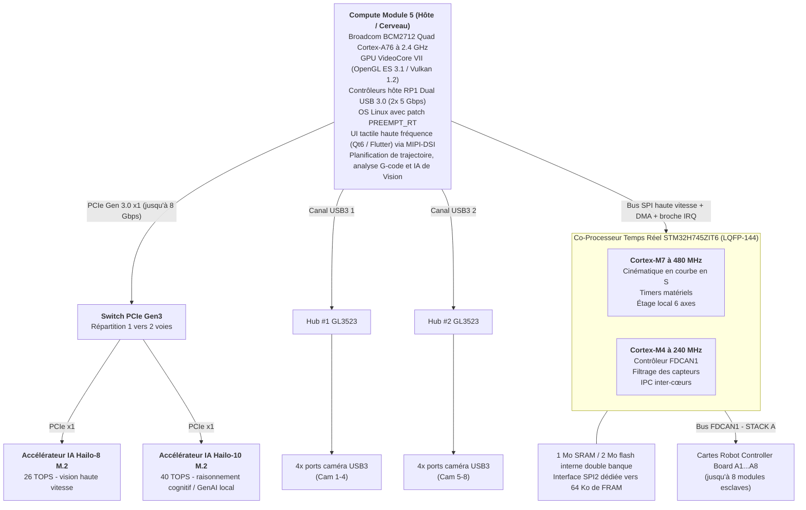
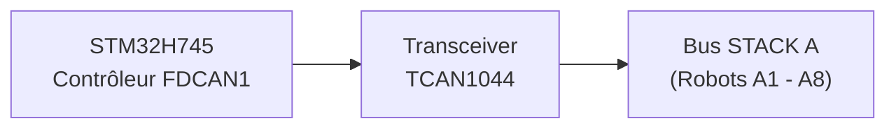
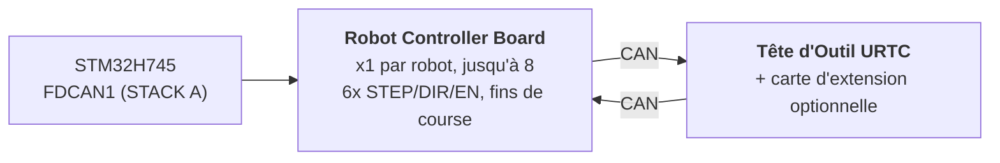

<!-- =============================================================================
HYDRA-UMC - Universal Machines Controller: board design, bootloaders and the CM5 SPI bridge
Copyright (C) JuanenRac (Electro Hobby 3D) <electrohobby3d@gmail.com>
GPL-3.0-or-later - see LICENSE
============================================================================= -->

<p align="center">
  
</p>

# 🚀 HYDRA-UMC

<p align="center"><a href="README.md">🇺🇸 English</a> | <a href="README_spa.md">🇪🇸 Español</a> | 🇫🇷 <b>Français</b> | <a href="README_ita.md">🇮🇹 Italiano</a> | <a href="README_deu.md">🇩🇪 Deutsch</a> | <a href="README_zho.md">🇨🇳 简体中文</a> | <a href="README_jpn.md">🇯🇵 日本語</a> | <a href="README_por.md">🇵🇹 Português</a></p>

### 🤖 La Plateforme Ultime de Micro-Usine à Double Cœur et Contrôleur Multi-Robot (V1.0 - Double Accélérateur IA PCIe Hailo-8 + Hailo-10 et Double Hub USB 3.0)

<p align="center">
  
  
  
  
  
  
  
</p>

---

> **État de la sûreté et de la cybersécurité :** cet écosystème n'est pas un système de sécurité certifié. Il n'existe pas encore de chaîne d'E-STOP matérielle, ni de limites ou de verrouillages imposés par le firmware, ni de commande de mouvement vérifiée ; les images de firmware sont contrôlées par CRC-32 et une signature Ed25519, et une compilation de version refuse les clés de développement publiées (les têtes d'outil et les cartes d'extension derrière le relais utilisent encore les chargeurs d'URTC, qui prennent un HMAC-SHA256 à clé partagée au lieu d'une signature) ; TLS et TLS mutuel sont optionnels et désactivés par défaut ; aucune carte propre n'a encore été assemblée ni testée. Lisez la [base de sécurité](https://github.com/JuanenRac/HYDRA-UMC-DOCS/blob/main/docs/SECURITY_BASELINE.md) et le [modèle de menaces](https://github.com/JuanenRac/HYDRA-UMC-DOCS/blob/main/docs/THREAT_MODEL.md) avant de vous fier à une affirmation d'ici pour la sécurité d'une personne.

---

## 📋 En un coup d'œil

| | |
|---|---|
| Version | `0.2.4` |
| Maturité | Ébauche |
| Tests | 154 (`python -m unittest discover -s tests -p 'test_*.py'`) |
| Technologie | STM32H745 (dual-core) / STM32G474 / FreeRTOS (AMP) / CMSIS-DSP / FDCAN (classic CAN mode) |
| Cible | Une carte à microcontrôleur (le firmware) ; compilé sur un PC |
| Sur matériel réel | Pas encore : aucune exécution sur du matériel réel n'est consignée pour cette version |

**Aller à :** [Présentation](#-présentation) · [Architecture](#-architecture) · [Fonctionnalités](#-fonctionnalités) · [Sécurité et protection](#-sécurité-et-protection) · [Interfaces](#-interfaces) · [Configuration](#-configuration) · [Démarrage rapide](#-démarrage-rapide) · [Tests](#-tests) · [Dépannage](#-dépannage) · [Structure du dépôt](#-structure-du-dépôt) · [Projets liés](#-projets-liés)

## 🚦 État du projet

Chaque ligne est une partie de ce dépôt et le feu dit où elle en est aujourd'hui. Elle est écrite d'après ce que le dépôt peut montrer (tests, compilations, exécutions), pas d'après ce qui est prévu.

🟢 Fait et vérifié · 🟡 Fonctionne, avec des limites connues · 🟠 À moitié fait ou pas encore vérifié · 🔴 Pas fait ou ne fonctionne pas

| Domaine | État | Ce que cela veut dire ici |
|---|---|---|
| Logiciel | 🟠 | Seulement la structure et les premières pièces ; l'essentiel du travail reste à faire |
| Tests | 🟡 | 154 tests automatiques, exécutés à chaque modification |
| Matériel réel | 🔴 | Pas encore : aucune exécution sur du matériel réel n'est consignée pour cette version |
| Documentation | 🟡 | README en huit langues, vérifié par rapport au manifeste à chaque modification |

## 🎯 Présentation

**HYDRA-UMC** (Universal Machines Controller) est une plateforme de contrôle distribué et une architecture HMI, encore à un stade précoce côté firmware, conçues pour la robotique cellulaire multi-axes, les micro-usines, la fabrication automatisée et l'orchestration complexe de têtes d'outils.

Conçue comme une **Architecture Hétérogène Hôte + Co-Processeur Temps Réel**, HYDRA-UMC est destinée à découpler le rendu d'interface utilisateur haut niveau, la vision par ordinateur, l'inférence IA et la connectivité cloud, de la génération de pas en temps réel, de la gestion du bus de terrain et de l'actionnement de l'électronique de puissance (prévu : la génération de pas et l'actionnement ne sont pas encore écrits).

> **État de la conception :** les sections ci-dessous décrivent la conception prévue de la carte et de son firmware. Ce qui existe aujourd'hui se limite aux bootloaders, aux applications de communication du CM4 et du G474 et au pont SPI côté CM5 (voir l'encadré *État de la sécurité* vers la fin et le tableau d'état de `docs/architecture.md`). Chaque fois qu'une phrase ci-dessous parle au présent de génération de mouvement, de profils en S, de boucles PID, de verrouillages de sécurité, d'un E-STOP, de la gestion de la perte d'alimentation, de la détection d'objets ou de tout autre comportement de la carte finale, il faut la lire comme prévue : rien de tout cela n'a tourné sur une carte assemblée.

### 🤖 Capacités de la Micro-Usine (objectifs de conception) :
* 📡 **Réseau Multi-Robot Distribué :** Prévu : coordonner jusqu'à 8 modules robotiques esclaves distribués (3, 4, 5 et 6-DDL d'abord ; évolution vers des architectures 7, 8, 9-DDL et des robots doubles dans les futures versions) connectés via un unique bus physique CAN.
* 🧠 **Double Coprocesseur Neuronal Embarqué :** Un switch PCIe Gen3 embarqué répartit l'unique voie PCIe du CM5 entre 2 accélérateurs IA M.2 - un Hailo-8 (26 TOPS) assurant la détection d'objets multi-flux YOLOv8/YOLO11 (prévu ; ne tourne pas encore), l'inspection de défauts et l'alignement de repères fiduciaires PnP en temps réel sur les 8 caméras, plus un Hailo-10 (40 TOPS) exécutant du raisonnement cognitif et du GenAI local sur l'appareil lui-même (modèles LLM/VLA quantifiés) sans aller-retour vers le cloud.
* 📐 **Étage Local 6 Axes :** Génération directe d'impulsions step/dir/enable pour 6 axes locaux (X, Y1, Y2, Z, E0, E1) pour des besoins auxiliaires : robots supplémentaires, révolvers ATC (Automatic Tool Changer), synchronisation de bandes transporteuses ou portiques de tables XYZ.
* 🎯 **Intégration JuanenPNP et JuanenCNC :** Directement compatible avec les systèmes Pick-and-Place (structures matérielles LumenPNP) et les unités CNC équipées de modules laser optiques de 10W pour le prototypage de PCB et le placement SMD.
* 👁️ **Matrice de Vision et d'Inspection Octuple par Caméra :** Double contrôleur USB 3.0 intégré alimentant 8 ports caméra USB dédiés pour l'alignement optique pick-and-place OpenCV en temps réel, l'inspection thermique, et la surveillance de flux vidéo à distance.
* ⚡ **Matrice d'Actionnement et Gestion Thermique :** Contrôle 16 canaux MOSFET industriels côté bas (8 électrovannes pneumatiques + 8 pompes à vide/générateurs venturi) et des drivers de plateau chauffant haute intensité pour le brasage par refusion SMD ou les plateaux d'impression 3D.
* 🚜 **Plateformes Mobiles JuanenBOT :** Architecture de communication évolutive capable d'interfacer avec des plateformes de transport 4 roues robustes à 48V (châssis de 50x50x50 cm avec roues omnidirectionnelles/mecanum pour des charges utiles de 100 kg).

## 🧩 Rôle dans HYDRA-UMC

**HYDRA-UMC** est la conception de l'Universal Machines Controller : un hôte Compute Module 5, un coprocesseur temps réel STM32H745 et jusqu'à huit Robot Controller Boards sur un seul bus CAN, destiné à piloter des cellules robotiques et des micro-usines. Ce qui existe aujourd'hui, ce sont les trois chargeurs d'amorçage (images signées, anti-retour en arrière), les applications de communication CM4 et G474 et le pont SPI côté CM5 ; le reste est de la conception, et aucune carte n'a été construite.

## 🏛️ Architecture

<p align="center">
  
</p>

<details>
<summary>Version texte du diagramme (Mermaid)</summary>







</details>

## ✨ Fonctionnalités

La spécification détaillée de la conception (onze sous-systèmes, de l'ordinateur hôte à la tête d'outil) est un document à part ; chaque ligne ci-dessous ouvre sa section :

- [SOUS-SYSTÈME DE CALCUL HÔTE (HMI ET HAUT NIVEAU)](docs/HARDWARE_SPECIFICATION_fra.md#2--sous-système-de-calcul-hôte-hmi-et-haut-niveau)
- [SOUS-SYSTÈME ACCÉLÉRATEUR IA PCIE (NPU DOUBLE HAILO-8 + HAILO-10)](docs/HARDWARE_SPECIFICATION_fra.md#3--sous-système-accélérateur-ia-pcie-npu-double-hailo-8--hailo-10)
- [SOUS-SYSTÈME DE VISION DOUBLE USB 3.0 (8x PORTS CAMÉRA)](docs/HARDWARE_SPECIFICATION_fra.md#4--sous-système-de-vision-double-usb-30-8x-ports-caméra)
- [SOUS-SYSTÈME DE CO-TRAITEMENT TEMPS RÉEL (CONCEPTION)](docs/HARDWARE_SPECIFICATION_fra.md#5--sous-système-de-co-traitement-temps-réel-conception)
- [COMMUNICATION BUS DE TERRAIN DISTRIBUÉ (BUS CAN UNIQUE ; PÉRIPHÉRIQUE FDCAN EN MODE CLASSIQUE)](docs/HARDWARE_SPECIFICATION_fra.md#6--communication-bus-de-terrain-distribué-bus-can-unique--périphérique-fdcan-en-mode-classique)
- [MÉMOIRE NON VOLATILE ULTRA-RAPIDE (SPI FRAM)](docs/HARDWARE_SPECIFICATION_fra.md#7--mémoire-non-volatile-ultra-rapide-spi-fram)
- [SUITE LOCALE DE MOUVEMENT, ACTIONNEMENT ET CAPTEURS](docs/HARDWARE_SPECIFICATION_fra.md#8--suite-locale-de-mouvement-actionnement-et-capteurs)
- [DISTRIBUTION ET RÉGULATION DE PUISSANCE](docs/HARDWARE_SPECIFICATION_fra.md#9--distribution-et-régulation-de-puissance)
- [COMMUNICATION INTER-PROCESSEUR (IPC)](docs/HARDWARE_SPECIFICATION_fra.md#10--communication-inter-processeur-ipc)
- [SPÉCIFICATIONS MATÉRIELLES PCB 4 COUCHES](docs/HARDWARE_SPECIFICATION_fra.md#11--spécifications-matérielles-pcb-4-couches)
- [CARTES ROBOT CONTROLLER BOARD ET TÊTE D'OUTIL URTC (NIVEAU DISTRIBUÉ)](docs/HARDWARE_SPECIFICATION_fra.md#12--cartes-robot-controller-board-et-tête-doutil-urtc-niveau-distribué)

## 🔒 Sécurité et protection

| Menace | Défense | Où |
|---|---|---|
| Une image de firmware falsifiée ou modifiée | Un en-tête fixe de 64 octets (magic, version, id matériel, taille, mots de vecteur, CRC-32) est suivi de l'image et d'une signature Ed25519 de 64 octets sur l'en-tête et l'image ; le chargeur vérifie d'abord la signature et ne croit rien de l'en-tête avant qu'elle soit vérifiée | `image_header.h`, `tools/image_header.py` |
| Une ancienne image signée renvoyée (retour en arrière) | Une nouvelle image doit être strictement plus récente que celle installée (majeure, mineure et correctif sont comparés) ; une plus ancienne n'est acceptée qu'avec un jeton de rétrogradation, une signature Ed25519 sur les versions installée et cible et le condensat de l'image ; le firmware ne contient aucune constante permettant de rétrograder | `image_header.h`, `ImageHeader_CheckRollback` |
| Des images compilées avec les clés de développement | Sans `HYDRA_FW_UPDATE_PUBKEY_HEX` et `HYDRA_FW_HMAC_KEY_HEX`, les chargeurs portent des clés de développement dont la partie privée est publiée dans le dépôt ; la compilation avertit, et avec `HYDRA_UMC_RELEASE=1` elle refuse de compiler ; la carte ne détient que la clé publique, la graine privée reste chez le propriétaire | `build_firmware.sh` |
| Une carte qui se bloque | Le chargeur G474 arme le chien de garde indépendant (IWDG) comme toute première action de `main()`, avant `HAL_Init()`, si bien qu'un blocage au démarrage réinitialise la puce | `src/mcu_stm32g474/boot/bootloader_main.c` |
| Le service HTTP local du pont SPI atteint par quelqu'un d'autre | Il écoute sur 127.0.0.1 par défaut, accepte un corps de firmware de 4 Mio au plus et ne détient aucune clé de signature : la signature arrive dans la requête, faite sur la machine qui détient la graine privée ; il n'a ni TLS ni connexion propre, donc ce qui lui relaie doit décider qui peut flasher | `src/cm5_host/spi_bridge/spi_bridge/http_service.py` |

**Ce qu'il ne fait jamais aujourd'hui :** fournir un arrêt d'urgence, des limites logicielles, des verrouillages, la sauvegarde vers la FRAM en cas de coupure ni aucune commande de mouvement ; Secure Boot et la protection en lecture de la flash ne sont pas revendiqués. Lisez l'encadré de sécurité en haut avant de vous fier à quoi que ce soit ici.

## 🔌 Interfaces

| Topic ou route | Ce qu'il porte |
|---|---|
| CAN, FDCAN1 in classic mode | un bus (STACK A) du STM32H745 à jusqu'à huit Robot Controller Boards ; les identifiants du protocole de relais sont listés une seule fois dans `tools/can_ids.py` et vérifiés par `tests/test_can_ids.py` |
| SPI + DMA + IRQ pin, 128-byte frames | de la CM5 au STM32H745 : trames fixes `SpiOtaFrame` qui correspondent à la structure C octet par octet ; le pont tourne à 10 MHz par défaut |
| `GET /version`, `GET /counters`, `POST /flash` on 127.0.0.1:8765 | le service local du pont SPI : la version d'une carte, les compteurs d'erreurs de son contrôleur CAN et un flash en flux (JSON délimité par lignes) d'une image avec sa signature Ed25519 ; `relay=1` atteint une tête d'outil URTC via sa Robot Controller Board |
| `tools/image_header.py sign \| keygen \| pubkey` | la référence côté hôte de l'en-tête d'image signé : elle fait les signatures et les jetons de rétrogradation que les chargeurs vérifient, et `tests/image_header_vectors.h` en est généré pour que les côtés C et Python ne divergent pas |

## ⚙️ Configuration

Le firmware se configure à la compilation, par des variables d'environnement ; le pont SPI prend ses réglages sur sa ligne de commande.

| Variable | Par défaut | Ce qu'elle définit |
|---|---|---|
| `HYDRA_FW_UPDATE_PUBKEY_HEX` | clé de développement | 64 chiffres hexadécimaux : la clé publique Ed25519 pour laquelle une mise à jour doit être signée |
| `HYDRA_FW_HMAC_KEY_HEX` | clé de développement | 64 chiffres hexadécimaux gardés hors du dépôt : la clé du contrôle d'intégrité local de l'application installée |
| `HYDRA_UMC_RELEASE` | `0` | avec `1` la compilation refuse d'utiliser les clés de développement |
| `HYDRA_UMC_SKIP_HOST_TESTS`, `HOST_CC` | `0`, le compilateur du système | saute les tests logiques hôte de l'étape 1b, ou nomme le compilateur C qu'ils utilisent |
| `python -m spi_bridge run --spi-speed-hz --host --port --collector-url` | `10000000`, `127.0.0.1`, `8765` | l'horloge SPI, où écoute le service HTTP local et l'adresse du HYDRA-UMC-TELEMETRY-COLLECTOR auquel le pont peut rendre compte (au plus un rapport par seconde) |

## 🚀 Démarrage rapide

Compiler le firmware demande la chaîne d'outils Arm GNU (`arm-none-eabi-gcc` 10.3 ou plus récent), `git` et `python` ; les tests hôte n'ont besoin que d'un compilateur C ordinaire et de Python. Windows a `build_firmware.bat`.

```bash
./build_firmware.sh                                  # builds every MCU target and runs the host tests (step 1b)
./build_firmware.sh g474                             # only the Robot Controller Board; h745 builds only the Kinematic Brain
python tools/verify_firmware_inventory.py            # read-only check of the committed six-component firmware inventory
python -m unittest discover -s tests -p 'test_*.py'  # the Python tests of the firmware sources, the image header and the CAN identifiers
```

### ENVIRONNEMENT DE DÉVELOPPEMENT

Ce que les machines de développement de ce projet lui-même ont réellement
installé et vérifié fonctionnel (`build_firmware.sh`/`build_firmware.bat`,
cibles `g474`/`h745`/par défaut, 0 erreur) - pas une liste théorique :

* 🔧 **ARM GNU Toolchain** (`arm-none-eabi-gcc` 10.3+) - compile chaque
  cible firmware MCU. Aucun fichier de projet STM32CubeIDE/CubeMX n'est
  utilisé ni requis pour la build - `build_firmware.sh`/`build_firmware.bat`
  récupère les propres sources HAL/CMSIS de ST directement depuis leurs
  repositories GitHub officiels et pilote le compilateur directement, la
  même philosophie déjà établie par le propre
  `build_firmware.sh`/`build_firmware.bat` du repository jumeau `URTC`.
* 🧩 **VS Code + extensions** (`.vscode/extensions.json` les liste toutes) :
  [STM32 VS Code Extension](https://marketplace.visualstudio.com/items?itemName=stmicroelectronics.stm32-vscode-extension)
  (intégration projet/build/debug), **Cortex-Debug** (débogage SWD/JTAG -
  indépendant de `build_firmware.sh`, utile une fois qu'un matériel réel
  existe), **CMake Tools** (pour le propre projet CMake de
  `src/cm5_host/hmi_qt6/`), **C/C++** (IntelliSense sur chaque fichier
  source firmware/hôte), **Python** (scripts du pipeline `ai_inference/`),
  **Hex Editor** (inspecter la sortie firmware `.bin`), **YAML** (la
  configuration propre à MediaMTX de `video_streamer/`). Ouvrez le
  repository, acceptez l'invite des extensions recommandées, et utilisez
  **Terminal → Run Task** pour les tâches de build déjà préconfigurées
  (`.vscode/tasks.json`).
* 🗂️ **git** - à la fois pour ce repository lui-même et pour le propre
  vendoring à tag fixe des paquets HAL/CMSIS de ST fait par
  `build_firmware.sh` (mis en cache sous `build/`, dans gitignore,
  re-récupéré avec `--clean`).

## 🧪 Tests

154 tests automatiques s'exécutent avec `python -m unittest discover -s tests -p 'test_*.py'`. Es s'agit de 87 tests du pont SPI de la CM5 plus 67 des sources du firmware, de l'en-tête d'image signé et des identifiants CAN (ceux du pont SPI se lancent avec `PYTHONPATH=src/cm5_host/spi_bridge:src/cm5_host/spi_bridge/tests` et `-s src/cm5_host/spi_bridge/tests`). La logique C des chargeurs d'amorçage et du relais est vérifiée par 19 autres programmes compilés avec un compilateur C ordinaire de l'hôte, à l'étape 1b de `build_firmware.sh`. Aucun n'a besoin d'une carte.

La CI exécute `HYDRA_UMC_CI=1 python tools/ci_validate.py`, qui vérifie le manifeste, les documents, les huit README et les images.

## 🏗️ Compilation et publication

**Linux/Mac :**
```bash
./build_firmware.sh          # compile chaque cible MCU (Robot Controller Board + Kinematic Brain, les deux cœurs)
./build_firmware.sh g474     # Robot Controller Board uniquement
./build_firmware.sh h745     # Kinematic Brain uniquement (les deux cœurs)
./build_firmware.sh --clean  # efface d'abord le cache HAL/CMSIS vendoré
```

**Windows :**
```bat
build_firmware.bat          :: compile chaque cible MCU (Robot Controller Board + Kinematic Brain, les deux cœurs)
build_firmware.bat g474     :: Robot Controller Board uniquement
build_firmware.bat h745     :: Kinematic Brain uniquement (les deux cœurs)
build_firmware.bat --clean  :: efface d'abord le cache HAL/CMSIS vendoré
```

`build_firmware.bat` est la même build que `build_firmware.sh` traduite en
batch (mêmes étapes, mêmes versions fixes de HAL/CMSIS, même rapport
pass/warn/fail) - exécutée de bout en bout sur une véritable machine Windows
avec l'[Arm GNU
Toolchain](https://developer.arm.com/downloads/-/arm-gnu-toolchain-downloads)
installé et `arm-none-eabi-gcc` dans le `PATH` : chaque module HAL, les deux
bootloaders, et chaque application compilés et liés proprement, et
`firmware_manifest.json` régénéré avec des CRC32 correspondant à la propre
sortie de la build Linux/Mac. Nécessite les mêmes outils que le script
Linux/Mac : l'Arm GNU Toolchain, `git` (pour récupérer les propres sources
HAL/CMSIS de ST), et `python` pour l'étape du manifest.

**Build manuelle (l'un ou l'autre OS, sans le script) :** le script
automatise exactement les étapes de `docs/COMPILE_STM32G474.TXT` et
`docs/COMPILE_STM32H745.TXT` - récupère les sources fixes
HAL/CMSIS/FreeRTOS listées en haut de
`build_firmware.sh`/`build_firmware.bat`, compile les modules HAL et les
fichiers startup/system de chaque cible avec `arm-none-eabi-gcc` (les
options/listes de modules sont listées dans ce même script), puis lie
chaque bootloader et application contre son propre script de liaison
(`*.ld`, à côté de sa source) avec `arm-none-eabi-gcc`/`-Wl,--gc-sections` et
convertit avec `arm-none-eabi-objcopy` en `.bin`/`.hex`. Ces deux fichiers
`docs/COMPILE_*.TXT` sont la référence faisant autorité, étape par étape, si
vous préférez ne pas exécuter l'un des deux scripts - les scripts existent
pour les automatiser, pas pour les remplacer comme source de vérité.

La sortie atterrit dans `firmware/`, qui est commitée et poussée vers ce
repository (même convention que le propre dossier de sortie `firmware/`
d'URTC) afin que la fonctionnalité de téléchargement depuis GitHub de
HYDRA-UMC-STUDIO puisse réellement y trouver de vrais fichiers `.bin` via
`firmware_manifest.json` - ce n'est PAS dans gitignore.
Voir `docs/COMPILE_STM32G474.TXT` et `docs/COMPILE_STM32H745.TXT` pour ce que
fait exactement chaque étape et pourquoi - et le propre `README.md` de
chaque dossier firmware pour l'état actuel. Les **bootloaders** pour les 3
cibles (G474, H745 CM7, H745 CM4) sont des implémentations CAN-OTA/SPI-OTA
réelles et fonctionnelles (vérification CRC-32 + signature Ed25519,
vérifier-dans-la-sauvegarde-avant-de-copier-vers-le-principal, même
discipline anti-brick que le propre bootloader d'URTC) - compilant
proprement de bout en bout, pas encore vérifiées contre un matériel réel.
Les **applications** restent des tests de fumée FreeRTOS GPIO-toggle
vérifiés à la compilation, pas encore le vrai firmware de
mouvement/vision/relais. Voir `docs/architecture.md` (en particulier le
tableau d'état de la section 6 et les limitations de sécurité connues et
acceptées de la section 8) pour ce qui est exactement réel par rapport à ce
qui reste ouvert.

> **État de la sécurité :** ce dépôt ne contient pas encore de chemin d'E-STOP, de limites logicielles, de verrouillages de sécurité, de sauvegarde en FRAM sur perte d'alimentation (PVD) ni de commande de mouvement. Là où les sections ci-dessus (ou un autre projet de l'écosystème) les décrivent, il s'agit de la conception prévue : rien ne doit s'y fier pour la sécurité tant qu'elle n'est pas implémentée et testée sur une vraie carte. Ce que font aujourd'hui les applications : celles du CM4 et du G474 exécutent l'interrogation/réponse AXIS_STATUS de STACK A et le tunnel de relais Tier 2/3 ; celle du CM7 reste un test de fumée GPIO-toggle.

Les six composants du firmware (trois chargeurs d'amorçage et trois applications, une paire par puce ou cœur) ont chacun leur version. Compiler ne la change jamais : `build_firmware.sh` et `.bat` ne font que la signaler. Monter les versions est la commande explicite `python bump_firmware_versions.py` (`--list` les montre), et `python show_component_version.py` affiche la version d'un composant.

## 🩺 Dépannage

| Vous voyez | Parce que | Faites |
|---|---|---|
| « les chargeurs acceptent des mises à jour signées avec la graine de DÉVELOPPEMENT, qui est publique » | La compilation n'avait pas `HYDRA_FW_UPDATE_PUBKEY_HEX` (ou pas `HYDRA_FW_HMAC_KEY_HEX`) | Acceptable sur un banc ; pour toute carte qu'un tiers peut atteindre, créez une paire de clés avec `python tools/image_header.py keygen`, compilez avec la clé publique et compilez les versions avec `HYDRA_UMC_RELEASE=1` |
| « arm-none-eabi-gcc introuvable » | La chaîne d'outils Arm GNU n'est pas installée ou n'est pas dans le `PATH` | Installez-la (le script essaie `apt` sous Linux) et relancez la compilation ; les tests hôte de l'étape 1b n'ont besoin que d'un compilateur C ordinaire |
| Le pont SPI n'ouvre pas le périphérique, ou `SPI transfer returned ... bytes` | Le vrai transport demande `spidev` et `gpiod` sur une CM5 dont le périphérique SPI est activé, et un STM32H745 de l'autre côté ; ni l'un ni l'autre n'existe encore, le pont n'a donc été exercé que contre des simulations | Utilisez le transport simulé des tests tant qu'aucune carte n'existe |
| `build_firmware.sh` se termine par FAIL sur un test hôte | Les copies d'une source que partagent les trois chargeurs ont divergé, ou `tests/image_header_vectors.h` est plus ancien que `tools/image_header.py` | Lancez `python tools/gen_image_header_vectors.py` et `python -m unittest discover -s tests` pour voir quelle copie diffère |

## 📂 Structure du dépôt

<p align="center">
  
</p>

<details>
<summary>Version texte de l'arborescence</summary>

```text
HYDRA-UMC/
├── src/
│   ├── cm5_host/                    Applications Linux userspace exécutées AU-DESSUS de la propre image de os/
│   ├── mcu_stm32h745/               Firmware du Kinematic Brain (Niveau 0) - double cœur
│   └── mcu_stm32g474/               Firmware de la Robot Controller Board (Niveau 1) - cœur unique, + son propre boot/
├── .vscode/                         Extensions recommandées + tâches de build - voir "Environnement de Développement" ci-dessous
├── docs/                            architecture, références de compilation, affectation des broches, protocole CAN, fiches techniques
├── hardware/                        les deux conceptions de carte ; pas encore de schéma
├── tests/                           Tests sur l'ordinateur : la logique C des bootloaders et du relais (stubs/ remplace le HAL, image_header_vectors.h contient les vecteurs de référence) et les tests Python des outils
├── os/                              Image OS du CM5 - choix de l'OS de base, unités systemd, provisionnement au premier démarrage
├── images/                          Bannière du README + icône + écran de démarrage (SVG)
├── tools/                           outils du projet et vérifications de la CI
├── firmware/                        Sortie de build commitée (.bin/.hex/.elf + manifest) - PAS dans gitignore, même convention que le propre dossier de sortie d'URTC, voir "Compiler le Firmware" ci-dessous
├── .github/                         workflow de CI et modèles de tickets
├── build_firmware.sh                Compile chaque cible firmware MCU ci-dessus depuis un checkout propre (Linux/Mac)
├── build_firmware.bat               Même build, Windows (voir "Compiler le Firmware" ci-dessous)
├── build-test.sh / build-test.bat   Contrôle build/compilation sans gestion de version
├── generate_manifest.py             Régénère firmware/firmware_manifest.json (versions/CRC32) après une build complète
├── bump_version.py                  Incrément de version type compteur kilométrique d'un composant
├── bump_firmware_versions.py        Monte explicitement les six versions de composant
├── show_component_version.py        Affiche la version qu'un composant a déjà
├── bump_manifest_version.py         Synchronise la version de hydra-umc.project.json avec la version native (--sync)
├── CHANGELOG.md                     ce qui a changé à chaque version
├── hydra-umc.project.json           manifeste : version, maturité, famille
└── test.sh                          vérification de build sans modification
```

</details>

## 🗺️ Feuille de route et limites connues

Ce qui existe aujourd'hui se limite aux trois chargeurs d'amorçage, aux applications de communication CM4 et G474 et au pont SPI côté CM5 ; le reste de la spécification est de la conception. Aucune carte propre n'a été assemblée ni testée, les deux dossiers de carte ne contiennent pas encore de schéma, et les applications sont des tests de fumée FreeRTOS qui basculent une broche, pas le firmware de mouvement, de vision et de relais. Les chargeurs et le pont ont été testés sur un ordinateur hôte, jamais sur les vraies puces.

## 🌍 Langues

Ce README et les documents du dépôt existent en huit langues : anglais, espagnol, allemand, français, italien, japonais, chinois et portugais (Portugal). Ils sont écrits ensemble et la CI vérifie que les huit fichiers ont les mêmes sections et les mêmes liens. Ce dépôt n'a ni écran ni catalogue de messages propre, il n'y a donc aucune chaîne d'interface à traduire.

## 🔗 Projets liés

Ce projet fait partie de l'écosystème robotique HYDRA-UMC du même auteur (JuanenRac / Electro Hobby 3D). Bon à savoir, car une demande pourrait en réalité concerner l'un de ceux-ci plutôt que ce dépôt.

**Directement Liés** — projets qui se branchent directement sur ce firmware
- **[URTC](https://github.com/JuanenRac/URTC)** — firmware pour la carte physique Universal Robot Tool Controller, plus de 25 profils d'outil sur bus CAN ; le firmware de tête d'outil que monte chaque bras robotique piloté par cette carte, un saut plus loin sur sa propre liaison descendante CAN.
- **[HYDRA-UMC-OS](https://github.com/JuanenRac/HYDRA-UMC-OS)** — couche produit reproductible sur Raspberry Pi OS pour le CM5 : agent en lecture seule, config/profils validés, provisionnement WiFi de premier contact ; le système d'exploitation exécuté par le propre hôte CM5 de cette carte.
- **[HYDRA-UMC-SERVER](https://github.com/JuanenRac/HYDRA-UMC-SERVER)** — le vrai backend headless (REST/WebSocket) auquel parle réellement chaque client de contrôle ; son propre service `spi_bridge` parle à ce firmware via la vraie connexion SPI-OTA CM5↔STM32H745.
- **[HYDRA-UMC-VISION-NODE](https://github.com/JuanenRac/HYDRA-UMC-VISION-NODE)** — hub d'intégration pour le pipeline de vision Hailo-8, avec une vraie vérification de disponibilité matérielle par étape ; il n'existe pas encore de boucle de perception/E-STOP avec ce firmware.
- **[HYDRA-UMC-SAFETY-ZONES](https://github.com/JuanenRac/HYDRA-UMC-SAFETY-ZONES)** — logique v0 de violation de zone, de fraîcheur de calibration et de demande d'E-STOP qui lit les positions d'objets dans un fichier ; aucun détecteur ne l'alimente et aucun E-STOP physique n'y est encore relié.
- **[HYDRA-UMC-VISUAL-SERVOING-API](https://github.com/JuanenRac/HYDRA-UMC-VISUAL-SERVOING-API)** — loi de correction Position-Based Visual Servoing avec autorisation conditionnée à l'état de zone ; pas encore d'estimation de pose par caméra.
- **[HYDRA-UMC-ORCHESTRATOR](https://github.com/JuanenRac/HYDRA-UMC-ORCHESTRATOR)** — hub d'intégration avec un vrai contrat de rapport de santé gRPC/Protobuf et une machine à états de mission ; coordonne plusieurs unités HYDRA-UMC en essaim.
- **[HYDRA-UMC-TWIN](https://github.com/JuanenRac/HYDRA-UMC-TWIN)** — hub d'intégration pour le moteur de jumeau numérique, avec un vrai contrat de synchronisation par compatibilité de version ; destiné à répliquer la cinématique de ce firmware quand elle existera.
- **[URTC-SMART-RACK](https://github.com/JuanenRac/URTC-SMART-RACK)** — firmware pour un rack de montage de cartes avec décodage réel d'ID d'outil et logique de préchauffage Smart Idle ; partage le même bus CAN d'outils que ce firmware.
- **[URTC-VISION-TOOL](https://github.com/JuanenRac/URTC-VISION-TOOL)** — firmware plus un vrai compagnon de vision Python pour une tête d'outil d'inspection thermique/RGB ; partage le même bus CAN d'outils que ce firmware.

**Fait Également Partie de l'Écosystème**

*Matériel & Plateforme de Base*
- **[HYDRA-UMC-SDK](https://github.com/JuanenRac/HYDRA-UMC-SDK)** — le contrat JSON-Schema partagé et la barrière logicielle de contrôle des jobs contre laquelle chaque bridge valide ses commandes (pas une fonction de sécurité certifiée).
- **[HYDRA-UMC-CONNECTOR-HUB](https://github.com/JuanenRac/HYDRA-UMC-CONNECTOR-HUB)** — registre déclaratif et validateur de manifestes d'adaptateur pour les connecteurs de machines externes ; étend la propre idée de contrat du SDK aux machines externes sans remplacer les projets de passerelle industrielle.

*Backend Central & Clients*
- **[HYDRA-UMC-STUDIO](https://github.com/JuanenRac/HYDRA-UMC-STUDIO)** — tableau de bord de contrôle web avec visualisation 3D multi-robot en temps réel.
- **[HYDRA-UMC-SUITE](https://github.com/JuanenRac/HYDRA-UMC-SUITE)** — centre de commande d'essaim de bureau (PySide6) pour plusieurs serveurs à la fois, empaqueté en exécutable autonome.
- **[HYDRA-UMC-ANDROID-CONTROL](https://github.com/JuanenRac/HYDRA-UMC-ANDROID-CONTROL)** — application de contrôle Android native avec connexion biométrique et un compagnon Wear OS jumelé.
- **[HYDRA-UMC-IOS-CONTROL](https://github.com/JuanenRac/HYDRA-UMC-IOS-CONTROL)** — application de contrôle iOS/iPadOS (Flutter) avec synchronisation WebSocket en temps réel.
- **[HYDRA-UMC-DSI](https://github.com/JuanenRac/HYDRA-UMC-DSI)** — interface tactile native pour l'écran tactile DSI 7" embarqué, intégrée directement sur le CM5.
- **[HYDRA-UMC-EDITOR-URDF](https://github.com/JuanenRac/HYDRA-UMC-EDITOR-URDF)** — créateur/éditeur graphique de bureau pour URDF qui envoie les modèles terminés vers le propre catalogue de STUDIO.
- **[HYDRA-UMC-EDITOR-STL](https://github.com/JuanenRac/HYDRA-UMC-EDITOR-STL)** — éditeur de bureau de modèles STL, transformant/remplaçant/retirant/ajoutant de vraies pièces dans le même catalogue de modèles qu'édite aussi HYDRA-UMC-EDITOR-URDF.
- **[HYDRA-UMC-BRIDGE-AMR](https://github.com/JuanenRac/HYDRA-UMC-BRIDGE-AMR)** — frontière de coordination pour les flottes AGV/AMR via un éditeur MQTT VDA 5050 (testé uniquement contre une flotte émulée).
- **[HYDRA-UMC-BRIDGE-CNC](https://github.com/JuanenRac/HYDRA-UMC-BRIDGE-CNC)** — coordinateur haut niveau pour cellules CNC avec accès au statut/octets de contrôle GRBL (testé uniquement contre un émulateur).
- **[HYDRA-UMC-BRIDGE-DROIDS](https://github.com/JuanenRac/HYDRA-UMC-BRIDGE-DROIDS)** — frontière de coordination pour droïdes à pattes/humanoïdes, avec un émetteur de commandes Boston Dynamics Spot (testé uniquement contre un émulateur).
- **[HYDRA-UMC-BRIDGE-LASER](https://github.com/JuanenRac/HYDRA-UMC-BRIDGE-LASER)** — coordinateur de cellules laser lisant 3 signaux GPIO de clé/enceinte/verrouillage (testé uniquement contre une puce simulée ; il ne peut ni armer ni tirer un laser).
- **[HYDRA-UMC-BRIDGE-OPENPNP](https://github.com/JuanenRac/HYDRA-UMC-BRIDGE-OPENPNP)** — coordinateur haut niveau sûr pour le flux de cartes du pick-and-place OpenPnP.
- **[HYDRA-UMC-BRIDGE-PRINTER3D](https://github.com/JuanenRac/HYDRA-UMC-BRIDGE-PRINTER3D)** — frontière de coordination sûre pour imprimantes 3D Moonraker/Klipper, avec de vraies commandes de tâche contrôlées.
- **[HYDRA-UMC-BRIDGE-ROS2](https://github.com/JuanenRac/HYDRA-UMC-BRIDGE-ROS2)** — coordinateur avec un transport ROS 2 rclpy à importation paresseuse (pas encore exécuté contre une installation ROS 2).
- **[HYDRA-UMC-BRIDGE-UAV](https://github.com/JuanenRac/HYDRA-UMC-BRIDGE-UAV)** — frontière de coordination pour UAV équipés de caméra, avec un émetteur de commandes MAVLink (testé uniquement contre un émulateur).

*Plateforme d'Outils URTC*
- **[URTC-FLASHER](https://github.com/JuanenRac/URTC-FLASHER)** — outil de bureau à interface graphique pour flasher les cartes URTC, CAN-OTA plus SWD/JTAG puce complète.
- **[URTC-TESTER](https://github.com/JuanenRac/URTC-TESTER)** — outil de bureau de diagnostic CAN-bus en direct pour cartes URTC, un panneau par profil d'outil.
- **[URTC-WEB-STUDIO](https://github.com/JuanenRac/URTC-WEB-STUDIO)** — alternative basée navigateur à URTC-TESTER via la Web Serial API, sans installation locale.
- **[URTC-GATEWAY](https://github.com/JuanenRac/URTC-GATEWAY)** — passerelle devant le bus CAN d'URTC : liste d'identifiants autorisés, limite de débit et clé de session ; logiciel testé sur ordinateur, pas encore sur un bus réel.

*Nœud IA de Vision (Hailo-8)*
- **[HYDRA-UMC-DETECTION-HEF](https://github.com/JuanenRac/HYDRA-UMC-DETECTION-HEF)** — registre réel de modèles compilés avec vérification de chargement sécurisé par architecture Hailo/checksum.
- **[HYDRA-UMC-VISION-STREAMER](https://github.com/JuanenRac/HYDRA-UMC-VISION-STREAMER)** — générateur réel de pipeline GStreamer + config MediaMTX, avec une vraie frontière d'intégration HailoRT.

*Nœud IA Cognitif (Hailo-10)*
- **[HYDRA-UMC-COGNITIVE-NODE](https://github.com/JuanenRac/HYDRA-UMC-COGNITIVE-NODE)** — hub d'intégration pour le pipeline cognitif Hailo-10 (orchestration LLM/VLA/voix).
- **[HYDRA-UMC-VLA-ENGINE](https://github.com/JuanenRac/HYDRA-UMC-VLA-ENGINE)** — vrai encodage/décodage de jetons d'action et génération de trajectoire pour un modèle Vision-Language-Action.
- **[HYDRA-UMC-VOICE-UI](https://github.com/JuanenRac/HYDRA-UMC-VOICE-UI)** — vrai front-end vocal (VAD + analyseur d'intention) avec un relais Watch borné et soumis à confirmation.
- **[HYDRA-UMC-SEMANTIC-PLANNER](https://github.com/JuanenRac/HYDRA-UMC-SEMANTIC-PLANNER)** — vraie décomposition de tâches basée sur des règles et récupération sémantique d'erreurs sur les codes d'erreur MCU.
- **[HYDRA-UMC-DOCS-QA](https://github.com/JuanenRac/HYDRA-UMC-DOCS-QA)** — vraie recherche documentaire TF-IDF (bibliothèque standard uniquement) sur les propres documents Markdown de cet écosystème.

*Orchestration & Essaim*
- **[HYDRA-UMC-JOB-DISPATCHER](https://github.com/JuanenRac/HYDRA-UMC-JOB-DISPATCHER)** — vraie file de tâches basée sur la priorité avec déduplication, via une vraie API HTTP.
- **[HYDRA-UMC-NODE-HEALING](https://github.com/JuanenRac/HYDRA-UMC-NODE-HEALING)** — vrai chien de garde de santé de flotte basé sur gRPC, avec retry/backoff et détection d'incohérence d'identité.
- **[HYDRA-UMC-PATH-PLANNER-3D](https://github.com/JuanenRac/HYDRA-UMC-PATH-PLANNER-3D)** — vrai planificateur de trajectoire 3D basé sur RRT, avec vraie validation des collisions obstacle/espace de travail.
- **[HYDRA-UMC-SWARM-SYNC](https://github.com/JuanenRac/HYDRA-UMC-SWARM-SYNC)** — vraie synchronisation d'état CRDT LWW-Element-Map, testée par propriétés pour la convergence multi-cellule.

*Jumeau Numérique & Simulation*
- **[HYDRA-UMC-HIL-BRIDGE](https://github.com/JuanenRac/HYDRA-UMC-HIL-BRIDGE)** — routeur hardware-in-the-loop avec un verrouillage logiciel de collision entre simulation et matériel réel (testé sans matériel réel).
- **[HYDRA-UMC-PHYSICS-REPLICA](https://github.com/JuanenRac/HYDRA-UMC-PHYSICS-REPLICA)** — vraie cinématique directe et validation des limites articulaires sur un vrai sous-ensemble URDF.
- **[HYDRA-UMC-SYNTHETIC-DATA-GEN](https://github.com/JuanenRac/HYDRA-UMC-SYNTHETIC-DATA-GEN)** — vrai générateur procédural de scènes 2D avec export d'annotations YOLO/COCO.

*Données & Analytique*
- **[HYDRA-UMC-DATALAKE](https://github.com/JuanenRac/HYDRA-UMC-DATALAKE)** — vrai magasin de séries temporelles basé sur sqlite3, avec une vraie API HTTP d'ingestion/requête.
- **[HYDRA-UMC-ANOMALY-DETECTOR](https://github.com/JuanenRac/HYDRA-UMC-ANOMALY-DETECTOR)** — vrai détecteur d'anomalies FFT + ligne de base statistique, avec surveillance de dérive.
- **[HYDRA-UMC-PRODUCTION-REPORTS](https://github.com/JuanenRac/HYDRA-UMC-PRODUCTION-REPORTS)** — vrai calcul OEE/disponibilité sur l'historique de DATALAKE, avec export CSV reproductible.
- **[HYDRA-UMC-TELEMETRY-COLLECTOR](https://github.com/JuanenRac/HYDRA-UMC-TELEMETRY-COLLECTOR)** — vrai pipeline d'ingestion CAN/WebSocket vers DATALAKE, avec déduplication par séquence.

*Passerelle Industrielle*
- **[HYDRA-UMC-GATEWAY-INDUSTRIAL](https://github.com/JuanenRac/HYDRA-UMC-GATEWAY-INDUSTRIAL)** — hub d'intégration relayant vers les protocoles industriels, avec une vraie couche de liste blanche de commandes/contre-pression.
- **[HYDRA-UMC-OPCUA-SERVER](https://github.com/JuanenRac/HYDRA-UMC-OPCUA-SERVER)** — vrai espace d'adressage OPC-UA, vérifié avec une vraie session client du protocole binaire.
- **[HYDRA-UMC-MQTT-BROKER](https://github.com/JuanenRac/HYDRA-UMC-MQTT-BROKER)** — vrai broker MQTT avec authentification par client optionnelle et ACL de sujets.
- **[HYDRA-UMC-MTCONNECT-ADAPTER](https://github.com/JuanenRac/HYDRA-UMC-MTCONNECT-ADAPTER)** — vrais points de terminaison XML MTConnect `/probe` et `/current`, avec sortie en mode dégradé.

*Outils Complémentaires & Opérations de l'Écosystème*
- **[HYDRA-UMC-DASHBOARD-AI](https://github.com/JuanenRac/HYDRA-UMC-DASHBOARD-AI)** — panneaux Smart Summaries et Anomaly Highlighting sur DATALAKE/ANOMALY-DETECTOR, avec un repli statistique honnête.
- **[HYDRA-UMC-TOOL-CLI](https://github.com/JuanenRac/HYDRA-UMC-TOOL-CLI)** — CLI de flotte avec un vrai contrat de codes de sortie stable, un vrai client en direct de la propre API de HYDRA-UMC-SERVER.
- **[HYDRA-UMC-WATCH](https://github.com/JuanenRac/HYDRA-UMC-WATCH)** — application compagnon WearOS avec des motifs d'alerte haptique et un relais vocal vers le téléphone jumelé (pas encore exécutée sur une montre physique).
- **[HYDRA-UMC-UPDATER](https://github.com/JuanenRac/HYDRA-UMC-UPDATER)** — outil administratif de bureau qui découvre, clone et met à jour chaque dépôt de cet écosystème.
- **[HYDRA-UMC-OS-REBUILDER](https://github.com/JuanenRac/HYDRA-UMC-OS-REBUILDER)** — outil de bureau Windows/Linux qui construit une image de la CM5 prête à graver, préchargée avec les versions les plus actuelles de l'écosystème, avec une configuration de premier démarrage Wi-Fi/utilisateur/SSH façon Raspberry Pi Imager.
- **[HYDRA-UMC-OPS-AGENT](https://github.com/JuanenRac/HYDRA-UMC-OPS-AGENT)** — coordinateur d'incidents de maintenance : un rôle edge à faible privilège collecte un instantané d'inventaire/santé assaini, un rôle control-plane le rend en lecture seule et demande à un fournisseur d'IA de suggérer un diagnostic - n'applique jamais de correctif ni ne déploie rien.
- **[HYDRA-UMC-DOCS](https://github.com/JuanenRac/HYDRA-UMC-DOCS)** — le centre de documentation et d'outils de l'écosystème : architecture, interfaces, socle de sécurité, matrice des capacités et catalogue de projets généré à partir de chaque manifeste.

## 📚 Documentation

Où lire la suite :

* [docs/SOURCE_MAP.md](docs/SOURCE_MAP.md) - chaque fichier du dépôt avec une ligne sur son rôle
* [docs/HARDWARE_SPECIFICATION.md](docs/HARDWARE_SPECIFICATION.md) - la spécification de la conception : onze sous-systèmes, de l'ordinateur hôte à la tête d'outil (un fichier par langue)
* [Base de sécurité de l'écosystème](https://github.com/JuanenRac/HYDRA-UMC-DOCS/blob/main/docs/SECURITY_BASELINE.md)
* [Modèle de menaces de l'écosystème](https://github.com/JuanenRac/HYDRA-UMC-DOCS/blob/main/docs/THREAT_MODEL.md)
* [Journal des modifications de ce dépôt](CHANGELOG.md)
* [Licence de ce dépôt](LICENSE.md)

## 🤝 Contribuer et communauté

* Avant une pull request, exécutez `HYDRA_UMC_CI=1 py -3 tools/ci_validate.py` (ou `HYDRA_UMC_CI=1 python3 tools/ci_validate.py`) : il doit afficher `CI_VALIDATION=PASS`. N'exécutez pas `build.sh` ni `build.bat` pour cette vérification ; compiler n'est pas vérifier.
* Les huit README sont écrits à partir d'une source unique dans HYDRA-UMC-DOCS ; ne les modifiez pas à la main. Changez la source et réécrivez-les avec `tools/make_readmes.py`.
* N'affirmez pas dans un README ce qui n'a pas tourné : écrivez « simulé » ou « non essayé sur matériel » quand c'est la vérité.
* Voir [CONTRIBUTING.md](CONTRIBUTING.md), le [code de conduite](CODE_OF_CONDUCT.md), [SECURITY.md](SECURITY.md) et [SUPPORT.md](SUPPORT.md).

## 👤 AUTEUR

**JuanenRac (Electro Hobby 3D)** · electrohobby3d@gmail.com

## 📜 LICENCE

GPL-3.0-or-later - [LICENSE](LICENSE).
