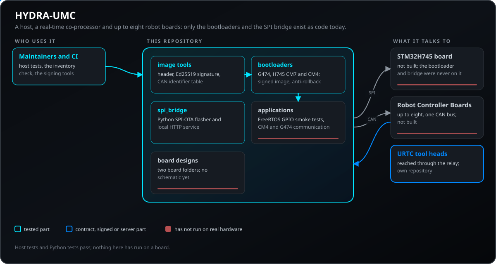
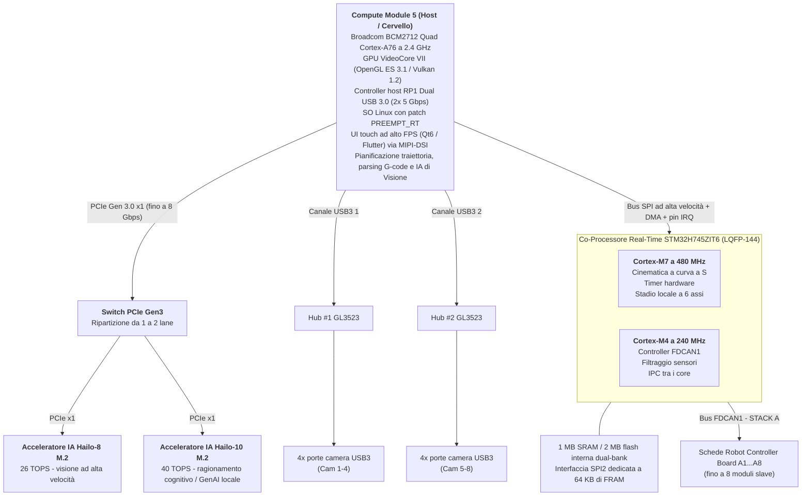
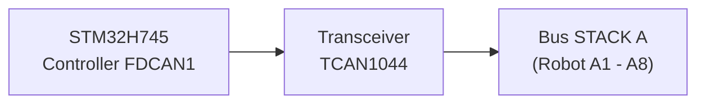
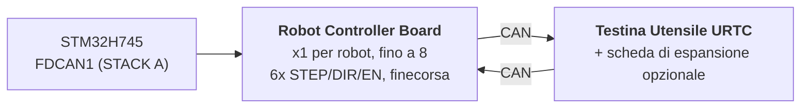
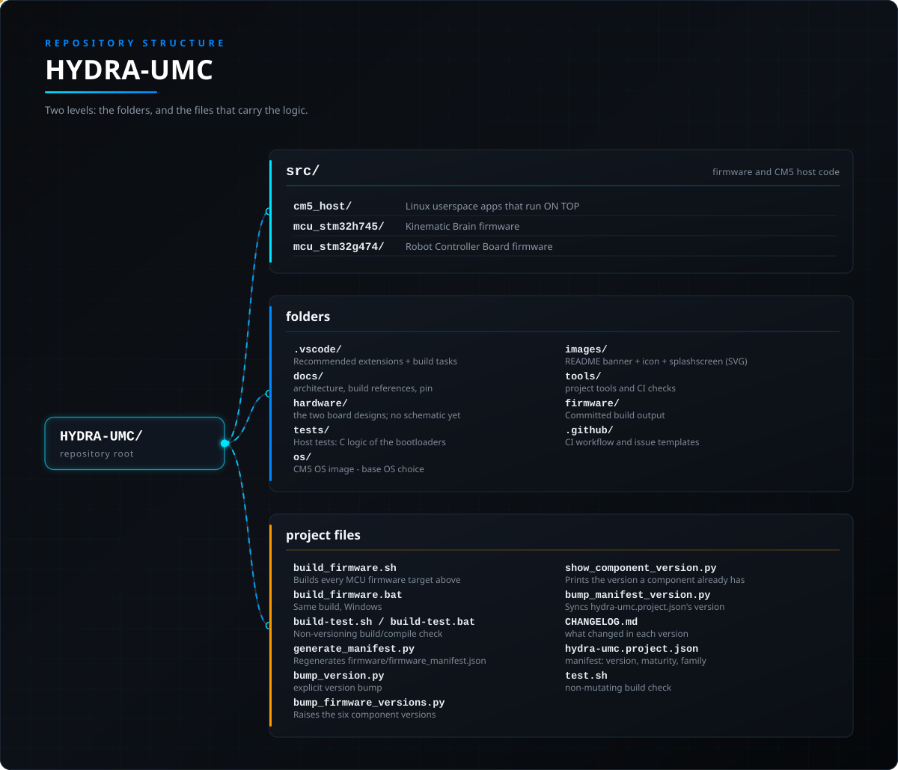

<!-- =============================================================================
HYDRA-UMC - Universal Machines Controller: board design, bootloaders and the CM5 SPI bridge
Copyright (C) JuanenRac (Electro Hobby 3D) <electrohobby3d@gmail.com>
GPL-3.0-or-later - see LICENSE
============================================================================= -->

<p align="center">
  
</p>

# 🚀 HYDRA-UMC

<p align="center"><a href="README.md">🇺🇸 English</a> | <a href="README_spa.md">🇪🇸 Español</a> | <a href="README_fra.md">🇫🇷 Français</a> | 🇮🇹 <b>Italiano</b> | <a href="README_deu.md">🇩🇪 Deutsch</a> | <a href="README_zho.md">🇨🇳 简体中文</a> | <a href="README_jpn.md">🇯🇵 日本語</a> | <a href="README_por.md">🇵🇹 Português</a></p>

### 🤖 La Piattaforma Definitiva di Micro-Fabbrica a Doppio Nucleo e Controller Multi-Robot (V1.0 - Doppio Acceleratore IA PCIe Hailo-8 + Hailo-10 e Doppio Hub USB 3.0)

<p align="center">
  
  
  
  
  
  
  
</p>

---

> **Stato di sicurezza (safety e security):** questo ecosistema non è un sistema di sicurezza certificato. Non esiste ancora un percorso E-STOP hardware, né limiti o interblocchi imposti dal firmware, né un comando di movimento verificato; le immagini firmware sono controllate con CRC32 e un HMAC-SHA256 a chiave condivisa, non con una firma asimmetrica; TLS e TLS reciproco sono opzionali e disattivati per impostazione predefinita; nessuna scheda propria è stata ancora assemblata o provata. Leggi la [base di sicurezza](https://github.com/JuanenRac/HYDRA-UMC-DOCS/blob/main/docs/SECURITY_BASELINE.md) e il [modello delle minacce](https://github.com/JuanenRac/HYDRA-UMC-DOCS/blob/main/docs/THREAT_MODEL.md) prima di fidarti di qualsiasi affermazione qui per la sicurezza di una persona.

---

## 📋 In breve

| | |
|---|---|
| Versione | `0.2.3` |
| Maturità | Impalcatura |
| Test | 148 (`python -m unittest discover -s tests -p 'test_*.py'`) |
| Tecnologia | STM32H745 (dual-core) / STM32G474 / FreeRTOS (AMP) / CMSIS-DSP / FDCAN (classic CAN mode) |
| Destinazione | Una scheda con microcontrollore (il firmware); compilato su un PC |
| Su hardware reale | Non ancora: per questa versione non risulta alcuna esecuzione su hardware reale |

**Vai a:** [Panoramica](#-panoramica) · [Architettura](#-architettura) · [Funzionalità](#-funzionalità) · [Sicurezza e protezione](#-sicurezza-e-protezione) · [Interfacce](#-interfacce) · [Configurazione](#-configurazione) · [Avvio rapido](#-avvio-rapido) · [Test](#-test) · [Risoluzione dei problemi](#-risoluzione-dei-problemi) · [Struttura del repository](#-struttura-del-repository) · [Progetti correlati](#-progetti-correlati)

## 🚦 Stato del progetto

Ogni riga è una parte di questo repository e il semaforo dice a che punto è oggi. È scritta in base a ciò che il repository può mostrare (test, compilazioni, esecuzioni), non a ciò che è previsto.

🟢 Fatto e verificato · 🟡 Funziona, con limiti noti · 🟠 Fatto a metà o non ancora verificato · 🔴 Non fatto o non funzionante

| Area | Stato | Cosa significa qui |
|---|---|---|
| Software | 🟠 | Solo struttura e primi pezzi; gran parte del lavoro è ancora da fare |
| Test | 🟢 | 148 test automatici, eseguiti a ogni modifica |
| Hardware reale | 🔴 | Non ancora: per questa versione non risulta alcuna esecuzione su hardware reale |
| Documentazione | 🟢 | README in otto lingue, verificato rispetto al manifesto a ogni modifica |

## 🎯 Panoramica

**HYDRA-UMC** (Universal Machines Controller) è una piattaforma di controllo distribuito e un'architettura HMI, ancora in una fase iniziale lato firmware, progettate per robotica cellulare multi-asse, micro-fabbriche, produzione automatizzata e orchestrazione complessa di testine utensile.

Progettata come **Architettura Ibrida Host + Co-Processore Real-Time**, HYDRA-UMC è pensata per disaccoppiare il rendering dell'interfaccia utente di alto livello, la visione artificiale, l'inferenza IA e la connettività cloud dalla generazione degli step in tempo reale, dalla gestione del bus di campo e dall'attuazione dell'elettronica di potenza (previsto: generazione degli step e attuazione non sono ancora scritte).

> **Stato del progetto:** le sezioni seguenti descrivono il progetto previsto della scheda e del suo firmware. Ciò che esiste oggi si limita ai bootloader, alle applicazioni di comunicazione del CM4 e del G474 e al bridge SPI lato CM5 (vedi il riquadro *Stato della sicurezza* verso la fine e la tabella di stato in `docs/architecture.md`). Ogni volta che una frase qui sotto parla al presente di generazione del movimento, profili a S, cicli PID, interblocchi di sicurezza, un E-STOP, gestione della perdita di alimentazione, rilevamento di oggetti o qualsiasi altro comportamento della scheda finale, va letta come prevista: nulla di tutto ciò è stato eseguito su una scheda assemblata.

### 🤖 Capacità della Micro-Fabbrica (obiettivi di progetto):
* 📡 **Rete Multi-Robot Distribuita:** Previsto: coordinare fino a 8 moduli robotici slave distribuiti (prima 3, 4, 5 e 6 assi; scalabile a 7, 8, 9 assi e architetture di robot duali nelle versioni future) collegati su un unico bus fisico CAN.
* 🧠 **Doppio Coprocessore Neurale Embedded:** Uno switch PCIe Gen3 onboard ripartisce l'unica lane PCIe del CM5 tra 2 acceleratori IA M.2 - un Hailo-8 (26 TOPS) che esegue il rilevamento oggetti multi-stream YOLOv8/YOLO11 (previsto; non ancora in esecuzione), l'ispezione difetti e l'allineamento fiduciale PnP in tempo reale su tutte e 8 le camere, più un Hailo-10 (40 TOPS) che esegue ragionamento cognitivo e GenAI locale direttamente sul dispositivo (modelli LLM/VLA quantizzati) senza passare dal cloud.
* 📐 **Stadio Locale a 6 Assi:** Generazione diretta di impulsi step/dir/enable per 6 assi locali (X, Y1, Y2, Z, E0, E1) per esigenze ausiliarie: robot aggiuntivi, revolver ATC (Automatic Tool Changer), sincronizzazione di nastri trasportatori o portali di tavole XYZ.
* 🎯 **Integrazione JuanenPNP e JuanenCNC:** Direttamente compatibile con sistemi Pick-and-Place (strutture hardware LumenPNP) e unità CNC dotate di moduli laser ottico da 10W per la prototipazione PCB e il posizionamento SMD.
* 👁️ **Matrice di Visione e Ispezione Octal a Camera:** Doppio controller USB 3.0 integrato che alimenta 8 porte camera USB dedicate per l'allineamento ottico pick-and-place con OpenCV in tempo reale, l'ispezione termica e il monitoraggio remoto dello streaming.
* ⚡ **Matrice di Attuazione e Gestione Termica:** Controlla 16 canali industriali MOSFET low-side (8 valvole elettropneumatiche + 8 pompe per vuoto/generatori venturi) e driver del piano riscaldato ad alta corrente per la saldatura a rifusione SMD o i piani di stampa 3D.
* 🚜 **Piattaforme Mobili JuanenBOT:** Architettura di comunicazione scalabile in grado di interfacciarsi con piattaforme di trasporto a 4 ruote heavy-duty a 48V (telai 50x50x50 cm con ruote omnidirezionali/mecanum per carichi utili di 100 kg).

## 🧩 Ruolo in HYDRA-UMC

**HYDRA-UMC** è il progetto dell'Universal Machines Controller: un host Compute Module 5, un coprocessore real-time STM32H745 e fino a otto Robot Controller Board su un unico bus CAN, pensato per gestire celle robotiche e micro-fabbriche. Oggi esistono i tre bootloader (immagini firmate, anti-rollback), le applicazioni di comunicazione di CM4 e G474 e il bridge SPI lato CM5; il resto è progetto, e nessuna scheda è stata costruita.

## 🏛️ Architettura

<p align="center">
  
</p>

<details>
<summary>Versione testuale del diagramma (Mermaid)</summary>







</details>

## ✨ Funzionalità

La specifica dettagliata del progetto (undici sottosistemi, dal computer host alla testa utensile) è un documento a parte; ogni riga qui sotto apre la sua sezione:

- [SOTTOSISTEMA DI COMPUTAZIONE HOST (HMI E ALTO LIVELLO)](docs/HARDWARE_SPECIFICATION_ita.md#2--sottosistema-di-computazione-host-hmi-e-alto-livello)
- [SOTTOSISTEMA ACCELERATORE IA PCIE (NPU DOPPIO HAILO-8 + HAILO-10)](docs/HARDWARE_SPECIFICATION_ita.md#3--sottosistema-acceleratore-ia-pcie-npu-doppio-hailo-8--hailo-10)
- [SOTTOSISTEMA DI VISIONE DOPPIO USB 3.0 (8x PORTE CAMERA)](docs/HARDWARE_SPECIFICATION_ita.md#4--sottosistema-di-visione-doppio-usb-30-8x-porte-camera)
- [SOTTOSISTEMA DI CO-PROCESSING REAL-TIME (PROGETTO)](docs/HARDWARE_SPECIFICATION_ita.md#5--sottosistema-di-co-processing-real-time-progetto)
- [COMUNICAZIONE FIELDBUS DISTRIBUITA (BUS CAN UNICO; PERIFERICA FDCAN IN MODALITÀ CLASSICA)](docs/HARDWARE_SPECIFICATION_ita.md#6--comunicazione-fieldbus-distribuita-bus-can-unico-periferica-fdcan-in-modalità-classica)
- [MEMORIA NON VOLATILE ULTRA-VELOCE (SPI FRAM)](docs/HARDWARE_SPECIFICATION_ita.md#7--memoria-non-volatile-ultra-veloce-spi-fram)
- [SUITE LOCALE DI MOVIMENTO, ATTUAZIONE E SENSORI](docs/HARDWARE_SPECIFICATION_ita.md#8--suite-locale-di-movimento-attuazione-e-sensori)
- [DISTRIBUZIONE E REGOLAZIONE DI POTENZA](docs/HARDWARE_SPECIFICATION_ita.md#9--distribuzione-e-regolazione-di-potenza)
- [COMUNICAZIONE INTER-PROCESSORE (IPC)](docs/HARDWARE_SPECIFICATION_ita.md#10--comunicazione-inter-processore-ipc)
- [SPECIFICHE HARDWARE PCB A 4 STRATI](docs/HARDWARE_SPECIFICATION_ita.md#11--specifiche-hardware-pcb-a-4-strati)
- [SCHEDE ROBOT CONTROLLER BOARD E TESTINA UTENSILE URTC (LIVELLO DISTRIBUITO)](docs/HARDWARE_SPECIFICATION_ita.md#12--schede-robot-controller-board-e-testina-utensile-urtc-livello-distribuito)

## 🔒 Sicurezza e protezione

| Minaccia | Difesa | Dove |
|---|---|---|
| Un'immagine firmware falsa o modificata | Un'intestazione fissa di 64 byte (magic, versione, id hardware, dimensione, parole di vettore, CRC-32) è seguita dall'immagine e da una firma Ed25519 di 64 byte su intestazione e immagine; il bootloader controlla prima la firma e non crede a nulla dell'intestazione prima che sia verificata | `image_header.h`, `tools/image_header.py` |
| Una vecchia immagine firmata inviata di nuovo (rollback) | Una nuova immagine deve essere strettamente più recente di quella installata (si confrontano maggiore, minore e patch); una più vecchia è accettata solo con un token di downgrade, una firma Ed25519 sulle versioni installata e di destinazione e sul digest dell'immagine; il firmware non contiene alcuna costante che consenta un downgrade | `image_header.h`, `ImageHeader_CheckRollback` |
| Immagini compilate con le chiavi di sviluppo | Senza `HYDRA_FW_UPDATE_PUBKEY_HEX` e `HYDRA_FW_HMAC_KEY_HEX` i bootloader portano chiavi di sviluppo la cui parte privata è pubblicata nel repository; la compilazione avvisa, e con `HYDRA_UMC_RELEASE=1` si rifiuta di compilare; la scheda tiene solo la chiave pubblica, il seme privato resta al proprietario | `build_firmware.sh` |
| Una scheda che si blocca | Il bootloader della G474 arma il watchdog indipendente (IWDG) come primissima azione di `main()`, prima di `HAL_Init()`, così un blocco all'avvio reimposta il chip | `src/mcu_stm32g474/boot/bootloader_main.c` |
| Il servizio HTTP locale del bridge SPI raggiunto da qualcun altro | Ascolta su 127.0.0.1 per impostazione predefinita, accetta un corpo di firmware di al massimo 4 MiB e non conserva alcuna chiave di firma: la firma arriva nella richiesta, fatta sulla macchina che ha il seme privato; non ha TLS né un accesso proprio, quindi chi gli inoltra le richieste deve decidere chi può flashare | `src/cm5_host/spi_bridge/spi_bridge/http_service.py` |

**Cosa non fa mai oggi:** fornire un arresto di emergenza, limiti software, interblocchi, il salvataggio su FRAM alla perdita di alimentazione né alcun comando di movimento; Secure Boot e protezione in lettura della flash non sono dichiarati. Leggi il riquadro di sicurezza in alto prima di fidarti di qualsiasi cosa qui.

## 🔌 Interfacce

| Topic o rotta | Cosa porta |
|---|---|
| CAN, FDCAN1 in classic mode | un bus (STACK A) dall'STM32H745 fino a otto Robot Controller Board; gli identificatori del protocollo relay sono elencati una sola volta in `tools/can_ids.py` e controllati da `tests/test_can_ids.py` |
| SPI + DMA + IRQ pin, 128-byte frames | dalla CM5 all'STM32H745: frame fissi `SpiOtaFrame` che corrispondono alla struct C byte per byte; il bridge gira a 10 MHz per impostazione predefinita |
| `GET /version`, `GET /counters`, `POST /flash` on 127.0.0.1:8765 | il servizio locale del bridge SPI: la versione di una scheda, i contatori di errore del suo controller CAN e un flash in streaming (JSON delimitato da righe) di un'immagine con la sua firma Ed25519; `relay=1` raggiunge una testa utensile URTC attraverso la sua Robot Controller Board |
| `tools/image_header.py sign \| keygen \| pubkey` | il riferimento sull'host dell'intestazione immagine firmata: produce le firme e i token di downgrade che i bootloader controllano, e `tests/image_header_vectors.h` è generato da esso perché i lati C e Python non divergano |

## ⚙️ Configurazione

Il firmware si configura al momento della compilazione, tramite variabili d'ambiente; il bridge SPI prende le sue impostazioni dalla riga di comando.

| Variabile | Predefinito | Cosa imposta |
|---|---|---|
| `HYDRA_FW_UPDATE_PUBKEY_HEX` | chiave di sviluppo | 64 cifre esadecimali: la chiave pubblica Ed25519 per cui deve essere firmato un aggiornamento |
| `HYDRA_FW_HMAC_KEY_HEX` | chiave di sviluppo | 64 cifre esadecimali tenute fuori dal repository: la chiave del controllo di integrità locale dell'applicazione installata |
| `HYDRA_UMC_RELEASE` | `0` | con `1` la compilazione si rifiuta di usare le chiavi di sviluppo |
| `HYDRA_UMC_SKIP_HOST_TESTS`, `HOST_CC` | `0`, il compilatore di sistema | salta i test logici host del passo 1b, o indica il compilatore C che usano |
| `python -m spi_bridge run --spi-speed-hz --host --port --collector-url` | `10000000`, `127.0.0.1`, `8765` | il clock SPI, dove ascolta il servizio HTTP locale e l'indirizzo dell'HYDRA-UMC-TELEMETRY-COLLECTOR a cui il bridge può riferire (al massimo un rapporto al secondo) |

## 🚀 Avvio rapido

Compilare il firmware richiede la toolchain Arm GNU (`arm-none-eabi-gcc` 10.3 o successivo), `git` e `python`; i test host richiedono solo un normale compilatore C e Python. Windows ha `build_firmware.bat`.

```bash
./build_firmware.sh                                  # builds every MCU target and runs the host tests (step 1b)
./build_firmware.sh g474                             # only the Robot Controller Board; h745 builds only the Kinematic Brain
python tools/verify_firmware_inventory.py            # read-only check of the committed six-component firmware inventory
python -m unittest discover -s tests -p 'test_*.py'  # the Python tests of the firmware sources, the image header and the CAN identifiers
```

### AMBIENTE DI SVILUPPO

Cosa hanno effettivamente installato e verificato funzionante le macchine di
sviluppo di questo stesso progetto (`build_firmware.sh`/`build_firmware.bat`,
target `g474`/`h745`/default, 0 errori) - non un elenco teorico:

* 🔧 **ARM GNU Toolchain** (`arm-none-eabi-gcc` 10.3+) - compila ogni target
  firmware MCU. Nessun file di progetto STM32CubeIDE/CubeMX viene usato o
  richiesto per la build - `build_firmware.sh`/`build_firmware.bat` recupera
  le sorgenti HAL/CMSIS di ST direttamente dai loro repository GitHub
  ufficiali e guida il compilatore direttamente, stessa filosofia già
  stabilita dal proprio `build_firmware.sh`/`build_firmware.bat` del
  repository gemello `URTC`.
* 🧩 **VS Code + estensioni** (`.vscode/extensions.json` le elenca tutte):
  [STM32 VS Code Extension](https://marketplace.visualstudio.com/items?itemName=stmicroelectronics.stm32-vscode-extension)
  (integrazione progetto/build/debug), **Cortex-Debug** (debug SWD/JTAG -
  indipendente da `build_firmware.sh`, utile una volta che esista hardware
  reale), **CMake Tools** (per il proprio progetto CMake di
  `src/cm5_host/hmi_qt6/`), **C/C++** (IntelliSense su ogni file sorgente
  firmware/host), **Python** (script della pipeline `ai_inference/`), **Hex
  Editor** (ispezionare l'output firmware `.bin`), **YAML** (la config
  propria di MediaMTX di `video_streamer/`). Apri il repository, accetta il
  prompt delle estensioni consigliate, e usa **Terminal → Run Task** per i
  task di build già preconfigurati (`.vscode/tasks.json`).
* 🗂️ **git** - sia per questo stesso repository sia per il vendoring a tag
  fisso dei pacchetti HAL/CMSIS di ST fatto da `build_firmware.sh` (in
  cache sotto `build/`, in gitignore, ri-scaricato con `--clean`).

## 🧪 Test

148 test automatici si eseguono con `python -m unittest discover -s tests -p 'test_*.py'`. Sono 87 test del bridge SPI della CM5 più 61 dei sorgenti del firmware, dell'intestazione immagine firmata e degli identificatori CAN (quelli del bridge SPI si eseguono con `PYTHONPATH=src/cm5_host/spi_bridge:src/cm5_host/spi_bridge/tests` e `-s src/cm5_host/spi_bridge/tests`). La logica C dei bootloader e del relay è verificata da altri 19 programmi compilati con un normale compilatore C host, nel passo 1b di `build_firmware.sh`. Nessuno richiede una scheda.

La CI esegue `HYDRA_UMC_CI=1 python tools/ci_validate.py`, che controlla il manifesto, i documenti, gli otto README e le immagini.

## 🏗️ Compilazione e rilascio

**Linux/Mac:**
```bash
./build_firmware.sh          # compila ogni target MCU (Robot Controller Board + Kinematic Brain, entrambi i core)
./build_firmware.sh g474     # solo Robot Controller Board
./build_firmware.sh h745     # solo Kinematic Brain (entrambi i core)
./build_firmware.sh --clean  # cancella prima la cache HAL/CMSIS scaricata
```

**Windows:**
```bat
build_firmware.bat          :: compila ogni target MCU (Robot Controller Board + Kinematic Brain, entrambi i core)
build_firmware.bat g474     :: solo Robot Controller Board
build_firmware.bat h745     :: solo Kinematic Brain (entrambi i core)
build_firmware.bat --clean  :: cancella prima la cache HAL/CMSIS scaricata
```

`build_firmware.bat` è la stessa build di `build_firmware.sh` tradotta in
batch (stessi passi, stesse versioni fisse di HAL/CMSIS, stesso report
pass/warn/fail) - eseguita end-to-end su una macchina Windows reale con
l'[Arm GNU
Toolchain](https://developer.arm.com/downloads/-/arm-gnu-toolchain-downloads)
installato e `arm-none-eabi-gcc` nel `PATH`: ogni modulo HAL, entrambi i
bootloader, e ogni applicazione compilati e linkati puliti, e
`firmware_manifest.json` rigenerato con CRC32 corrispondenti al proprio
output della build Linux/Mac. Richiede gli stessi strumenti dello script
Linux/Mac: l'Arm GNU Toolchain, `git` (per recuperare le sorgenti HAL/CMSIS
di ST), e `python` per il passo del manifest.

**Build manuale (entrambi i SO, senza lo script):** lo script automatizza
esattamente i passi di `docs/COMPILE_STM32G474.TXT` e
`docs/COMPILE_STM32H745.TXT` - recupera le sorgenti fisse HAL/CMSIS/FreeRTOS
elencate all'inizio di `build_firmware.sh`/`build_firmware.bat`, compila i
moduli HAL e i file startup/system di ogni target con `arm-none-eabi-gcc`
(flag/elenchi moduli sono elencati in quello stesso script), poi linka ogni
bootloader e applicazione contro il proprio linker script (`*.ld`, accanto
alla propria sorgente) con `arm-none-eabi-gcc`/`-Wl,--gc-sections` e converte
con `arm-none-eabi-objcopy` in `.bin`/`.hex`. Quei due file
`docs/COMPILE_*.TXT` sono il riferimento autoritativo passo-passo se
preferisci non eseguire nessuno dei due script - gli script esistono per
automatizzarli, non per sostituirli come fonte di verità.

L'output finisce in `firmware/`, che è committata e pushata su questo
repository (stessa convenzione della propria cartella di output `firmware/`
di URTC) affinché la funzione di download da GitHub di HYDRA-UMC-STUDIO
possa effettivamente trovare lì file `.bin` reali tramite
`firmware_manifest.json` - NON è in gitignore.
Vedi `docs/COMPILE_STM32G474.TXT` e `docs/COMPILE_STM32H745.TXT` per cosa fa
esattamente ogni passo e perché - e il proprio `README.md` di ogni cartella
firmware per lo stato attuale. I **bootloader** per tutti e 3 i target (G474,
H745 CM7, H745 CM4) sono implementazioni CAN-OTA/SPI-OTA reali e funzionanti
(verifica CRC32 + HMAC-SHA256, verifica-in-backup-prima-di-copiare-nel-main,
stessa disciplina anti-brick del proprio bootloader di URTC) - compilano
puliti end-to-end, non ancora verificati contro hardware reale. Le
**applicazioni** sono ancora smoke test FreeRTOS GPIO-toggle verificati per
compilazione, non ancora il vero firmware di movimento/visione/relè. Vedi
`docs/architecture.md` (in particolare la tabella di stato della sezione 6 e
le limitazioni di sicurezza note e accettate della sezione 8) per cosa è
esattamente reale rispetto a ciò che resta aperto.

> **Stato della sicurezza:** questo repository non contiene ancora alcun percorso di E-STOP, limiti software, interblocchi di sicurezza, scarico su FRAM per perdita di alimentazione (PVD) né comandi di movimento. Dove le sezioni precedenti (o un altro progetto dell'ecosistema) li descrivono, si tratta del progetto previsto: nulla deve farvi affidamento per la sicurezza finché non è implementato e provato su una scheda reale. Cosa fanno oggi le applicazioni: quelle del CM4 e del G474 eseguono il polling/risposta AXIS_STATUS di STACK A e il tunnel di relay Tier 2/3; quella del CM7 è ancora uno smoke test GPIO-toggle.

Tutti e sei i componenti del firmware (tre bootloader e tre applicazioni, una coppia per chip o core) hanno la propria versione. Compilare non la cambia mai: `build_firmware.sh` e `.bat` si limitano a riportarla. Alzare le versioni è il comando esplicito `python bump_firmware_versions.py` (`--list` le mostra), e `python show_component_version.py` stampa la versione di un componente.

## 🩺 Risoluzione dei problemi

| Vedi | Perché | Fai |
|---|---|---|
| «i bootloader accettano aggiornamenti firmati con il seme di SVILUPPO, che è pubblico» | La compilazione non aveva `HYDRA_FW_UPDATE_PUBKEY_HEX` (o non aveva `HYDRA_FW_HMAC_KEY_HEX`) | Va bene per un banco di prova; per qualsiasi scheda raggiungibile da altri, crea una coppia di chiavi con `python tools/image_header.py keygen`, compila con la chiave pubblica e compila le release con `HYDRA_UMC_RELEASE=1` |
| «arm-none-eabi-gcc non trovato» | La toolchain Arm GNU non è installata o non è nel `PATH` | Installala (lo script prova `apt` su Linux) e ricompila; i test host del passo 1b richiedono solo un normale compilatore C |
| Il bridge SPI non apre il dispositivo, oppure `SPI transfer returned ... bytes` | Il trasporto reale richiede `spidev` e `gpiod` su una CM5 con il dispositivo SPI abilitato, e un STM32H745 dall'altra parte; nessuno dei due esiste ancora, quindi il bridge è stato provato solo con simulazioni | Usa il trasporto simulato dei test finché non esiste una scheda |
| `build_firmware.sh` termina con FAIL in un test host | Le copie di un sorgente condiviso dai tre bootloader sono divergenti, oppure `tests/image_header_vectors.h` è più vecchio di `tools/image_header.py` | Esegui `python tools/gen_image_header_vectors.py` e `python -m unittest discover -s tests` per vedere quale copia differisce |

## 📂 Struttura del repository

<p align="center">
  
</p>

<details>
<summary>Versione testuale dell'albero</summary>

```text
HYDRA-UMC/
├── src/
│   ├── cm5_host/                    App Linux userspace eseguite SOPRA la propria immagine di os/
│   ├── mcu_stm32h745/               Firmware del Kinematic Brain (Livello 0) - dual-core
│   └── mcu_stm32g474/               Firmware della Robot Controller Board (Livello 1) - single-core, + il proprio boot/
├── .vscode/                         Estensioni consigliate + task di build - vedi "Ambiente di Sviluppo" sotto
├── docs/                            architettura, riferimenti di compilazione, assegnazione dei pin, protocollo CAN, schede tecniche
├── hardware/                        i due progetti di scheda; ancora senza schema
├── tests/                           Test sul computer: la logica C dei bootloader e del relay (stubs/ sostituisce l'HAL, image_header_vectors.h contiene i vettori di riferimento) e i test Python degli strumenti
├── os/                              Immagine SO del CM5 - scelta SO base, unit systemd, provisioning al primo avvio
├── images/                          Banner del README + icona + splashscreen (SVG)
├── tools/                           strumenti del progetto e controlli della CI
├── firmware/                        Output di build committato (.bin/.hex/.elf + manifest) - NON in gitignore, stessa convenzione della cartella di output propria di URTC, vedi "Compilare il Firmware" sotto
├── .github/                         workflow di CI e modelli di segnalazione
├── build_firmware.sh                Compila ogni target firmware MCU sopra da un checkout pulito (Linux/Mac)
├── build_firmware.bat               Stessa build, Windows (vedi "Compilare il Firmware" sotto)
├── build-test.sh / build-test.bat   Controllo build/compilazione senza incremento di versione
├── generate_manifest.py             Rigenera firmware/firmware_manifest.json (versioni/CRC32) dopo una build completa
├── bump_version.py                  Incremento di versione stile contachilometri di un componente
├── bump_firmware_versions.py        Alza esplicitamente le sei versioni dei componenti
├── show_component_version.py        Mostra la versione che un componente ha già
├── bump_manifest_version.py         Sincronizza la versione di hydra-umc.project.json con quella nativa (--sync)
├── CHANGELOG.md                     cosa è cambiato in ogni versione
├── hydra-umc.project.json           manifesto: versione, maturità, famiglia
└── test.sh                          controllo di build senza modifiche
```

</details>

## 🗺️ Roadmap e limiti noti

Ciò che esiste oggi si limita ai tre bootloader, alle applicazioni di comunicazione di CM4 e G474 e al bridge SPI lato CM5; il resto della specifica è progetto. Nessuna scheda propria è stata assemblata o provata, le due cartelle di scheda non contengono ancora uno schema, e le applicazioni sono smoke test FreeRTOS che commutano un pin, non il firmware di movimento, visione e relay. Bootloader e bridge sono stati provati su un computer host, mai sui chip reali.

## 🌍 Lingue

Questo README e i documenti del repository esistono in otto lingue: inglese, spagnolo, tedesco, francese, italiano, giapponese, cinese e portoghese (Portogallo). Sono scritti insieme e la CI verifica che gli otto file abbiano le stesse sezioni e gli stessi link. Questo repository non ha uno schermo né un catalogo di messaggi propri, quindi non ci sono stringhe di interfaccia da tradurre.

## 🔗 Progetti correlati

Questo progetto fa parte dell'ecosistema robotico HYDRA-UMC dello stesso autore (JuanenRac / Electro Hobby 3D). Vale la pena conoscerlo, poiché una richiesta potrebbe in realtà riguardare uno di questi invece di questo repository.

**Direttamente Correlati** — progetti che si collegano direttamente a questo firmware
- **[URTC](https://github.com/JuanenRac/URTC)** — firmware per la scheda fisica dell'Universal Robot Tool Controller, oltre 25 profili utensile su bus CAN; il firmware della testa utensile montata da ogni braccio robotico guidato da questa scheda, un salto più in là sul proprio downlink CAN.
- **[HYDRA-UMC-OS](https://github.com/JuanenRac/HYDRA-UMC-OS)** — livello prodotto riproducibile su Raspberry Pi OS per il CM5: agente in sola lettura, config/profili validati, provisioning WiFi al primo contatto; il sistema operativo eseguito dal proprio host CM5 di questa scheda.
- **[HYDRA-UMC-SERVER](https://github.com/JuanenRac/HYDRA-UMC-SERVER)** — il vero backend headless (REST/WebSocket) con cui parla davvero ogni client di controllo; il suo servizio `spi_bridge` parla con questo firmware tramite la vera connessione SPI-OTA CM5↔STM32H745.
- **[HYDRA-UMC-VISION-NODE](https://github.com/JuanenRac/HYDRA-UMC-VISION-NODE)** — hub di integrazione per la pipeline di visione Hailo-8, con un vero controllo di prontezza hardware per fase; non esiste ancora un ciclo percezione/E-STOP con questo firmware.
- **[HYDRA-UMC-SAFETY-ZONES](https://github.com/JuanenRac/HYDRA-UMC-SAFETY-ZONES)** — logica v0 di violazione zona, freschezza di calibrazione e richiesta E-STOP che legge le posizioni degli oggetti da un file; nessun rilevatore la alimenta e nessun E-STOP fisico è ancora collegato.
- **[HYDRA-UMC-VISUAL-SERVOING-API](https://github.com/JuanenRac/HYDRA-UMC-VISUAL-SERVOING-API)** — legge di correzione Position-Based Visual Servoing con autorizzazione condizionata allo stato di zona; ancora nessuna stima di posa da telecamera.
- **[HYDRA-UMC-ORCHESTRATOR](https://github.com/JuanenRac/HYDRA-UMC-ORCHESTRATOR)** — hub di integrazione con un vero contratto di health-report gRPC/Protobuf e una macchina a stati di missione; coordina più unità HYDRA-UMC come uno sciame.
- **[HYDRA-UMC-TWIN](https://github.com/JuanenRac/HYDRA-UMC-TWIN)** — hub di integrazione per il motore di gemello digitale, con un vero contratto di sincronizzazione per compatibilità di versione; pensato per replicare la cinematica di questo firmware quando esisterà.
- **[URTC-SMART-RACK](https://github.com/JuanenRac/URTC-SMART-RACK)** — firmware per un rack di montaggio schede con decodifica reale dell'ID utensile e logica di preriscaldamento Smart Idle; condivide lo stesso bus CAN utensili di questo firmware.
- **[URTC-VISION-TOOL](https://github.com/JuanenRac/URTC-VISION-TOOL)** — firmware più un vero companion di visione Python per una testa utensile di ispezione termica/RGB; condivide lo stesso bus CAN utensili di questo firmware.

**Fa Anche Parte dell'Ecosistema**

*Hardware e Piattaforma di Base*
- **[HYDRA-UMC-SDK](https://github.com/JuanenRac/HYDRA-UMC-SDK)** — il contratto JSON-Schema condiviso e la barriera software di controllo dei job contro cui ogni bridge valida i propri comandi (non è una funzione di sicurezza certificata).
- **[HYDRA-UMC-CONNECTOR-HUB](https://github.com/JuanenRac/HYDRA-UMC-CONNECTOR-HUB)** — registro dichiarativo e validatore di manifesti adattatore per connettori di macchine esterne; estende la propria idea di contratto dell'SDK alle macchine esterne senza sostituire i progetti di gateway industriale.

*Backend Centrale e Client*
- **[HYDRA-UMC-STUDIO](https://github.com/JuanenRac/HYDRA-UMC-STUDIO)** — dashboard di controllo web con visualizzazione 3D multi-robot in tempo reale.
- **[HYDRA-UMC-SUITE](https://github.com/JuanenRac/HYDRA-UMC-SUITE)** — centro di comando sciame desktop (PySide6) per più server contemporaneamente, pacchettizzato come eseguibile standalone.
- **[HYDRA-UMC-ANDROID-CONTROL](https://github.com/JuanenRac/HYDRA-UMC-ANDROID-CONTROL)** — app di controllo nativa per Android con login biometrico e un companion Wear OS abbinato.
- **[HYDRA-UMC-IOS-CONTROL](https://github.com/JuanenRac/HYDRA-UMC-IOS-CONTROL)** — app di controllo per iOS/iPadOS (Flutter) con sincronizzazione WebSocket in tempo reale.
- **[HYDRA-UMC-DSI](https://github.com/JuanenRac/HYDRA-UMC-DSI)** — interfaccia touch nativa per il touchscreen DSI da 7" a bordo, incorporata direttamente nel CM5.
- **[HYDRA-UMC-EDITOR-URDF](https://github.com/JuanenRac/HYDRA-UMC-EDITOR-URDF)** — creatore/editor grafico desktop di URDF che invia i modelli finiti al catalogo di STUDIO.
- **[HYDRA-UMC-EDITOR-STL](https://github.com/JuanenRac/HYDRA-UMC-EDITOR-STL)** — editor desktop di modelli STL, che trasforma/sostituisce/rimuove/aggiunge veri pezzi nello stesso catalogo di modelli modificato anche da HYDRA-UMC-EDITOR-URDF.
- **[HYDRA-UMC-BRIDGE-AMR](https://github.com/JuanenRac/HYDRA-UMC-BRIDGE-AMR)** — barriera di coordinamento per flotte AGV/AMR tramite un publisher MQTT VDA 5050 (testato solo contro una flotta emulata).
- **[HYDRA-UMC-BRIDGE-CNC](https://github.com/JuanenRac/HYDRA-UMC-BRIDGE-CNC)** — coordinatore ad alto livello per celle CNC con accesso a stato/byte di controllo GRBL (testato solo contro un emulatore).
- **[HYDRA-UMC-BRIDGE-DROIDS](https://github.com/JuanenRac/HYDRA-UMC-BRIDGE-DROIDS)** — barriera di coordinamento per droidi con zampe/umanoidi, con un mittente di comandi per Boston Dynamics Spot (testato solo contro un emulatore).
- **[HYDRA-UMC-BRIDGE-LASER](https://github.com/JuanenRac/HYDRA-UMC-BRIDGE-LASER)** — coordinatore per celle laser che legge 3 segnali GPIO di chiave/involucro/interblocco (testato solo contro un chip simulato; non può armare né far partire un laser).
- **[HYDRA-UMC-BRIDGE-OPENPNP](https://github.com/JuanenRac/HYDRA-UMC-BRIDGE-OPENPNP)** — coordinatore ad alto livello sicuro per il flusso schede del pick-and-place OpenPnP.
- **[HYDRA-UMC-BRIDGE-PRINTER3D](https://github.com/JuanenRac/HYDRA-UMC-BRIDGE-PRINTER3D)** — barriera di coordinamento sicura per stampanti 3D Moonraker/Klipper, con comandi di lavoro reali e controllati.
- **[HYDRA-UMC-BRIDGE-ROS2](https://github.com/JuanenRac/HYDRA-UMC-BRIDGE-ROS2)** — coordinatore con un trasporto ROS 2 rclpy importato in modo lazy (non ancora eseguito contro un'installazione ROS 2).
- **[HYDRA-UMC-BRIDGE-UAV](https://github.com/JuanenRac/HYDRA-UMC-BRIDGE-UAV)** — barriera di coordinamento per UAV dotati di fotocamera, con un mittente di comandi MAVLink (testato solo contro un emulatore).

*Piattaforma Strumenti URTC*
- **[URTC-FLASHER](https://github.com/JuanenRac/URTC-FLASHER)** — strumento desktop con GUI per il flashing delle schede URTC, CAN-OTA più SWD/JTAG a chip intero.
- **[URTC-TESTER](https://github.com/JuanenRac/URTC-TESTER)** — strumento desktop di diagnostica CAN-bus dal vivo per schede URTC, un pannello per profilo utensile.
- **[URTC-WEB-STUDIO](https://github.com/JuanenRac/URTC-WEB-STUDIO)** — alternativa basata su browser a URTC-TESTER tramite la Web Serial API, senza installazione locale.
- **[URTC-GATEWAY](https://github.com/JuanenRac/URTC-GATEWAY)** — gateway davanti al bus CAN di URTC: elenco di identificatori consentiti, limite di frequenza e chiave di sessione; software provato su computer, non ancora su un bus reale.

*Nodo IA Visione (Hailo-8)*
- **[HYDRA-UMC-DETECTION-HEF](https://github.com/JuanenRac/HYDRA-UMC-DETECTION-HEF)** — registro reale di modelli compilati con verifica di caricamento sicuro per architettura Hailo/checksum.
- **[HYDRA-UMC-VISION-STREAMER](https://github.com/JuanenRac/HYDRA-UMC-VISION-STREAMER)** — generatore reale di pipeline GStreamer + config MediaMTX, con una vera barriera di integrazione HailoRT.

*Nodo IA Cognitivo (Hailo-10)*
- **[HYDRA-UMC-COGNITIVE-NODE](https://github.com/JuanenRac/HYDRA-UMC-COGNITIVE-NODE)** — hub di integrazione per la pipeline cognitiva Hailo-10 (orchestrazione LLM/VLA/voce).
- **[HYDRA-UMC-VLA-ENGINE](https://github.com/JuanenRac/HYDRA-UMC-VLA-ENGINE)** — vera codifica/decodifica di token d'azione e generazione di traiettoria per un modello Vision-Language-Action.
- **[HYDRA-UMC-VOICE-UI](https://github.com/JuanenRac/HYDRA-UMC-VOICE-UI)** — vero front-end vocale (VAD + parser di intenti) con un relay verso Watch limitato e soggetto a conferma.
- **[HYDRA-UMC-SEMANTIC-PLANNER](https://github.com/JuanenRac/HYDRA-UMC-SEMANTIC-PLANNER)** — vera scomposizione dei task basata su regole e recupero semantico degli errori sui codici errore MCU.
- **[HYDRA-UMC-DOCS-QA](https://github.com/JuanenRac/HYDRA-UMC-DOCS-QA)** — vera ricerca documentale TF-IDF (solo libreria standard) sui documenti Markdown di questo ecosistema.

*Orchestrazione e Sciame*
- **[HYDRA-UMC-JOB-DISPATCHER](https://github.com/JuanenRac/HYDRA-UMC-JOB-DISPATCHER)** — vera coda di lavori basata su priorità con deduplicazione, su una vera API HTTP.
- **[HYDRA-UMC-NODE-HEALING](https://github.com/JuanenRac/HYDRA-UMC-NODE-HEALING)** — vero watchdog di salute della flotta basato su gRPC, con retry/backoff e rilevamento di discrepanza d'identità.
- **[HYDRA-UMC-PATH-PLANNER-3D](https://github.com/JuanenRac/HYDRA-UMC-PATH-PLANNER-3D)** — vero pianificatore di percorsi 3D basato su RRT, con vera validazione delle collisioni ostacolo/spazio di lavoro.
- **[HYDRA-UMC-SWARM-SYNC](https://github.com/JuanenRac/HYDRA-UMC-SWARM-SYNC)** — vera sincronizzazione di stato CRDT LWW-Element-Map, con property test per la convergenza multi-cella.

*Gemello Digitale e Simulazione*
- **[HYDRA-UMC-HIL-BRIDGE](https://github.com/JuanenRac/HYDRA-UMC-HIL-BRIDGE)** — router hardware-in-the-loop con un interblocco software di collisione tra simulazione e hardware reale (testato senza hardware reale).
- **[HYDRA-UMC-PHYSICS-REPLICA](https://github.com/JuanenRac/HYDRA-UMC-PHYSICS-REPLICA)** — vera cinematica diretta e validazione dei limiti articolari su un vero sottoinsieme URDF.
- **[HYDRA-UMC-SYNTHETIC-DATA-GEN](https://github.com/JuanenRac/HYDRA-UMC-SYNTHETIC-DATA-GEN)** — vero generatore procedurale di scene 2D con esportazione di annotazioni YOLO/COCO.

*Dati e Analisi*
- **[HYDRA-UMC-DATALAKE](https://github.com/JuanenRac/HYDRA-UMC-DATALAKE)** — vero archivio di serie temporali basato su sqlite3, con una vera API HTTP di ingestione/query.
- **[HYDRA-UMC-ANOMALY-DETECTOR](https://github.com/JuanenRac/HYDRA-UMC-ANOMALY-DETECTOR)** — vero rilevatore di anomalie FFT + baseline statistica, con monitoraggio della deriva.
- **[HYDRA-UMC-PRODUCTION-REPORTS](https://github.com/JuanenRac/HYDRA-UMC-PRODUCTION-REPORTS)** — vero calcolo OEE/disponibilità sullo storico di DATALAKE, con esportazione CSV riproducibile.
- **[HYDRA-UMC-TELEMETRY-COLLECTOR](https://github.com/JuanenRac/HYDRA-UMC-TELEMETRY-COLLECTOR)** — vera pipeline di ingestione CAN/WebSocket verso DATALAKE, con deduplicazione per sequenza.

*Gateway Industriale*
- **[HYDRA-UMC-GATEWAY-INDUSTRIAL](https://github.com/JuanenRac/HYDRA-UMC-GATEWAY-INDUSTRIAL)** — hub di integrazione che inoltra ai protocolli industriali, con un vero livello di allowlist dei comandi/backpressure.
- **[HYDRA-UMC-OPCUA-SERVER](https://github.com/JuanenRac/HYDRA-UMC-OPCUA-SERVER)** — vero spazio di indirizzi OPC-UA, verificato con una vera sessione client del protocollo binario.
- **[HYDRA-UMC-MQTT-BROKER](https://github.com/JuanenRac/HYDRA-UMC-MQTT-BROKER)** — vero broker MQTT con autenticazione opzionale per client e ACL sui topic.
- **[HYDRA-UMC-MTCONNECT-ADAPTER](https://github.com/JuanenRac/HYDRA-UMC-MTCONNECT-ADAPTER)** — veri endpoint XML `/probe` e `/current` di MTConnect, con output in modalità degradata.

*Strumenti Complementari e Operazioni dell'Ecosistema*
- **[HYDRA-UMC-DASHBOARD-AI](https://github.com/JuanenRac/HYDRA-UMC-DASHBOARD-AI)** — pannelli Smart Summaries e Anomaly Highlighting su DATALAKE/ANOMALY-DETECTOR, con un fallback statistico onesto.
- **[HYDRA-UMC-TOOL-CLI](https://github.com/JuanenRac/HYDRA-UMC-TOOL-CLI)** — CLI di flotta con un vero e stabile contratto di exit-code, un client live reale della stessa API di HYDRA-UMC-SERVER.
- **[HYDRA-UMC-WATCH](https://github.com/JuanenRac/HYDRA-UMC-WATCH)** — app companion WearOS con schemi di avviso aptico e un relay vocale verso il telefono abbinato (non ancora eseguita su un orologio fisico).
- **[HYDRA-UMC-UPDATER](https://github.com/JuanenRac/HYDRA-UMC-UPDATER)** — strumento amministrativo desktop che scopre, clona e aggiorna ogni repository di questo ecosistema.
- **[HYDRA-UMC-OS-REBUILDER](https://github.com/JuanenRac/HYDRA-UMC-OS-REBUILDER)** — strumento desktop Windows/Linux che costruisce un'immagine della CM5 pronta da scrivere, precaricata con le versioni più aggiornate dell'ecosistema, con configurazione di primo avvio Wi-Fi/utente/SSH in stile Raspberry Pi Imager.
- **[HYDRA-UMC-OPS-AGENT](https://github.com/JuanenRac/HYDRA-UMC-OPS-AGENT)** — coordinatore di incidenti di manutenzione: un ruolo edge a basso privilegio raccoglie uno snapshot di inventario/salute sanificato, un ruolo control-plane lo rende in sola lettura e chiede a un provider di IA di suggerire una diagnosi - non applica mai una patch né distribuisce nulla.
- **[HYDRA-UMC-DOCS](https://github.com/JuanenRac/HYDRA-UMC-DOCS)** — il centro di documentazione e strumenti dell'ecosistema: architettura, interfacce, base di sicurezza, matrice delle capacità e un catalogo dei progetti generato da ogni manifesto.

## 📚 Documentazione

Dove leggere di più:

* [docs/SOURCE_MAP.md](docs/SOURCE_MAP.md) - ogni file del repository con una riga su ciò che fa
* [docs/HARDWARE_SPECIFICATION.md](docs/HARDWARE_SPECIFICATION.md) - la specifica del progetto: undici sottosistemi, dal computer host alla testa utensile (un file per lingua)
* [Base di sicurezza dell'ecosistema](https://github.com/JuanenRac/HYDRA-UMC-DOCS/blob/main/docs/SECURITY_BASELINE.md)
* [Modello delle minacce dell'ecosistema](https://github.com/JuanenRac/HYDRA-UMC-DOCS/blob/main/docs/THREAT_MODEL.md)
* [Registro delle modifiche di questo repository](CHANGELOG.md)
* [Licenza di questo repository](LICENSE.md)

## 🤝 Contribuire e comunità

* Prima di una pull request esegui `HYDRA_UMC_CI=1 py -3 tools/ci_validate.py` (oppure `HYDRA_UMC_CI=1 python3 tools/ci_validate.py`): deve stampare `CI_VALIDATION=PASS`. Non eseguire `build.sh` né `build.bat` per questa verifica; compilare non è verificare.
* I otto README sono scritti da un'unica fonte in HYDRA-UMC-DOCS; non modificarli a mano. Cambia la fonte e riscrivili con `tools/make_readmes.py`.
* Non affermare in un README ciò che non è stato eseguito: scrivi «simulato» o «non provato su hardware» quando è la verità.
* Vedi [CONTRIBUTING.md](CONTRIBUTING.md), il [codice di condotta](CODE_OF_CONDUCT.md), [SECURITY.md](SECURITY.md) e [SUPPORT.md](SUPPORT.md).

## 👤 AUTORE

**JuanenRac (Electro Hobby 3D)** · electrohobby3d@gmail.com

## 📜 LICENZA

GPL-3.0-or-later - [LICENSE](LICENSE).
