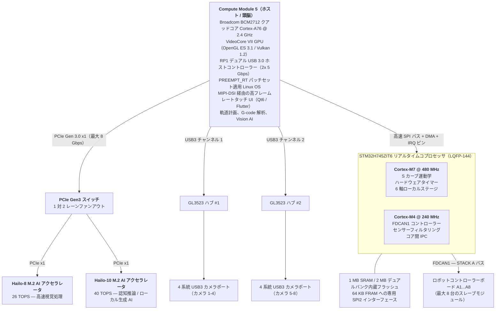
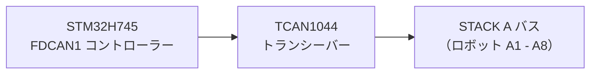
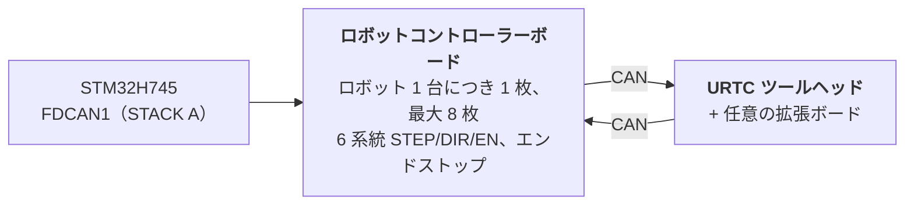

<!-- =============================================================================
HYDRA-UMC - Universal Machines Controller: board design, bootloaders and the CM5 SPI bridge
Copyright (C) JuanenRac (Electro Hobby 3D) <electrohobby3d@gmail.com>
GPL-3.0-or-later - see LICENSE
============================================================================= -->

<p align="center">
  
</p>

# 🚀 HYDRA-UMC

<p align="center"><a href="README.md">🇺🇸 English</a> | <a href="README_spa.md">🇪🇸 Español</a> | <a href="README_fra.md">🇫🇷 Français</a> | <a href="README_ita.md">🇮🇹 Italiano</a> | <a href="README_deu.md">🇩🇪 Deutsch</a> | <a href="README_zho.md">🇨🇳 简体中文</a> | 🇯🇵 <b>日本語</b> | <a href="README_por.md">🇵🇹 Português</a></p>

### 🤖 究極のデュアルコア・マイクロファクトリー＆マルチロボットコントローラープラットフォーム（V1.0 — デュアル PCIe Hailo-8 + Hailo-10 AI アクセラレータ & デュアル USB 3.0 ハブ）

<p align="center">
  
  
  
  
  
  
  
</p>

---

> **安全性とセキュリティの現状:** このエコシステムは認証された安全システムではありません。ハードウェアの E-STOP 経路、ファームウェアが強制する制限やインターロック、検証済みの動作コマンドはまだありません。ファームウェアイメージは CRC-32 と Ed25519 署名で検査し、リリースビルドは公開済みの開発用鍵を拒否します(リレーの先のツールヘッドと拡張ボードは引き続き URTC のブートローダーを使い、署名ではなく共有鍵の HMAC-SHA256 を使います)。TLS と相互 TLS は任意で、既定では無効です。独自基板はまだ実装も試験もされていません。ここに書かれた内容を人の安全のために頼る前に、[セキュリティベースライン](https://github.com/JuanenRac/HYDRA-UMC-DOCS/blob/main/docs/SECURITY_BASELINE.md)と[脅威モデル](https://github.com/JuanenRac/HYDRA-UMC-DOCS/blob/main/docs/THREAT_MODEL.md)をお読みください。

---

## 📋 ひと目で

| | |
|---|---|
| バージョン | `0.2.3` |
| 成熟度 | 足場段階 |
| テスト | 154 (`python -m unittest discover -s tests -p 'test_*.py'`) |
| 技術 | STM32H745 (dual-core) / STM32G474 / FreeRTOS (AMP) / CMSIS-DSP / FDCAN (classic CAN mode) |
| 対象 | マイコン基板（ファームウェア）。ビルドは PC で行います |
| 実機での確認 | まだです：このバージョンについて実機での動作記録はありません |

**移動：** [概要](#-概要) · [アーキテクチャ](#-アーキテクチャ) · [機能](#-機能) · [セキュリティと安全](#-セキュリティと安全) · [インターフェース](#-インターフェース) · [設定](#-設定) · [クイックスタート](#-クイックスタート) · [テスト](#-テスト) · [トラブルシューティング](#-トラブルシューティング) · [リポジトリの構成](#-リポジトリの構成) · [関連プロジェクト](#-関連プロジェクト)

## 🚦 プロジェクトの状況

各行はこのリポジトリの一部分で、信号は今日どこまで進んでいるかを示します。計画ではなく、リポジトリが示せるもの（テスト、ビルド、実行）に基づいて書かれています。

🟢 完了・検証済み · 🟡 動作する（既知の制限あり） · 🟠 一部のみ、または未検証 · 🔴 未実装または動作しない

| 領域 | 状態 | ここでの意味 |
|---|---|---|
| ソフトウェア | 🟠 | 構造と最初の部品のみで、作業の大部分はこれからです |
| テスト | 🟡 | 自動テスト 154 件。変更のたびに実行されます |
| 実機 | 🔴 | まだです：このバージョンについて実機での動作記録はありません |
| ドキュメント | 🟡 | 8 言語の README。変更のたびにマニフェストと照合されます |

## 🎯 概要

**HYDRA-UMC**（Universal Machines Controller）は、多軸セル型ロボティクス、マイクロファクトリー、自動化製造、複雑なツールヘッドの統合制御を目的とした、分散制御プラットフォームであり、HMI アーキテクチャです(ファームウェアはまだ初期段階にあります)。

**ヘテロジニアスなホスト + リアルタイムコプロセッサアーキテクチャ** として設計された HYDRA-UMC は、高水準のユーザーインターフェース描画・コンピュータビジョン・AI 推論・クラウド接続を、リアルタイムなステップパルス生成・フィールドバス管理・パワーエレクトロニクス駆動から分離することを目指しています(計画中:ステップパルス生成と駆動はまだ書かれていません)。

> **設計の状況:** 以下の各節は、ボードとそのファームウェアの意図した設計を述べています。現時点で存在するのは、ブートローダー、CM4 と G474 の通信アプリケーション、CM5 側の SPI ブリッジだけです(終盤の「安全に関する現状」の囲みと `docs/architecture.md` の状況表を参照)。以下の文が動作生成、S カーブプロファイル、PID ループ、安全インターロック、E-STOP、停電時の処理、物体検出、あるいは完成後のボードのその他の挙動を現在形で述べている場合は、計画中のものとして読んでください。そのいずれも、実装済みの基板上では動作していません。

### 🤖 マイクロファクトリーとしての機能（設計上の目標）：
* 📡 **分散型マルチロボットネットワーク：** 計画中：単一の物理 CAN バス上で、最大 8 台の分散スレーブロボットモジュール（まず 3・4・5・6 自由度、将来のリリースでは 7・8・9 自由度およびデュアルロボット構成へ拡張予定）を協調動作させる。
* 🧠 **デュアル組み込みニューラルコプロセッシング：** 板載の PCIe Gen3 スイッチが、CM5 の単一 PCIe レーンを 2 基の M.2 AI アクセラレータへファンアウトします。Hailo-8（26 TOPS）は 8 台のカメラすべてに対し、マルチストリームの YOLOv8/YOLO11 (計画中。まだ動作していません) 物体検出・欠陥検査・リアルタイム PnP フィデューシャルアライメントを駆動し、Hailo-10（40 TOPS）はクラウドへの往復通信なしに、ローカル・オンデバイスで認知推論と生成 AI（量子化された LLM/VLA モデル）を実行します。
* 📐 **ローカル 6 軸ステージ：** 6 つのローカル軸（X、Y1、Y2、Z、E0、E1）に対する直接的な step/dir/enable パルス生成。副ロボット、ATC（自動工具交換装置）タレット、コンベアベルト同期、XYZ テーブルガントリーといった補助用途に対応します。
* 🎯 **JuanenPNP・JuanenCNC 統合：** Pick-and-Place システム（LumenPNP ハードウェア構成）や、PCB プロトタイピング・SMD 実装向けの 10W 光学レーザーモジュールを搭載した CNC ユニットと直接互換性があります。
* 👁️ **8 系統カメラビジョン・検査マトリクス：** デュアル USB 3.0 コントローラーを統合し、8 個の専用 USB カメラポートを駆動。リアルタイム OpenCV による Pick-and-Place 光学アライメント、熱画像検査、リモートストリーム監視を実現します。
* ⚡ **駆動マトリクス・熱管理：** 16 系統の産業用ローサイド MOSFET チャンネル（8 系統の電磁空圧バルブ + 8 系統の真空ポンプ／ベンチュリ発生器）と、SMD リフローはんだ付けや 3D プリント用ベッド向けの大電流ベッドドライバーを制御します。
* 🚜 **JuanenBOT モバイルプラットフォーム：** 重量級の 48V 4輪走行プラットフォーム（オムニホイール／メカナムホイールを備えた 50x50x50 cm フレーム、100 kg ペイロード対応）とインターフェース可能な、スケーラブルな通信アーキテクチャ。

## 🧩 HYDRA-UMC での役割

**HYDRA-UMC** は Universal Machines Controller の設計です。Compute Module 5 のホスト、STM32H745 リアルタイムコプロセッサー、1 本の CAN バス上の最大 8 枚の Robot Controller Board で、ロボットセルやマイクロファクトリーを動かすことを目指しています。現時点で存在するのは、3 つのブートローダー（署名付きイメージ、ロールバック防止）、CM4 と G474 の通信アプリケーション、CM5 側の SPI ブリッジです。残りは設計で、基板はまだ作られていません。

## 🏛️ アーキテクチャ

<p align="center">
  
</p>

<details>
<summary>図のテキスト版（Mermaid）</summary>







</details>

## ✨ 機能

設計の詳細な仕様（ホストコンピューターからツールヘッドまでの 11 のサブシステム）は別のドキュメントになっています。以下の各行がその節を開きます：

- [ホストコンピューティングサブシステム（HMI・上位処理系）](docs/HARDWARE_SPECIFICATION_jpn.md#2--ホストコンピューティングサブシステムhmi上位処理系)
- [PCIE AI アクセラレータサブシステム（HAILO-8 + HAILO-10 デュアル NPU）](docs/HARDWARE_SPECIFICATION_jpn.md#3--pcie-ai-アクセラレータサブシステムhailo-8--hailo-10-デュアル-npu)
- [デュアル USB 3.0 ビジョンサブシステム（カメラポート ×8）](docs/HARDWARE_SPECIFICATION_jpn.md#4--デュアル-usb-30-ビジョンサブシステムカメラポート-8)
- [リアルタイムコプロセッシングサブシステム（設計）](docs/HARDWARE_SPECIFICATION_jpn.md#5--リアルタイムコプロセッシングサブシステム設計)
- [分散フィールドバス通信（単一 CAN バス、FDCAN ペリフェラルをクラシックモードで使用）](docs/HARDWARE_SPECIFICATION_jpn.md#6--分散フィールドバス通信単一-can-バスfdcan-ペリフェラルをクラシックモードで使用)
- [超高速不揮発性メモリ（SPI FRAM）](docs/HARDWARE_SPECIFICATION_jpn.md#7--超高速不揮発性メモリspi-fram)
- [ローカルモーション・駆動・センサー系](docs/HARDWARE_SPECIFICATION_jpn.md#8--ローカルモーション駆動センサー系)
- [電源分配・レギュレーション](docs/HARDWARE_SPECIFICATION_jpn.md#9--電源分配レギュレーション)
- [プロセッサ間通信（IPC）](docs/HARDWARE_SPECIFICATION_jpn.md#10--プロセッサ間通信ipc)
- [4 層 PCB ハードウェア仕様](docs/HARDWARE_SPECIFICATION_jpn.md#11--4-層-pcb-ハードウェア仕様)
- [ロボットコントローラーボードと URTC ツールヘッド（分散階層）](docs/HARDWARE_SPECIFICATION_jpn.md#12--ロボットコントローラーボードと-urtc-ツールヘッド分散階層)

## 🔒 セキュリティと安全

| 脅威 | 防御 | 場所 |
|---|---|---|
| 偽造または編集されたファームウェアイメージ | 固定の 64 バイトのヘッダー（マジック、バージョン、ハードウェア ID、サイズ、ベクターワード、CRC-32）にイメージと、ヘッダーとイメージにかけた 64 バイトの Ed25519 署名が続きます。ブートローダーはまず署名を確認し、検証が通るまでヘッダーの内容を一切信用しません | `image_header.h`, `tools/image_header.py` |
| 古い署名付きイメージの再送（ロールバック） | 新しいイメージはインストール済みのものより厳密に新しくなければなりません（メジャー・マイナー・パッチを比較）。古いイメージは、インストール済みと対象のバージョンおよびイメージのダイジェストにかけた Ed25519 署名であるダウングレードトークンがある場合にだけ受け入れられ、ファームウェアにはダウングレードを許す定数はありません | `image_header.h`, `ImageHeader_CheckRollback` |
| 開発用の鍵でビルドされたイメージ | `HYDRA_FW_UPDATE_PUBKEY_HEX` と `HYDRA_FW_HMAC_KEY_HEX` がないと、ブートローダーには秘密部分がリポジトリで公開されている開発用の鍵が入ります。ビルドは警告し、`HYDRA_UMC_RELEASE=1` ではビルドを拒否します。基板が持つのは公開鍵だけで、秘密のシードは所有者の手元に残ります | `build_firmware.sh` |
| ハングする基板 | G474 のブートローダーは `main()` の最初の処理として、`HAL_Init()` より前に独立ウォッチドッグ（IWDG）を有効にするため、起動中のハングはチップをリセットします | `src/mcu_stm32g474/boot/bootloader_main.c` |
| SPI ブリッジのローカル HTTP サービスに他者が到達する | 既定では 127.0.0.1 で待ち受け、ファームウェア本体は最大 4 MiB まで受け付け、署名鍵は持ちません。署名は秘密のシードを持つマシンで作られてリクエストに含まれます。TLS も独自のサインインもないため、中継する側が誰がフラッシュできるかを決める必要があります | `src/cm5_host/spi_bridge/spi_bridge/http_service.py` |

**現時点で絶対にしないこと：** 非常停止、ソフトウェア制限、インターロック、電源喪失時の FRAM へのダンプ、あらゆる動作コマンドの提供。Secure Boot とフラッシュの読み出し保護は主張していません。ここにあるものを頼りにする前に、冒頭の安全に関する注意を読んでください。

## 🔌 インターフェース

| トピックまたはルート | 内容 |
|---|---|
| CAN, FDCAN1 in classic mode | STM32H745 から最大 8 枚の Robot Controller Board へ至る 1 本のバス（STACK A）。リレープロトコルの識別子は `tools/can_ids.py` に 1 度だけ列挙され、`tests/test_can_ids.py` が検査します |
| SPI + DMA + IRQ pin, 128-byte frames | CM5 から STM32H745 へ：C 構造体とバイト単位で一致する固定の `SpiOtaFrame` フレーム。ブリッジは既定で 10 MHz で動作します |
| `GET /version`, `GET /counters`, `POST /flash` on 127.0.0.1:8765 | SPI ブリッジのローカルサービス：基板のバージョン、その CAN コントローラーのエラーカウンター、Ed25519 署名付きイメージのストリーミング書き込み（改行区切り JSON）。`relay=1` で Robot Controller Board 経由の URTC ツールヘッドに到達します |
| `tools/image_header.py sign \| keygen \| pubkey` | 署名付きイメージヘッダーのホスト側リファレンス：ブートローダーが検査する署名とダウングレードトークンを作り、C 側と Python 側がずれないよう `tests/image_header_vectors.h` はそこから生成されます |

## ⚙️ 設定

ファームウェアはビルド時に環境変数で設定します。SPI ブリッジの設定はコマンドラインから取ります。

| 変数 | 既定値 | 設定する内容 |
|---|---|---|
| `HYDRA_FW_UPDATE_PUBKEY_HEX` | 開発用の鍵 | 64 桁の 16 進数：更新が署名されていなければならない Ed25519 公開鍵 |
| `HYDRA_FW_HMAC_KEY_HEX` | 開発用の鍵 | リポジトリの外に保管する 64 桁の 16 進数：インストール済みアプリケーションのローカル整合性検査の鍵 |
| `HYDRA_UMC_RELEASE` | `0` | `1` にするとビルドは開発用の鍵の使用を拒否します |
| `HYDRA_UMC_SKIP_HOST_TESTS`, `HOST_CC` | `0`、システムのコンパイラー | ステップ 1b のホストロジックテストを省略するか、それが使う C コンパイラーを指定します |
| `python -m spi_bridge run --spi-speed-hz --host --port --collector-url` | `10000000`, `127.0.0.1`, `8765` | SPI クロック、ローカル HTTP サービスの待ち受け先、ブリッジが報告できる HYDRA-UMC-TELEMETRY-COLLECTOR のアドレス（報告は 1 秒に 1 回まで） |

## 🚀 クイックスタート

ファームウェアのビルドには Arm GNU ツールチェーン（`arm-none-eabi-gcc` 10.3 以降）、`git`、`python` が必要です。ホストテストに必要なのは通常の C コンパイラーと Python だけです。Windows には `build_firmware.bat` があります。

```bash
./build_firmware.sh                                  # builds every MCU target and runs the host tests (step 1b)
./build_firmware.sh g474                             # only the Robot Controller Board; h745 builds only the Kinematic Brain
python tools/verify_firmware_inventory.py            # read-only check of the committed six-component firmware inventory
python -m unittest discover -s tests -p 'test_*.py'  # the Python tests of the firmware sources, the image header and the CAN identifiers
```

### 開発環境

本プロジェクト自身の開発マシンに実際にインストールされ、動作確認済みの環境（`build_firmware.sh`/`build_firmware.bat`、`g474`/`h745`/デフォルトターゲット、エラー 0 件）— 机上の理論的なリストではありません：

* 🔧 **ARM GNU ツールチェーン**（`arm-none-eabi-gcc` 10.3 以降）— すべての MCU ファームウェアターゲットをコンパイル。STM32CubeIDE／CubeMX のプロジェクトファイルは使用も必要もありません — `build_firmware.sh`/`build_firmware.bat` は ST 公式の GitHub リポジトリから最新の HAL/CMSIS ソースを直接取得し、コンパイラを直接駆動します。これは、同族の `URTC` リポジトリ自身の `build_firmware.sh`/`build_firmware.bat` がすでに確立している方針と同じです。
* 🧩 **VS Code と拡張機能**（`.vscode/extensions.json` に以下すべてを記載）：[STM32 VS Code Extension](https://marketplace.visualstudio.com/items?itemName=stmicroelectronics.stm32-vscode-extension)（プロジェクト／ビルド／デバッグ統合）、**Cortex-Debug**（SWD/JTAG デバッグ — `build_firmware.sh` とは独立、実機到着後に有用）、**CMake Tools**（`src/cm5_host/hmi_qt6/` 自身の CMake プロジェクト向け）、**C/C++**（全ファームウェア／ホストソースファイルにわたる IntelliSense）、**Python**（`ai_inference/` パイプラインスクリプト）、**Hex Editor**（`.bin` ファームウェア出力の確認）、**YAML**（`video_streamer/` 自身の MediaMTX 設定）。リポジトリを開き、推奨拡張機能のインストール案内を承諾した後、あらかじめ用意されたビルドタスク（`.vscode/tasks.json`）を **ターミナル → タスクの実行** から使用してください。
* 🗂️ **git** — 本リポジトリ自身のためだけでなく、`build_firmware.sh` 自身による ST の HAL/CMSIS パッケージの固定タグでのベンダリング取得にも使用（`build/` 配下にキャッシュ、gitignore 対象、`--clean` 時に再取得）。

## 🧪 テスト

`python -m unittest discover -s tests -p 'test_*.py'` で自動テスト 154 件を実行します。 CM5 の SPI ブリッジのテスト 87 件と、ファームウェアのソース、署名付きイメージヘッダー、CAN 識別子のテスト 67 件です（SPI ブリッジ側は `PYTHONPATH=src/cm5_host/spi_bridge:src/cm5_host/spi_bridge/tests` と `-s src/cm5_host/spi_bridge/tests` で実行します）。ブートローダーとリレーの C ロジックは、`build_firmware.sh` のステップ 1b で通常のホスト C コンパイラーでビルドする 19 本のプログラムがさらに検査します。どれも基板を必要としません。

CI は `HYDRA_UMC_CI=1 python tools/ci_validate.py` を実行し、マニフェスト、文書、8 つの README、図を検査します。

## 🏗️ ビルドとリリース

**Linux/Mac：**
```bash
./build_firmware.sh          # 全 MCU ターゲットをビルド（ロボットコントローラーボード + Kinematic Brain、両コア含む）
./build_firmware.sh g474     # ロボットコントローラーボードのみ
./build_firmware.sh h745     # Kinematic Brain のみ（両コア含む）
./build_firmware.sh --clean  # ベンダリング済み HAL/CMSIS キャッシュを先に消去
```

**Windows：**
```bat
build_firmware.bat          :: 全 MCU ターゲットをビルド（ロボットコントローラーボード + Kinematic Brain、両コア含む）
build_firmware.bat g474     :: ロボットコントローラーボードのみ
build_firmware.bat h745     :: Kinematic Brain のみ（両コア含む）
build_firmware.bat --clean  :: ベンダリング済み HAL/CMSIS キャッシュを先に消去
```

`build_firmware.bat` は `build_firmware.sh` をバッチファイルに変換した完全に対応するもの（同じ手順、同じ固定 HAL/CMSIS バージョン、同じ合格／警告／失敗の報告方式）です — [Arm GNU Toolchain](https://developer.arm.com/downloads/-/arm-gnu-toolchain-downloads) がインストールされ、`arm-none-eabi-gcc` が `PATH` に通った実際の Windows マシン上でエンドツーエンドに実行済みです：すべての HAL モジュール、両方のブートローダー、すべてのアプリケーションがクリーンにコンパイル・リンクされ、再生成された `firmware_manifest.json` の CRC32 は Linux/Mac ビルド自身の出力と一致します。必要なツールは Linux/Mac スクリプトと同じです：Arm GNU Toolchain、`git`（ST 公式の HAL/CMSIS ソース取得用）、マニフェスト生成ステップ用の `python`。

**手動ビルド（いずれの OS でも、スクリプトを使わない場合）：** このスクリプトが自動化しているのは、まさに `docs/COMPILE_STM32G474.TXT` および `docs/COMPILE_STM32H745.TXT` に記載された手順そのものです — `build_firmware.sh`/`build_firmware.bat` の冒頭にリストされた固定バージョンの HAL/CMSIS/FreeRTOS ソースを取得し、各ターゲットの HAL モジュールとスタートアップ／システムファイルを `arm-none-eabi-gcc` でコンパイル（コンパイルオプション／モジュール一覧は同スクリプト内に記載）、その後各ブートローダー・アプリケーションを、ソースの隣にあるそれぞれ自身のリンカスクリプト（`*.ld`）に対して `arm-none-eabi-gcc`／`-Wl,--gc-sections` でリンクし、`arm-none-eabi-objcopy` で `.bin`／`.hex` へ変換します。いずれのスクリプトも使いたくない場合は、これら 2 つの `docs/COMPILE_*.TXT` ファイルが権威ある手順書です — スクリプトはこれらを自動化するために存在するのであり、事実上の根拠を置き換えるものではありません。

ビルド成果物は `firmware/` に配置され、本リポジトリにコミット・プッシュされます（URTC 自身の `firmware/` 出力フォルダと同じ規約）。これにより、HYDRA-UMC-STUDIO の GitHub ダウンロード機能が `firmware_manifest.json` 経由で実際に存在する `.bin` ファイルを見つけられるようになっています — このディレクトリは gitignore の対象では **ありません**。各ステップの内容と理由は `docs/COMPILE_STM32G474.TXT` および `docs/COMPILE_STM32H745.TXT` を、現在の状況は各ファームウェアフォルダ自身の `README.md` を参照してください。3 つのターゲット（G474、H745 CM7、H745 CM4）すべての **ブートローダー** は、実際に動作する CAN-OTA/SPI-OTA 実装です（CRC32 + HMAC-SHA256 による検証後にバックアップへ書き込み、その後メイン領域へコピーするという、URTC 自身のブートローダーと同じ防文鎮化の仕組み）— エンドツーエンドでクリーンにコンパイルされていますが、実機での検証はまだです。**アプリケーション** は、現時点ではコンパイル検証済みの FreeRTOS GPIO 点滅スモークテストにとどまり、実際のモーション／ビジョン／中継ファームウェアではまだありません。何が実際で何がまだ未着手かは、`docs/architecture.md`（特に第 6 節の状況表と第 8 節の既知かつ許容済みのセキュリティ上の制約）を参照してください。

> **安全に関する現状：** このリポジトリには、E-STOP の経路、ソフトウェアリミット、安全インターロック、電源喪失時（PVD）の FRAM への退避、モーション指令はまだ含まれていません。上記の各セクション（またはエコシステム内の他のプロジェクト）がそれらを説明している箇所は、あくまで想定している設計です。実装され、実機基板で試験されるまで、安全のためにそれらに依存してはいけません。現在のアプリケーションの動作：CM4 と G474 のものは STACK A の AXIS_STATUS ポーリング／応答と Tier 2/3 リレートンネルを実行し、CM7 のものは依然として GPIO トグルのスモークテストです。

6 つのファームウェアコンポーネント（チップまたはコアごとにブートローダーとアプリケーションの組）にはそれぞれ独自のバージョンがあります。ビルドでは変わらず、`build_firmware.sh` と `.bat` は報告するだけです。バージョンを上げるのは明示的なコマンド `python bump_firmware_versions.py`（`--list` で一覧）で、`python show_component_version.py` はコンポーネントのバージョンを表示します。

## 🩺 トラブルシューティング

| 表示 | 原因 | 対処 |
|---|---|---|
| 「ブートローダーは公開されている開発用シードで署名された更新を受け入れます」 | ビルドに `HYDRA_FW_UPDATE_PUBKEY_HEX`（または `HYDRA_FW_HMAC_KEY_HEX`）がなかった | 作業台なら問題ありません。他人が触れる基板には、`python tools/image_header.py keygen` で鍵ペアを作り、公開鍵でビルドし、リリースは `HYDRA_UMC_RELEASE=1` でビルドします |
| 「arm-none-eabi-gcc が見つかりません」 | Arm GNU ツールチェーンがインストールされていないか、`PATH` にありません | インストールして（スクリプトは Linux で `apt` を試します）再ビルドします。ステップ 1b のホストテストに必要なのは通常の C コンパイラーだけです |
| SPI ブリッジがデバイスを開けない、または `SPI transfer returned ... bytes` | 実際のトランスポートには、SPI デバイスを有効にした CM5 上の `spidev` と `gpiod`、反対側の STM32H745 が必要です。どちらもまだ存在しないため、ブリッジは模擬相手でしか試していません | 基板ができるまでは、テストの模擬トランスポートを使う |
| `build_firmware.sh` がホストテストで FAIL で終わる | 3 つのブートローダーが共有するソースのコピーがずれたか、`tests/image_header_vectors.h` が `tools/image_header.py` より古い | `python tools/gen_image_header_vectors.py` と `python -m unittest discover -s tests` を実行して、どのコピーが違うかを確認する |

## 📂 リポジトリの構成

<p align="center">
  
</p>

<details>
<summary>ツリーのテキスト版</summary>

```text
HYDRA-UMC/
├── src/
│   ├── cm5_host/                    os/ 自身のイメージ上で動作する Linux ユーザースペースアプリ
│   ├── mcu_stm32h745/               Kinematic Brain ファームウェア（第 0 階層）— デュアルコア
│   └── mcu_stm32g474/               ロボットコントローラーボードファームウェア（第 1 階層）— シングルコア、+ 自身の boot/
├── .vscode/                         推奨拡張機能 + ビルドタスク — 下記「開発環境」参照
├── docs/                            アーキテクチャ、ビルド資料、ピン割り当て、CAN プロトコル、データシート
├── hardware/                        2 つの基板設計。回路図はまだありません
├── tests/                           ホストテスト: ブートローダーとリレーの C ロジック (stubs/ が HAL の代わり、image_header_vectors.h が基準ベクタ) とツールの Python テスト
├── os/                              CM5 OS イメージ — ベース OS の選定、systemd ユニット、初回起動時のプロビジョニング
├── images/                          README バナー + アイコン + スプラッシュスクリーン（SVG）
├── tools/                           プロジェクトのツールと CI の検査
├── firmware/                        コミット済みのビルド成果物（.bin/.hex/.elf + マニフェスト）— gitignore 対象外、URTC 自身の出力フォルダと同じ規約、下記「ファームウェアのビルド」参照
├── .github/                         CI ワークフローと Issue テンプレート
├── build_firmware.sh                クリーンなチェックアウトから、上記の全 MCU ファームウェアターゲットを一括ビルド（Linux/Mac）
├── build_firmware.bat               同じビルド、Windows 版（下記「ファームウェアのビルド」参照）
├── build-test.sh / build-test.bat   バージョンを更新しないビルド/コンパイル確認
├── generate_manifest.py             フルビルド後に firmware/firmware_manifest.json（バージョン／CRC32）を再生成
├── bump_version.py                  明示的なバージョン更新
├── bump_firmware_versions.py        6 つのコンポーネントバージョンを明示的に上げる
├── show_component_version.py        コンポーネントの現在のバージョンを表示
├── bump_manifest_version.py         hydra-umc.project.json のバージョンをネイティブ側と同期（--sync）
├── CHANGELOG.md                     各バージョンの変更点
├── hydra-umc.project.json           マニフェスト：バージョン、成熟度、ファミリー
└── test.sh                          変更を伴わないビルド確認
```

</details>

## 🗺️ ロードマップと既知の制限

現時点で存在するのは、3 つのブートローダー、CM4 と G474 の通信アプリケーション、CM5 側の SPI ブリッジだけで、仕様の残りは設計です。独自基板は実装も試験もされておらず、2 つの基板フォルダーにはまだ回路図がなく、アプリケーションは動作・ビジョン・リレーのファームウェアではなく、ピンを切り替えるだけの FreeRTOS スモークテストです。ブートローダーとブリッジはホストコンピューターで試験し、実チップでは一度も試していません。

## 🌍 言語

この README とリポジトリの文書は、英語・スペイン語・ドイツ語・フランス語・イタリア語・日本語・中国語・ポルトガル語（ポルトガル）の 8 言語で提供されています。8 つのファイルは同時に書かれ、同じ節と同じリンクを持つことを CI が確認します。 このリポジトリには独自の画面もメッセージカタログもないため、翻訳すべきインターフェース文字列はありません。

## 🔗 関連プロジェクト

本プロジェクトは、同じ作者(JuanenRac / Electro Hobby 3D)による HYDRA-UMC ロボティクスエコシステムの一部です。リクエストが実はこの中のどれかについてのものである可能性があるため、知っておく価値があります。

**直接関連** —— このファームウェアに直接接続するプロジェクト
- **[URTC](https://github.com/JuanenRac/URTC)** — 物理的な Universal Robot Tool Controller 基板向けファームウェア、CAN バス経由の 25 以上のツールプロファイル。本基板が駆動する各ロボットアームが搭載するツールヘッドのファームウェアで、自身の CAN ダウンリンクをさらに 1 ホップ先に持つ。
- **[HYDRA-UMC-OS](https://github.com/JuanenRac/HYDRA-UMC-OS)** — CM5 向けの再現可能な Raspberry Pi OS プロダクト層——読み取り専用エージェント、検証済み設定/プロファイル、WiFi 初回接続プロビジョニング。本基板自身の CM5 ホストが実行する OS。
- **[HYDRA-UMC-SERVER](https://github.com/JuanenRac/HYDRA-UMC-SERVER)** — すべての制御クライアントが実際に通信する、本物のヘッドレスバックエンド(REST/WebSocket)。その `spi_bridge` サービスが実際の CM5↔STM32H745 SPI-OTA 接続を介して本ファームウェアと通信する。
- **[HYDRA-UMC-VISION-NODE](https://github.com/JuanenRac/HYDRA-UMC-VISION-NODE)** — Hailo-8 ビジョンパイプラインの統合ハブ、段階ごとの実際のハードウェア準備状況チェック付き。本ファームウェアとの知覚/E-STOP ループはまだ存在しない。
- **[HYDRA-UMC-SAFETY-ZONES](https://github.com/JuanenRac/HYDRA-UMC-SAFETY-ZONES)** — ファイルから物体位置を受け取る、ゾーン侵入・キャリブレーション鮮度・E-STOP 要求の v0 ロジック。検出器は接続されておらず、物理 E-STOP もまだ配線されていない。
- **[HYDRA-UMC-VISUAL-SERVOING-API](https://github.com/JuanenRac/HYDRA-UMC-VISUAL-SERVOING-API)** — ゾーン状態を条件に承認する Position-Based Visual Servoing 補正則。カメラによる姿勢推定はまだない。
- **[HYDRA-UMC-ORCHESTRATOR](https://github.com/JuanenRac/HYDRA-UMC-ORCHESTRATOR)** — 実際の gRPC/Protobuf ヘルスレポート契約とミッションステートマシンを持つ統合ハブ。複数の HYDRA-UMC ユニットをスウォームとして調整する。
- **[HYDRA-UMC-TWIN](https://github.com/JuanenRac/HYDRA-UMC-TWIN)** — 実際のバージョン互換性同期契約を持つ、デジタルツインエンジンの統合ハブ。本ファームウェアの運動学が実装された時点で再現することを目指す。
- **[URTC-SMART-RACK](https://github.com/JuanenRac/URTC-SMART-RACK)** — 実際の工具 ID デコードと Smart Idle 予熱ロジックを備えた、基板搭載ラック用ファームウェア。本ファームウェアと同じツール CAN バスを共有する。
- **[URTC-VISION-TOOL](https://github.com/JuanenRac/URTC-VISION-TOOL)** — サーマル/RGB 検査ツールヘッド向けの、ファームウェアと実際の Python ビジョンコンパニオン。本ファームウェアと同じツール CAN バスを共有する。

**エコシステムの他のプロジェクト**

*コアハードウェア&プラットフォーム*
- **[HYDRA-UMC-SDK](https://github.com/JuanenRac/HYDRA-UMC-SDK)** — すべてのブリッジが自身のコマンドを検証する共有 JSON-Schema 契約とソフトウェアのジョブゲート境界(認証済みの安全機能ではない)。
- **[HYDRA-UMC-CONNECTOR-HUB](https://github.com/JuanenRac/HYDRA-UMC-CONNECTOR-HUB)** — 外部マシン用コネクタのための宣言的アダプターマニフェストのレジストリとバリデーター。SDK 自身の契約という発想を外部マシンにまで拡張し、産業用ゲートウェイ系のプロジェクトを置き換えることはありません。

*コアバックエンド&クライアント*
- **[HYDRA-UMC-STUDIO](https://github.com/JuanenRac/HYDRA-UMC-STUDIO)** — リアルタイムのマルチロボット 3D 可視化を備えたウェブ制御ダッシュボード。
- **[HYDRA-UMC-SUITE](https://github.com/JuanenRac/HYDRA-UMC-SUITE)** — 複数のサーバーを同時に扱えるデスクトップ(PySide6)スウォームコマンドセンター、スタンドアロン実行ファイルとしてパッケージ化。
- **[HYDRA-UMC-ANDROID-CONTROL](https://github.com/JuanenRac/HYDRA-UMC-ANDROID-CONTROL)** — 生体認証ログインとペアリングされた Wear OS コンパニオンを備えたネイティブ Android 制御アプリ。
- **[HYDRA-UMC-IOS-CONTROL](https://github.com/JuanenRac/HYDRA-UMC-IOS-CONTROL)** — リアルタイム WebSocket 同期を備えた iOS/iPadOS 制御アプリ(Flutter)。
- **[HYDRA-UMC-DSI](https://github.com/JuanenRac/HYDRA-UMC-DSI)** — 本体搭載の 7 インチ DSI タッチスクリーン向けネイティブタッチ UI、CM5 自体に組み込み。
- **[HYDRA-UMC-EDITOR-URDF](https://github.com/JuanenRac/HYDRA-UMC-EDITOR-URDF)** — 完成したモデルを STUDIO 自身のカタログへ送信するデスクトップ用グラフィカル URDF 作成/編集ツール。
- **[HYDRA-UMC-EDITOR-STL](https://github.com/JuanenRac/HYDRA-UMC-EDITOR-STL)** — HYDRA-UMC-EDITOR-URDF も編集する同じモデルカタログ内で、実在するパーツを変換/置換/削除/追加するデスクトップ STL モデルエディタ。
- **[HYDRA-UMC-BRIDGE-AMR](https://github.com/JuanenRac/HYDRA-UMC-BRIDGE-AMR)** — VDA 5050 MQTT パブリッシャーによる AGV/AMR フリートの調整境界(エミュレートしたフリートに対してのみテスト済み)。
- **[HYDRA-UMC-BRIDGE-CNC](https://github.com/JuanenRac/HYDRA-UMC-BRIDGE-CNC)** — GRBL ステータス/制御バイトへのアクセスを持つ、CNC セルの高レベルコーディネーター(エミュレーターに対してのみテスト済み)。
- **[HYDRA-UMC-BRIDGE-DROIDS](https://github.com/JuanenRac/HYDRA-UMC-BRIDGE-DROIDS)** — Boston Dynamics Spot コマンド送信機能を持つ、脚型/ヒューマノイドドロイドの調整境界(エミュレーターに対してのみテスト済み)。
- **[HYDRA-UMC-BRIDGE-LASER](https://github.com/JuanenRac/HYDRA-UMC-BRIDGE-LASER)** — キー/筐体/インターロックの GPIO 信号 3 系統を読み取るレーザーセルのコーディネーター(模擬チップに対してのみテスト済み。レーザーの武装や発射はできない)。
- **[HYDRA-UMC-BRIDGE-OPENPNP](https://github.com/JuanenRac/HYDRA-UMC-BRIDGE-OPENPNP)** — OpenPnP ピックアンドプレースの基板フローを安全に統括する高レベルコーディネーター。
- **[HYDRA-UMC-BRIDGE-PRINTER3D](https://github.com/JuanenRac/HYDRA-UMC-BRIDGE-PRINTER3D)** — 実際にゲート制御されたジョブコマンドを持つ、Moonraker/Klipper 3D プリンター向けの安全な調整境界。
- **[HYDRA-UMC-BRIDGE-ROS2](https://github.com/JuanenRac/HYDRA-UMC-BRIDGE-ROS2)** — 遅延インポートの rclpy ROS 2 トランスポートを持つコーディネーター(ROS 2 環境ではまだ実行していない)。
- **[HYDRA-UMC-BRIDGE-UAV](https://github.com/JuanenRac/HYDRA-UMC-BRIDGE-UAV)** — MAVLink コマンド送信機能を持つ、カメラ搭載 UAV の調整境界(エミュレーターに対してのみテスト済み)。

*URTC ツールプラットフォーム*
- **[URTC-FLASHER](https://github.com/JuanenRac/URTC-FLASHER)** — URTC 基板用のデスクトップ GUI 書き込みツール、CAN-OTA およびフルチップ SWD/JTAG。
- **[URTC-TESTER](https://github.com/JuanenRac/URTC-TESTER)** — URTC 基板向けのデスクトップ CAN バスライブ診断ツール、ツールプロファイルごとに 1 パネル。
- **[URTC-WEB-STUDIO](https://github.com/JuanenRac/URTC-WEB-STUDIO)** — Web Serial API を使ったブラウザベースの URTC-TESTER の代替、ローカルインストール不要。
- **[URTC-GATEWAY](https://github.com/JuanenRac/URTC-GATEWAY)** — URTC の CAN バスの前に置くゲートウェイ：許可する識別子のリスト、レート制限、セッション鍵。コンピューター上でテスト済みで、実際のバスではまだ試していません。

*ビジョン AI ノード(Hailo-8)*
- **[HYDRA-UMC-DETECTION-HEF](https://github.com/JuanenRac/HYDRA-UMC-DETECTION-HEF)** — Hailo アーキテクチャ/チェックサムによる安全読み込み検証を備えた、実際のコンパイル済みモデルレジストリ。
- **[HYDRA-UMC-VISION-STREAMER](https://github.com/JuanenRac/HYDRA-UMC-VISION-STREAMER)** — 実際の HailoRT 統合境界を持つ、実際の GStreamer パイプライン + MediaMTX 設定生成器。

*コグニティブ AI ノード(Hailo-10)*
- **[HYDRA-UMC-COGNITIVE-NODE](https://github.com/JuanenRac/HYDRA-UMC-COGNITIVE-NODE)** — Hailo-10 コグニティブパイプライン(LLM/VLA/音声オーケストレーション)の統合ハブ。
- **[HYDRA-UMC-VLA-ENGINE](https://github.com/JuanenRac/HYDRA-UMC-VLA-ENGINE)** — Vision-Language-Action モデル向けの、実際のアクショントークンのエンコード/デコードと軌道生成。
- **[HYDRA-UMC-VOICE-UI](https://github.com/JuanenRac/HYDRA-UMC-VOICE-UI)** — 確認ゲート付きの限定的な Watch リレーを備えた、実際の音声フロントエンド(VAD + 意図解析)。
- **[HYDRA-UMC-SEMANTIC-PLANNER](https://github.com/JuanenRac/HYDRA-UMC-SEMANTIC-PLANNER)** — MCU エラーコードに対する、実際のルールベースのタスク分解と意味的エラー復旧。
- **[HYDRA-UMC-DOCS-QA](https://github.com/JuanenRac/HYDRA-UMC-DOCS-QA)** — このエコシステム自身の Markdown ドキュメントに対する、標準ライブラリのみの実際の TF-IDF 文書検索。

*オーケストレーション&スウォーム*
- **[HYDRA-UMC-JOB-DISPATCHER](https://github.com/JuanenRac/HYDRA-UMC-JOB-DISPATCHER)** — 実際の HTTP API 上に構築された、優先度ベースの実際のジョブキュー(重複排除付き)。
- **[HYDRA-UMC-NODE-HEALING](https://github.com/JuanenRac/HYDRA-UMC-NODE-HEALING)** — リトライ/バックオフとアイデンティティ不一致検出を備えた、実際の gRPC ベースのフリートヘルスウォッチドッグ。
- **[HYDRA-UMC-PATH-PLANNER-3D](https://github.com/JuanenRac/HYDRA-UMC-PATH-PLANNER-3D)** — 実際の障害物/ワークスペース衝突検証を備えた、実際の RRT ベースの 3D 経路プランナー。
- **[HYDRA-UMC-SWARM-SYNC](https://github.com/JuanenRac/HYDRA-UMC-SWARM-SYNC)** — 複数セルの収束についてプロパティテストされた、実際の CRDT LWW-Element-Map 状態同期。

*デジタルツイン&シミュレーション*
- **[HYDRA-UMC-HIL-BRIDGE](https://github.com/JuanenRac/HYDRA-UMC-HIL-BRIDGE)** — シミュレーションと実機の間にソフトウェアの衝突インターロックを備えたハードウェア・イン・ザ・ループのルーター(実機なしでテスト済み)。
- **[HYDRA-UMC-PHYSICS-REPLICA](https://github.com/JuanenRac/HYDRA-UMC-PHYSICS-REPLICA)** — 実際の URDF サブセットに対する、実際の順運動学と関節限界検証。
- **[HYDRA-UMC-SYNTHETIC-DATA-GEN](https://github.com/JuanenRac/HYDRA-UMC-SYNTHETIC-DATA-GEN)** — YOLO/COCO アノテーションのエクスポート機能を持つ、実際のプロシージャル 2D シーンジェネレーター。

*データ&分析*
- **[HYDRA-UMC-DATALAKE](https://github.com/JuanenRac/HYDRA-UMC-DATALAKE)** — 実際の取り込み/クエリ HTTP API を備えた、実際の sqlite3 ベースの時系列ストア。
- **[HYDRA-UMC-ANOMALY-DETECTOR](https://github.com/JuanenRac/HYDRA-UMC-ANOMALY-DETECTOR)** — ドリフト監視を備えた、実際の FFT + 統計ベースラインによる異常検知器。
- **[HYDRA-UMC-PRODUCTION-REPORTS](https://github.com/JuanenRac/HYDRA-UMC-PRODUCTION-REPORTS)** — DATALAKE の履歴に対する実際の OEE/稼働率計算、再現可能な CSV エクスポート付き。
- **[HYDRA-UMC-TELEMETRY-COLLECTOR](https://github.com/JuanenRac/HYDRA-UMC-TELEMETRY-COLLECTOR)** — シーケンス重複排除機能を備えた、DATALAKE への実際の CAN/WebSocket 取り込みパイプライン。

*産業用ゲートウェイ*
- **[HYDRA-UMC-GATEWAY-INDUSTRIAL](https://github.com/JuanenRac/HYDRA-UMC-GATEWAY-INDUSTRIAL)** — 実際のコマンド許可リスト/バックプレッシャー層を持つ、産業用プロトコルへ中継する統合ハブ。
- **[HYDRA-UMC-OPCUA-SERVER](https://github.com/JuanenRac/HYDRA-UMC-OPCUA-SERVER)** — 実際のバイナリプロトコルクライアントセッションで検証された、実際の OPC-UA アドレス空間。
- **[HYDRA-UMC-MQTT-BROKER](https://github.com/JuanenRac/HYDRA-UMC-MQTT-BROKER)** — クライアント単位のオプション認証とトピック ACL を備えた、実際の MQTT ブローカー。
- **[HYDRA-UMC-MTCONNECT-ADAPTER](https://github.com/JuanenRac/HYDRA-UMC-MTCONNECT-ADAPTER)** — 縮退モード出力を備えた、実際の MTConnect `/probe` および `/current` XML エンドポイント。

*補完ツール&エコシステム運用*
- **[HYDRA-UMC-DASHBOARD-AI](https://github.com/JuanenRac/HYDRA-UMC-DASHBOARD-AI)** — 誠実な統計フォールバックを備えた、DATALAKE/ANOMALY-DETECTOR 上のスマートサマリーと異常ハイライトパネル。
- **[HYDRA-UMC-TOOL-CLI](https://github.com/JuanenRac/HYDRA-UMC-TOOL-CLI)** — 実際の安定した終了コード契約を持つフリート CLI、HYDRA-UMC-SERVER 自身の API の本物のライブクライアント。
- **[HYDRA-UMC-WATCH](https://github.com/JuanenRac/HYDRA-UMC-WATCH)** — 触覚アラートのパターンとペアリング済みスマートフォンへの音声リレーを備えた WearOS コンパニオンアプリ(物理的なウォッチではまだ実行していない)。
- **[HYDRA-UMC-UPDATER](https://github.com/JuanenRac/HYDRA-UMC-UPDATER)** — このエコシステム内のすべてのリポジトリを検出・クローン・更新する、管理用デスクトップツール。
- **[HYDRA-UMC-OS-REBUILDER](https://github.com/JuanenRac/HYDRA-UMC-OS-REBUILDER)** — エコシステムの最新バージョンをプリロードした、書き込み可能なCM5イメージを構築するWindows/Linuxデスクトップツール。Raspberry Pi Imager方式の初回起動Wi-Fi/ユーザー/SSH設定を備える。
- **[HYDRA-UMC-OPS-AGENT](https://github.com/JuanenRac/HYDRA-UMC-OPS-AGENT)** — 保守インシデントコーディネーター: 低権限のエッジ役割がサニタイズされたインベントリ/ヘルスのスナップショットを収集し、コントロールプレーン役割がそれを読み取り専用でレンダリングして AI プロバイダーに診断の提案を依頼します - パッチを適用することも、何かをデプロイすることも決してありません。
- **[HYDRA-UMC-DOCS](https://github.com/JuanenRac/HYDRA-UMC-DOCS)** — エコシステムのドキュメントとツールの拠点：アーキテクチャ、インターフェース、セキュリティ基準、能力マトリクス、各マニフェストから生成されるプロジェクトカタログ。

## 📚 ドキュメント

さらに読むには：

* [docs/SOURCE_MAP.md](docs/SOURCE_MAP.md) - リポジトリのすべてのファイルと、その役割を示す 1 行
* [docs/HARDWARE_SPECIFICATION.md](docs/HARDWARE_SPECIFICATION.md) - 設計の仕様：ホストコンピューターからツールヘッドまでの 11 のサブシステム（言語ごとに 1 ファイル）
* [エコシステムのセキュリティ基準](https://github.com/JuanenRac/HYDRA-UMC-DOCS/blob/main/docs/SECURITY_BASELINE.md)
* [エコシステムの脅威モデル](https://github.com/JuanenRac/HYDRA-UMC-DOCS/blob/main/docs/THREAT_MODEL.md)
* [このリポジトリの変更履歴](CHANGELOG.md)
* [このリポジトリのライセンス](LICENSE.md)

## 🤝 コントリビュートとコミュニティ

* プルリクエストの前に `HYDRA_UMC_CI=1 py -3 tools/ci_validate.py`（または `HYDRA_UMC_CI=1 python3 tools/ci_validate.py`）を実行してください。`CI_VALIDATION=PASS` と表示される必要があります。この確認に `build.sh` や `build.bat` は使わないでください。ビルドは検査ではありません。
* 8 つの README は HYDRA-UMC-DOCS の 1 つのソースから書かれます。手で編集しないでください。ソースを変更し、`tools/make_readmes.py` で書き直します。
* 実行していないことを README に書かないでください。事実であれば「シミュレーションのみ」「実機では未確認」と書きます。
* [CONTRIBUTING.md](CONTRIBUTING.md)、[行動規範](CODE_OF_CONDUCT.md)、[SECURITY.md](SECURITY.md)、[SUPPORT.md](SUPPORT.md) を参照してください。

## 👤 作者

**JuanenRac (Electro Hobby 3D)** · electrohobby3d@gmail.com

## 📜 ライセンス

GPL-3.0-or-later - [LICENSE](LICENSE).
