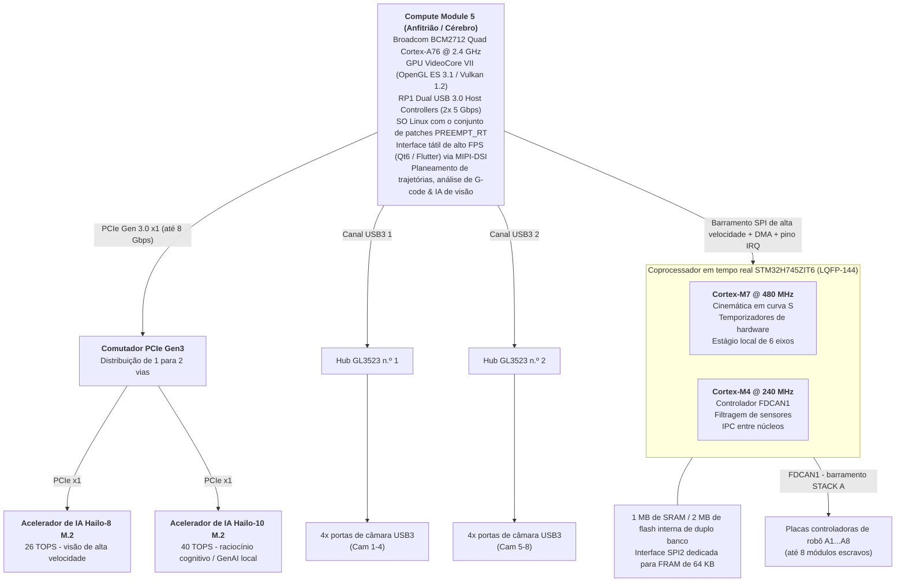
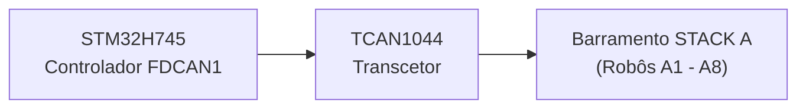
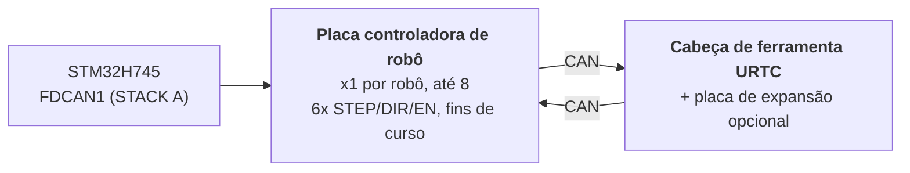

<p align="center">
  
</p>

# 🚀 ESPECIFICAÇÃO TÉCNICA DO HYDRA-UMC

<p align="center">
  <a href="README.md">🇺🇸 English</a> |
  <a href="README_spa.md">🇪🇸 Español</a> |
  <a href="README_fra.md">🇫🇷 Français</a> |
  <a href="README_ita.md">🇮🇹 Italiano</a> |
  <a href="README_deu.md">🇩🇪 Deutsch</a> |
  <a href="README_zho.md">🇨🇳 简体中文</a> |
  <a href="README_jpn.md">🇯🇵 日本語</a> |
  🇵🇹 <b>Português</b>
</p>

### 🤖 A plataforma definitiva de microfábrica de dois núcleos e controlador multirrobô (V1.0 - dois aceleradores de IA PCIe Hailo-8 + Hailo-10 e dois hubs USB 3.0)

<p align="center">
  
  
  
  
  
</p>


---

> **Estado de segurança (safety e security):** este ecossistema não é um sistema de segurança certificado. Ainda não existe um caminho de E-STOP por hardware, nem limites ou interlocks impostos pelo firmware, nem um comando de movimento verificado; as imagens de firmware são verificadas com CRC32 e um HMAC-SHA256 de chave partilhada, não com uma assinatura assimétrica; TLS e TLS mútuo são opcionais e estão desativados por defeito; nenhuma placa própria foi ainda montada ou testada. Leia a [base de segurança](https://github.com/JuanenRac/HYDRA-UMC-DOCS/blob/main/docs/SECURITY_BASELINE.md) e o [modelo de ameaças](https://github.com/JuanenRac/HYDRA-UMC-DOCS/blob/main/docs/THREAT_MODEL.md) antes de confiar em qualquer afirmação aqui para a segurança de uma pessoa.

## 📋 Num relance

| | |
|---|---|
| Versão | `0.2.2` |
| Maturidade | Estrutura inicial |
| Tecnologia | STM32H745 (dual-core) / STM32G474 / FreeRTOS (AMP) / CMSIS-DSP / FDCAN (classic CAN mode) |
| Destino | Uma placa com microcontrolador (o firmware); compila-se num PC |
| Em hardware real | Ainda não: não há registo de execução em hardware real para esta versão |

## 1. 🛠️ VISÃO GERAL DO PROJETO E O ECOSSISTEMA DA MICROFÁBRICA

O **HYDRA-UMC** (Universal Machines Controller) é uma plataforma de controlo distribuído e uma arquitetura HMI, ainda numa fase inicial no firmware, concebidas para robótica celular multieixo, microfábricas, fabrico automatizado e orquestração complexa de cabeças de ferramenta.

Concebido como uma **arquitetura heterogénea de anfitrião + coprocessador em tempo real**, o HYDRA-UMC destina-se a separar a renderização da interface de alto nível, a visão por computador, a inferência de IA e a ligação à nuvem da geração de passos em tempo real, da gestão do barramento de campo e do acionamento da eletrónica de potência (previsto: a geração de passos e o acionamento ainda não estão escritos).

> **Estado do desenho:** as secções seguintes descrevem o desenho previsto da placa e do seu firmware. O que existe hoje limita-se aos bootloaders, às aplicações de comunicação do CM4 e do G474 e à ponte SPI do lado do CM5 (ver a caixa *Estado de segurança* perto do fim e a tabela de estado em `docs/architecture.md`). Sempre que uma frase abaixo falar no presente de geração de movimento, perfis em S, laços PID, interlocks de segurança, um E-STOP, tratamento de perda de energia, deteção de objetos ou qualquer outro comportamento da placa final, deve ler-se como previsto: nada disso foi executado numa placa montada.



### 🤖 Capacidades da microfábrica (objetivos de desenho):
* 📡 **Rede distribuída multirrobô:** previsto: coordenar até 8 módulos robóticos escravos distribuídos (primeiro 3, 4, 5 e 6 GDL; com escala para 7, 8, 9 GDL e arquiteturas de duplo robô em versões futuras) ligados por um único barramento CAN físico.
* 🧠 **Coprocessamento neuronal duplo integrado:** um comutador PCIe Gen3 a bordo reparte a única via PCIe do CM5 por 2 aceleradores de IA M.2: um Hailo-8 (26 TOPS) que executa deteção de objetos YOLOv8/YOLO11 (previsto; ainda não em execução) em vários fluxos, inspeção de defeitos e alinhamento de fiduciais PnP em tempo real nas 8 câmaras, e um Hailo-10 (40 TOPS) que executa localmente, no próprio dispositivo, raciocínio cognitivo e GenAI (modelos LLM/VLA quantizados) sem ir à nuvem.
* 📐 **Estágio local de 6 eixos:** geração direta de pulsos step/dir/enable para 6 eixos locais (X, Y1, Y2, Z, E0, E1) para necessidades auxiliares: robôs adicionais, revólveres ATC (trocador automático de ferramentas), sincronização de tapete rolante ou pórticos de mesa XYZ.
* 🎯 **Integração JuanenPNP e JuanenCNC:** compatível diretamente com sistemas Pick-and-Place (estruturas de hardware LumenPNP) e unidades CNC equipadas com módulos laser ópticos de 10 W para prototipagem de PCB e colocação de SMD.
* 👁️ **Matriz de visão e inspeção com oito câmaras:** controladores USB 3.0 duplos integrados que alimentam 8 portas de câmara USB dedicadas para alinhamento ótico pick-and-place com OpenCV em tempo real, inspeção térmica e monitorização remota de transmissões.
* ⚡ **Matriz de atuação e gestão térmica:** controla 16 canais MOSFET industriais low-side (8 eletroválvulas pneumáticas + 8 bombas de vácuo/geradores venturi) e drivers de cama de alta corrente para soldadura por refusão SMD ou camas de impressão 3D.
* 🚜 **Plataformas móveis JuanenBOT:** arquitetura de comunicação escalável capaz de se ligar a plataformas de transporte robustas de 4 rodas e 48 V (estruturas de 50x50x50 cm com rodas omnidirecionais/mecanum para cargas de 100 kg).

---

## 2. 🖥️ SUBSISTEMA DE COMPUTAÇÃO ANFITRIÃO (HMI E ALTO NÍVEL)

* 🧩 **Módulo:** Raspberry Pi Compute Module 5 (CM5)
* ⚙️ **Processador:** Broadcom BCM2712 Quad-Core ARM Cortex-A76 @ 2.4 GHz
* 🎮 **Motor gráfico:** GPU VideoCore VII (OpenGL ES 3.1, Vulkan 1.2)
* 💾 **Memória do sistema:** 2 GB / 4 GB LPDDR4X (integrada no CM5)
* 💽 **Armazenamento de alta velocidade:** flash eMMC integrada
* 🐧 **Sistema operativo:** Linux de 64 bits (Raspberry Pi OS / Yocto com patch `PREEMPT_RT`)
* 📺 **Interface de ecrã:** MIPI-DSI (2 vias / 4 vias) ligada a um painel tátil capacitivo de alta resolução (interface ao estilo Bambu Lab a 60 FPS)
* 🌐 **Conjunto de conectividade:**
  * 🌐 1x Gigabit Ethernet (RJ45) para LAN industrial / transmissão de vídeo RTSP / WebSockets / MQTT
  * 📶 Wi-Fi 6 e Bluetooth 5.4
  * 📷 **8x portas de visão USB 3.0 / 2.0:** controladas por dois controladores Genesys Logic GL3523 a bordo.
  * 🎮 **2x portas HID USB 2.0:** gamepad / rato / teclado - ver a secção 4a.

---

## 3. 🧠 SUBSISTEMA DE ACELERADORES DE IA PCIE (DUPLO NPU HAILO-8 + HAILO-10)

* 🔀 **Distribuição PCIe:** o conector do CM5 expõe apenas **uma** via PCIe Gen 2.0/3.0 x1 (confirmado na Tabela 5 da folha de dados do CM5, `docs/PINOUT_CM5_CARRIER.TXT`), insuficiente para ligar 2 aceleradores de IA M.2 diretamente. Um comutador de pacotes PCIe Gen3 a bordo (candidato: família ASMedia ASM2806 ou equivalente, peça exata por definir; Gen3 especificamente, para que a ligação do Hailo-10 não fique limitada abaixo da sua velocidade nativa) reparte essa única via do lado do CM5 por 2 vias PCIe x1 independentes a jusante, uma por cada ranhura M.2 abaixo.
* 🔌 **Interfaces físicas:** 2x ranhuras M.2 Key M a bordo (formatos 2242 / 2280), cada uma ligada à sua própria porta a jusante do comutador PCIe acima, e não diretamente ao CM5.
* 🚀 **Motor NPU 1 - Hailo-8 (perceção de alta velocidade):** processador de IA industrial Hailo-8 que entrega **26 TOPS** (Tera Operações Por Segundo) com um consumo inferior a 5 W. Executa deteção de objetos YOLOv8/YOLO11 (previsto; ainda não em execução) em vários fluxos, inspeção de defeitos e alinhamento de fiduciais PnP em tempo real nas 8 câmaras (secção 4); é o acelerador já existente, sem mudar de papel.
* 🧠 **Motor NPU 2 - Hailo-10 (raciocínio cognitivo / GenAI local):** acrescentado ao lado do Hailo-8, não em substituição. Com **40 TOPS**, executa modelos LLM e Visão-Linguagem-Ação (VLA) quantizados de forma local e privada: traduz instruções do operador em linguagem natural/voz para trajetórias cinemáticas e trata da recuperação semântica de erros quando um robô falha uma tarefa, sem ida e volta a qualquer serviço externo na nuvem. É o mesmo papel cognitivo já estabelecido para o Hailo-10 no resto do ecossistema HYDRA-UMC (o projeto irmão HYDRA-UMC-COGNITIVE-NODE).
* ⚡ **Integração de software:** o conjunto de software oficial Hailo RT integrado com o Raspberry Pi OS para ambos os aceleradores, que executa pipelines GStreamer/TAPPAS e OpenCV para a inferência de visão do Hailo-8 sem custo de CPU; a integração do runtime LLM/VLA do Hailo-10 ainda está em fase de desenho (ver `src/cm5_host/ai_inference/README.md`).
* ⚠️ **Ponto em aberto:** o número de peça exato do comutador PCIe e o consumo real do Hailo-10 continuam por definir; ver os itens 05 e 09 de `hardware/PCB/kinematic_brain_stm32h745/BOM.TXT`.

---

## 4. 📷 SUBSISTEMA DE VISÃO USB 3.0 DUPLO (8x PORTAS DE CÂMARA)

* 🎛️ **Controladores de hub:** 2x CI de hub USB 3.0 / SuperSpeed Genesys Logic `GL3523` integrados diretamente na placa-mãe.
* 🔀 **Topologia e distribuição:**
  * 🅰️ **Hub n.º 1 (`GL3523-A`):** ligado ao PHY SuperSpeed USB3-0 nativo do CM5 (5 Gbps). Alimenta as portas USB 1 a 4 (câmaras A1-A4).
  * 🅱️ **Hub n.º 2 (`GL3523-B`):** ligado ao PHY SuperSpeed USB3-1 nativo do CM5 (5 Gbps). Alimenta as portas USB 5 a 8 (câmaras A5-A8).
  * ℹ️ O CM5 expõe diretamente estes 2 PHY SuperSpeed (BCM2712); não intervém nenhum chip RP1 auxiliar (o RP1 é específico da placa Raspberry Pi 5, não do CM5). Encaminhamento completo dos sinais ao nível dos pinos: `docs/PINOUT_CM5_CARRIER.TXT`.
* 🛡️ **Interruptor de potência e proteção de circuito:** proteção individual do VBUS USB com interruptores de potência high-side com limitação de corrente (`TPS2065` / `SY6280`) configurados para 500 mA - 1 A com comunicação de falhas.
* ⚡ **Linha VBUS de alta corrente:** alimentada por um regulador redutor dedicado de 24 V para 5 V (5 V @ 6 A contínuos).

### 4a. 🎮 SUBSISTEMA HID USB 2.0 (2x PORTAS PARA GAMEPAD / RATO / TECLADO)

* 🎛️ **Controlador de hub:** 1x pequeno CI de hub USB 2.0 (p. ex. Genesys Logic `GL850G` / `FE1.1s`, por definir) que reparte o único PHY USB 2.0 nativo do CM5 por 2 portas físicas.
* ℹ️ **Porque é preciso um hub:** a folha de dados do CM5 (`docs/datasheets/Raspberry Pi CM5.pdf`, §2.5) confirma que o BCM2712 expõe exatamente **uma** porta USB 2.0 (High Speed) no conector DF40 (`USB_N`/`USB_P`, pinos 103/105), separada e distinta dos 2 PHY USB 3.0 SuperSpeed nativos já dedicados aos hubs de câmaras GL3523 (secção 4). Um único par físico não se pode dividir em 2 portas sem um hub no meio.
* 🔀 **Topologia:** `USB_N`/`USB_P` (CM5) -> porta ascendente do hub -> 2x portas USB 2.0 Tipo-A a jusante (painel frontal/lateral, para um gamepad, rato ou teclado: controlo manual de jog/teach-pendant e entrada HMI, independentes do ecrã tátil).
* 📌 Encaminhamento completo dos sinais ao nível dos pinos: `docs/PINOUT_CM5_CARRIER.TXT`, secção 1.

---

## 5. ⚡ SUBSISTEMA DE COPROCESSAMENTO EM TEMPO REAL (DESENHO)

* 🎛️ **Microcontrolador:** STMicroelectronics **STM32H745ZIT6** (MCU de dois núcleos com custo otimizado)
* 📦 **Encapsulamento:** LQFP-144 (passo de pino de 0,5 mm)
* 🧠 **Arquitetura:** multiprocessamento assimétrico (AMP) de dois núcleos
  * 🚀 **Núcleo 1 (Cortex-M7 @ 480 MHz):** previsto: motor de movimento em tempo real, geração de pulsos por hardware, perfis de velocidade em curva S e laços de controlo PID. Hoje a sua aplicação é apenas um teste de fumo que comuta um GPIO.
  * 📡 **Núcleo 2 (Cortex-M4 @ 240 MHz):** a gestão do protocolo FDCAN1 em modo CAN clássico e a caixa de correio entre núcleos existem (nunca executadas numa placa); previstos e não implementados: filtragem de sensores analógicos e interlocks de segurança.
* 💾 **Arquitetura de memória interna:**
  * 💾 **2 MB** de flash interna de duplo banco
  * 🧠 **1 MB** de SRAM interna total (512 KB de SRAM AXI + 128 KB ITCM / 128 KB DTCM + SRAM1/SRAM2/SRAM3)
* 🧵 **RTOS:** **FreeRTOS**, uma instância independente por núcleo (AMP, não SMP: sem estado de escalonador partilhado entre o Núcleo 1 e o Núcleo 2). `src/mcu_stm32h745/`: o Núcleo 2 (CM4) já executa uma aplicação real de mestre FDCAN1 "STACK A" (`CM4/STM32H745ZI_CM4_main.c`); o `main()` do Núcleo 1 (CM7) ainda chama o antigo marcador sem função; ver `docs/architecture.md`, secção 2.

---

## 6. 📡 COMUNICAÇÃO DE BARRAMENTO DE CAMPO DISTRIBUÍDO (BARRAMENTO CAN ÚNICO; PERIFÉRICO FDCAN EM MODO CLÁSSICO)

A placa-mãe atua como controlador mestre de até 8 módulos robóticos escravos individuais distribuídos por um único barramento CAN físico:

* 🔌 **Periférico de hardware:** 1x controlador FDCAN nativo (`FDCAN1`) integrado no STM32H745, executado em **modo CAN clássico** (`FDCAN_FRAME_CLASSIC`, `BRS_OFF`) pela implementação real do bootloader: o periférico é silício compatível com FD, mas o protocolo CAN-OTA/SPI-OTA que este projeto fala hoje (`docs/CANBUS_STM32H745.TXT`, `docs/CANBUS_STM32G474.TXT`) usa apenas tramas clássicas (DLC máximo 8), como todos os outros níveis (placas controladoras de robô G474, URTC). As cargas BRS maiores, de 64 bytes, do CAN FD são folga real de hardware para mais tarde, não algo que o protocolo use já.
* ⚡ **Transcetor da camada física:** 1x transcetor CAN FD de alta velocidade (p. ex. TI `TCAN1044AVD` / NXP `TJA1443`); hardware compatível com FD escolhido pela mesma razão de folga futura que o periférico acima, mesmo que o tráfego de hoje sejam tramas clássicas.
* 🔀 **Topologia do barramento:**
  * 🅰️ **STACK A (`FDCAN1`):** serve os módulos escravos A1 a A8.
* ⏱️ **Especificações do protocolo:** taxa nominal de ~1 Mbps (CAN clássico, carga máxima de 8 bytes por trama). Está previsto que o Cortex-M4 gira a recuperação automática de bus-off, mas ainda não está implementada; a aplicação CM4 de hoje (`src/mcu_stm32h745/CM4/STM32H745ZI_CM4_main.c`) já executa uma tarefa de mestre FDCAN1 "STACK A" real (consultas `AXIS_STATUS` em rodízio por todas as 8 ranhuras, ver `KinematicBrainCan.c`) mais a renovação do watchdog, mas a recuperação de bus-off em concreto continua a ser trabalho futuro real e não uma capacidade entregue.
* 🔌 **Conector físico:** conector/ficha EMPILHÁVEL de 40 pinos e passo de 2,54 mm (+24 V ×10 pinos, GND ×10 pinos, +5 V ×4 pinos auxiliares, FDCAN1 H/L, `BOARD_PRESENT_N`, 13 de reserva): as 8 placas controladoras de robô EMPILHAM-SE fisicamente umas sobre as outras num dos lados desta placa (topologia CONFIRMADA, não um backplane), e cada placa passa diretamente os 40 sinais para o que se montar por cima. O endereçamento da ranhura é um interruptor DIP LOCAL por placa (`BOARD_ID[2:0]`, README.md secção 12), não derivado deste conector. Tabela completa de pinos e topologia da pilha em `docs/PINOUT_STACKA_CONNECTOR.TXT`. Definição de conector idêntica na porta do próprio Cérebro Cinemático e no par de portas de cada placa controladora de robô.



---

## 7. 💾 MEMÓRIA NÃO VOLÁTIL ULTRARRÁPIDA (FRAM SPI)

Objetivo de desenho (ainda não implementado): zero perda de dados e recuperação instantânea do estado durante falhas de energia de emergência:

* 🧪 **CI de memória:** Cypress/Infineon `FM25V05-G` / Fujitsu `MB85RS64` (FRAM SPI de 64 KB)
* ⚡ **Interface de barramento:** barramento SPI2 dedicado até 40 MHz.
* ♾️ **Durabilidade:** resistência infinita (10^14 ciclos) com latências de escrita de nanossegundos.
* 🛡️ **Sequência anti-perda de energia (PVD), prevista:** o detetor interno de tensão de alimentação (PVD) vigia a linha de 3,3 V. Ao detetar uma queda de tensão, uma interrupção não mascarável (NMI) guarda na FRAM os vetores dos codificadores, as máquinas de estados ativas e as coordenadas em menos de **5 microssegundos** antes de a alimentação se desligar.

---

## 8. 🦾 CONJUNTO LOCAL DE MOVIMENTO, ATUAÇÃO E SENSORES

### ⚙️ Saídas de movimento
* 🎯 **Eixos suportados:** estágio local de 6 eixos: pórtico de duplo Y + eixos de ferramenta (`X`, `Y1`, `Y2`, `Z`, `E0`, `E1`), acionados por 6x drivers de motor de passo TMC5160A numa cadeia daisy-chain SPI.
* ⚡ **Sinais:** CMOS de 3,3 V (`STEP`, `DIR`, `ENABLE`), cadeia daisy-chain SPI4 partilhada para os 6 drivers.
* ⏱️ **Temporizadores:** temporizadores de controlo avançado (`TIM1` para X/Y1/Y2/Z, `TIM8` para E0/E1) com geração de pulsos por hardware.
* 🛑 **Fins de curso:** 12x entradas, 2 por eixo (MIN + MAX).
* 📌 Atribuição completa de pinos: `docs/PINOUT_STM32H745_KINEMATIC_BRAIN.TXT`.

### 🔌 Atuadores de potência e fluídicos
* 🔀 **20x canais de comutação low-side:** saídas MOSFET de canal N industriais com proteção contra retorno (flyback).
  * 🧲 **8+2 canais:** bombas de vácuo / geradores Venturi de Pick-and-Place.
  * 💨 **8+2 canais:** eletroválvulas pneumáticas (atuação a 5 V/24 V).
* 💨 **Ventoinhas:** 3x ventoinhas de 3 fios (alimentação comutada por PWM através de MOSFET low-side + leitura de tacómetro por canal).
* 🌡️ **Gestão térmica:**
  * 🔥 1x saída de controlo de relé de estado sólido para a cama aquecida, que comuta a **rede de 230 V CA**, opto-isolada dos domínios de MCU/lógica; é um circuito de tensão de rede e exige distâncias reais de fuga e isolamento na PCB, não uma pegada de barramento de 24 V.
  * 🌡️ 2x entradas analógicas de termístor NTC de precisão (cama aquecida) amostradas pelo `ADC1`.

---

## 9. 🔌 DISTRIBUIÇÃO E REGULAÇÃO DE ENERGIA

A placa funciona a partir de um único barramento de alimentação industrial de **24 V CC**:

* ⚡ **Entrada principal CC:** 24 V CC ±10 %
* 🔋 **Domínio de energia principal de 5 V:** regulador buck síncrono redutor que fornece **5 A contínuos** ao módulo CM5, à retroiluminação do ecrã tátil e à lógica a bordo.
* 📷 **Domínio de energia VBUS USB de 5 V:** regulador buck síncrono dedicado que fornece **6 A contínuos** exclusivamente às 8 portas de câmara USB 3.0 e aos controladores de hub GL3523.
* 🎛️ **Domínio de energia de 3,3 V:** regulador de baixo ruído que fornece **4 A contínuos** (dimensionado para o STM32, a FRAM, os transcetores, o comutador PCIe (secção 3) e as linhas de 3,3 V de ambas as ranhuras M.2 - Hailo-8 + Hailo-10). Este orçamento tem de ser revisto contra o valor de 4 A quando se confirmar o consumo real de ambos os módulos M.2 (o Hailo-8 tem menos de 5 W; o valor do Hailo-10 continua por definir); pode ter de crescer acima de 4 A; ver o item 09 de `hardware/PCB/kinematic_brain_stm32h745/BOM.TXT`.

---

## 10. 🔄 COMUNICAÇÃO ENTRE PROCESSADORES (IPC)

A comunicação entre o CM5 (anfitrião) e o STM32H745 (coprocessador) usa uma ligação SPI assistida por hardware e sem cópias:

* 🔗 **Transporte físico:** SPI1 full-duplex, concebido até 50 MHz em modo escravo no STM32 e modo mestre no CM5; o controlador real do lado do CM5 (`src/cm5_host/ipc_driver/src/ipc_driver.c`) assume hoje por omissão um valor prudente de 10 MHz, porque a configuração de modo/ordem de bits do escravo SPI1 do STM32H745 com que tem de coincidir ainda não foi verificada em hardware real.
* 🤝 **Linha de handshake:** linha GPIO `HYDRA_DATA_READY`.
* ⚡ **Fluxo de execução:** o Cortex-M4 prepara uma trama de telemetria de 128 bytes na SRAM AXI partilhada, ativa `HYDRA_DATA_READY` e o CM5 obtém o pacote por SPI DMA de alta velocidade sem custo de polling.

---

## 11. 🎛️ ESPECIFICAÇÕES DE HARDWARE DA PCB DE 4 CAMADAS

* 📐 **Formato:** placa-mãe industrial monolítica.
* 🥞 **Empilhamento de camadas (4 camadas):**
  * 🟢 **Camada 1 (superior):** colocação de componentes, sinais de alta frequência, pares diferenciais USB SuperSpeed de 90 ohm, pares PCIe Gen 3.0 de 85 ohm.
  * 🛡️ **Camada 2 (interna 1):** plano de massa sólido contínuo (`GND`).
  * ⚡ **Camada 3 (interna 2):** planos de alimentação divididos (`24V`, `5V_MAIN`, `5V_USB`, `3.3V`).
  * 🔴 **Camada 4 (inferior):** pistas de sinal secundárias e saídas de potência de alta corrente.
* 🛠️ **Conectores e montagem:**
  * 🔲 Encapsulamento LQFP-144 (passo de 0,5 mm) para o STM32H745, encapsulamentos QFN-88 para os 2 hubs GL3523 e 2 ranhuras M.2 Key M 2242/2280 (Hailo-8 + Hailo-10, secção 3) alimentadas por um comutador PCIe Gen3 a bordo.
  * 🔌 Dois conectores mezanino Hirose DF40 para o Compute Module 5.
  * 📌 Conector EMPILHÁVEL de 40 pinos e passo de 2,54 mm para a ligação do barramento STACK A (base da pilha física de placas controladoras de robô): `docs/PINOUT_STACKA_CONNECTOR.TXT`.
  * 🔌 8x conectores USB 3.0 Tipo-A (ou Hirose industriais com trava) para as câmaras dos robôs.

---

## 12. 🦾 PLACAS CONTROLADORAS DE ROBÔ E CABEÇA DE FERRAMENTA URTC (NÍVEL DISTRIBUÍDO)

Cada um dos até 8 módulos escravos do STACK A (secção 6) é uma **placa controladora de robô**: uma por robô, que aciona os 6 eixos desse robô (STEP/DIR/ENABLE), lê os seus fins de curso e reencaminha o tráfego da sua própria cabeça de ferramenta mais um salto por uma *segunda* ligação CAN até uma placa **URTC** (Universal Robot Tool Controller; ver o repositório irmão `URTC`) montada na cabeça do robô, opcionalmente com a sua própria placa de expansão.



* 🎛️ **MCU:** STMicroelectronics **STM32G474RET6** (Cortex-M4 @ 170 MHz, LQFP-64, 512 KB de flash), que usa 2 dos seus 3 periféricos FDCAN a bordo: um como ligação FDCAN ascendente para o STM32H745 e outro como ligação CAN descendente para a sua própria cabeça URTC. Ver `docs/architecture.md` §1.
* 🔢 **Endereçamento:** `BOARD_ID[2:0]`, um interruptor DIP local de 3 posições em cada placa, ajustado manualmente de 0 a 7 na instalação, dá a cada placa o seu próprio ID base de ranhura FDCAN1; não se deriva da posição física na pilha nem do conector STACK A (todas as placas são a mesma PCB intercambiável). Ver `docs/PINOUT_STM32G474_ROBOT_CONTROLLER.TXT` §1c.
* 🧵 **RTOS:** **FreeRTOS** (o seu bootloader continua a ser bare-metal: não precisa de escalonador para receber/verificar/saltar). Aplicação real: `src/mcu_stm32g474/STM32G474RE_main.c` executa uma tarefa de relé real (`RobotControllerRelay.c`: ligação descendente FDCAN2 para a cabeça de ferramenta URTC, um respondedor de `AXIS_STATUS` e o túnel `RELAY_SEND`/`RELAY_RECV`) ao lado da tarefa que pisca e renova o watchdog.
* 📡 **Atualizações de firmware CAN-OTA, 4 níveis de profundidade:** o próprio STM32H745 (pela sua ligação SPI existente ao CM5), esta placa, a sua cabeça de ferramenta URTC (STM32F303CCT6) e, só quando está instalada, a placa de expansão avançada dessa cabeça (STM32F303CBT6, `expansion_board_type` 3 ou 4, ver o `docs/EXPANSION.TXT` do URTC) podem ser gravados e diagnosticados a partir do Flasher/Tester do HYDRA-UMC-STUDIO, sem sonda JTAG/SWD nem dongle USB-CAN. O esquema de endereçamento completo, o túnel de relé que chega aos dois últimos níveis sem nenhum desenho de protocolo novo e o estado atual da implementação estão em `docs/architecture.md`.

Ver `docs/architecture.md` para a arquitetura completa por níveis (esta secção é um resumo), incluindo o que é facto de hardware confirmado e o que ainda é um desenho proposto à espera de implementação. A secção 8 desse documento regista também as limitações de segurança conhecidas e aceites dos bootloaders atuais (ainda sem proteção de leitura, um valor de bypass de anti-rollback partilhado, leitura de volta sem autenticação): lacunas deliberadas antes do hardware, não descuidos.

---

## 📂 ESTRUTURA DE DIRETORIAS DO REPOSITÓRIO

```text
HYDRA-UMC/
├── .vscode/                    # Extensões recomendadas + tarefas de build - ver "Ambiente de desenvolvimento" abaixo
├── docs/
│   ├── datasheets/             # Folhas de dados das peças usadas em todas as placas deste repositório
│   ├── architecture.md         # A arquitetura do sistema de 4 níveis (comece aqui)
│   ├── COMPILE_STM32G474.TXT   # Referência de compilação do firmware da placa controladora de robô
│   ├── COMPILE_STM32H745.TXT   # Referência de compilação do firmware do Cérebro Cinemático (dois núcleos)
│   ├── PINOUT_STM32H745_KINEMATIC_BRAIN.TXT    # Atribuição completa de pinos do Cérebro Cinemático
│   ├── PINOUT_STM32G474_ROBOT_CONTROLLER.TXT   # Atribuição completa de pinos da placa controladora de robô
│   ├── PINOUT_CM5_CARRIER.TXT                  # Encaminhamento de sinais do subsistema anfitrião CM5
│   ├── PINOUT_STACKA_CONNECTOR.TXT             # Conector de empilhamento STACK A de 40 pinos partilhado
│   ├── CANBUS_STM32H745.TXT                    # Protocolo ao nível do fio do Cérebro Cinemático (SPI1/mailbox/mestre FDCAN1)
│   ├── CANBUS_STM32G474.TXT                    # Protocolo ao nível do fio da placa controladora de robô (escravo FDCAN1/FDCAN2)
│   └── HYDRA-UMC_*.md/txt/TXT  # Documentos mais antigos - Markdown quando escritos em Markdown; ver o aviso de cada ficheiro
├── hardware/
│   ├── PCB/
│   │   ├── kinematic_brain_stm32h745/          # Placa-mãe principal - ainda sem esquema, ver o seu próprio README
│   │   └── robot_controller_board_stm32g474/   # Placa por robô - ainda sem esquema, ver o seu próprio README
│   └── gerbers/                # Ficheiros de saída de fabrico (vazio até haver uma placa desenhada)
├── src/                         # Mesma convenção de disposição do repositório irmão URTC: src/ é CÓDIGO-FONTE
│   ├── cm5_host/                # Aplicações Linux de espaço de utilizador que correm SOBRE a imagem de os/
│   │   ├── hmi_qt6/             # Shell de quiosque Qt6 que envolve o painel do HYDRA-UMC-STUDIO
│   │   ├── ai_inference/        # Pipeline Hailo-8 TAPPAS / YOLOv8
│   │   ├── video_streamer/      # Servidor RTSP/WebRTC multicâmara (MediaMTX)
│   │   ├── ipc_driver/          # Ligação CM5 <-> STM32H745 SPI (espaço de utilizador) - esqueleto em C inacabado, mantido como referência
│   │   └── spi_bridge/          # Bridge SPI-OTA real CM5<->STM32H745 (Python) - substitui ipc_driver/,
│   │                              adapta a máquina de estados de bootloader CRC32/HMAC já comprovada do URTC-FLASHER
│   ├── mcu_stm32h745/           # Firmware do Cérebro Cinemático (nível 0) - dois núcleos
│   │   ├── CM7/                 # Motor de movimento, temporizadores de hardware (+ o seu próprio boot/)
│   │   ├── CM4/                 # Controladores FDCAN, filtragem de sensores (+ o seu próprio boot/)
│   │   └── Common/              # Mailbox IPC de memória partilhada CM7<->CM4 (ipc_mailbox.h) - implementada, usada pelos bootloaders de ambos os núcleos
│   └── mcu_stm32g474/           # Firmware da placa controladora de robô (nível 1) - um só núcleo, + o seu próprio boot/
├── os/                          # Imagem do SO do CM5 - escolha do SO base, unidades systemd, aprovisionamento de primeiro arranque
├── images/                      # Banner do README + ícone + ecrã de arranque (SVG)
├── build_firmware.sh            # Constrói cada alvo de firmware MCU acima a partir de um checkout limpo (Linux/Mac)
├── build_firmware.bat           # O mesmo build, Windows (ver "Compilar o firmware" abaixo)
├── build-test.sh / build-test.bat # Verificação de compilação sem alterar versões
├── generate_manifest.py         # Regenera firmware/firmware_manifest.json (versões/CRC32) depois de um build completo
├── bump_version.py              # Subida de versão ao estilo conta-quilómetros, executada por build_firmware.sh/.bat
├── bump_manifest_version.py     # Sincroniza a versão de hydra-umc.project.json com a nativa (--sync)
├── tools/
│   ├── verify_firmware_inventory.py # Verificação só de leitura do inventário de seis componentes registado
│   ├── build_test.py                # Verificação de compilação sem alterar versões
│   └── ci_validate.py               # Validação de manifesto/CHANGELOG/documentos usada pelo CI
├── firmware/                    # Saída de build registada (.bin/.hex/.elf + manifesto) - NÃO está no gitignore, mesma convenção da pasta de saída do URTC, ver "Compilar o firmware" abaixo
├── README.md                    # Este ficheiro (em inglês)
└── README_spa.md / README_ita.md / README_fra.md / README_deu.md / README_zho.md / README_jpn.md / README_por.md    # <- traduções
```

Ver `docs/architecture.md` para o que cada nível faz realmente e como se ligam; cada pasta acima que tem o seu próprio `README.md` tem mais detalhe do que este resumo de topo.

## 🛠️ AMBIENTE DE DESENVOLVIMENTO

O que as máquinas de desenvolvimento deste projeto têm realmente instalado e verificado a funcionar (`build_firmware.sh`/`build_firmware.bat`, alvos `g474`/`h745`/por omissão, 0 erros), e não uma lista teórica:

* 🔧 **ARM GNU Toolchain** (`arm-none-eabi-gcc` 10.3+): compila todos os alvos de firmware MCU. Não se usa nem é preciso nenhum ficheiro de projeto STM32CubeIDE/CubeMX para compilar: `build_firmware.sh`/`build_firmware.bat` obtém de novo as fontes HAL/CMSIS da ST dos seus repositórios oficiais no GitHub e controla o compilador diretamente, a mesma filosofia que o `build_firmware.sh`/`build_firmware.bat` do repositório irmão `URTC` já estabeleceu.
* 🧩 **VS Code + extensões** (`.vscode/extensions.json` lista todas): [STM32 VS Code Extension](https://marketplace.visualstudio.com/items?itemName=stmicroelectronics.stm32-vscode-extension) (integração de projeto/build/depuração), **Cortex-Debug** (depuração SWD/JTAG; independente de `build_firmware.sh`, útil quando houver hardware real), **CMake Tools** (para o projeto CMake próprio de `src/cm5_host/hmi_qt6/`), **C/C++** (IntelliSense em todos os ficheiros de firmware/anfitrião), **Python** (scripts do pipeline de `ai_inference/`), **Hex Editor** (inspecionar a saída de firmware `.bin`), **YAML** (a configuração MediaMTX de `video_streamer/`). Abra o repositório, aceite o aviso de extensões recomendadas e use **Terminal → Run Task** para as tarefas de build já preparadas (`.vscode/tasks.json`).
* 🗂️ **git**: tanto para este próprio repositório como para a obtenção, por etiquetas fixadas, dos pacotes HAL/CMSIS da ST feita por `build_firmware.sh` (em cache em `build/`, no gitignore, obtidos de novo com `--clean`).

## 🏗️ COMPILAR O FIRMWARE

**Linux/Mac:**
```bash
./build_firmware.sh          # compila todos os alvos MCU (placa controladora de robô + Cérebro Cinemático, ambos os núcleos)
./build_firmware.sh g474     # só a placa controladora de robô
./build_firmware.sh h745     # só o Cérebro Cinemático (ambos os núcleos)
./build_firmware.sh --clean  # apaga primeiro a cache HAL/CMSIS obtida
```

**Windows:**
```bat
build_firmware.bat          :: compila todos os alvos MCU (placa controladora de robô + Cérebro Cinemático, ambos os núcleos)
build_firmware.bat g474     :: só a placa controladora de robô
build_firmware.bat h745     :: só o Cérebro Cinemático (ambos os núcleos)
build_firmware.bat --clean  :: apaga primeiro a cache HAL/CMSIS obtida
```

`build_firmware.bat` é o mesmo build que `build_firmware.sh` traduzido para batch (os mesmos passos, as mesmas versões HAL/CMSIS fixadas, o mesmo relatório de passa/aviso/falha); foi executado de ponta a ponta numa máquina Windows real com o [Arm GNU Toolchain](https://developer.arm.com/downloads/-/arm-gnu-toolchain-downloads) instalado e `arm-none-eabi-gcc` no `PATH`: cada módulo HAL, ambos os bootloaders e cada aplicação compilaram e ligaram sem erros, e o `firmware_manifest.json` foi regenerado com CRC32 iguais aos da saída do build Linux/Mac. Requer as mesmas ferramentas que o script Linux/Mac: o Arm GNU Toolchain, `git` (para obter as fontes HAL/CMSIS da ST) e `python` para o passo do manifesto.

**Build manual (em qualquer SO, sem o script):** o script automatiza exatamente os passos de `docs/COMPILE_STM32G474.TXT` e `docs/COMPILE_STM32H745.TXT`: obter as fontes HAL/CMSIS/FreeRTOS fixadas listadas no início de `build_firmware.sh`/`build_firmware.bat`, compilar os módulos HAL e os ficheiros de arranque/sistema de cada alvo com `arm-none-eabi-gcc` (as opções e listas de módulos estão nesse mesmo script), depois ligar cada bootloader e aplicação com o seu próprio script de ligação (`*.ld`, junto da sua fonte) com `arm-none-eabi-gcc`/`-Wl,--gc-sections` e converter com `arm-none-eabi-objcopy` para `.bin`/`.hex`. Esses dois ficheiros `docs/COMPILE_*.TXT` são a referência autorizada, passo a passo, se preferir não executar nenhum dos scripts: os scripts existem para os automatizar, não para os substituir como fonte de verdade.

A saída fica em `firmware/`, que é registada e enviada a este repositório (a mesma convenção da pasta `firmware/` de saída do URTC) para que a funcionalidade de descarga do GitHub do HYDRA-UMC-STUDIO consiga realmente encontrar aí ficheiros `.bin` reais através de `firmware_manifest.json`; NÃO está no gitignore. Ver `docs/COMPILE_STM32G474.TXT` e `docs/COMPILE_STM32H745.TXT` para saber exatamente o que faz cada passo e porquê, e o `README.md` de cada pasta de firmware para o estado atual. Os **bootloaders** dos 3 alvos (G474, H745 CM7, H745 CM4) são implementações CAN-OTA/SPI-OTA reais e funcionais (verificação CRC32 + HMAC-SHA256 na cópia de segurança antes de copiar para a principal, a mesma disciplina anti-brick do bootloader do URTC), que compilam sem erros de ponta a ponta, ainda não verificadas em hardware real. As **aplicações** continuam a ser testes de fumo FreeRTOS que só alternam GPIO e compilam, ainda não o firmware real de movimento/visão/relé. Ver `docs/architecture.md` (em especial a tabela de estado da secção 6 e as limitações de segurança conhecidas e aceites da secção 8) para saber exatamente o que é real e o que continua em aberto.

> **Estado de segurança:** este repositório ainda não contém nenhum caminho de E-STOP, limites por software, interlocks de segurança, o despejo para a FRAM em caso de perda de energia (PVD) nem qualquer comando de movimento. Onde as secções acima (ou outro projeto do ecossistema) os descrevem, trata-se do desenho previsto: nada deve depender deles para a segurança até estarem implementados e testados numa placa real. O que as aplicações fazem hoje: as do CM4 e do G474 executam a sondagem/resposta AXIS_STATUS da STACK A e o túnel de relé Tier 2/3; a do CM7 continua a ser um teste de fumo com GPIO-toggle.

## 🔢 Versionamento

Os 6 componentes de firmware (3 bootloaders + 3 aplicações: o STM32G474 da placa controladora de robô, o CM7 do Cérebro Cinemático e o CM4 do Cérebro Cinemático, um par bootloader/aplicação por chip/núcleo) têm versões incrementais: `build_firmware.sh`/`.bat` sobe exatamente 1 ao PATCH desse componente imediatamente antes de o compilar, através de `bump_version.py`, de modo que cada build real que produz um binário novo para um componente leva incorporada a sua própria versão nova: nunca escrita à mão, nunca capaz de se desalinhar do que realmente foi compilado. Regra de transporte (um "conta-quilómetros"): o PATCH além de 9 volta a 0 e o MINOR sobe 1 (p. ex. `1.1.9` -> `1.2.0`, nunca `1.1.10`); o MINOR além de 9 passa para o MAJOR da mesma forma. Ver o `bootloader_common.h` de cada componente e o comentário de cabeçalho de `bump_version.py` para o mecanismo completo.

## 🔗 Projetos relacionados

Este projeto faz parte do ecossistema de robótica HYDRA-UMC do mesmo autor (JuanenRac / Electro Hobby 3D). Vale a pena conhecê-los, porque um pedido pode ser, na verdade, sobre um destes e não sobre este repositório.

**Diretamente relacionados** — projetos que se ligam diretamente a este firmware
- **[URTC](https://github.com/JuanenRac/URTC)** — firmware da placa física Universal Robot Tool Controller, mais de 25 perfis de ferramenta por barramento CAN; o firmware da cabeça de ferramenta que monta cada braço robótico que esta placa aciona, um salto mais além pela sua própria ligação CAN descendente.
- **[HYDRA-UMC-OS](https://github.com/JuanenRac/HYDRA-UMC-OS)** — camada de produto reproduzível do Raspberry Pi OS para o CM5: agente só de leitura, configuração/perfis validados, aprovisionamento Wi-Fi de primeiro contacto; o SO em que corre o anfitrião CM5 desta placa.
- **[HYDRA-UMC-SERVER](https://github.com/JuanenRac/HYDRA-UMC-SERVER)** — o verdadeiro backend sem interface (REST/WebSocket) com que falam todos os clientes de controlo; o seu serviço `spi_bridge` fala com este firmware pela ligação SPI-OTA real CM5↔STM32H745.
- **[HYDRA-UMC-VISION-NODE](https://github.com/JuanenRac/HYDRA-UMC-VISION-NODE)** — centro de integração do pipeline de visão Hailo-8, com uma verificação real de prontidão de hardware por fase; ainda não existe um laço de perceção/E-STOP com este firmware.
- **[HYDRA-UMC-SAFETY-ZONES](https://github.com/JuanenRac/HYDRA-UMC-SAFETY-ZONES)** — lógica v0 de violação de zonas, atualidade da calibração e pedido de E-STOP que lê as posições dos objetos de um ficheiro; nenhum detetor a alimenta e ainda não há E-STOP físico ligado.
- **[HYDRA-UMC-VISUAL-SERVOING-API](https://github.com/JuanenRac/HYDRA-UMC-VISUAL-SERVOING-API)** — lei de correção de servovisão baseada em posição com autorização condicionada ao estado da zona; ainda sem estimativa de pose por câmara.
- **[HYDRA-UMC-ORCHESTRATOR](https://github.com/JuanenRac/HYDRA-UMC-ORCHESTRATOR)** — centro de integração com um contrato real de relatório de saúde gRPC/Protobuf e uma máquina de estados de missões; coordena várias unidades HYDRA-UMC como um enxame.
- **[HYDRA-UMC-TWIN](https://github.com/JuanenRac/HYDRA-UMC-TWIN)** — centro de integração do motor de gémeo digital, com um contrato real de sincronização de compatibilidade de versões; pensado para replicar a cinemática deste firmware quando existir.
- **[URTC-SMART-RACK](https://github.com/JuanenRac/URTC-SMART-RACK)** — firmware de um rack de montagem de placas com descodificação real do ID da ferramenta e lógica de pré-aquecimento Smart Idle; partilha o mesmo barramento CAN de ferramentas que este firmware.
- **[URTC-VISION-TOOL](https://github.com/JuanenRac/URTC-VISION-TOOL)** — firmware mais um companheiro de visão em Python real para uma cabeça de ferramenta de inspeção térmica/RGB; partilha o mesmo barramento CAN de ferramentas que este firmware.

**Também fazem parte do ecossistema**

*Hardware e plataforma centrais*
- **[HYDRA-UMC-SDK](https://github.com/JuanenRac/HYDRA-UMC-SDK)** — o contrato JSON-Schema partilhado e a fronteira de software de controlo de trabalhos contra a qual cada bridge valida os seus comandos (não é uma função de segurança certificada).
- **[HYDRA-UMC-CONNECTOR-HUB](https://github.com/JuanenRac/HYDRA-UMC-CONNECTOR-HUB)** — registo declarativo de manifestos de adaptador e validador para conectores de máquinas externas; estende a ideia de contrato do SDK a máquinas externas sem substituir os projetos de gateway industrial.

*Backend central e clientes*
- **[HYDRA-UMC-STUDIO](https://github.com/JuanenRac/HYDRA-UMC-STUDIO)** — painel web de controlo com visualização 3D em tempo real de vários robôs.
- **[HYDRA-UMC-SUITE](https://github.com/JuanenRac/HYDRA-UMC-SUITE)** — centro de comando de enxame para desktop (PySide6) para vários servidores ao mesmo tempo, empacotado como executável independente.
- **[HYDRA-UMC-ANDROID-CONTROL](https://github.com/JuanenRac/HYDRA-UMC-ANDROID-CONTROL)** — aplicação Android nativa de controlo, com início de sessão biométrico e um companheiro Wear OS emparelhado.
- **[HYDRA-UMC-IOS-CONTROL](https://github.com/JuanenRac/HYDRA-UMC-IOS-CONTROL)** — aplicação de controlo para iOS/iPadOS (Flutter) com sincronização WebSocket em tempo real.
- **[HYDRA-UMC-DSI](https://github.com/JuanenRac/HYDRA-UMC-DSI)** — interface tátil nativa para o ecrã tátil DSI de 7" integrado, executada no próprio CM5.
- **[HYDRA-UMC-EDITOR-URDF](https://github.com/JuanenRac/HYDRA-UMC-EDITOR-URDF)** — criador/editor gráfico de URDF para desktop que envia os modelos concluídos para o catálogo do STUDIO.
- **[HYDRA-UMC-EDITOR-STL](https://github.com/JuanenRac/HYDRA-UMC-EDITOR-STL)** — editor de modelos STL para desktop que transforma/substitui/remove/adiciona peças reais no mesmo catálogo de modelos que o HYDRA-UMC-EDITOR-URDF também edita.
- **[HYDRA-UMC-BRIDGE-AMR](https://github.com/JuanenRac/HYDRA-UMC-BRIDGE-AMR)** — fronteira de coordenação para frotas AGV/AMR através de um publicador MQTT VDA 5050 (testado apenas contra uma frota emulada).
- **[HYDRA-UMC-BRIDGE-CNC](https://github.com/JuanenRac/HYDRA-UMC-BRIDGE-CNC)** — coordenador de células CNC de alto nível com acesso ao estado GRBL e aos bytes de controlo (testado apenas contra um emulador).
- **[HYDRA-UMC-BRIDGE-DROIDS](https://github.com/JuanenRac/HYDRA-UMC-BRIDGE-DROIDS)** — fronteira de coordenação para droides com patas/humanoides, com um emissor de comandos para o Boston Dynamics Spot (testado apenas contra um emulador).
- **[HYDRA-UMC-BRIDGE-LASER](https://github.com/JuanenRac/HYDRA-UMC-BRIDGE-LASER)** — coordenador de células laser que lê 3 sinais GPIO (chave, caixa e interlock) (testado apenas contra um chip simulado; não pode armar nem disparar um laser).
- **[HYDRA-UMC-BRIDGE-OPENPNP](https://github.com/JuanenRac/HYDRA-UMC-BRIDGE-OPENPNP)** — coordenador seguro de fluxo de placa de alto nível para pick-and-place com OpenPnP.
- **[HYDRA-UMC-BRIDGE-PRINTER3D](https://github.com/JuanenRac/HYDRA-UMC-BRIDGE-PRINTER3D)** — fronteira de coordenação segura para impressoras 3D Moonraker/Klipper, com comandos de trabalho reais protegidos por portas.
- **[HYDRA-UMC-BRIDGE-ROS2](https://github.com/JuanenRac/HYDRA-UMC-BRIDGE-ROS2)** — coordenador com um transporte ROS 2 baseado em rclpy importado sob demanda (ainda não executado contra uma instalação ROS 2).
- **[HYDRA-UMC-BRIDGE-UAV](https://github.com/JuanenRac/HYDRA-UMC-BRIDGE-UAV)** — fronteira de coordenação para UAV com câmara, com um emissor de comandos MAVLink (testado apenas contra um emulador).

*Plataforma de ferramentas URTC*
- **[URTC-FLASHER](https://github.com/JuanenRac/URTC-FLASHER)** — ferramenta gráfica de gravação para desktop das placas URTC, por CAN-OTA e também SWD/JTAG de chip completo.
- **[URTC-TESTER](https://github.com/JuanenRac/URTC-TESTER)** — ferramenta de diagnóstico CAN em tempo real para desktop das placas URTC, com um painel por perfil de ferramenta.
- **[URTC-WEB-STUDIO](https://github.com/JuanenRac/URTC-WEB-STUDIO)** — alternativa no navegador ao URTC-TESTER através da Web Serial API, sem instalação local.

*Nó de IA de visão (Hailo-8)*
- **[HYDRA-UMC-DETECTION-HEF](https://github.com/JuanenRac/HYDRA-UMC-DETECTION-HEF)** — registo real de modelos compilados com verificação segura de carga por arquitetura Hailo e soma de verificação.
- **[HYDRA-UMC-VISION-STREAMER](https://github.com/JuanenRac/HYDRA-UMC-VISION-STREAMER)** — pipeline GStreamer real e gerador de configuração MediaMTX com uma fronteira de integração HailoRT real.

*Nó de IA cognitiva (Hailo-10)*
- **[HYDRA-UMC-COGNITIVE-NODE](https://github.com/JuanenRac/HYDRA-UMC-COGNITIVE-NODE)** — centro de integração do pipeline cognitivo do Hailo-10 (orquestração de LLM/VLA/voz).
- **[HYDRA-UMC-VLA-ENGINE](https://github.com/JuanenRac/HYDRA-UMC-VLA-ENGINE)** — codificação/descodificação real de tokens de ação e geração de trajetórias para um modelo Visão-Linguagem-Ação.
- **[HYDRA-UMC-VOICE-UI](https://github.com/JuanenRac/HYDRA-UMC-VOICE-UI)** — front-end de voz real (VAD + analisador de intenções) com um relé para o relógio limitado e protegido por confirmação.
- **[HYDRA-UMC-SEMANTIC-PLANNER](https://github.com/JuanenRac/HYDRA-UMC-SEMANTIC-PLANNER)** — decomposição real de tarefas baseada em regras e recuperação semântica de erros sobre os códigos de erro do MCU.
- **[HYDRA-UMC-DOCS-QA](https://github.com/JuanenRac/HYDRA-UMC-DOCS-QA)** — pesquisa real de documentos TF-IDF só com a biblioteca padrão sobre a documentação Markdown deste ecossistema.

*Orquestração e enxame*
- **[HYDRA-UMC-JOB-DISPATCHER](https://github.com/JuanenRac/HYDRA-UMC-JOB-DISPATCHER)** — fila real de trabalhos por prioridade com deduplicação, sobre uma API HTTP real.
- **[HYDRA-UMC-NODE-HEALING](https://github.com/JuanenRac/HYDRA-UMC-NODE-HEALING)** — vigilante real de saúde da frota por gRPC com repetição/recuo e deteção de identidade incoerente.
- **[HYDRA-UMC-PATH-PLANNER-3D](https://github.com/JuanenRac/HYDRA-UMC-PATH-PLANNER-3D)** — planeador real de trajetórias 3D baseado em RRT com validação real de colisões com obstáculos e espaço de trabalho.
- **[HYDRA-UMC-SWARM-SYNC](https://github.com/JuanenRac/HYDRA-UMC-SWARM-SYNC)** — sincronização real de estado CRDT LWW-Element-Map, testada por propriedades para a convergência de várias células.

*Gémeo digital e simulação*
- **[HYDRA-UMC-HIL-BRIDGE](https://github.com/JuanenRac/HYDRA-UMC-HIL-BRIDGE)** — encaminhador hardware-in-the-loop com um interlock de software de colisão entre a simulação e o hardware real (testado sem hardware real).
- **[HYDRA-UMC-PHYSICS-REPLICA](https://github.com/JuanenRac/HYDRA-UMC-PHYSICS-REPLICA)** — cinemática direta real e validação de limites de juntas sobre um subconjunto real de URDF.
- **[HYDRA-UMC-SYNTHETIC-DATA-GEN](https://github.com/JuanenRac/HYDRA-UMC-SYNTHETIC-DATA-GEN)** — gerador procedural real de cenas 2D com exportação de anotações YOLO/COCO.

*Dados e análise*
- **[HYDRA-UMC-DATALAKE](https://github.com/JuanenRac/HYDRA-UMC-DATALAKE)** — armazém real de séries temporais sobre sqlite3 com uma API HTTP real de ingestão/consulta.
- **[HYDRA-UMC-ANOMALY-DETECTOR](https://github.com/JuanenRac/HYDRA-UMC-ANOMALY-DETECTOR)** — detetor real de anomalias por FFT e linha de base estatística, com monitorização de deriva.
- **[HYDRA-UMC-PRODUCTION-REPORTS](https://github.com/JuanenRac/HYDRA-UMC-PRODUCTION-REPORTS)** — cálculo real de OEE/disponibilidade sobre o histórico do DATALAKE, com exportação CSV reprodutível.
- **[HYDRA-UMC-TELEMETRY-COLLECTOR](https://github.com/JuanenRac/HYDRA-UMC-TELEMETRY-COLLECTOR)** — pipeline real de ingestão CAN/WebSocket para o DATALAKE, com deduplicação por sequência.

*Gateway industrial*
- **[HYDRA-UMC-GATEWAY-INDUSTRIAL](https://github.com/JuanenRac/HYDRA-UMC-GATEWAY-INDUSTRIAL)** — centro de integração que retransmite para protocolos industriais, com uma camada real de lista de comandos permitidos e contrapressão.
- **[HYDRA-UMC-OPCUA-SERVER](https://github.com/JuanenRac/HYDRA-UMC-OPCUA-SERVER)** — espaço de endereços OPC-UA real, verificado com uma sessão de cliente real do protocolo binário.
- **[HYDRA-UMC-MQTT-BROKER](https://github.com/JuanenRac/HYDRA-UMC-MQTT-BROKER)** — broker MQTT real com autenticação opcional por cliente e ACL de tópicos.
- **[HYDRA-UMC-MTCONNECT-ADAPTER](https://github.com/JuanenRac/HYDRA-UMC-MTCONNECT-ADAPTER)** — endpoints XML MTConnect `/probe` e `/current` reais com saída em modo degradado.

*Ferramentas complementares e operações do ecossistema*
- **[HYDRA-UMC-DASHBOARD-AI](https://github.com/JuanenRac/HYDRA-UMC-DASHBOARD-AI)** — painéis de Resumos Inteligentes e Realce de Anomalias sobre o DATALAKE/ANOMALY-DETECTOR, com um recurso estatístico honesto.
- **[HYDRA-UMC-TOOL-CLI](https://github.com/JuanenRac/HYDRA-UMC-TOOL-CLI)** — CLI da frota com um contrato de códigos de saída real e estável, um cliente vivo genuíno da API do HYDRA-UMC-SERVER.
- **[HYDRA-UMC-WATCH](https://github.com/JuanenRac/HYDRA-UMC-WATCH)** — aplicação companheira WearOS com padrões de alerta tátil e um relé de voz para o telemóvel emparelhado (ainda não executada num relógio físico).
- **[HYDRA-UMC-UPDATER](https://github.com/JuanenRac/HYDRA-UMC-UPDATER)** — ferramenta administrativa de desktop que descobre, clona e atualiza todos os repositórios deste ecossistema.
- **[HYDRA-UMC-OS-REBUILDER](https://github.com/JuanenRac/HYDRA-UMC-OS-REBUILDER)** — ferramenta de desktop para Windows/Linux que constrói uma imagem do CM5 pronta a gravar com as versões mais recentes do ecossistema, com configuração de primeiro arranque de Wi-Fi/utilizador/SSH ao estilo do Raspberry Pi Imager.
- **[HYDRA-UMC-OPS-AGENT](https://github.com/JuanenRac/HYDRA-UMC-OPS-AGENT)** — coordenador de incidentes de manutenção: um papel de borda de poucos privilégios recolhe um inventário/estado higienizado, um papel de plano de controlo mostra-o só de leitura e pede a um fornecedor de IA que sugira um diagnóstico; nunca aplica um patch nem implanta nada.
- **[HYDRA-UMC-DOCS](https://github.com/JuanenRac/HYDRA-UMC-DOCS)** — o centro de documentação e ferramentas do ecossistema: arquitetura, interfaces, base de segurança, matriz de capacidades e um catálogo de projetos gerado a partir de cada manifesto.

---

## 📚 Documentação e comunidade

- **[CONTRIBUTING.md](CONTRIBUTING.md)** — pilha tecnológica e diretrizes de código para um pull request.
- **[CODE_OF_CONDUCT.md](CODE_OF_CONDUCT.md)** — as normas de comportamento esperadas nesta comunidade.
- **[SECURITY.md](SECURITY.md)** — como comunicar uma vulnerabilidade e as áreas de segurança em que este projeto se concentra.
- **[SUPPORT.md](SUPPORT.md)** — onde fazer perguntas e comunicar erros.
- **[LICENSE.md](LICENSE.md)** — a licença deste projeto.

## 👤 AUTOR
**JuanenRac** (Electro Hobby 3D)
📧 electrohobby3d@gmail.com
📺 [youtube.com/@electrohobby3d](https://youtube.com/@electrohobby3d)

## 📜 LICENÇA

O HYDRA-UMC é (c) 2026 JuanenRac (Electro Hobby 3D). Este aviso tem de ser incluído em qualquer distribuição deste projeto ou de obras derivadas.

Como este projeto é constituído por vários tipos de conteúdo, as partes individuais são disponibilizadas sob licenças diferentes, cada uma adequada ao que realmente cobre, em vez de forçar uma só licença a servir para tudo:

1. O **firmware** localizado em `./firmware` (aplicação e bootloader CAN) está disponível sob a **GNU General Public License v3.0 or later (GPL-3.0-or-later)**. Texto completo em https://www.gnu.org/licenses/gpl-3.0.html.

2. Os **desenhos de hardware** (ficheiros de esquema/placa Eagle, gerbers e as peças imprimíveis em 3D em `./hardware` e `./3D`) estão disponíveis sob a **CERN Open Hardware Licence v2 - Strongly Reciprocal (CERN-OHL-S v2)**. Texto completo em https://cern-ohl.web.cern.ch/.

3. A **documentação** (este README, o manual de serviço e os ficheiros de referência em `./docs`) está disponível sob a **Creative Commons Attribution-ShareAlike 4.0 International (CC BY-SA 4.0)**. Texto completo em https://creativecommons.org/licenses/by-sa/4.0/.

Se construir sobre este projeto, tenha presente a divisão de licenças: as alterações ao código do firmware ou da ferramenta de gravação devem manter-se em GPL-3.0-or-later, as modificações ao hardware devem manter-se em CERN-OHL-S e os derivados da documentação devem manter-se em CC BY-SA, todos com atribuição a este projeto.
