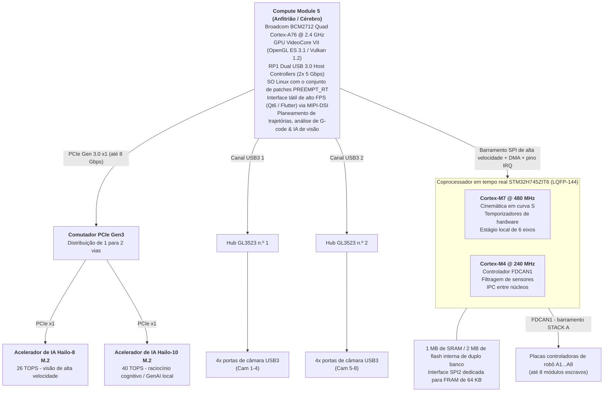
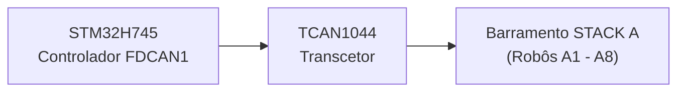
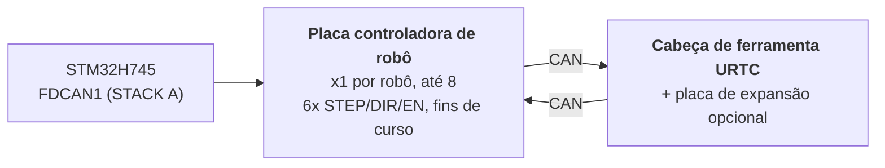

<!-- =============================================================================
HYDRA-UMC - Universal Machines Controller: board design, bootloaders and the CM5 SPI bridge
Copyright (C) JuanenRac (Electro Hobby 3D) <electrohobby3d@gmail.com>
GPL-3.0-or-later - see LICENSE
============================================================================= -->

<p align="center">
  
</p>

# 🚀 HYDRA-UMC

<p align="center"><a href="README.md">🇺🇸 English</a> | <a href="README_spa.md">🇪🇸 Español</a> | <a href="README_fra.md">🇫🇷 Français</a> | <a href="README_ita.md">🇮🇹 Italiano</a> | <a href="README_deu.md">🇩🇪 Deutsch</a> | <a href="README_zho.md">🇨🇳 简体中文</a> | <a href="README_jpn.md">🇯🇵 日本語</a> | 🇵🇹 <b>Português</b></p>

### 🤖 A plataforma definitiva de microfábrica de dois núcleos e controlador multirrobô (V1.0 - dois aceleradores de IA PCIe Hailo-8 + Hailo-10 e dois hubs USB 3.0)

<p align="center">
  
  
  
  
  
  
  
</p>

---

> **Estado de segurança (safety e security):** este ecossistema não é um sistema de segurança certificado. Ainda não existe um caminho de E-STOP por hardware, nem limites ou interlocks impostos pelo firmware, nem um comando de movimento verificado; as imagens de firmware são verificadas com CRC-32 e uma assinatura Ed25519, e uma compilação de versão recusa as chaves de desenvolvimento publicadas (as cabeças de ferramenta e as placas de expansão atrás do relé ainda usam os bootloaders do URTC, que aceitam um HMAC-SHA256 de chave partilhada em vez de uma assinatura); TLS e TLS mútuo são opcionais e estão desativados por defeito; nenhuma placa própria foi ainda montada ou testada. Leia a [base de segurança](https://github.com/JuanenRac/HYDRA-UMC-DOCS/blob/main/docs/SECURITY_BASELINE.md) e o [modelo de ameaças](https://github.com/JuanenRac/HYDRA-UMC-DOCS/blob/main/docs/THREAT_MODEL.md) antes de confiar em qualquer afirmação aqui para a segurança de uma pessoa.

---

## 📋 Num relance

| | |
|---|---|
| Versão | `0.2.3` |
| Maturidade | Estrutura inicial |
| Testes | 148 (`python -m unittest discover -s tests -p 'test_*.py'`) |
| Tecnologia | STM32H745 (dual-core) / STM32G474 / FreeRTOS (AMP) / CMSIS-DSP / FDCAN (classic CAN mode) |
| Destino | Uma placa com microcontrolador (o firmware); compila-se num PC |
| Em hardware real | Ainda não: não há registo de execução em hardware real para esta versão |

**Ir para:** [Visão geral](#-visão-geral) · [Arquitetura](#-arquitetura) · [Funcionalidades](#-funcionalidades) · [Segurança e proteção](#-segurança-e-proteção) · [Interfaces](#-interfaces) · [Configuração](#-configuração) · [Início rápido](#-início-rápido) · [Testes](#-testes) · [Resolução de problemas](#-resolução-de-problemas) · [Estrutura do repositório](#-estrutura-do-repositório) · [Projetos relacionados](#-projetos-relacionados)

## 🚦 Estado do projeto

Cada linha é uma parte deste repositório e a luz diz até onde chega hoje. É escrita com o que o repositório consegue demonstrar (testes, compilações, execuções), não com o que está previsto.

🟢 Feito e verificado · 🟡 Funciona, com limites conhecidos · 🟠 Feito a meio ou ainda por verificar · 🔴 Por fazer ou a não funcionar

| Área | Estado | O que significa aqui |
|---|---|---|
| Software | 🟠 | Só estrutura e as primeiras peças; falta a maior parte do trabalho |
| Testes | 🟢 | 148 testes automáticos, executados a cada alteração |
| Hardware real | 🔴 | Ainda não: não há registo de execução em hardware real para esta versão |
| Documentação | 🟢 | README em oito idiomas, verificado contra o manifesto a cada alteração |

## 🎯 Visão geral

O **HYDRA-UMC** (Universal Machines Controller) é uma plataforma de controlo distribuído e uma arquitetura HMI, ainda numa fase inicial no firmware, concebidas para robótica celular multieixo, microfábricas, fabrico automatizado e orquestração complexa de cabeças de ferramenta.

Concebido como uma **arquitetura heterogénea de anfitrião + coprocessador em tempo real**, o HYDRA-UMC destina-se a separar a renderização da interface de alto nível, a visão por computador, a inferência de IA e a ligação à nuvem da geração de passos em tempo real, da gestão do barramento de campo e do acionamento da eletrónica de potência (previsto: a geração de passos e o acionamento ainda não estão escritos).

> **Estado do desenho:** as secções seguintes descrevem o desenho previsto da placa e do seu firmware. O que existe hoje limita-se aos bootloaders, às aplicações de comunicação do CM4 e do G474 e à ponte SPI do lado do CM5 (ver a caixa *Estado de segurança* perto do fim e a tabela de estado em `docs/architecture.md`). Sempre que uma frase abaixo falar no presente de geração de movimento, perfis em S, laços PID, interlocks de segurança, um E-STOP, tratamento de perda de energia, deteção de objetos ou qualquer outro comportamento da placa final, deve ler-se como previsto: nada disso foi executado numa placa montada.

### 🤖 Capacidades da microfábrica (objetivos de desenho):
* 📡 **Rede distribuída multirrobô:** previsto: coordenar até 8 módulos robóticos escravos distribuídos (primeiro 3, 4, 5 e 6 GDL; com escala para 7, 8, 9 GDL e arquiteturas de duplo robô em versões futuras) ligados por um único barramento CAN físico.
* 🧠 **Coprocessamento neuronal duplo integrado:** um comutador PCIe Gen3 a bordo reparte a única via PCIe do CM5 por 2 aceleradores de IA M.2: um Hailo-8 (26 TOPS) que executa deteção de objetos YOLOv8/YOLO11 (previsto; ainda não em execução) em vários fluxos, inspeção de defeitos e alinhamento de fiduciais PnP em tempo real nas 8 câmaras, e um Hailo-10 (40 TOPS) que executa localmente, no próprio dispositivo, raciocínio cognitivo e GenAI (modelos LLM/VLA quantizados) sem ir à nuvem.
* 📐 **Estágio local de 6 eixos:** geração direta de pulsos step/dir/enable para 6 eixos locais (X, Y1, Y2, Z, E0, E1) para necessidades auxiliares: robôs adicionais, revólveres ATC (trocador automático de ferramentas), sincronização de tapete rolante ou pórticos de mesa XYZ.
* 🎯 **Integração JuanenPNP e JuanenCNC:** compatível diretamente com sistemas Pick-and-Place (estruturas de hardware LumenPNP) e unidades CNC equipadas com módulos laser ópticos de 10 W para prototipagem de PCB e colocação de SMD.
* 👁️ **Matriz de visão e inspeção com oito câmaras:** controladores USB 3.0 duplos integrados que alimentam 8 portas de câmara USB dedicadas para alinhamento ótico pick-and-place com OpenCV em tempo real, inspeção térmica e monitorização remota de transmissões.
* ⚡ **Matriz de atuação e gestão térmica:** controla 16 canais MOSFET industriais low-side (8 eletroválvulas pneumáticas + 8 bombas de vácuo/geradores venturi) e drivers de cama de alta corrente para soldadura por refusão SMD ou camas de impressão 3D.
* 🚜 **Plataformas móveis JuanenBOT:** arquitetura de comunicação escalável capaz de se ligar a plataformas de transporte robustas de 4 rodas e 48 V (estruturas de 50x50x50 cm com rodas omnidirecionais/mecanum para cargas de 100 kg).

## 🧩 Papel no HYDRA-UMC

O **HYDRA-UMC** é o desenho do Universal Machines Controller: um anfitrião Compute Module 5, um coprocessador de tempo real STM32H745 e até oito Robot Controller Boards num só bus CAN, pensado para gerir células de robôs e microfábricas. O que existe hoje são os três carregadores de arranque (imagens assinadas, anti-retrocesso), as aplicações de comunicação da CM4 e da G474 e a ponte SPI do lado da CM5; o resto é desenho, e nenhuma placa foi construída.

## 🏛️ Arquitetura

<p align="center">
  
</p>

<details>
<summary>Versão em texto do diagrama (Mermaid)</summary>







</details>

## ✨ Funcionalidades

A especificação detalhada do desenho (onze subsistemas, do computador anfitrião à cabeça de ferramenta) é um documento à parte; cada linha abaixo abre a sua secção:

- [SUBSISTEMA DE COMPUTAÇÃO ANFITRIÃO (HMI E ALTO NÍVEL)](docs/HARDWARE_SPECIFICATION_por.md#2--subsistema-de-computação-anfitrião-hmi-e-alto-nível)
- [SUBSISTEMA DE ACELERADORES DE IA PCIE (DUPLO NPU HAILO-8 + HAILO-10)](docs/HARDWARE_SPECIFICATION_por.md#3--subsistema-de-aceleradores-de-ia-pcie-duplo-npu-hailo-8--hailo-10)
- [SUBSISTEMA DE VISÃO USB 3.0 DUPLO (8x PORTAS DE CÂMARA)](docs/HARDWARE_SPECIFICATION_por.md#4--subsistema-de-visão-usb-30-duplo-8x-portas-de-câmara)
- [SUBSISTEMA DE COPROCESSAMENTO EM TEMPO REAL (DESENHO)](docs/HARDWARE_SPECIFICATION_por.md#5--subsistema-de-coprocessamento-em-tempo-real-desenho)
- [COMUNICAÇÃO DE BARRAMENTO DE CAMPO DISTRIBUÍDO (BARRAMENTO CAN ÚNICO; PERIFÉRICO FDCAN EM MODO CLÁSSICO)](docs/HARDWARE_SPECIFICATION_por.md#6--comunicação-de-barramento-de-campo-distribuído-barramento-can-único-periférico-fdcan-em-modo-clássico)
- [MEMÓRIA NÃO VOLÁTIL ULTRARRÁPIDA (FRAM SPI)](docs/HARDWARE_SPECIFICATION_por.md#7--memória-não-volátil-ultrarrápida-fram-spi)
- [CONJUNTO LOCAL DE MOVIMENTO, ATUAÇÃO E SENSORES](docs/HARDWARE_SPECIFICATION_por.md#8--conjunto-local-de-movimento-atuação-e-sensores)
- [DISTRIBUIÇÃO E REGULAÇÃO DE ENERGIA](docs/HARDWARE_SPECIFICATION_por.md#9--distribuição-e-regulação-de-energia)
- [COMUNICAÇÃO ENTRE PROCESSADORES (IPC)](docs/HARDWARE_SPECIFICATION_por.md#10--comunicação-entre-processadores-ipc)
- [ESPECIFICAÇÕES DE HARDWARE DA PCB DE 4 CAMADAS](docs/HARDWARE_SPECIFICATION_por.md#11--especificações-de-hardware-da-pcb-de-4-camadas)
- [PLACAS CONTROLADORAS DE ROBÔ E CABEÇA DE FERRAMENTA URTC (NÍVEL DISTRIBUÍDO)](docs/HARDWARE_SPECIFICATION_por.md#12--placas-controladoras-de-robô-e-cabeça-de-ferramenta-urtc-nível-distribuído)

## 🔒 Segurança e proteção

| Ameaça | Defesa | Onde |
|---|---|---|
| Uma imagem de firmware falsa ou editada | Um cabeçalho fixo de 64 bytes (magia, versão, id de hardware, tamanho, palavras de vetor, CRC-32) é seguido da imagem e de uma assinatura Ed25519 de 64 bytes sobre cabeçalho e imagem; o carregador verifica primeiro a assinatura e não acredita em nada do cabeçalho antes de ela verificar | `image_header.h`, `tools/image_header.py` |
| Uma imagem assinada antiga enviada de novo (retrocesso) | Uma imagem nova tem de ser estritamente mais nova do que a instalada (comparam-se maior, menor e correção); uma mais antiga só é aceite com um token de descida de versão, uma assinatura Ed25519 sobre as versões instalada e de destino e o resumo da imagem; o firmware não contém nenhuma constante que permita descer de versão | `image_header.h`, `ImageHeader_CheckRollback` |
| Imagens compiladas com as chaves de desenvolvimento | Sem `HYDRA_FW_UPDATE_PUBKEY_HEX` e `HYDRA_FW_HMAC_KEY_HEX` os carregadores levam chaves de desenvolvimento cuja parte privada está publicada no repositório; a compilação avisa, e com `HYDRA_UMC_RELEASE=1` recusa-se a compilar; a placa guarda só a chave pública, a semente privada fica com o dono | `build_firmware.sh` |
| Uma placa que fica presa | O carregador da G474 arma o cão de guarda independente (IWDG) como primeiríssima ação de `main()`, antes de `HAL_Init()`, pelo que um bloqueio no arranque reinicia o chip | `src/mcu_stm32g474/boot/bootloader_main.c` |
| O serviço HTTP local da ponte SPI alcançado por outra pessoa | Escuta em 127.0.0.1 por predefinição, aceita um corpo de firmware de 4 MiB no máximo e não guarda nenhuma chave de assinatura: a assinatura chega no pedido, feita na máquina que tem a semente privada; não tem TLS nem início de sessão próprio, pelo que quem lhe reencaminha pedidos deve decidir quem pode gravar | `src/cm5_host/spi_bridge/spi_bridge/http_service.py` |

**O que hoje nunca faz:** dar uma paragem de emergência, limites por software, bloqueios, o despejo para a FRAM na perda de alimentação nem qualquer comando de movimento; não se afirma Secure Boot nem proteção de leitura da flash. Leia a caixa de segurança no topo antes de confiar em algo daqui.

## 🔌 Interfaces

| Tópico ou rota | O que leva |
|---|---|
| CAN, FDCAN1 in classic mode | um bus (STACK A) do STM32H745 até oito Robot Controller Boards; os identificadores do protocolo de relé estão listados uma só vez em `tools/can_ids.py` e verificados por `tests/test_can_ids.py` |
| SPI + DMA + IRQ pin, 128-byte frames | da CM5 ao STM32H745: tramas fixas `SpiOtaFrame` que coincidem byte a byte com a estrutura em C; a ponte corre a 10 MHz por predefinição |
| `GET /version`, `GET /counters`, `POST /flash` on 127.0.0.1:8765 | o serviço local da ponte SPI: a versão de uma placa, os contadores de erro do seu controlador CAN e uma gravação em fluxo (JSON delimitado por linhas) de uma imagem com a sua assinatura Ed25519; `relay=1` chega a uma cabeça URTC através da sua Robot Controller Board |
| `tools/image_header.py sign \| keygen \| pubkey` | a referência no anfitrião do cabeçalho de imagem assinado: faz as assinaturas e os tokens de descida de versão que os carregadores verificam, e `tests/image_header_vectors.h` é gerado a partir dela para que os lados C e Python não se afastem |

## ⚙️ Configuração

O firmware configura-se ao compilar, através de variáveis de ambiente; a ponte SPI recebe as suas definições da linha de comandos.

| Variável | Predefinição | O que define |
|---|---|---|
| `HYDRA_FW_UPDATE_PUBKEY_HEX` | chave de desenvolvimento | 64 dígitos hexadecimais: a chave pública Ed25519 para a qual uma atualização tem de estar assinada |
| `HYDRA_FW_HMAC_KEY_HEX` | chave de desenvolvimento | 64 dígitos hexadecimais guardados fora do repositório: a chave da verificação de integridade local da aplicação instalada |
| `HYDRA_UMC_RELEASE` | `0` | com `1` a compilação recusa-se a usar as chaves de desenvolvimento |
| `HYDRA_UMC_SKIP_HOST_TESTS`, `HOST_CC` | `0`, o compilador do sistema | salta os testes lógicos de anfitrião do passo 1b, ou indica o compilador de C que usam |
| `python -m spi_bridge run --spi-speed-hz --host --port --collector-url` | `10000000`, `127.0.0.1`, `8765` | o relógio SPI, onde escuta o serviço HTTP local e o endereço do HYDRA-UMC-TELEMETRY-COLLECTOR a que a ponte pode comunicar (no máximo um relatório por segundo) |

## 🚀 Início rápido

Compilar o firmware exige a cadeia de ferramentas Arm GNU (`arm-none-eabi-gcc` 10.3 ou superior), `git` e `python`; os testes de anfitrião só precisam de um compilador de C normal e de Python. O Windows tem `build_firmware.bat`.

```bash
./build_firmware.sh                                  # builds every MCU target and runs the host tests (step 1b)
./build_firmware.sh g474                             # only the Robot Controller Board; h745 builds only the Kinematic Brain
python tools/verify_firmware_inventory.py            # read-only check of the committed six-component firmware inventory
python -m unittest discover -s tests -p 'test_*.py'  # the Python tests of the firmware sources, the image header and the CAN identifiers
```

### AMBIENTE DE DESENVOLVIMENTO

O que as máquinas de desenvolvimento deste projeto têm realmente instalado e verificado a funcionar (`build_firmware.sh`/`build_firmware.bat`, alvos `g474`/`h745`/por omissão, 0 erros), e não uma lista teórica:

* 🔧 **ARM GNU Toolchain** (`arm-none-eabi-gcc` 10.3+): compila todos os alvos de firmware MCU. Não se usa nem é preciso nenhum ficheiro de projeto STM32CubeIDE/CubeMX para compilar: `build_firmware.sh`/`build_firmware.bat` obtém de novo as fontes HAL/CMSIS da ST dos seus repositórios oficiais no GitHub e controla o compilador diretamente, a mesma filosofia que o `build_firmware.sh`/`build_firmware.bat` do repositório irmão `URTC` já estabeleceu.
* 🧩 **VS Code + extensões** (`.vscode/extensions.json` lista todas): [STM32 VS Code Extension](https://marketplace.visualstudio.com/items?itemName=stmicroelectronics.stm32-vscode-extension) (integração de projeto/build/depuração), **Cortex-Debug** (depuração SWD/JTAG; independente de `build_firmware.sh`, útil quando houver hardware real), **CMake Tools** (para o projeto CMake próprio de `src/cm5_host/hmi_qt6/`), **C/C++** (IntelliSense em todos os ficheiros de firmware/anfitrião), **Python** (scripts do pipeline de `ai_inference/`), **Hex Editor** (inspecionar a saída de firmware `.bin`), **YAML** (a configuração MediaMTX de `video_streamer/`). Abra o repositório, aceite o aviso de extensões recomendadas e use **Terminal → Run Task** para as tarefas de build já preparadas (`.vscode/tasks.json`).
* 🗂️ **git**: tanto para este próprio repositório como para a obtenção, por etiquetas fixadas, dos pacotes HAL/CMSIS da ST feita por `build_firmware.sh` (em cache em `build/`, no gitignore, obtidos de novo com `--clean`).

## 🧪 Testes

148 testes automáticos correm com `python -m unittest discover -s tests -p 'test_*.py'`. São 87 testes da ponte SPI da CM5 mais 61 das fontes do firmware, do cabeçalho de imagem assinado e dos identificadores CAN (os da ponte SPI correm com `PYTHONPATH=src/cm5_host/spi_bridge:src/cm5_host/spi_bridge/tests` e `-s src/cm5_host/spi_bridge/tests`). A lógica em C dos carregadores de arranque e do relé é verificada por mais 19 programas compilados com um compilador de C normal do anfitrião, no passo 1b de `build_firmware.sh`. Nenhum precisa de uma placa.

A CI executa `HYDRA_UMC_CI=1 python tools/ci_validate.py`, que verifica o manifesto, os documentos, os oito README e as imagens.

## 🏗️ Compilação e publicação

**Linux/Mac:**
```bash
./build_firmware.sh          # compila todos os alvos MCU (placa controladora de robô + Cérebro Cinemático, ambos os núcleos)
./build_firmware.sh g474     # só a placa controladora de robô
./build_firmware.sh h745     # só o Cérebro Cinemático (ambos os núcleos)
./build_firmware.sh --clean  # apaga primeiro a cache HAL/CMSIS obtida
```

**Windows:**
```bat
build_firmware.bat          :: compila todos os alvos MCU (placa controladora de robô + Cérebro Cinemático, ambos os núcleos)
build_firmware.bat g474     :: só a placa controladora de robô
build_firmware.bat h745     :: só o Cérebro Cinemático (ambos os núcleos)
build_firmware.bat --clean  :: apaga primeiro a cache HAL/CMSIS obtida
```

`build_firmware.bat` é o mesmo build que `build_firmware.sh` traduzido para batch (os mesmos passos, as mesmas versões HAL/CMSIS fixadas, o mesmo relatório de passa/aviso/falha); foi executado de ponta a ponta numa máquina Windows real com o [Arm GNU Toolchain](https://developer.arm.com/downloads/-/arm-gnu-toolchain-downloads) instalado e `arm-none-eabi-gcc` no `PATH`: cada módulo HAL, ambos os bootloaders e cada aplicação compilaram e ligaram sem erros, e o `firmware_manifest.json` foi regenerado com CRC32 iguais aos da saída do build Linux/Mac. Requer as mesmas ferramentas que o script Linux/Mac: o Arm GNU Toolchain, `git` (para obter as fontes HAL/CMSIS da ST) e `python` para o passo do manifesto.

**Build manual (em qualquer SO, sem o script):** o script automatiza exatamente os passos de `docs/COMPILE_STM32G474.TXT` e `docs/COMPILE_STM32H745.TXT`: obter as fontes HAL/CMSIS/FreeRTOS fixadas listadas no início de `build_firmware.sh`/`build_firmware.bat`, compilar os módulos HAL e os ficheiros de arranque/sistema de cada alvo com `arm-none-eabi-gcc` (as opções e listas de módulos estão nesse mesmo script), depois ligar cada bootloader e aplicação com o seu próprio script de ligação (`*.ld`, junto da sua fonte) com `arm-none-eabi-gcc`/`-Wl,--gc-sections` e converter com `arm-none-eabi-objcopy` para `.bin`/`.hex`. Esses dois ficheiros `docs/COMPILE_*.TXT` são a referência autorizada, passo a passo, se preferir não executar nenhum dos scripts: os scripts existem para os automatizar, não para os substituir como fonte de verdade.

A saída fica em `firmware/`, que é registada e enviada a este repositório (a mesma convenção da pasta `firmware/` de saída do URTC) para que a funcionalidade de descarga do GitHub do HYDRA-UMC-STUDIO consiga realmente encontrar aí ficheiros `.bin` reais através de `firmware_manifest.json`; NÃO está no gitignore. Ver `docs/COMPILE_STM32G474.TXT` e `docs/COMPILE_STM32H745.TXT` para saber exatamente o que faz cada passo e porquê, e o `README.md` de cada pasta de firmware para o estado atual. Os **bootloaders** dos 3 alvos (G474, H745 CM7, H745 CM4) são implementações CAN-OTA/SPI-OTA reais e funcionais (verificação CRC32 + HMAC-SHA256 na cópia de segurança antes de copiar para a principal, a mesma disciplina anti-brick do bootloader do URTC), que compilam sem erros de ponta a ponta, ainda não verificadas em hardware real. As **aplicações** continuam a ser testes de fumo FreeRTOS que só alternam GPIO e compilam, ainda não o firmware real de movimento/visão/relé. Ver `docs/architecture.md` (em especial a tabela de estado da secção 6 e as limitações de segurança conhecidas e aceites da secção 8) para saber exatamente o que é real e o que continua em aberto.

> **Estado de segurança:** este repositório ainda não contém nenhum caminho de E-STOP, limites por software, interlocks de segurança, o despejo para a FRAM em caso de perda de energia (PVD) nem qualquer comando de movimento. Onde as secções acima (ou outro projeto do ecossistema) os descrevem, trata-se do desenho previsto: nada deve depender deles para a segurança até estarem implementados e testados numa placa real. O que as aplicações fazem hoje: as do CM4 e do G474 executam a sondagem/resposta AXIS_STATUS da STACK A e o túnel de relé Tier 2/3; a do CM7 continua a ser um teste de fumo com GPIO-toggle.

Os seis componentes do firmware (três carregadores de arranque e três aplicações, um par por chip ou núcleo) têm cada um a sua versão. Compilar nunca a altera: `build_firmware.sh` e `.bat` só a comunicam. Subir versões é o comando explícito `python bump_firmware_versions.py` (`--list` mostra-as), e `python show_component_version.py` imprime a versão de um componente.

## 🩺 Resolução de problemas

| Vê | Porque | Faça |
|---|---|---|
| «os carregadores aceitam atualizações assinadas com a semente de DESENVOLVIMENTO, que é pública» | A compilação não tinha `HYDRA_FW_UPDATE_PUBKEY_HEX` (ou não tinha `HYDRA_FW_HMAC_KEY_HEX`) | Serve numa bancada; para qualquer placa que outra pessoa possa alcançar, crie um par de chaves com `python tools/image_header.py keygen`, compile com a chave pública e compile as versões com `HYDRA_UMC_RELEASE=1` |
| «arm-none-eabi-gcc não encontrado» | A cadeia de ferramentas Arm GNU não está instalada ou não está no `PATH` | Instale-a (o script tenta `apt` no Linux) e compile de novo; os testes de anfitrião do passo 1b só precisam de um compilador de C normal |
| A ponte SPI não abre o dispositivo, ou `SPI transfer returned ... bytes` | O transporte real precisa de `spidev` e `gpiod` numa CM5 com o dispositivo SPI ativado, e de um STM32H745 do outro lado; nenhum existe ainda, por isso a ponte só foi exercitada com simulações | Use o transporte simulado dos testes até existir uma placa |
| `build_firmware.sh` termina com FAIL num teste de anfitrião | As cópias de uma fonte que os três carregadores partilham afastaram-se, ou `tests/image_header_vectors.h` é mais antigo do que `tools/image_header.py` | Execute `python tools/gen_image_header_vectors.py` e `python -m unittest discover -s tests` para ver que cópia difere |

## 📂 Estrutura do repositório

<p align="center">
  
</p>

<details>
<summary>Versão em texto da árvore</summary>

```text
HYDRA-UMC/
├── src/
│   ├── cm5_host/                    Aplicações Linux de espaço de utilizador que correm SOBRE a imagem de os/
│   ├── mcu_stm32h745/               Firmware do Cérebro Cinemático (nível 0) - dois núcleos
│   └── mcu_stm32g474/               Firmware da placa controladora de robô (nível 1) - um só núcleo, + o seu próprio boot/
├── .vscode/                         Extensões recomendadas + tarefas de build - ver "Ambiente de desenvolvimento" abaixo
├── docs/                            arquitetura, referências de compilação, atribuição de pinos, protocolo CAN, folhas de dados
├── hardware/                        os dois desenhos de placa; ainda sem esquema
├── tests/                           Testes no computador: a lógica em C dos bootloaders e do relé (stubs/ substitui o HAL, image_header_vectors.h guarda os vetores de referência) e testes em Python das ferramentas
├── os/                              Imagem do SO do CM5 - escolha do SO base, unidades systemd, aprovisionamento de primeiro arranque
├── images/                          Banner do README + ícone + ecrã de arranque (SVG)
├── tools/                           ferramentas do projeto e verificações da CI
├── firmware/                        Saída de build registada (.bin/.hex/.elf + manifesto) - NÃO está no gitignore, mesma convenção da pasta de saída do URTC, ver "Compilar o firmware" abaixo
├── .github/                         fluxo de CI e modelos de problemas
├── build_firmware.sh                Constrói cada alvo de firmware MCU acima a partir de um checkout limpo (Linux/Mac)
├── build_firmware.bat               O mesmo build, Windows (ver "Compilar o firmware" abaixo)
├── build-test.sh / build-test.bat   Verificação de compilação sem alterar versões
├── generate_manifest.py             Regenera firmware/firmware_manifest.json (versões/CRC32) depois de um build completo
├── bump_version.py                  Subida de versão ao estilo conta-quilómetros de um componente
├── bump_firmware_versions.py        Sobe explicitamente as seis versões de componente
├── show_component_version.py        Mostra a versão que um componente já tem
├── bump_manifest_version.py         Sincroniza a versão de hydra-umc.project.json com a nativa (--sync)
├── CHANGELOG.md                     o que mudou em cada versão
├── hydra-umc.project.json           manifesto: versão, maturidade, família
└── test.sh                          verificação de compilação sem alterações
```

</details>

## 🗺️ Roteiro e limites conhecidos

O que existe hoje limita-se aos três carregadores de arranque, às aplicações de comunicação da CM4 e da G474 e à ponte SPI do lado da CM5; o resto da especificação é desenho. Nenhuma placa própria foi montada ou testada, as duas pastas de placa ainda não têm esquema, e as aplicações são testes de fumo FreeRTOS que comutam um pino, não o firmware de movimento, visão e relé. Os carregadores e a ponte foram testados num computador anfitrião, nunca nos chips reais.

## 🌍 Idiomas

Este README e os documentos do repositório existem em oito idiomas: inglês, espanhol, alemão, francês, italiano, japonês, chinês e português (Portugal). São escritos em conjunto e a CI verifica que os oito ficheiros têm as mesmas secções e as mesmas ligações. Este repositório não tem ecrã nem catálogo de mensagens próprios, por isso não há textos de interface para traduzir.

## 🔗 Projetos relacionados

Este projeto faz parte do ecossistema de robótica HYDRA-UMC do mesmo autor (JuanenRac / Electro Hobby 3D). Vale a pena conhecê-los, porque um pedido pode ser, na verdade, sobre um destes e não sobre este repositório.

**Diretamente relacionados** — projetos que se ligam diretamente a este firmware
- **[URTC](https://github.com/JuanenRac/URTC)** — firmware da placa física Universal Robot Tool Controller, mais de 25 perfis de ferramenta por barramento CAN; o firmware da cabeça de ferramenta que monta cada braço robótico que esta placa aciona, um salto mais além pela sua própria ligação CAN descendente.
- **[HYDRA-UMC-OS](https://github.com/JuanenRac/HYDRA-UMC-OS)** — camada de produto reproduzível do Raspberry Pi OS para o CM5: agente só de leitura, configuração/perfis validados, aprovisionamento Wi-Fi de primeiro contacto; o SO em que corre o anfitrião CM5 desta placa.
- **[HYDRA-UMC-SERVER](https://github.com/JuanenRac/HYDRA-UMC-SERVER)** — o verdadeiro backend sem interface (REST/WebSocket) com que falam todos os clientes de controlo; o seu serviço `spi_bridge` fala com este firmware pela ligação SPI-OTA real CM5↔STM32H745.
- **[HYDRA-UMC-VISION-NODE](https://github.com/JuanenRac/HYDRA-UMC-VISION-NODE)** — centro de integração do pipeline de visão Hailo-8, com uma verificação real de prontidão de hardware por fase; ainda não existe um laço de perceção/E-STOP com este firmware.
- **[HYDRA-UMC-SAFETY-ZONES](https://github.com/JuanenRac/HYDRA-UMC-SAFETY-ZONES)** — lógica v0 de violação de zonas, atualidade da calibração e pedido de E-STOP que lê as posições dos objetos de um ficheiro; nenhum detetor a alimenta e ainda não há E-STOP físico ligado.
- **[HYDRA-UMC-VISUAL-SERVOING-API](https://github.com/JuanenRac/HYDRA-UMC-VISUAL-SERVOING-API)** — lei de correção de servovisão baseada em posição com autorização condicionada ao estado da zona; ainda sem estimativa de pose por câmara.
- **[HYDRA-UMC-ORCHESTRATOR](https://github.com/JuanenRac/HYDRA-UMC-ORCHESTRATOR)** — centro de integração com um contrato real de relatório de saúde gRPC/Protobuf e uma máquina de estados de missões; coordena várias unidades HYDRA-UMC como um enxame.
- **[HYDRA-UMC-TWIN](https://github.com/JuanenRac/HYDRA-UMC-TWIN)** — centro de integração do motor de gémeo digital, com um contrato real de sincronização de compatibilidade de versões; pensado para replicar a cinemática deste firmware quando existir.
- **[URTC-SMART-RACK](https://github.com/JuanenRac/URTC-SMART-RACK)** — firmware de um rack de montagem de placas com descodificação real do ID da ferramenta e lógica de pré-aquecimento Smart Idle; partilha o mesmo barramento CAN de ferramentas que este firmware.
- **[URTC-VISION-TOOL](https://github.com/JuanenRac/URTC-VISION-TOOL)** — firmware mais um companheiro de visão em Python real para uma cabeça de ferramenta de inspeção térmica/RGB; partilha o mesmo barramento CAN de ferramentas que este firmware.

**Também fazem parte do ecossistema**

*Hardware e plataforma centrais*
- **[HYDRA-UMC-SDK](https://github.com/JuanenRac/HYDRA-UMC-SDK)** — o contrato JSON-Schema partilhado e a fronteira de software de controlo de trabalhos contra a qual cada bridge valida os seus comandos (não é uma função de segurança certificada).
- **[HYDRA-UMC-CONNECTOR-HUB](https://github.com/JuanenRac/HYDRA-UMC-CONNECTOR-HUB)** — registo declarativo de manifestos de adaptador e validador para conectores de máquinas externas; estende a ideia de contrato do SDK a máquinas externas sem substituir os projetos de gateway industrial.

*Backend central e clientes*
- **[HYDRA-UMC-STUDIO](https://github.com/JuanenRac/HYDRA-UMC-STUDIO)** — painel web de controlo com visualização 3D em tempo real de vários robôs.
- **[HYDRA-UMC-SUITE](https://github.com/JuanenRac/HYDRA-UMC-SUITE)** — centro de comando de enxame para desktop (PySide6) para vários servidores ao mesmo tempo, empacotado como executável independente.
- **[HYDRA-UMC-ANDROID-CONTROL](https://github.com/JuanenRac/HYDRA-UMC-ANDROID-CONTROL)** — aplicação Android nativa de controlo, com início de sessão biométrico e um companheiro Wear OS emparelhado.
- **[HYDRA-UMC-IOS-CONTROL](https://github.com/JuanenRac/HYDRA-UMC-IOS-CONTROL)** — aplicação de controlo para iOS/iPadOS (Flutter) com sincronização WebSocket em tempo real.
- **[HYDRA-UMC-DSI](https://github.com/JuanenRac/HYDRA-UMC-DSI)** — interface tátil nativa para o ecrã tátil DSI de 7" integrado, executada no próprio CM5.
- **[HYDRA-UMC-EDITOR-URDF](https://github.com/JuanenRac/HYDRA-UMC-EDITOR-URDF)** — criador/editor gráfico de URDF para desktop que envia os modelos concluídos para o catálogo do STUDIO.
- **[HYDRA-UMC-EDITOR-STL](https://github.com/JuanenRac/HYDRA-UMC-EDITOR-STL)** — editor de modelos STL para desktop que transforma/substitui/remove/adiciona peças reais no mesmo catálogo de modelos que o HYDRA-UMC-EDITOR-URDF também edita.
- **[HYDRA-UMC-BRIDGE-AMR](https://github.com/JuanenRac/HYDRA-UMC-BRIDGE-AMR)** — fronteira de coordenação para frotas AGV/AMR através de um publicador MQTT VDA 5050 (testado apenas contra uma frota emulada).
- **[HYDRA-UMC-BRIDGE-CNC](https://github.com/JuanenRac/HYDRA-UMC-BRIDGE-CNC)** — coordenador de células CNC de alto nível com acesso ao estado GRBL e aos bytes de controlo (testado apenas contra um emulador).
- **[HYDRA-UMC-BRIDGE-DROIDS](https://github.com/JuanenRac/HYDRA-UMC-BRIDGE-DROIDS)** — fronteira de coordenação para droides com patas/humanoides, com um emissor de comandos para o Boston Dynamics Spot (testado apenas contra um emulador).
- **[HYDRA-UMC-BRIDGE-LASER](https://github.com/JuanenRac/HYDRA-UMC-BRIDGE-LASER)** — coordenador de células laser que lê 3 sinais GPIO (chave, caixa e interlock) (testado apenas contra um chip simulado; não pode armar nem disparar um laser).
- **[HYDRA-UMC-BRIDGE-OPENPNP](https://github.com/JuanenRac/HYDRA-UMC-BRIDGE-OPENPNP)** — coordenador seguro de fluxo de placa de alto nível para pick-and-place com OpenPnP.
- **[HYDRA-UMC-BRIDGE-PRINTER3D](https://github.com/JuanenRac/HYDRA-UMC-BRIDGE-PRINTER3D)** — fronteira de coordenação segura para impressoras 3D Moonraker/Klipper, com comandos de trabalho reais protegidos por portas.
- **[HYDRA-UMC-BRIDGE-ROS2](https://github.com/JuanenRac/HYDRA-UMC-BRIDGE-ROS2)** — coordenador com um transporte ROS 2 baseado em rclpy importado sob demanda (ainda não executado contra uma instalação ROS 2).
- **[HYDRA-UMC-BRIDGE-UAV](https://github.com/JuanenRac/HYDRA-UMC-BRIDGE-UAV)** — fronteira de coordenação para UAV com câmara, com um emissor de comandos MAVLink (testado apenas contra um emulador).

*Plataforma de ferramentas URTC*
- **[URTC-FLASHER](https://github.com/JuanenRac/URTC-FLASHER)** — ferramenta gráfica de gravação para desktop das placas URTC, por CAN-OTA e também SWD/JTAG de chip completo.
- **[URTC-TESTER](https://github.com/JuanenRac/URTC-TESTER)** — ferramenta de diagnóstico CAN em tempo real para desktop das placas URTC, com um painel por perfil de ferramenta.
- **[URTC-WEB-STUDIO](https://github.com/JuanenRac/URTC-WEB-STUDIO)** — alternativa no navegador ao URTC-TESTER através da Web Serial API, sem instalação local.
- **[URTC-GATEWAY](https://github.com/JuanenRac/URTC-GATEWAY)** — gateway à frente do barramento CAN do URTC: lista de identificadores permitidos, limite de taxa e chave de sessão; software testado num computador, ainda não num barramento real.

*Nó de IA de visão (Hailo-8)*
- **[HYDRA-UMC-DETECTION-HEF](https://github.com/JuanenRac/HYDRA-UMC-DETECTION-HEF)** — registo real de modelos compilados com verificação segura de carga por arquitetura Hailo e soma de verificação.
- **[HYDRA-UMC-VISION-STREAMER](https://github.com/JuanenRac/HYDRA-UMC-VISION-STREAMER)** — pipeline GStreamer real e gerador de configuração MediaMTX com uma fronteira de integração HailoRT real.

*Nó de IA cognitiva (Hailo-10)*
- **[HYDRA-UMC-COGNITIVE-NODE](https://github.com/JuanenRac/HYDRA-UMC-COGNITIVE-NODE)** — centro de integração do pipeline cognitivo do Hailo-10 (orquestração de LLM/VLA/voz).
- **[HYDRA-UMC-VLA-ENGINE](https://github.com/JuanenRac/HYDRA-UMC-VLA-ENGINE)** — codificação/descodificação real de tokens de ação e geração de trajetórias para um modelo Visão-Linguagem-Ação.
- **[HYDRA-UMC-VOICE-UI](https://github.com/JuanenRac/HYDRA-UMC-VOICE-UI)** — front-end de voz real (VAD + analisador de intenções) com um relé para o relógio limitado e protegido por confirmação.
- **[HYDRA-UMC-SEMANTIC-PLANNER](https://github.com/JuanenRac/HYDRA-UMC-SEMANTIC-PLANNER)** — decomposição real de tarefas baseada em regras e recuperação semântica de erros sobre os códigos de erro do MCU.
- **[HYDRA-UMC-DOCS-QA](https://github.com/JuanenRac/HYDRA-UMC-DOCS-QA)** — pesquisa real de documentos TF-IDF só com a biblioteca padrão sobre a documentação Markdown deste ecossistema.

*Orquestração e enxame*
- **[HYDRA-UMC-JOB-DISPATCHER](https://github.com/JuanenRac/HYDRA-UMC-JOB-DISPATCHER)** — fila real de trabalhos por prioridade com deduplicação, sobre uma API HTTP real.
- **[HYDRA-UMC-NODE-HEALING](https://github.com/JuanenRac/HYDRA-UMC-NODE-HEALING)** — vigilante real de saúde da frota por gRPC com repetição/recuo e deteção de identidade incoerente.
- **[HYDRA-UMC-PATH-PLANNER-3D](https://github.com/JuanenRac/HYDRA-UMC-PATH-PLANNER-3D)** — planeador real de trajetórias 3D baseado em RRT com validação real de colisões com obstáculos e espaço de trabalho.
- **[HYDRA-UMC-SWARM-SYNC](https://github.com/JuanenRac/HYDRA-UMC-SWARM-SYNC)** — sincronização real de estado CRDT LWW-Element-Map, testada por propriedades para a convergência de várias células.

*Gémeo digital e simulação*
- **[HYDRA-UMC-HIL-BRIDGE](https://github.com/JuanenRac/HYDRA-UMC-HIL-BRIDGE)** — encaminhador hardware-in-the-loop com um interlock de software de colisão entre a simulação e o hardware real (testado sem hardware real).
- **[HYDRA-UMC-PHYSICS-REPLICA](https://github.com/JuanenRac/HYDRA-UMC-PHYSICS-REPLICA)** — cinemática direta real e validação de limites de juntas sobre um subconjunto real de URDF.
- **[HYDRA-UMC-SYNTHETIC-DATA-GEN](https://github.com/JuanenRac/HYDRA-UMC-SYNTHETIC-DATA-GEN)** — gerador procedural real de cenas 2D com exportação de anotações YOLO/COCO.

*Dados e análise*
- **[HYDRA-UMC-DATALAKE](https://github.com/JuanenRac/HYDRA-UMC-DATALAKE)** — armazém real de séries temporais sobre sqlite3 com uma API HTTP real de ingestão/consulta.
- **[HYDRA-UMC-ANOMALY-DETECTOR](https://github.com/JuanenRac/HYDRA-UMC-ANOMALY-DETECTOR)** — detetor real de anomalias por FFT e linha de base estatística, com monitorização de deriva.
- **[HYDRA-UMC-PRODUCTION-REPORTS](https://github.com/JuanenRac/HYDRA-UMC-PRODUCTION-REPORTS)** — cálculo real de OEE/disponibilidade sobre o histórico do DATALAKE, com exportação CSV reprodutível.
- **[HYDRA-UMC-TELEMETRY-COLLECTOR](https://github.com/JuanenRac/HYDRA-UMC-TELEMETRY-COLLECTOR)** — pipeline real de ingestão CAN/WebSocket para o DATALAKE, com deduplicação por sequência.

*Gateway industrial*
- **[HYDRA-UMC-GATEWAY-INDUSTRIAL](https://github.com/JuanenRac/HYDRA-UMC-GATEWAY-INDUSTRIAL)** — centro de integração que retransmite para protocolos industriais, com uma camada real de lista de comandos permitidos e contrapressão.
- **[HYDRA-UMC-OPCUA-SERVER](https://github.com/JuanenRac/HYDRA-UMC-OPCUA-SERVER)** — espaço de endereços OPC-UA real, verificado com uma sessão de cliente real do protocolo binário.
- **[HYDRA-UMC-MQTT-BROKER](https://github.com/JuanenRac/HYDRA-UMC-MQTT-BROKER)** — broker MQTT real com autenticação opcional por cliente e ACL de tópicos.
- **[HYDRA-UMC-MTCONNECT-ADAPTER](https://github.com/JuanenRac/HYDRA-UMC-MTCONNECT-ADAPTER)** — endpoints XML MTConnect `/probe` e `/current` reais com saída em modo degradado.

*Ferramentas complementares e operações do ecossistema*
- **[HYDRA-UMC-DASHBOARD-AI](https://github.com/JuanenRac/HYDRA-UMC-DASHBOARD-AI)** — painéis de Resumos Inteligentes e Realce de Anomalias sobre o DATALAKE/ANOMALY-DETECTOR, com um recurso estatístico honesto.
- **[HYDRA-UMC-TOOL-CLI](https://github.com/JuanenRac/HYDRA-UMC-TOOL-CLI)** — CLI da frota com um contrato de códigos de saída real e estável, um cliente vivo genuíno da API do HYDRA-UMC-SERVER.
- **[HYDRA-UMC-WATCH](https://github.com/JuanenRac/HYDRA-UMC-WATCH)** — aplicação companheira WearOS com padrões de alerta tátil e um relé de voz para o telemóvel emparelhado (ainda não executada num relógio físico).
- **[HYDRA-UMC-UPDATER](https://github.com/JuanenRac/HYDRA-UMC-UPDATER)** — ferramenta administrativa de desktop que descobre, clona e atualiza todos os repositórios deste ecossistema.
- **[HYDRA-UMC-OS-REBUILDER](https://github.com/JuanenRac/HYDRA-UMC-OS-REBUILDER)** — ferramenta de desktop para Windows/Linux que constrói uma imagem do CM5 pronta a gravar com as versões mais recentes do ecossistema, com configuração de primeiro arranque de Wi-Fi/utilizador/SSH ao estilo do Raspberry Pi Imager.
- **[HYDRA-UMC-OPS-AGENT](https://github.com/JuanenRac/HYDRA-UMC-OPS-AGENT)** — coordenador de incidentes de manutenção: um papel de borda de poucos privilégios recolhe um inventário/estado higienizado, um papel de plano de controlo mostra-o só de leitura e pede a um fornecedor de IA que sugira um diagnóstico; nunca aplica um patch nem implanta nada.
- **[HYDRA-UMC-DOCS](https://github.com/JuanenRac/HYDRA-UMC-DOCS)** — o centro de documentação e ferramentas do ecossistema: arquitetura, interfaces, base de segurança, matriz de capacidades e um catálogo de projetos gerado a partir de cada manifesto.

## 📚 Documentação

Onde ler mais:

* [docs/SOURCE_MAP.md](docs/SOURCE_MAP.md) - cada ficheiro do repositório com uma linha sobre o que faz
* [docs/HARDWARE_SPECIFICATION.md](docs/HARDWARE_SPECIFICATION.md) - a especificação do desenho: onze subsistemas, do computador anfitrião à cabeça de ferramenta (um ficheiro por idioma)
* [Base de segurança do ecossistema](https://github.com/JuanenRac/HYDRA-UMC-DOCS/blob/main/docs/SECURITY_BASELINE.md)
* [Modelo de ameaças do ecossistema](https://github.com/JuanenRac/HYDRA-UMC-DOCS/blob/main/docs/THREAT_MODEL.md)
* [Registo de alterações deste repositório](CHANGELOG.md)
* [Licença deste repositório](LICENSE.md)

## 🤝 Contribuir e comunidade

* Antes de um pull request execute `HYDRA_UMC_CI=1 py -3 tools/ci_validate.py` (ou `HYDRA_UMC_CI=1 python3 tools/ci_validate.py`): tem de imprimir `CI_VALIDATION=PASS`. Não execute `build.sh` nem `build.bat` para esta verificação; compilar não é verificar.
* Os oito README são escritos a partir de uma única fonte em HYDRA-UMC-DOCS; não os edite à mão. Altere a fonte e escreva-os de novo com `tools/make_readmes.py`.
* Não afirme num README o que não foi executado: diga «simulado» ou «não testado em hardware» quando for a verdade.
* Consulte [CONTRIBUTING.md](CONTRIBUTING.md), o [código de conduta](CODE_OF_CONDUCT.md), [SECURITY.md](SECURITY.md) e [SUPPORT.md](SUPPORT.md).

## 👤 AUTOR

**JuanenRac (Electro Hobby 3D)** · electrohobby3d@gmail.com

## 📜 LICENÇA

GPL-3.0-or-later - [LICENSE](LICENSE).
