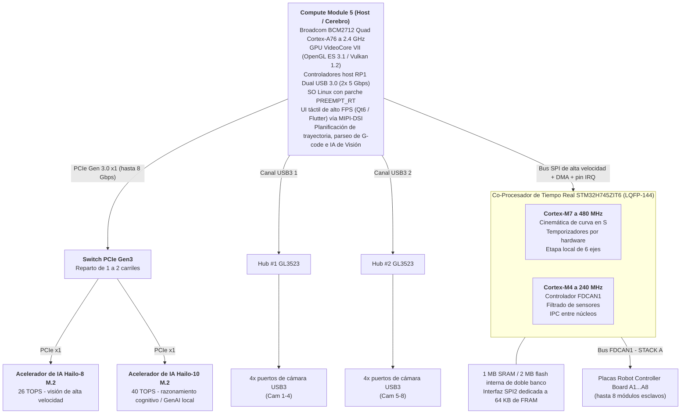
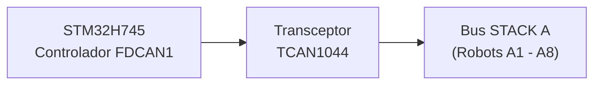
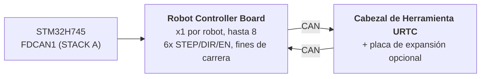

<!-- =============================================================================
HYDRA-UMC - Universal Machines Controller: board design, bootloaders and the CM5 SPI bridge
Copyright (C) JuanenRac (Electro Hobby 3D) <electrohobby3d@gmail.com>
GPL-3.0-or-later - see LICENSE
============================================================================= -->

<p align="center">
  
</p>

# 🚀 HYDRA-UMC

<p align="center"><a href="README.md">🇺🇸 English</a> | 🇪🇸 <b>Español</b> | <a href="README_fra.md">🇫🇷 Français</a> | <a href="README_ita.md">🇮🇹 Italiano</a> | <a href="README_deu.md">🇩🇪 Deutsch</a> | <a href="README_zho.md">🇨🇳 简体中文</a> | <a href="README_jpn.md">🇯🇵 日本語</a> | <a href="README_por.md">🇵🇹 Português</a></p>

### 🤖 La Plataforma Definitiva de Micro-Fábrica de Doble Núcleo y Controlador Multi-Robot (V1.0 - Doble Acelerador de IA por PCIe Hailo-8 + Hailo-10 y Doble Hub USB 3.0)

<p align="center">
  
  
  
  
  
  
  
</p>

---

> **Estado de seguridad física y de ciberseguridad:** este ecosistema no es un sistema de seguridad certificado. Todavía no existe una ruta de E-STOP por hardware, ni límites ni enclavamientos aplicados por el firmware, ni un comando de movimiento verificado; las imágenes de firmware se comprueban con CRC-32 y una firma Ed25519, y una compilación de versión rechaza las claves de desarrollo publicadas (los cabezales de herramienta y las placas de expansión detrás del relé siguen con cargadores de URTC, que usan un HMAC-SHA256 de clave compartida en lugar de una firma); TLS y TLS mutuo son opcionales y están desactivados por defecto; aún no se ha poblado ni probado ninguna placa propia. Lee la [línea base de seguridad](https://github.com/JuanenRac/HYDRA-UMC-DOCS/blob/main/docs/SECURITY_BASELINE.md) y el [modelo de amenazas](https://github.com/JuanenRac/HYDRA-UMC-DOCS/blob/main/docs/THREAT_MODEL.md) antes de fiarte de cualquier afirmación de aquí para la seguridad de una persona.

---

## 📋 De un vistazo

| | |
|---|---|
| Versión | `0.2.3` |
| Madurez | Andamiaje |
| Tests | 154 (`python -m unittest discover -s tests -p 'test_*.py'`) |
| Tecnología | STM32H745 (dual-core) / STM32G474 / FreeRTOS (AMP) / CMSIS-DSP / FDCAN (classic CAN mode) |
| Destino | Una placa con microcontrolador (el firmware); se compila en un PC |
| En hardware real | Todavía no: no consta ninguna ejecución en hardware real para esta versión |

**Ir a:** [Resumen](#-resumen) · [Arquitectura](#-arquitectura) · [Funciones](#-funciones) · [Seguridad y protección](#-seguridad-y-protección) · [Interfaces](#-interfaces) · [Configuración](#-configuración) · [Inicio rápido](#-inicio-rápido) · [Pruebas](#-pruebas) · [Resolución de problemas](#-resolución-de-problemas) · [Estructura del repositorio](#-estructura-del-repositorio) · [Proyectos relacionados](#-proyectos-relacionados)

## 🚦 Estado del proyecto

Cada línea es una parte de este repositorio y la luz dice hasta dónde llega hoy. Se escribe con lo que el repositorio puede demostrar (pruebas, compilaciones, ejecuciones), no con lo previsto.

🟢 Hecho y verificado · 🟡 Funciona, con límites conocidos · 🟠 Hecho a medias o sin verificar · 🔴 Sin hacer o sin funcionar

| Área | Estado | Qué significa aquí |
|---|---|---|
| Software | 🟠 | Solo estructura y primeras piezas; falta la mayor parte del trabajo |
| Pruebas | 🟢 | 154 pruebas automáticas, ejecutadas en cada cambio |
| Hardware real | 🔴 | Todavía no: no consta ninguna ejecución en hardware real para esta versión |
| Documentación | 🟢 | README en ocho idiomas, comprobado contra el manifiesto en cada cambio |

## 🎯 Resumen

**HYDRA-UMC** (Universal Machines Controller) es una plataforma de control distribuido y una arquitectura HMI, todavía en una fase temprana del firmware, diseñadas para robótica celular multi-eje, micro-fábricas, fabricación automatizada y orquestación compleja de cabezales de herramienta.

Diseñada como una **Arquitectura Heterogénea de Host + Co-Procesador de Tiempo Real**, HYDRA-UMC pretende desacoplar el renderizado de interfaz de usuario de alto nivel, la visión por computador, la inferencia de IA y la conectividad en la nube, de la generación de pasos en tiempo real, la gestión del bus de campo y la actuación de la electrónica de potencia (previsto: la generación de pasos y la actuación todavía no están escritas).

> **Estado del diseño:** las secciones siguientes describen el diseño previsto de la placa y de su firmware. Lo que existe hoy se limita a los bootloaders, las aplicaciones de comunicación del CM4 y del G474 y el puente SPI del lado del CM5 (véanse el recuadro *Estado de seguridad* cerca del final y la tabla de estado de `docs/architecture.md`). Siempre que una frase de abajo hable en presente de generación de movimiento, perfiles en S, bucles PID, enclavamientos de seguridad, un E-STOP, gestión de pérdida de alimentación, detección de objetos o cualquier otro comportamiento de la placa final, léela como previsto: nada de ello se ha ejecutado en una placa poblada.

### 🤖 Capacidades de la Micro-Fábrica (objetivos de diseño):
* 📡 **Red Multi-Robot Distribuida:** Previsto: coordinar hasta 8 módulos robóticos esclavos distribuidos (primero 3, 4, 5 y 6 ejes; escalable a 7, 8, 9 ejes y arquitecturas de robots duales en futuras versiones) conectados a través de un único bus físico CAN.
* 🧠 **Doble Coprocesamiento Neuronal Embebido:** Un switch PCIe Gen3 a bordo reparte el único carril PCIe del CM5 entre 2 aceleradores de IA M.2 - un Hailo-8 (26 TOPS) que realiza detección de objetos multi-flujo YOLOv8/YOLO11 (previsto; todavía no se ejecuta), inspección de defectos y alineación de fiduciales PnP en tiempo real en las 8 cámaras, más un Hailo-10 (40 TOPS) que ejecuta razonamiento cognitivo y GenAI local en el propio dispositivo (modelos LLM/VLA cuantizados) sin pasar por la nube.
* 📐 **Etapa Local de 6 Ejes:** Generación directa de pulsos step/dir/enable para 6 ejes locales (X, Y1, Y2, Z, E0, E1) para necesidades auxiliares: robots adicionales, revólveres ATC (Cambiador Automático de Herramientas), sincronización de cintas transportadoras o pórticos de tablas XYZ.
* 🎯 **Integración con JuanenPNP y JuanenCNC:** Directamente compatible con sistemas de Pick-and-Place (estructuras de hardware LumenPNP) y unidades CNC equipadas con módulos de láser óptico de 10W para prototipado de PCB y colocación SMD.
* 👁️ **Matriz de Visión e Inspección Óctuple por Cámara:** Doble controlador USB 3.0 integrado que alimenta 8 puertos de cámara USB dedicados para alineación óptica pick-and-place con OpenCV en tiempo real, inspección térmica y monitorización remota de flujo de vídeo.
* ⚡ **Matriz de Actuación y Gestión Térmica:** Controla 16 canales industriales de MOSFET de lado bajo (8 válvulas electroneumáticas + 8 bombas de vacío/generadores venturi) y drivers de cama de alta corriente para soldadura por reflujo SMD o camas de impresión 3D.
* 🚜 **Plataformas Móviles JuanenBOT:** Arquitectura de comunicación escalable capaz de interconectar con plataformas de transporte de 4 ruedas de servicio pesado a 48V (chasis de 50x50x50 cm con ruedas omnidireccionales/mecanum para cargas de 100 kg).

## 🧩 Papel en HYDRA-UMC

**HYDRA-UMC** es el diseño del Universal Machines Controller: un anfitrión Compute Module 5, un coprocesador de tiempo real STM32H745 y hasta ocho Robot Controller Boards en un solo bus CAN, pensado para manejar celdas de robots y microfábricas. Lo que existe hoy son los tres cargadores de arranque (imágenes firmadas, antirretroceso), las aplicaciones de comunicación de la CM4 y la G474 y el puente SPI del lado de la CM5; el resto es diseño, y no se ha construido ninguna placa.

## 🏛️ Arquitectura

<p align="center">
  
</p>

<details>
<summary>Versión en texto del diagrama (Mermaid)</summary>







</details>

## ✨ Funciones

La especificación detallada del diseño (once subsistemas, del ordenador anfitrión a la cabeza de herramienta) es un documento aparte; cada línea de abajo abre su sección:

- [SUBSISTEMA DE COMPUTACIÓN HOST (HMI Y ALTO NIVEL)](docs/HARDWARE_SPECIFICATION_spa.md#2--subsistema-de-computación-host-hmi-y-alto-nivel)
- [SUBSISTEMA ACELERADOR DE IA POR PCIE (NPU DOBLE HAILO-8 + HAILO-10)](docs/HARDWARE_SPECIFICATION_spa.md#3--subsistema-acelerador-de-ia-por-pcie-npu-doble-hailo-8--hailo-10)
- [SUBSISTEMA DE VISIÓN DOBLE USB 3.0 (8x PUERTOS DE CÁMARA)](docs/HARDWARE_SPECIFICATION_spa.md#4--subsistema-de-visión-doble-usb-30-8x-puertos-de-cámara)
- [SUBSISTEMA DE COPROCESAMIENTO EN TIEMPO REAL (DISEÑO)](docs/HARDWARE_SPECIFICATION_spa.md#5--subsistema-de-coprocesamiento-en-tiempo-real-diseño)
- [COMUNICACIÓN DE BUS DE CAMPO DISTRIBUIDO (UN ÚNICO BUS CAN; PERIFÉRICO FDCAN EN MODO CLÁSICO)](docs/HARDWARE_SPECIFICATION_spa.md#6--comunicación-de-bus-de-campo-distribuido-un-único-bus-can-periférico-fdcan-en-modo-clásico)
- [MEMORIA NO VOLÁTIL ULTRA-RÁPIDA (SPI FRAM)](docs/HARDWARE_SPECIFICATION_spa.md#7--memoria-no-volátil-ultra-rápida-spi-fram)
- [SUITE LOCAL DE MOVIMIENTO, ACTUACIÓN Y SENSORES](docs/HARDWARE_SPECIFICATION_spa.md#8--suite-local-de-movimiento-actuación-y-sensores)
- [DISTRIBUCIÓN Y REGULACIÓN DE POTENCIA](docs/HARDWARE_SPECIFICATION_spa.md#9--distribución-y-regulación-de-potencia)
- [COMUNICACIÓN ENTRE PROCESADORES (IPC)](docs/HARDWARE_SPECIFICATION_spa.md#10--comunicación-entre-procesadores-ipc)
- [ESPECIFICACIONES DE HARDWARE DE LA PCB DE 4 CAPAS](docs/HARDWARE_SPECIFICATION_spa.md#11--especificaciones-de-hardware-de-la-pcb-de-4-capas)
- [PLACAS ROBOT CONTROLLER BOARD Y CABEZAL DE HERRAMIENTA URTC (NIVEL DISTRIBUIDO)](docs/HARDWARE_SPECIFICATION_spa.md#12--placas-robot-controller-board-y-cabezal-de-herramienta-urtc-nivel-distribuido)

## 🔒 Seguridad y protección

| Amenaza | Defensa | Dónde |
|---|---|---|
| Una imagen de firmware falsa o editada | Una cabecera fija de 64 bytes (magia, versión, id de hardware, tamaño, palabras de vector, CRC-32) va seguida de la imagen y de una firma Ed25519 de 64 bytes sobre cabecera e imagen; el cargador comprueba primero la firma y no cree nada de la cabecera antes de que verifique | `image_header.h`, `tools/image_header.py` |
| Una imagen firmada antigua enviada de nuevo (retroceso) | Una imagen nueva debe ser estrictamente más nueva que la instalada (se comparan mayor, menor y parche); una más antigua solo se acepta con un token de bajada de versión, una firma Ed25519 sobre las versiones instalada y destino y el resumen de la imagen; el firmware no contiene ninguna constante que permita bajar de versión | `image_header.h`, `ImageHeader_CheckRollback` |
| Imágenes compiladas con las claves de desarrollo | Sin `HYDRA_FW_UPDATE_PUBKEY_HEX` y `HYDRA_FW_HMAC_KEY_HEX` los cargadores llevan claves de desarrollo cuya parte privada está publicada en el repositorio; la compilación avisa, y con `HYDRA_UMC_RELEASE=1` se niega a compilar; la placa solo guarda la clave pública, la semilla privada queda con el dueño | `build_firmware.sh` |
| Una placa que se cuelga | El cargador de la G474 arma el perro guardián independiente (IWDG) como primerísima acción de `main()`, antes de `HAL_Init()`, así que un cuelgue durante el arranque reinicia el chip | `src/mcu_stm32g474/boot/bootloader_main.c` |
| El servicio HTTP local del puente SPI alcanzado por otra persona | Escucha en 127.0.0.1 por defecto, acepta un cuerpo de firmware de 4 MiB como máximo y no guarda ninguna clave de firma: la firma llega en la petición, hecha en la máquina que tiene la semilla privada; no tiene TLS ni inicio de sesión propio, así que quien le reenvíe debe decidir quién puede flashear | `src/cm5_host/spi_bridge/spi_bridge/http_service.py` |

**Lo que hoy nunca hace:** dar una parada de emergencia, límites por software, enclavamientos, el volcado a FRAM al perder la alimentación ni ninguna orden de movimiento; no se afirma Secure Boot ni protección de lectura de la flash. Lee el recuadro de seguridad de arriba antes de fiarte de algo de aquí.

## 🔌 Interfaces

| Topic o ruta | Qué lleva |
|---|---|
| CAN, FDCAN1 in classic mode | un bus (STACK A) del STM32H745 a hasta ocho Robot Controller Boards; los identificadores del protocolo de relé están en una sola tabla, `tools/can_ids.py`, y los comprueba `tests/test_can_ids.py` |
| SPI + DMA + IRQ pin, 128-byte frames | de la CM5 al STM32H745: tramas fijas `SpiOtaFrame` que coinciden con la estructura de C byte a byte; el puente funciona a 10 MHz por defecto |
| `GET /version`, `GET /counters`, `POST /flash` on 127.0.0.1:8765 | el servicio local del puente SPI: la versión de una placa, los contadores de error de su controlador CAN y un flasheo con respuesta en flujo (JSON delimitado por líneas) de una imagen con su firma Ed25519; `relay=1` llega a una cabeza URTC a través de su Robot Controller Board |
| `tools/image_header.py sign \| keygen \| pubkey` | la referencia en el anfitrión de la cabecera de imagen firmada: hace las firmas y los tokens de bajada de versión que comprueban los cargadores, y de ella se genera `tests/image_header_vectors.h` para que los lados C y Python no se separen |

## ⚙️ Configuración

El firmware se configura al compilarse, mediante variables de entorno; el puente SPI toma sus ajustes de su línea de órdenes.

| Variable | Por defecto | Qué fija |
|---|---|---|
| `HYDRA_FW_UPDATE_PUBKEY_HEX` | clave de desarrollo | 64 dígitos hexadecimales: la clave pública Ed25519 para la que debe estar firmada una actualización |
| `HYDRA_FW_HMAC_KEY_HEX` | clave de desarrollo | 64 dígitos hexadecimales guardados fuera del repositorio: la clave de la comprobación de integridad local de la aplicación instalada |
| `HYDRA_UMC_RELEASE` | `0` | con `1` la compilación se niega a usar las claves de desarrollo |
| `HYDRA_UMC_SKIP_HOST_TESTS`, `HOST_CC` | `0`, el compilador del sistema | omite las pruebas lógicas de host del paso 1b, o nombra el compilador de C que usan |
| `python -m spi_bridge run --spi-speed-hz --host --port --collector-url` | `10000000`, `127.0.0.1`, `8765` | el reloj SPI, dónde escucha el servicio HTTP local y la dirección del HYDRA-UMC-TELEMETRY-COLLECTOR al que el puente puede informar (como mucho un informe por segundo) |

## 🚀 Inicio rápido

Compilar el firmware requiere la cadena de herramientas Arm GNU (`arm-none-eabi-gcc` 10.3 o superior), `git` y `python`; las pruebas de host solo necesitan un compilador de C normal y Python. Windows tiene `build_firmware.bat`.

```bash
./build_firmware.sh                                  # builds every MCU target and runs the host tests (step 1b)
./build_firmware.sh g474                             # only the Robot Controller Board; h745 builds only the Kinematic Brain
python tools/verify_firmware_inventory.py            # read-only check of the committed six-component firmware inventory
python -m unittest discover -s tests -p 'test_*.py'  # the Python tests of the firmware sources, the image header and the CAN identifiers
```

### ENTORNO DE DESARROLLO

Lo que las propias máquinas de desarrollo de este proyecto tienen realmente
instalado y verificado funcionando (`build_firmware.sh`/`build_firmware.bat`,
objetivos `g474`/`h745`/por defecto, 0 errores) - no una lista teórica:

* 🔧 **ARM GNU Toolchain** (`arm-none-eabi-gcc` 10.3+) - compila cada objetivo
  de firmware MCU. No se usan ni se requieren archivos de proyecto
  STM32CubeIDE/CubeMX para compilar -
  `build_firmware.sh`/`build_firmware.bat` obtiene las propias fuentes
  HAL/CMSIS de ST directamente de sus repositorios oficiales de GitHub y
  ejecuta el compilador directamente, la misma filosofía que ya estableció
  el propio `build_firmware.sh`/`build_firmware.bat` del repositorio hermano
  `URTC`.
* 🧩 **VS Code + extensiones** (`.vscode/extensions.json` lista todas
  estas): [STM32 VS Code Extension](https://marketplace.visualstudio.com/items?itemName=stmicroelectronics.stm32-vscode-extension)
  (integración de proyecto/compilación/depuración), **Cortex-Debug**
  (depuración SWD/JTAG - independiente de `build_firmware.sh`, útil cuando
  exista hardware real), **CMake Tools** (para el propio proyecto CMake de
  `src/cm5_host/hmi_qt6/`), **C/C++** (IntelliSense en cada archivo fuente de
  firmware/host), **Python** (scripts del pipeline de `ai_inference/`),
  **Hex Editor** (inspeccionar la salida de firmware `.bin`), **YAML**
  (configuración propia de MediaMTX de `video_streamer/`). Abre el
  repositorio, acepta el aviso de extensiones recomendadas, y usa
  **Terminal → Run Task** para las tareas de compilación ya preconfiguradas
  (`.vscode/tasks.json`).
* 🗂️ **git** - tanto para este propio repositorio como para el propio
  vendoring de tags fijos de los paquetes HAL/CMSIS de ST que hace
  `build_firmware.sh` (cacheado bajo `build/`, en gitignore, vuelto a obtener
  con `--clean`).

## 🧪 Pruebas

154 pruebas automáticas se ejecutan con `python -m unittest discover -s tests -p 'test_*.py'`. Son 87 pruebas del puente SPI de la CM5 más 67 de las fuentes del firmware, la cabecera de imagen firmada y los identificadores CAN (las del puente SPI se ejecutan con `PYTHONPATH=src/cm5_host/spi_bridge:src/cm5_host/spi_bridge/tests` y `-s src/cm5_host/spi_bridge/tests`). La lógica en C de los cargadores de arranque y del relé la comprueban otros 19 programas compilados con un compilador de C normal del anfitrión, en el paso 1b de `build_firmware.sh`. Ninguna necesita una placa.

El CI ejecuta `HYDRA_UMC_CI=1 python tools/ci_validate.py`, que comprueba el manifiesto, los documentos, los ocho README y las imágenes.

## 🏗️ Compilación y publicación

**Linux/Mac:**
```bash
./build_firmware.sh          # compila cada objetivo MCU (Robot Controller Board + Kinematic Brain, ambos núcleos)
./build_firmware.sh g474     # solo Robot Controller Board
./build_firmware.sh h745     # solo Kinematic Brain (ambos núcleos)
./build_firmware.sh --clean  # borra primero la caché de HAL/CMSIS obtenida
```

**Windows:**
```bat
build_firmware.bat          :: compila cada objetivo MCU (Robot Controller Board + Kinematic Brain, ambos núcleos)
build_firmware.bat g474     :: solo Robot Controller Board
build_firmware.bat h745     :: solo Kinematic Brain (ambos núcleos)
build_firmware.bat --clean  :: borra primero la caché de HAL/CMSIS obtenida
```

`build_firmware.bat` es la misma compilación que `build_firmware.sh`
traducida a batch (mismos pasos, mismas versiones fijas de HAL/CMSIS, mismo
reporte pass/warn/fail) - ejecutada de principio a fin en una máquina
Windows real con el [Arm GNU
Toolchain](https://developer.arm.com/downloads/-/arm-gnu-toolchain-downloads)
instalado y `arm-none-eabi-gcc` en el `PATH`: cada módulo HAL, ambos
bootloaders, y cada aplicación se compilaron y enlazaron limpio, y
`firmware_manifest.json` se regeneró con CRC32s que coinciden con la propia
salida de la compilación de Linux/Mac. Requiere las mismas herramientas que
el script de Linux/Mac: el Arm GNU Toolchain, `git` (para obtener las propias
fuentes HAL/CMSIS de ST), y `python` para el paso del manifest.

**Compilación manual (cualquier SO, sin el script):** el script automatiza
exactamente los pasos de `docs/COMPILE_STM32G474.TXT` y
`docs/COMPILE_STM32H745.TXT` - obtiene las fuentes fijas de
HAL/CMSIS/FreeRTOS listadas al principio de
`build_firmware.sh`/`build_firmware.bat`, compila los módulos HAL y los
archivos de arranque/sistema de cada objetivo con `arm-none-eabi-gcc` (las
flags/listas de módulos están listadas en ese mismo script), luego enlaza
cada bootloader y aplicación contra su propio script de enlazado (`*.ld`,
junto a su fuente) con `arm-none-eabi-gcc`/`-Wl,--gc-sections` y convierte con
`arm-none-eabi-objcopy` a `.bin`/`.hex`. Esos dos archivos
`docs/COMPILE_*.TXT` son la referencia autoritativa paso a paso si prefieres
no ejecutar ninguno de los scripts - los scripts existen para automatizarlos,
no para reemplazarlos como fuente de verdad.

La salida termina en `firmware/`, que está comiteada y subida a este
repositorio (misma convención que la propia carpeta de salida `firmware/` de
URTC) para que la función de descarga desde GitHub de HYDRA-UMC-STUDIO pueda
encontrar de verdad archivos `.bin` reales ahí vía
`firmware_manifest.json` - NO está en gitignore.
Ver `docs/COMPILE_STM32G474.TXT` y `docs/COMPILE_STM32H745.TXT` para
exactamente qué hace cada paso y por qué - y el propio `README.md` de cada
carpeta de firmware para el estado actual. Los **bootloaders** de los 3
objetivos (G474, H745 CM7, H745 CM4) son implementaciones reales y
funcionales de CAN-OTA/SPI-OTA (verificación CRC-32 + firma Ed25519,
verificar-en-el-slot-de-respaldo-antes-de-copiar-al-principal, la misma
disciplina anti-brickeo que el propio bootloader de URTC) - compilando limpio
de principio a fin, todavía no verificados contra hardware real. Las
**aplicaciones** siguen siendo pruebas de humo FreeRTOS de GPIO-toggle
verificadas por compilación, todavía no el firmware real de
movimiento/visión/relé. Ver `docs/architecture.md` (especialmente la tabla
de estado de la sección 6 y las limitaciones de seguridad conocidas y
aceptadas de la sección 8) para exactamente qué es real frente a lo que
sigue abierto.

> **Estado de seguridad:** este repositorio todavía no contiene ninguna ruta de E-STOP, límites por software, enclavamientos de seguridad, el volcado a FRAM por pérdida de alimentación (PVD) ni ningún comando de movimiento. Allí donde las secciones anteriores (u otro proyecto del ecosistema) los describen, es el diseño previsto: nada debe depender de ello para la seguridad hasta que esté implementado y probado en una placa real. Lo que hacen hoy las aplicaciones: las del CM4 y del G474 ejecutan el sondeo/respuesta AXIS_STATUS de STACK A y el túnel de relé de Tier 2/3; la del CM7 sigue siendo una prueba de humo con GPIO-toggle.

Los seis componentes del firmware (tres cargadores de arranque y tres aplicaciones, un par por chip o núcleo) tienen cada uno su versión. Compilar nunca la cambia: `build_firmware.sh` y `.bat` solo la informan. Subir versiones es el comando explícito `python bump_firmware_versions.py` (`--list` las muestra), y `python show_component_version.py` imprime la versión de un componente.

## 🩺 Resolución de problemas

| Ves | Porque | Haz |
|---|---|---|
| «los cargadores aceptan actualizaciones firmadas con la semilla de DESARROLLO, que es pública» | La compilación no tenía `HYDRA_FW_UPDATE_PUBKEY_HEX` (o no tenía `HYDRA_FW_HMAC_KEY_HEX`) | Vale para un banco de pruebas; para cualquier placa que otra persona pueda alcanzar, crea un par de claves con `python tools/image_header.py keygen`, compila con la clave pública y compila las versiones con `HYDRA_UMC_RELEASE=1` |
| «arm-none-eabi-gcc no encontrado» | La cadena de herramientas Arm GNU no está instalada o no está en `PATH` | Instálala (el script prueba `apt` en Linux) y vuelve a compilar; las pruebas de host del paso 1b solo necesitan un compilador de C normal |
| El puente SPI no abre el dispositivo, o `SPI transfer returned ... bytes` | El transporte real necesita `spidev` y `gpiod` en una CM5 con el dispositivo SPI activado, y un STM32H745 al otro lado; ninguno existe aún, así que el puente solo se ha ejercitado con simulaciones | Usa el transporte simulado de las pruebas hasta que exista una placa |
| `build_firmware.sh` termina con FAIL en una prueba de host | Las copias de una fuente que comparten los tres cargadores se han separado, o `tests/image_header_vectors.h` es más viejo que `tools/image_header.py` | Ejecuta `python tools/gen_image_header_vectors.py` y `python -m unittest discover -s tests` para ver qué copia difiere |

## 📂 Estructura del repositorio

<p align="center">
  
</p>

<details>
<summary>Versión en texto del árbol</summary>

```text
HYDRA-UMC/
├── src/
│   ├── cm5_host/                    Aplicaciones Linux userspace que corren ENCIMA de la propia imagen de os/
│   ├── mcu_stm32h745/               Firmware del Kinematic Brain (Nivel 0) - doble núcleo
│   └── mcu_stm32g474/               Firmware de la Robot Controller Board (Nivel 1) - un solo núcleo, + su propio boot/
├── .vscode/                         Extensiones recomendadas + tareas de build - ver "Entorno de Desarrollo" abajo
├── docs/                            arquitectura, referencias de compilación, asignación de pines, protocolo CAN, hojas de datos
├── hardware/                        los dos diseños de placa; aún sin esquema
├── tests/                           Pruebas en el ordenador: la lógica en C de los bootloaders y del relé (stubs/ sustituye al HAL, image_header_vectors.h guarda los vectores de referencia) y pruebas en Python de las herramientas
├── os/                              Imagen de SO del CM5 - elección de SO base, unidades systemd, aprovisionamiento de primer arranque
├── images/                          Banner del README + icono + splashscreen (SVG)
├── tools/                           herramientas del proyecto y comprobaciones del CI
├── firmware/                        Salida de compilación comiteada (.bin/.hex/.elf + manifest) - NO en gitignore, misma convención que la propia carpeta de salida de URTC, ver "Compilando el Firmware" abajo
├── .github/                         flujo de CI y plantillas de incidencias
├── build_firmware.sh                Compila cada objetivo de firmware MCU de arriba desde una copia limpia (Linux/Mac)
├── build_firmware.bat               La misma compilación, Windows (ver "Compilando el Firmware" abajo)
├── build-test.sh / build-test.bat   Comprobación de build/compilación sin subir versión
├── generate_manifest.py             Regenera firmware/firmware_manifest.json (versiones/CRC32) tras una compilación completa
├── bump_version.py                  Incremento de versión tipo cuentakilómetros de un componente
├── bump_firmware_versions.py        Sube las seis versiones de componente, de forma explícita
├── show_component_version.py        Muestra la versión que ya tiene un componente
├── bump_manifest_version.py         Sincroniza la versión de hydra-umc.project.json con la nativa (--sync)
├── CHANGELOG.md                     qué cambió en cada versión
├── hydra-umc.project.json           manifiesto: versión, madurez, familia
└── test.sh                          comprobación de compilación sin cambios
```

</details>

## 🗺️ Hoja de ruta y límites conocidos

Lo que existe hoy se limita a los tres cargadores de arranque, las aplicaciones de comunicación de la CM4 y la G474 y el puente SPI del lado de la CM5; el resto de la especificación es diseño. No se ha montado ni probado ninguna placa propia, las dos carpetas de placa aún no tienen esquema, y las aplicaciones son pruebas de humo de FreeRTOS que conmutan un pin, no el firmware de movimiento, visión y relé. Los cargadores y el puente se probaron en un ordenador anfitrión, nunca en los chips reales.

## 🌍 Idiomas

Este README y los documentos del repositorio existen en ocho idiomas: inglés, español, alemán, francés, italiano, japonés, chino y portugués (Portugal). Se escriben a la vez y el CI comprueba que los ocho ficheros tengan las mismas secciones y los mismos enlaces. Este repositorio no tiene pantalla ni catálogo de mensajes propios, así que no hay cadenas de interfaz que traducir.

## 🔗 Proyectos relacionados

Este proyecto es parte del ecosistema de robótica HYDRA-UMC del mismo autor (JuanenRac / Electro Hobby 3D). Vale la pena conocerlo, ya que una petición podría en realidad ser sobre alguno de estos en vez de sobre este repositorio.

**Directamente Relacionados** — proyectos que se conectan directamente a este firmware
- **[URTC](https://github.com/JuanenRac/URTC)** — firmware para la placa física del Universal Robot Tool Controller, más de 25 perfiles de herramienta por bus CAN; el firmware del cabezal de herramienta que monta cada brazo robótico que controla esta placa, un salto más allá por su propio enlace CAN.
- **[HYDRA-UMC-OS](https://github.com/JuanenRac/HYDRA-UMC-OS)** — capa de producto reproducible sobre Raspberry Pi OS para el CM5: agente de solo lectura, config/perfiles validados, aprovisionamiento WiFi de primer contacto; el sistema operativo que ejecuta el propio host CM5 de esta placa.
- **[HYDRA-UMC-SERVER](https://github.com/JuanenRac/HYDRA-UMC-SERVER)** — el backend headless real (REST/WebSocket) con el que habla de verdad cada cliente de control; su propio servicio `spi_bridge` habla con este firmware a través de la conexión SPI-OTA real CM5↔STM32H745.
- **[HYDRA-UMC-VISION-NODE](https://github.com/JuanenRac/HYDRA-UMC-VISION-NODE)** — nodo de integración para el pipeline de visión Hailo-8, con una comprobación real de disponibilidad de hardware por etapa; todavía no existe ningún bucle de percepción/E-STOP contra este firmware.
- **[HYDRA-UMC-SAFETY-ZONES](https://github.com/JuanenRac/HYDRA-UMC-SAFETY-ZONES)** — lógica v0 de invasión de zona, vigencia de calibración y solicitud de E-STOP que toma las posiciones de los objetos de un fichero; ningún detector la alimenta y todavía no hay un E-STOP físico conectado.
- **[HYDRA-UMC-VISUAL-SERVOING-API](https://github.com/JuanenRac/HYDRA-UMC-VISUAL-SERVOING-API)** — ley de corrección Position-Based Visual Servoing con autorización condicionada al estado de zona; todavía sin estimación de pose por cámara.
- **[HYDRA-UMC-ORCHESTRATOR](https://github.com/JuanenRac/HYDRA-UMC-ORCHESTRATOR)** — nodo de integración con un contrato real de informe de salud gRPC/Protobuf y una máquina de estados de misión; coordina varias unidades HYDRA-UMC como un enjambre.
- **[HYDRA-UMC-TWIN](https://github.com/JuanenRac/HYDRA-UMC-TWIN)** — nodo de integración para el motor de gemelo digital, con un contrato real de sincronización por compatibilidad de versión; pensado para replicar la cinemática de este firmware cuando exista.
- **[URTC-SMART-RACK](https://github.com/JuanenRac/URTC-SMART-RACK)** — firmware para un rack de montaje de placas con decodificación real de ID de herramienta y lógica de precalentamiento Smart Idle; comparte el mismo bus CAN de herramientas que este firmware.
- **[URTC-VISION-TOOL](https://github.com/JuanenRac/URTC-VISION-TOOL)** — firmware más un compañero de visión real en Python para un cabezal de inspección térmica/RGB; comparte el mismo bus CAN de herramientas que este firmware.

**También Forma Parte del Ecosistema**

*Hardware y Plataforma Base*
- **[HYDRA-UMC-SDK](https://github.com/JuanenRac/HYDRA-UMC-SDK)** — el contrato JSON-Schema compartido y la barrera de software de puerta de trabajos contra la que cada bridge valida sus comandos (no es una función de seguridad certificada).
- **[HYDRA-UMC-CONNECTOR-HUB](https://github.com/JuanenRac/HYDRA-UMC-CONNECTOR-HUB)** — registro declarativo y validador de manifiestos de adaptador para conectores de máquinas externas; extiende la propia idea de contrato del SDK a máquinas externas sin sustituir a los proyectos de pasarela industrial.

*Backend Central y Clientes*
- **[HYDRA-UMC-STUDIO](https://github.com/JuanenRac/HYDRA-UMC-STUDIO)** — panel de control web con visualización 3D multi-robot en tiempo real.
- **[HYDRA-UMC-SUITE](https://github.com/JuanenRac/HYDRA-UMC-SUITE)** — centro de mando de enjambre de escritorio (PySide6) para varios servidores a la vez, empaquetado como ejecutable independiente.
- **[HYDRA-UMC-ANDROID-CONTROL](https://github.com/JuanenRac/HYDRA-UMC-ANDROID-CONTROL)** — app nativa de control para Android con inicio de sesión biométrico y un compañero Wear OS emparejado.
- **[HYDRA-UMC-IOS-CONTROL](https://github.com/JuanenRac/HYDRA-UMC-IOS-CONTROL)** — app de control para iOS/iPadOS (Flutter) con sincronización en tiempo real por WebSocket.
- **[HYDRA-UMC-DSI](https://github.com/JuanenRac/HYDRA-UMC-DSI)** — interfaz táctil nativa para la pantalla táctil DSI de 7" a bordo, embebida en el propio CM5.
- **[HYDRA-UMC-EDITOR-URDF](https://github.com/JuanenRac/HYDRA-UMC-EDITOR-URDF)** — creador/editor gráfico de URDF de escritorio que envía los modelos terminados al propio catálogo de STUDIO.
- **[HYDRA-UMC-EDITOR-STL](https://github.com/JuanenRac/HYDRA-UMC-EDITOR-STL)** — editor de escritorio de modelos STL, que transforma/reemplaza/quita/añade piezas reales en el mismo catálogo de modelos que también edita HYDRA-UMC-EDITOR-URDF.
- **[HYDRA-UMC-BRIDGE-AMR](https://github.com/JuanenRac/HYDRA-UMC-BRIDGE-AMR)** — barrera de coordinación para flotas AGV/AMR mediante un publicador MQTT VDA 5050 (probado solo contra una flota emulada).
- **[HYDRA-UMC-BRIDGE-CNC](https://github.com/JuanenRac/HYDRA-UMC-BRIDGE-CNC)** — coordinador de alto nivel para celdas CNC con acceso a estado/bytes de control GRBL (probado solo contra un emulador).
- **[HYDRA-UMC-BRIDGE-DROIDS](https://github.com/JuanenRac/HYDRA-UMC-BRIDGE-DROIDS)** — barrera de coordinación para droides con patas/humanoides, con un emisor de comandos para Boston Dynamics Spot (probado solo contra un emulador).
- **[HYDRA-UMC-BRIDGE-LASER](https://github.com/JuanenRac/HYDRA-UMC-BRIDGE-LASER)** — coordinador de celdas láser que lee 3 señales GPIO de llave/carcasa/enclavamiento (probado solo contra un chip simulado; no puede armar ni disparar un láser).
- **[HYDRA-UMC-BRIDGE-OPENPNP](https://github.com/JuanenRac/HYDRA-UMC-BRIDGE-OPENPNP)** — coordinador de alto nivel seguro para el flujo de placas de pick-and-place OpenPnP.
- **[HYDRA-UMC-BRIDGE-PRINTER3D](https://github.com/JuanenRac/HYDRA-UMC-BRIDGE-PRINTER3D)** — barrera de coordinación segura para impresoras 3D Moonraker/Klipper, con comandos de trabajo reales y controlados.
- **[HYDRA-UMC-BRIDGE-ROS2](https://github.com/JuanenRac/HYDRA-UMC-BRIDGE-ROS2)** — coordinador con un transporte ROS 2 rclpy importado de forma perezosa (todavía no ejecutado contra una instalación de ROS 2).
- **[HYDRA-UMC-BRIDGE-UAV](https://github.com/JuanenRac/HYDRA-UMC-BRIDGE-UAV)** — barrera de coordinación para UAV equipados con cámara, con un emisor de comandos MAVLink (probado solo contra un emulador).

*Plataforma de Herramientas URTC*
- **[URTC-FLASHER](https://github.com/JuanenRac/URTC-FLASHER)** — herramienta de escritorio con GUI para flashear placas URTC, CAN-OTA más SWD/JTAG de chip completo.
- **[URTC-TESTER](https://github.com/JuanenRac/URTC-TESTER)** — herramienta de escritorio de diagnóstico CAN-bus en vivo para placas URTC, un panel por perfil de herramienta.
- **[URTC-WEB-STUDIO](https://github.com/JuanenRac/URTC-WEB-STUDIO)** — alternativa basada en navegador a URTC-TESTER mediante la Web Serial API, sin instalación local.
- **[URTC-GATEWAY](https://github.com/JuanenRac/URTC-GATEWAY)** — pasarela delante del bus CAN de URTC: lista de identificadores permitidos, límite de tasa y clave de sesión; software probado en ordenador, aún no en un bus real.

*Nodo IA de Visión (Hailo-8)*
- **[HYDRA-UMC-DETECTION-HEF](https://github.com/JuanenRac/HYDRA-UMC-DETECTION-HEF)** — registro real de modelos compilados con verificación de carga segura por arquitectura Hailo/checksum.
- **[HYDRA-UMC-VISION-STREAMER](https://github.com/JuanenRac/HYDRA-UMC-VISION-STREAMER)** — generador real de pipeline GStreamer + config MediaMTX, con una frontera de integración HailoRT real.

*Nodo IA Cognitivo (Hailo-10)*
- **[HYDRA-UMC-COGNITIVE-NODE](https://github.com/JuanenRac/HYDRA-UMC-COGNITIVE-NODE)** — nodo de integración para el pipeline cognitivo Hailo-10 (orquestación de LLM/VLA/voz).
- **[HYDRA-UMC-VLA-ENGINE](https://github.com/JuanenRac/HYDRA-UMC-VLA-ENGINE)** — codificación/decodificación real de tokens de acción y generación de trayectoria para un modelo Vision-Language-Action.
- **[HYDRA-UMC-VOICE-UI](https://github.com/JuanenRac/HYDRA-UMC-VOICE-UI)** — front-end de voz real (VAD + analizador de intención) con un relé a Watch acotado y con confirmación.
- **[HYDRA-UMC-SEMANTIC-PLANNER](https://github.com/JuanenRac/HYDRA-UMC-SEMANTIC-PLANNER)** — descomposición real de tareas basada en reglas y recuperación semántica de errores sobre códigos de error del MCU.
- **[HYDRA-UMC-DOCS-QA](https://github.com/JuanenRac/HYDRA-UMC-DOCS-QA)** — búsqueda real de documentos TF-IDF (solo librería estándar) sobre los propios documentos Markdown de este ecosistema.

*Orquestación y Enjambre*
- **[HYDRA-UMC-JOB-DISPATCHER](https://github.com/JuanenRac/HYDRA-UMC-JOB-DISPATCHER)** — cola de trabajos real basada en prioridad con deduplicación, sobre una API HTTP real.
- **[HYDRA-UMC-NODE-HEALING](https://github.com/JuanenRac/HYDRA-UMC-NODE-HEALING)** — watchdog de salud de flota real basado en gRPC, con reintento/backoff y detección de discrepancia de identidad.
- **[HYDRA-UMC-PATH-PLANNER-3D](https://github.com/JuanenRac/HYDRA-UMC-PATH-PLANNER-3D)** — planificador de rutas 3D real basado en RRT, con validación real de colisión de obstáculos/espacio de trabajo.
- **[HYDRA-UMC-SWARM-SYNC](https://github.com/JuanenRac/HYDRA-UMC-SWARM-SYNC)** — sincronización de estado real mediante CRDT LWW-Element-Map, con pruebas de propiedades para convergencia multi-celda.

*Gemelo Digital y Simulación*
- **[HYDRA-UMC-HIL-BRIDGE](https://github.com/JuanenRac/HYDRA-UMC-HIL-BRIDGE)** — enrutador hardware-in-the-loop con un enclavamiento de software por colisión entre simulación y hardware real (probado sin hardware real).
- **[HYDRA-UMC-PHYSICS-REPLICA](https://github.com/JuanenRac/HYDRA-UMC-PHYSICS-REPLICA)** — cinemática directa real y validación de límites articulares sobre un subconjunto real de URDF.
- **[HYDRA-UMC-SYNTHETIC-DATA-GEN](https://github.com/JuanenRac/HYDRA-UMC-SYNTHETIC-DATA-GEN)** — generador real de escenas 2D procedurales con exportación de anotaciones YOLO/COCO.

*Datos y Analítica*
- **[HYDRA-UMC-DATALAKE](https://github.com/JuanenRac/HYDRA-UMC-DATALAKE)** — almacén de series temporales real respaldado por sqlite3, con una API HTTP real de ingesta/consulta.
- **[HYDRA-UMC-ANOMALY-DETECTOR](https://github.com/JuanenRac/HYDRA-UMC-ANOMALY-DETECTOR)** — detector de anomalías real basado en FFT + línea base estadística, con monitorización de deriva.
- **[HYDRA-UMC-PRODUCTION-REPORTS](https://github.com/JuanenRac/HYDRA-UMC-PRODUCTION-REPORTS)** — cálculo real de OEE/disponibilidad sobre el histórico de DATALAKE, con exportación CSV reproducible.
- **[HYDRA-UMC-TELEMETRY-COLLECTOR](https://github.com/JuanenRac/HYDRA-UMC-TELEMETRY-COLLECTOR)** — pipeline real de ingesta CAN/WebSocket hacia DATALAKE, con deduplicación por secuencia.

*Pasarela Industrial*
- **[HYDRA-UMC-GATEWAY-INDUSTRIAL](https://github.com/JuanenRac/HYDRA-UMC-GATEWAY-INDUSTRIAL)** — nodo de integración que retransmite a protocolos industriales, con una capa real de lista blanca de comandos/contrapresión.
- **[HYDRA-UMC-OPCUA-SERVER](https://github.com/JuanenRac/HYDRA-UMC-OPCUA-SERVER)** — espacio de direcciones OPC-UA real, verificado con una sesión de cliente real del protocolo binario.
- **[HYDRA-UMC-MQTT-BROKER](https://github.com/JuanenRac/HYDRA-UMC-MQTT-BROKER)** — broker MQTT real con autenticación por cliente opcional y ACL de tópicos.
- **[HYDRA-UMC-MTCONNECT-ADAPTER](https://github.com/JuanenRac/HYDRA-UMC-MTCONNECT-ADAPTER)** — endpoints XML reales `/probe` y `/current` de MTConnect, con salida en modo degradado.

*Herramientas Complementarias y Operaciones del Ecosistema*
- **[HYDRA-UMC-DASHBOARD-AI](https://github.com/JuanenRac/HYDRA-UMC-DASHBOARD-AI)** — paneles de Resúmenes Inteligentes y Resaltado de Anomalías sobre DATALAKE/ANOMALY-DETECTOR, con un respaldo estadístico honesto.
- **[HYDRA-UMC-TOOL-CLI](https://github.com/JuanenRac/HYDRA-UMC-TOOL-CLI)** — CLI de flota con un contrato real y estable de códigos de salida, cliente real y en vivo de la propia API de HYDRA-UMC-SERVER.
- **[HYDRA-UMC-WATCH](https://github.com/JuanenRac/HYDRA-UMC-WATCH)** — app compañera de WearOS con patrones de alerta háptica y un relé de voz al teléfono emparejado (todavía no ejecutada en un reloj físico).
- **[HYDRA-UMC-UPDATER](https://github.com/JuanenRac/HYDRA-UMC-UPDATER)** — herramienta administrativa de escritorio que descubre, clona y actualiza cada repositorio de este ecosistema.
- **[HYDRA-UMC-OS-REBUILDER](https://github.com/JuanenRac/HYDRA-UMC-OS-REBUILDER)** — herramienta de escritorio Windows/Linux que construye una imagen de la CM5 lista para grabar, precargada con las versiones más actuales del ecosistema, con configuración de primer arranque de Wi-Fi/usuario/SSH al estilo de Raspberry Pi Imager.
- **[HYDRA-UMC-OPS-AGENT](https://github.com/JuanenRac/HYDRA-UMC-OPS-AGENT)** — coordinador de incidencias de mantenimiento: un rol edge de bajo privilegio recopila un snapshot de inventario/salud saneado, un rol control-plane lo renderiza de solo lectura y pide a un proveedor de IA que sugiera un diagnóstico - nunca aplica un parche ni despliega nada.
- **[HYDRA-UMC-DOCS](https://github.com/JuanenRac/HYDRA-UMC-DOCS)** — el centro de documentación y herramientas del ecosistema: arquitectura, interfaces, base de seguridad, matriz de capacidades y un catálogo de proyectos generado a partir de cada manifiesto.

## 📚 Documentación

Dónde leer más:

* [docs/SOURCE_MAP.md](docs/SOURCE_MAP.md) - cada fichero del repositorio con una línea sobre lo que hace
* [docs/HARDWARE_SPECIFICATION.md](docs/HARDWARE_SPECIFICATION.md) - la especificación del diseño: once subsistemas, del ordenador anfitrión a la cabeza de herramienta (un fichero por idioma)
* [Base de seguridad del ecosistema](https://github.com/JuanenRac/HYDRA-UMC-DOCS/blob/main/docs/SECURITY_BASELINE.md)
* [Modelo de amenazas del ecosistema](https://github.com/JuanenRac/HYDRA-UMC-DOCS/blob/main/docs/THREAT_MODEL.md)
* [Historial de cambios de este repositorio](CHANGELOG.md)
* [Licencia de este repositorio](LICENSE.md)

## 🤝 Contribuir y comunidad

* Antes de un pull request ejecuta `HYDRA_UMC_CI=1 py -3 tools/ci_validate.py` (o `HYDRA_UMC_CI=1 python3 tools/ci_validate.py`): debe imprimir `CI_VALIDATION=PASS`. No ejecutes `build.sh` ni `build.bat` para esta comprobación; compilar no es comprobar.
* Los ocho README se escriben desde una sola fuente en HYDRA-UMC-DOCS; no los edites a mano. Cambia la fuente y vuelve a escribirlos con `tools/make_readmes.py`.
* No afirmes en un README lo que no se ha ejecutado: di «simulado» o «sin probar en hardware» cuando esa sea la verdad.
* Mira [CONTRIBUTING.md](CONTRIBUTING.md), el [código de conducta](CODE_OF_CONDUCT.md), [SECURITY.md](SECURITY.md) y [SUPPORT.md](SUPPORT.md).

## 👤 AUTOR

**JuanenRac (Electro Hobby 3D)** · electrohobby3d@gmail.com

## 📜 LICENCIA

GPL-3.0-or-later - [LICENSE](LICENSE).
