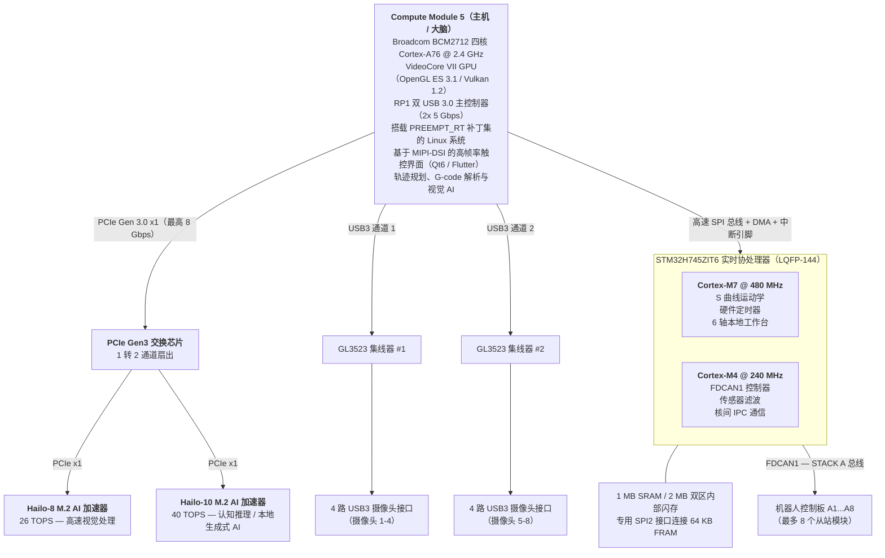
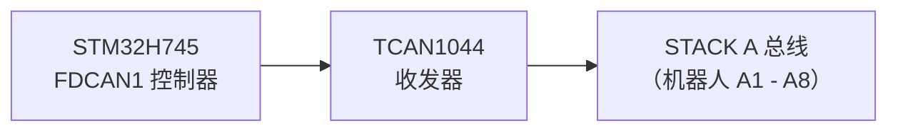
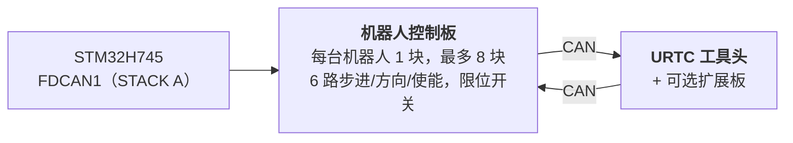

<!-- =============================================================================
HYDRA-UMC - Universal Machines Controller: board design, bootloaders and the CM5 SPI bridge
Copyright (C) JuanenRac (Electro Hobby 3D) <electrohobby3d@gmail.com>
GPL-3.0-or-later - see LICENSE
============================================================================= -->

<p align="center">
  
</p>

# 🚀 HYDRA-UMC

<p align="center"><a href="README.md">🇺🇸 English</a> | <a href="README_spa.md">🇪🇸 Español</a> | <a href="README_fra.md">🇫🇷 Français</a> | <a href="README_ita.md">🇮🇹 Italiano</a> | <a href="README_deu.md">🇩🇪 Deutsch</a> | 🇨🇳 <b>简体中文</b> | <a href="README_jpn.md">🇯🇵 日本語</a> | <a href="README_por.md">🇵🇹 Português</a></p>

### 🤖 终极双核微工厂与多机器人控制器平台（V1.0 — 双 PCIe Hailo-8 + Hailo-10 AI 加速器 与 双 USB 3.0 集线器）

<p align="center">
  
  
  
  
  
  
  
</p>

---

> **安全与安防现状:**本生态系统不是经认证的安全系统。目前尚无硬件 E-STOP 通路,没有由固件强制执行的限位或联锁,也没有经过验证的运动指令;固件映像使用 CRC-32 和 Ed25519 签名校验,发布构建会拒绝已公开的开发密钥(中继之后的工具头和扩展板仍运行 URTC 的引导程序,它们使用共享密钥的 HMAC-SHA256 而不是签名);TLS 与双向 TLS 均为可选项,默认关闭;自制电路板尚未组装或测试。在依赖此处任何说法来保障人身安全之前,请先阅读[安全基线](https://github.com/JuanenRac/HYDRA-UMC-DOCS/blob/main/docs/SECURITY_BASELINE.md)和[威胁模型](https://github.com/JuanenRac/HYDRA-UMC-DOCS/blob/main/docs/THREAT_MODEL.md)。

---

## 📋 速览

| | |
|---|---|
| 版本 | `0.2.3` |
| 成熟度 | 雏形 |
| 测试 | 154 (`python -m unittest discover -s tests -p 'test_*.py'`) |
| 技术栈 | STM32H745 (dual-core) / STM32G474 / FreeRTOS (AMP) / CMSIS-DSP / FDCAN (classic CAN mode) |
| 目标 | 微控制器板（固件）；在电脑上构建 |
| 真实硬件 | 尚未：此版本没有在真实硬件上运行的记录 |

**跳转：** [概述](#-概述) · [架构](#-架构) · [功能](#-功能) · [安全与防护](#-安全与防护) · [接口](#-接口) · [配置](#-配置) · [快速开始](#-快速开始) · [测试](#-测试) · [故障排除](#-故障排除) · [仓库结构](#-仓库结构) · [相关项目](#-相关项目)

## 🚦 项目状态

每一行是本仓库的一个部分，灯号表示它今天做到了哪一步。内容依据仓库能够展示的证据（测试、构建、运行），而不是计划。

🟢 已完成并验证 · 🟡 可用，有已知限制 · 🟠 部分完成或尚未验证 · 🔴 未完成或不可用

| 领域 | 状态 | 在这里的含义 |
|---|---|---|
| 软件 | 🟠 | 目前只有结构和最初的部分，大部分工作尚未完成 |
| 测试 | 🟡 | 154 项自动测试，每次变更都会运行 |
| 真实硬件 | 🔴 | 尚未：此版本没有在真实硬件上运行的记录 |
| 文档 | 🟡 | 八种语言的 README，每次变更都会与清单核对 |

## 🎯 概述

**HYDRA-UMC**（Universal Machines Controller，通用多轴控制器）是一套分布式控制平台与 HMI 架构（固件仍处于早期阶段），专为多轴单元机器人、微工厂、自动化制造以及复杂工具头编排而设计。

HYDRA-UMC 按 **异构主机 + 实时协处理器架构** 设计，目标是将高层用户界面渲染、计算机视觉、AI 推理与云端连接，同实时步进脉冲生成、现场总线管理及功率电子驱动解耦（计划中：步进脉冲生成与驱动尚未编写）。

> **设计状态:**以下各节描述的是电路板及其固件的预期设计。目前实际存在的只有引导加载程序、CM4 与 G474 的通信应用,以及 CM5 一侧的 SPI 桥(参见靠后位置的“安全状态”提示框和 `docs/architecture.md` 中的状态表)。下文凡以现在时描述运动生成、S 曲线、PID 回路、安全联锁、E-STOP、掉电处理、目标检测或成品电路板其他行为的句子,均应理解为计划中:其中任何一项都没有在已组装的电路板上运行过。

### 🤖 微工厂能力（设计目标）：
* 📡 **分布式多机器人网络：** 计划中：通过单一物理 CAN 总线，协调多达 8 个分布式从属机器人模块（先支持 3、4、5、6 自由度；未来版本将扩展至 7、8、9 自由度及双机器人架构）。
* 🧠 **双嵌入式神经协处理：** 板载 PCIe Gen3 交换芯片将 CM5 的单条 PCIe 通道扇出为 2 个 M.2 AI 加速器 —— 一颗 Hailo-8（26 TOPS）负责多路 YOLOv8/YOLO11 (计划中;尚未运行) 目标检测、缺陷检测，以及全部 8 路摄像头的实时 PnP 基准点对齐；一颗 Hailo-10（40 TOPS）负责本地设备端的认知推理与生成式 AI（量化后的 LLM/VLA 模型），无需回传云端。
* 📐 **本地 6 轴工作台：** 为 6 个本地轴（X、Y1、Y2、Z、E0、E1）直接生成 步进/方向/使能 脉冲，服务于辅助需求：额外机器人、ATC（自动换刀装置）转塔、传送带同步或 XYZ 工作台龙门架。
* 🎯 **JuanenPNP 与 JuanenCNC 集成：** 直接兼容 Pick-and-Place 系统（LumenPNP 硬件结构）以及配备 10W 光学激光模块的 CNC 设备，用于 PCB 原型制作与 SMD 贴装。
* 👁️ **八路摄像头视觉与检测矩阵：** 集成双 USB 3.0 控制器，驱动 8 个专用 USB 摄像头接口，用于实时 OpenCV Pick-and-Place 光学对位、热成像检测及远程视频流监控。
* ⚡ **驱动矩阵与热管理：** 控制 16 路工业级低边 MOSFET 通道（8 路电磁气动阀 + 8 路真空泵/文丘里发生器）以及用于 SMD 回流焊或 3D 打印热床的大电流加热床驱动。
* 🚜 **JuanenBOT 移动平台：** 可扩展的通信架构，能够对接重载 48V 四轮运输平台（50x50x50 cm 车架，配备全向轮/麦克纳姆轮，可承载 100 kg 负载）。

## 🧩 在 HYDRA-UMC 中的角色

**HYDRA-UMC** 是 Universal Machines Controller 的设计：一个 Compute Module 5 主机、一个 STM32H745 实时协处理器，以及同一 CAN 总线上最多八块 Robot Controller Board，用来运行机器人单元和微型工厂。目前已有的是三个引导程序（签名镜像、防回滚）、CM4 和 G474 的通信应用以及 CM5 一侧的 SPI 桥；其余都是设计，尚未制造任何电路板。

## 🏛️ 架构

<p align="center">
  
</p>

<details>
<summary>图表的文本版本（Mermaid）</summary>







</details>

## ✨ 功能

设计的详细规格（从主机到工具头共十一个子系统）是一份单独的文档；下面每一行都会打开对应的章节：

- [主机计算子系统（HMI 与高层处理）](docs/HARDWARE_SPECIFICATION_zho.md#2--主机计算子系统hmi-与高层处理)
- [PCIE AI 加速子系统（HAILO-8 + HAILO-10 双 NPU）](docs/HARDWARE_SPECIFICATION_zho.md#3--pcie-ai-加速子系统hailo-8--hailo-10-双-npu)
- [双 USB 3.0 视觉子系统（8 路摄像头接口）](docs/HARDWARE_SPECIFICATION_zho.md#4--双-usb-30-视觉子系统8-路摄像头接口)
- [实时协处理子系统（设计）](docs/HARDWARE_SPECIFICATION_zho.md#5--实时协处理子系统设计)
- [分布式现场总线通信（单一 CAN 总线，FDCAN 外设以经典模式运行）](docs/HARDWARE_SPECIFICATION_zho.md#6--分布式现场总线通信单一-can-总线fdcan-外设以经典模式运行)
- [超高速非易失性存储器（SPI FRAM）](docs/HARDWARE_SPECIFICATION_zho.md#7--超高速非易失性存储器spi-fram)
- [本地运动、驱动与传感套件](docs/HARDWARE_SPECIFICATION_zho.md#8--本地运动驱动与传感套件)
- [电源分配与稳压](docs/HARDWARE_SPECIFICATION_zho.md#9--电源分配与稳压)
- [处理器间通信（IPC）](docs/HARDWARE_SPECIFICATION_zho.md#10--处理器间通信ipc)
- [四层 PCB 硬件规格](docs/HARDWARE_SPECIFICATION_zho.md#11--四层-pcb-硬件规格)
- [机器人控制板与 URTC 工具头（分布式层级）](docs/HARDWARE_SPECIFICATION_zho.md#12--机器人控制板与-urtc-工具头分布式层级)

## 🔒 安全与防护

| 威胁 | 防御 | 位置 |
|---|---|---|
| 伪造或被篡改的固件镜像 | 固定的 64 字节头部（魔数、版本、硬件 ID、大小、向量字、CRC-32）之后是镜像和对头部与镜像的 64 字节 Ed25519 签名；引导程序先验签，验证通过之前不相信头部的任何内容 | `image_header.h`, `tools/image_header.py` |
| 重新发送的旧签名镜像（回滚） | 新镜像必须严格比已安装的更新（比较主版本、次版本和补丁号）；更旧的镜像只有在带有降级令牌时才被接受，该令牌是对已安装版本、目标版本和镜像摘要的 Ed25519 签名；固件中没有任何允许降级的常量 | `image_header.h`, `ImageHeader_CheckRollback` |
| 用开发密钥构建的镜像 | 没有 `HYDRA_FW_UPDATE_PUBKEY_HEX` 和 `HYDRA_FW_HMAC_KEY_HEX` 时，引导程序带有私有部分已公布在仓库中的开发密钥；构建会发出警告，设置 `HYDRA_UMC_RELEASE=1` 时会拒绝构建；电路板只持有公钥，私钥种子由所有者保管 | `build_firmware.sh` |
| 死机的电路板 | G474 引导程序在 `main()` 的第一个动作中、早于 `HAL_Init()` 启用独立看门狗（IWDG），因此启动期间的挂起会使芯片复位 | `src/mcu_stm32g474/boot/bootloader_main.c` |
| SPI 桥的本地 HTTP 服务被他人访问 | 默认监听 127.0.0.1，接受的固件正文最大为 4 MiB，且不持有签名密钥：签名随请求而来，由持有私钥种子的机器生成；它没有 TLS，也没有自己的登录，因此向它转发请求的一方必须决定谁可以刷写 | `src/cm5_host/spi_bridge/spi_bridge/http_service.py` |

**目前绝不做的事：** 提供紧急停止、软件限位、联锁、掉电时转储到 FRAM 或任何运动命令；不声称具备 Secure Boot 和闪存读出保护。依赖这里的任何内容之前，请先阅读顶部的安全说明框。

## 🔌 接口

| 主题或路由 | 内容 |
|---|---|
| CAN, FDCAN1 in classic mode | 从 STM32H745 到最多八块 Robot Controller Board 的一条总线（STACK A）；中继协议的标识符只在 `tools/can_ids.py` 中列出一次，由 `tests/test_can_ids.py` 检查 |
| SPI + DMA + IRQ pin, 128-byte frames | 从 CM5 到 STM32H745：与 C 结构体逐字节一致的固定 `SpiOtaFrame` 帧；桥默认运行在 10 MHz |
| `GET /version`, `GET /counters`, `POST /flash` on 127.0.0.1:8765 | SPI 桥的本地服务：电路板的版本、其 CAN 控制器的错误计数器，以及带 Ed25519 签名的镜像的流式刷写（按行分隔的 JSON）；`relay=1` 通过 Robot Controller Board 到达 URTC 工具头 |
| `tools/image_header.py sign \| keygen \| pubkey` | 签名镜像头的主机参考实现：它生成引导程序所检查的签名和降级令牌，`tests/image_header_vectors.h` 由它生成，使 C 和 Python 两侧不会漂移 |

## ⚙️ 配置

固件在构建时通过环境变量配置；SPI 桥的设置来自其命令行。

| 变量 | 默认值 | 设置内容 |
|---|---|---|
| `HYDRA_FW_UPDATE_PUBKEY_HEX` | 开发密钥 | 64 位十六进制数字：更新必须为其签名的 Ed25519 公钥 |
| `HYDRA_FW_HMAC_KEY_HEX` | 开发密钥 | 保存在仓库之外的 64 位十六进制数字：已安装应用的本地完整性检查的密钥 |
| `HYDRA_UMC_RELEASE` | `0` | 设为 `1` 时，构建拒绝使用开发密钥 |
| `HYDRA_UMC_SKIP_HOST_TESTS`, `HOST_CC` | `0`，系统编译器 | 跳过 1b 步骤的主机逻辑测试，或指定它们所用的 C 编译器 |
| `python -m spi_bridge run --spi-speed-hz --host --port --collector-url` | `10000000`, `127.0.0.1`, `8765` | SPI 时钟、本地 HTTP 服务的监听位置，以及桥可以向其报告的 HYDRA-UMC-TELEMETRY-COLLECTOR 的地址（每秒最多一次报告） |

## 🚀 快速开始

构建固件需要 Arm GNU 工具链（`arm-none-eabi-gcc` 10.3 或更高版本）、`git` 和 `python`；主机测试只需要普通的 C 编译器和 Python。Windows 上有 `build_firmware.bat`。

```bash
./build_firmware.sh                                  # builds every MCU target and runs the host tests (step 1b)
./build_firmware.sh g474                             # only the Robot Controller Board; h745 builds only the Kinematic Brain
python tools/verify_firmware_inventory.py            # read-only check of the committed six-component firmware inventory
python -m unittest discover -s tests -p 'test_*.py'  # the Python tests of the firmware sources, the image header and the CAN identifiers
```

### 开发环境

本项目自身的开发机器实际安装并验证可用的环境（`build_firmware.sh`/`build_firmware.bat`，`g474`/`h745`/默认目标，0 错误）——而非纸面理论清单：

* 🔧 **ARM GNU 工具链**（`arm-none-eabi-gcc` 10.3+）—— 编译每一个 MCU 固件目标。构建过程不使用也不需要任何 STM32CubeIDE/CubeMX 工程文件 —— `build_firmware.sh`/`build_firmware.bat` 会直接从 ST 官方 GitHub 仓库获取最新的 HAL/CMSIS 源码并直接驱动编译器，与同族 `URTC` 仓库自身 `build_firmware.sh`/`build_firmware.bat` 已确立的理念一致。
* 🧩 **VS Code 及扩展**（`.vscode/extensions.json` 列出了以下全部扩展）：[STM32 VS Code Extension](https://marketplace.visualstudio.com/items?itemName=stmicroelectronics.stm32-vscode-extension)（工程/构建/调试集成）、**Cortex-Debug**（SWD/JTAG 调试 —— 独立于 `build_firmware.sh`，待真实硬件到位后有用）、**CMake Tools**（面向 `src/cm5_host/hmi_qt6/` 自身的 CMake 工程）、**C/C++**（覆盖每个固件/主机源文件的智能感知）、**Python**（`ai_inference/` 管线脚本）、**Hex Editor**（查看 `.bin` 固件输出）、**YAML**（`video_streamer/` 自身的 MediaMTX 配置）。打开本仓库，接受推荐扩展的安装提示，然后使用 **终端 → 运行任务** 执行预先配置好的构建任务（`.vscode/tasks.json`）。
* 🗂️ **git** —— 既用于本仓库自身，也用于 `build_firmware.sh` 对 ST 官方 HAL/CMSIS 软件包的固定版本获取（缓存于 `build/` 下，已被 gitignore 排除，`--clean` 时会重新拉取）。

## 🧪 测试

运行 `python -m unittest discover -s tests -p 'test_*.py'` 会执行 154 个自动测试。 其中 87 个是 CM5 SPI 桥的测试，67 个是固件源码、签名镜像头和 CAN 标识符的测试（SPI 桥的测试用 `PYTHONPATH=src/cm5_host/spi_bridge:src/cm5_host/spi_bridge/tests` 和 `-s src/cm5_host/spi_bridge/tests` 运行）。引导程序和中继的 C 逻辑还由另外 19 个程序检查，它们在 `build_firmware.sh` 的 1b 步骤中用普通的主机 C 编译器编译。它们都不需要电路板。

CI 运行 `HYDRA_UMC_CI=1 python tools/ci_validate.py`，检查清单、文档、八个 README 和图片。

## 🏗️ 构建与发布

**Linux/Mac：**
```bash
./build_firmware.sh          # 构建全部 MCU 目标（机器人控制板 + 运动学大脑，双核均包含）
./build_firmware.sh g474     # 仅构建机器人控制板
./build_firmware.sh h745     # 仅构建运动学大脑（双核均包含）
./build_firmware.sh --clean  # 先清空已缓存的 HAL/CMSIS
```

**Windows：**
```bat
build_firmware.bat          :: 构建全部 MCU 目标（机器人控制板 + 运动学大脑，双核均包含）
build_firmware.bat g474     :: 仅构建机器人控制板
build_firmware.bat h745     :: 仅构建运动学大脑（双核均包含）
build_firmware.bat --clean  :: 先清空已缓存的 HAL/CMSIS
```

`build_firmware.bat` 是 `build_firmware.sh` 转换为批处理脚本后的完全对应版本（相同步骤、相同的固定 HAL/CMSIS 版本、相同的通过/警告/失败报告方式）——已在装有 [Arm GNU 工具链](https://developer.arm.com/downloads/-/arm-gnu-toolchain-downloads)、并将 `arm-none-eabi-gcc` 加入 `PATH` 的真实 Windows 机器上完整跑通：每个 HAL 模块、两个引导加载程序以及每个应用程序均编译链接干净通过，且重新生成的 `firmware_manifest.json` 中的 CRC32 与 Linux/Mac 构建自身的输出完全一致。所需工具与 Linux/Mac 脚本相同：Arm GNU 工具链、`git`（用于获取 ST 官方 HAL/CMSIS 源码），以及用于清单生成步骤的 `python`。

**手动构建（任一操作系统，不使用脚本）：** 该脚本自动化的正是 `docs/COMPILE_STM32G474.TXT` 与 `docs/COMPILE_STM32H745.TXT` 中列出的步骤 —— 获取 `build_firmware.sh`/`build_firmware.bat` 顶部列出的固定版本 HAL/CMSIS/FreeRTOS 源码，用 `arm-none-eabi-gcc` 编译每个目标的 HAL 模块与启动/系统文件（编译参数/模块列表均列于该脚本中），然后为每个引导加载程序与应用程序分别链接其自身的链接脚本（`*.ld`，位于源码旁），使用 `arm-none-eabi-gcc`/`-Wl,--gc-sections`，并通过 `arm-none-eabi-objcopy` 转换为 `.bin`/`.hex`。如果你不想运行任一脚本，这两份 `docs/COMPILE_*.TXT` 文档就是权威的分步参考 —— 脚本的存在是为了自动化这些步骤，而非取代它们作为事实依据。

构建产物存放于 `firmware/`，该目录会被提交并推送到本仓库（与 URTC 自身 `firmware/` 输出文件夹的约定一致），以便 HYDRA-UMC-STUDIO 的 GitHub 下载功能能够通过 `firmware_manifest.json` 真正找到实际存在的 `.bin` 文件 —— 该目录 **不会** 被 gitignore 排除。各步骤的具体内容与原因详见 `docs/COMPILE_STM32G474.TXT` 与 `docs/COMPILE_STM32H745.TXT`；当前状态详见各固件文件夹自身的 `README.md`。全部 3 个目标（G474、H745 CM7、H745 CM4）的 **引导加载程序** 均为真实可用的 CAN-OTA/SPI-OTA 实现（CRC32 + HMAC-SHA256 校验后先写入备份区再复制到主区，与 URTC 自身引导加载程序相同的防变砖机制）—— 端到端编译干净通过，但尚未在真实硬件上验证。**应用程序** 目前仍是经过编译验证的 FreeRTOS GPIO 闪烁烟雾测试代码，尚非真正的运动/视觉/中继固件。哪些内容属实、哪些仍待完成，详见 `docs/architecture.md`（尤其是第 6 节的状态表与第 8 节已知且已被接受的安全局限）。

> **安全状态：** 本仓库目前尚不包含 E-STOP 通路、软件限位、安全联锁、掉电（PVD）时向 FRAM 转储，也没有任何运动指令。上文各章节（或生态系统中其他项目）对这些功能的描述均属预期设计：在其实现并在真实电路板上测试之前，不得依赖它们来保障安全。目前各应用程序的实际行为：CM4 与 G474 的应用程序运行 STACK A 的 AXIS_STATUS 轮询/应答和 Tier 2/3 中继隧道；CM7 的应用程序仍只是 GPIO 翻转冒烟测试。

六个固件组件（每个芯片或内核一对引导程序和应用）各有自己的版本。构建从不改变它：`build_firmware.sh` 和 `.bat` 只报告版本。提升版本要使用明确的命令 `python bump_firmware_versions.py`（`--list` 列出它们），`python show_component_version.py` 会打印某个组件的版本。

## 🩺 故障排除

| 你看到 | 原因 | 处理 |
|---|---|---|
| “引导程序接受用公开的开发种子签名的更新” | 构建时没有 `HYDRA_FW_UPDATE_PUBKEY_HEX`（或没有 `HYDRA_FW_HMAC_KEY_HEX`） | 在工作台上没问题；对任何别人可能接触到的电路板，请用 `python tools/image_header.py keygen` 生成密钥对，用公钥构建，并用 `HYDRA_UMC_RELEASE=1` 构建发布版 |
| “未找到 arm-none-eabi-gcc” | 未安装 Arm GNU 工具链，或它不在 `PATH` 中 | 安装它（脚本在 Linux 上会尝试 `apt`）并重新构建；1b 步骤的主机测试只需要普通的 C 编译器 |
| SPI 桥无法打开设备，或出现 `SPI transfer returned ... bytes` | 真实传输需要在启用 SPI 设备的 CM5 上有 `spidev` 和 `gpiod`，另一端还要有 STM32H745；两者目前都不存在，因此桥只对模拟对象试过 | 在有电路板之前，使用测试中的模拟传输 |
| `build_firmware.sh` 在某个主机测试处以 FAIL 结束 | 三个引导程序共用的某个源文件的副本已出现差异，或 `tests/image_header_vectors.h` 比 `tools/image_header.py` 旧 | 运行 `python tools/gen_image_header_vectors.py` 和 `python -m unittest discover -s tests`，看看是哪份副本不同 |

## 📂 仓库结构

<p align="center">
  
</p>

<details>
<summary>目录树的文本版本</summary>

```text
HYDRA-UMC/
├── src/
│   ├── cm5_host/                    运行于 os/ 自身镜像之上的 Linux 用户空间应用
│   ├── mcu_stm32h745/               运动学大脑固件（第 0 层）—— 双核
│   └── mcu_stm32g474/               机器人控制板固件（第 1 层）—— 单核，+ 自身的 boot/
├── .vscode/                         推荐扩展 + 构建任务 —— 见下方“开发环境”
├── docs/                            架构、构建参考、引脚分配、CAN 协议、数据手册
├── hardware/                        两个电路板设计；尚无原理图
├── tests/                           主机测试: 引导程序与中继的 C 逻辑 (stubs/ 代替 HAL,image_header_vectors.h 存放参考向量) 以及工具的 Python 测试
├── os/                              CM5 操作系统镜像 —— 基础系统选型、systemd 单元、首次启动配置
├── images/                          README 横幅 + 图标 + 启动画面（SVG）
├── tools/                           项目工具和 CI 检查
├── firmware/                        已提交的构建产物（.bin/.hex/.elf + 清单文件）—— 未被 gitignore 排除，与 URTC 自身的输出文件夹约定一致，见下方“构建固件”
├── .github/                         CI 工作流和 Issue 模板
├── build_firmware.sh                从全新检出一次性构建上述所有 MCU 固件目标（Linux/Mac）
├── build_firmware.bat               相同构建，Windows 版（见下方“构建固件”）
├── build-test.sh / build-test.bat   不递增版本号的构建/编译检查
├── generate_manifest.py             完整构建后重新生成 firmware/firmware_manifest.json（版本号/CRC32）
├── bump_version.py                  显式提升版本
├── bump_firmware_versions.py        显式提升六个组件的版本
├── show_component_version.py        显示组件已有的版本
├── bump_manifest_version.py         将 hydra-umc.project.json 的版本与原生版本同步（--sync）
├── CHANGELOG.md                     每个版本的变更
├── hydra-umc.project.json           清单：版本、成熟度、系列
└── test.sh                          不修改内容的构建检查
```

</details>

## 🗺️ 路线图与已知限制

目前已有的仅限于三个引导程序、CM4 和 G474 的通信应用以及 CM5 一侧的 SPI 桥；规格的其余部分都是设计。尚未装配或测试任何自制电路板，两个电路板文件夹还没有原理图，应用是只切换一个引脚的 FreeRTOS 冒烟测试，而不是运动、视觉和中继固件。引导程序和桥只在主机上测试过，从未在真实芯片上测试。

## 🌍 语言

本 README 和仓库文档提供八种语言：英语、西班牙语、德语、法语、意大利语、日语、中文和葡萄牙语（葡萄牙）。它们同时编写，并由 CI 检查八个文件拥有相同的章节和相同的链接。 本仓库没有自己的界面或消息目录，因此没有需要翻译的界面文字。

## 🔗 相关项目

本项目是同一作者(JuanenRac / Electro Hobby 3D)打造的 HYDRA-UMC 机器人生态系统的一部分。值得了解,因为某个请求实际上可能是关于这些项目之一,而非本仓库本身。

**直接相关** —— 直接接入本固件的项目
- **[URTC](https://github.com/JuanenRac/URTC)** —— 面向实体 Universal Robot Tool Controller 板卡的固件,通过 CAN 总线支持 25 种以上工具配置;本板卡驱动的每条机器人手臂所搭载的工具头固件,通过其自身的 CAN 下行链路再向前一跳。
- **[HYDRA-UMC-OS](https://github.com/JuanenRac/HYDRA-UMC-OS)** —— 面向 CM5 的可复现 Raspberry Pi OS 产品层——只读代理、经过验证的配置/配置文件、WiFi 首次配网;本板卡自身 CM5 主机所运行的操作系统。
- **[HYDRA-UMC-SERVER](https://github.com/JuanenRac/HYDRA-UMC-SERVER)** —— 每个控制客户端真正通信的真实无头后端(REST/WebSocket);其自身的 `spi_bridge` 服务通过真实的 CM5↔STM32H745 SPI-OTA 连接与本固件通信。
- **[HYDRA-UMC-VISION-NODE](https://github.com/JuanenRac/HYDRA-UMC-VISION-NODE)** —— 面向 Hailo-8 视觉流水线的集成中枢,具备逐阶段的真实硬件就绪检测;与本固件之间的感知/E-STOP 回路尚不存在。
- **[HYDRA-UMC-SAFETY-ZONES](https://github.com/JuanenRac/HYDRA-UMC-SAFETY-ZONES)** —— 从文件读取物体位置的 v0 区域入侵、校准新鲜度与 E-STOP 请求逻辑;没有检测器为其供数,也尚未连接任何物理 E-STOP。
- **[HYDRA-UMC-VISUAL-SERVOING-API](https://github.com/JuanenRac/HYDRA-UMC-VISUAL-SERVOING-API)** —— 以区域状态为授权条件的 Position-Based Visual Servoing 修正律;尚无摄像头位姿估计;将运动学修正直接发送给本固件。
- **[HYDRA-UMC-ORCHESTRATOR](https://github.com/JuanenRac/HYDRA-UMC-ORCHESTRATOR)** —— 具备真实 gRPC/Protobuf 健康报告契约与任务状态机的集成中枢;将多个 HYDRA-UMC 单元作为一个集群协调。
- **[HYDRA-UMC-TWIN](https://github.com/JuanenRac/HYDRA-UMC-TWIN)** —— 面向数字孪生引擎的集成中枢,具备真实的版本兼容性同步契约;计划在本固件的运动学实现后对其进行复现。
- **[URTC-SMART-RACK](https://github.com/JuanenRac/URTC-SMART-RACK)** —— 面向板卡安装机架的固件,具备真实的工具 ID 解码与 Smart Idle 预热逻辑;与本固件共享同一条工具 CAN 总线。
- **[URTC-VISION-TOOL](https://github.com/JuanenRac/URTC-VISION-TOOL)** —— 面向热成像/RGB 检测工具头的固件及真实 Python 视觉伴侣程序;与本固件共享同一条工具 CAN 总线。

**生态系统中的其他项目**

*核心硬件与平台*
- **[HYDRA-UMC-SDK](https://github.com/JuanenRac/HYDRA-UMC-SDK)** —— 每个桥接都据此校验自身指令的共享 JSON-Schema 契约与软件作业门限边界(并非经认证的安全功能)。
- **[HYDRA-UMC-CONNECTOR-HUB](https://github.com/JuanenRac/HYDRA-UMC-CONNECTOR-HUB)** — 面向外部机器连接器的声明式适配器清单注册与校验工具；把 SDK 自身的契约理念扩展到外部机器，而不取代工业网关类项目。

*核心后端与客户端*
- **[HYDRA-UMC-STUDIO](https://github.com/JuanenRac/HYDRA-UMC-STUDIO)** —— 具有实时多机器人 3D 可视化的网页控制面板。
- **[HYDRA-UMC-SUITE](https://github.com/JuanenRac/HYDRA-UMC-SUITE)** —— 面向多台服务器的桌面(PySide6)集群指挥中心,打包为独立可执行文件。
- **[HYDRA-UMC-ANDROID-CONTROL](https://github.com/JuanenRac/HYDRA-UMC-ANDROID-CONTROL)** —— 具有生物识别登录和配对 Wear OS 伴侣应用的原生 Android 控制应用。
- **[HYDRA-UMC-IOS-CONTROL](https://github.com/JuanenRac/HYDRA-UMC-IOS-CONTROL)** —— 具有实时 WebSocket 同步的 iOS/iPadOS 控制应用(Flutter)。
- **[HYDRA-UMC-DSI](https://github.com/JuanenRac/HYDRA-UMC-DSI)** —— 面向机载 7 英寸 DSI 触摸屏的原生触控界面,直接嵌入 CM5 本体。
- **[HYDRA-UMC-EDITOR-URDF](https://github.com/JuanenRac/HYDRA-UMC-EDITOR-URDF)** —— 将完成的模型推送到 STUDIO 自身目录的桌面版图形化 URDF 创建/编辑工具。
- **[HYDRA-UMC-EDITOR-STL](https://github.com/JuanenRac/HYDRA-UMC-EDITOR-STL)** — 桌面 STL 模型编辑器，在 HYDRA-UMC-EDITOR-URDF 编辑的同一模型目录中变换/替换/移除/添加真实部件。
- **[HYDRA-UMC-BRIDGE-AMR](https://github.com/JuanenRac/HYDRA-UMC-BRIDGE-AMR)** —— 通过 VDA 5050 MQTT 发布者为 AGV/AMR 车队提供的协调边界(仅针对仿真车队测试)。
- **[HYDRA-UMC-BRIDGE-CNC](https://github.com/JuanenRac/HYDRA-UMC-BRIDGE-CNC)** —— 具备 GRBL 状态/控制字节访问能力的高层 CNC 单元协调器(仅针对模拟器测试)。
- **[HYDRA-UMC-BRIDGE-DROIDS](https://github.com/JuanenRac/HYDRA-UMC-BRIDGE-DROIDS)** —— 面向足式/人形机器人的协调边界,带有 Boston Dynamics Spot 指令发送器(仅针对模拟器测试)。
- **[HYDRA-UMC-BRIDGE-LASER](https://github.com/JuanenRac/HYDRA-UMC-BRIDGE-LASER)** —— 读取 3 路钥匙/外壳/联锁 GPIO 信号的激光单元协调器(仅针对模拟芯片测试;无法使激光器上膛或发射)。
- **[HYDRA-UMC-BRIDGE-OPENPNP](https://github.com/JuanenRac/HYDRA-UMC-BRIDGE-OPENPNP)** —— 面向 OpenPnP 贴片机板级流程的安全高层协调器。
- **[HYDRA-UMC-BRIDGE-PRINTER3D](https://github.com/JuanenRac/HYDRA-UMC-BRIDGE-PRINTER3D)** —— 面向 Moonraker/Klipper 3D 打印机的安全协调边界,具备真实的受控作业指令。
- **[HYDRA-UMC-BRIDGE-ROS2](https://github.com/JuanenRac/HYDRA-UMC-BRIDGE-ROS2)** —— 带有惰性导入 rclpy ROS 2 传输层的协调器(尚未在 ROS 2 环境中运行)。
- **[HYDRA-UMC-BRIDGE-UAV](https://github.com/JuanenRac/HYDRA-UMC-BRIDGE-UAV)** —— 面向搭载摄像头的无人机的协调边界,带有 MAVLink 指令发送器(仅针对模拟器测试)。

*URTC 工具平台*
- **[URTC-FLASHER](https://github.com/JuanenRac/URTC-FLASHER)** —— 面向 URTC 板卡的桌面图形烧录工具,支持 CAN-OTA 以及全芯片 SWD/JTAG。
- **[URTC-TESTER](https://github.com/JuanenRac/URTC-TESTER)** —— 面向 URTC 板卡的桌面实时 CAN 总线诊断工具,每种工具配置对应一个面板。
- **[URTC-WEB-STUDIO](https://github.com/JuanenRac/URTC-WEB-STUDIO)** —— 通过 Web Serial API 实现的浏览器版 URTC-TESTER 替代方案,无需本地安装。
- **[URTC-GATEWAY](https://github.com/JuanenRac/URTC-GATEWAY)** —— URTC CAN 总线前的网关：允许的标识符列表、速率限制和会话密钥；软件已在计算机上测试，尚未在真实总线上测试。

*视觉 AI 节点(Hailo-8)*
- **[HYDRA-UMC-DETECTION-HEF](https://github.com/JuanenRac/HYDRA-UMC-DETECTION-HEF)** —— 具备 Hailo 架构/校验和安全加载验证的真实编译模型注册表。
- **[HYDRA-UMC-VISION-STREAMER](https://github.com/JuanenRac/HYDRA-UMC-VISION-STREAMER)** —— 具备真实 HailoRT 集成边界的真实 GStreamer 流水线 + MediaMTX 配置生成器。

*认知 AI 节点(Hailo-10)*
- **[HYDRA-UMC-COGNITIVE-NODE](https://github.com/JuanenRac/HYDRA-UMC-COGNITIVE-NODE)** —— 面向 Hailo-10 认知流水线(LLM/VLA/语音编排)的集成中枢。
- **[HYDRA-UMC-VLA-ENGINE](https://github.com/JuanenRac/HYDRA-UMC-VLA-ENGINE)** —— 面向 Vision-Language-Action 模型的真实动作 token 编解码与轨迹生成。
- **[HYDRA-UMC-VOICE-UI](https://github.com/JuanenRac/HYDRA-UMC-VOICE-UI)** —— 具备受限、需确认的 Watch 中继的真实语音前端(VAD + 意图解析)。
- **[HYDRA-UMC-SEMANTIC-PLANNER](https://github.com/JuanenRac/HYDRA-UMC-SEMANTIC-PLANNER)** —— 基于真实规则的任务分解,以及针对 MCU 错误码的语义化错误恢复。
- **[HYDRA-UMC-DOCS-QA](https://github.com/JuanenRac/HYDRA-UMC-DOCS-QA)** —— 面向本生态系统自身 Markdown 文档的真实纯标准库 TF-IDF 文档检索。

*编排与集群*
- **[HYDRA-UMC-JOB-DISPATCHER](https://github.com/JuanenRac/HYDRA-UMC-JOB-DISPATCHER)** —— 基于真实 HTTP API 的真实优先级任务队列,支持去重。
- **[HYDRA-UMC-NODE-HEALING](https://github.com/JuanenRac/HYDRA-UMC-NODE-HEALING)** —— 具备重试/退避与身份不匹配检测的真实基于 gRPC 的车队健康看门狗。
- **[HYDRA-UMC-PATH-PLANNER-3D](https://github.com/JuanenRac/HYDRA-UMC-PATH-PLANNER-3D)** —— 具备真实障碍物/工作空间碰撞校验的真实基于 RRT 的三维路径规划器。
- **[HYDRA-UMC-SWARM-SYNC](https://github.com/JuanenRac/HYDRA-UMC-SWARM-SYNC)** —— 经过多单元收敛属性测试的真实 CRDT LWW-Element-Map 状态同步。

*数字孪生与仿真*
- **[HYDRA-UMC-HIL-BRIDGE](https://github.com/JuanenRac/HYDRA-UMC-HIL-BRIDGE)** —— 在仿真与真实硬件之间带有软件碰撞联锁的硬件在环路由器(未在真实硬件上测试)。
- **[HYDRA-UMC-PHYSICS-REPLICA](https://github.com/JuanenRac/HYDRA-UMC-PHYSICS-REPLICA)** —— 面向真实 URDF 子集的真实正向运动学与关节限位校验。
- **[HYDRA-UMC-SYNTHETIC-DATA-GEN](https://github.com/JuanenRac/HYDRA-UMC-SYNTHETIC-DATA-GEN)** —— 具备 YOLO/COCO 标注导出功能的真实程序化 2D 场景生成器。

*数据与分析*
- **[HYDRA-UMC-DATALAKE](https://github.com/JuanenRac/HYDRA-UMC-DATALAKE)** —— 具备真实数据摄入/查询 HTTP API 的真实 sqlite3 时序数据存储。
- **[HYDRA-UMC-ANOMALY-DETECTOR](https://github.com/JuanenRac/HYDRA-UMC-ANOMALY-DETECTOR)** —— 具备漂移监测能力的真实 FFT + 统计基线异常检测器。
- **[HYDRA-UMC-PRODUCTION-REPORTS](https://github.com/JuanenRac/HYDRA-UMC-PRODUCTION-REPORTS)** —— 基于 DATALAKE 历史数据的真实 OEE/可用率计算,支持可复现的 CSV 导出。
- **[HYDRA-UMC-TELEMETRY-COLLECTOR](https://github.com/JuanenRac/HYDRA-UMC-TELEMETRY-COLLECTOR)** —— 面向 DATALAKE 的真实 CAN/WebSocket 数据摄入管道,支持序列去重。

*工业网关*
- **[HYDRA-UMC-GATEWAY-INDUSTRIAL](https://github.com/JuanenRac/HYDRA-UMC-GATEWAY-INDUSTRIAL)** —— 中继至工业协议的集成中枢,具备真实的指令白名单/背压控制层。
- **[HYDRA-UMC-OPCUA-SERVER](https://github.com/JuanenRac/HYDRA-UMC-OPCUA-SERVER)** —— 经真实二进制协议客户端会话验证的真实 OPC-UA 地址空间。
- **[HYDRA-UMC-MQTT-BROKER](https://github.com/JuanenRac/HYDRA-UMC-MQTT-BROKER)** —— 具备可选按客户端认证与主题 ACL 的真实 MQTT 代理。
- **[HYDRA-UMC-MTCONNECT-ADAPTER](https://github.com/JuanenRac/HYDRA-UMC-MTCONNECT-ADAPTER)** —— 具备降级模式输出的真实 MTConnect `/probe` 与 `/current` XML 端点。

*辅助工具与生态系统运维*
- **[HYDRA-UMC-DASHBOARD-AI](https://github.com/JuanenRac/HYDRA-UMC-DASHBOARD-AI)** —— 基于 DATALAKE/ANOMALY-DETECTOR 的智能摘要与异常高亮面板,具备诚实的统计回退机制。
- **[HYDRA-UMC-TOOL-CLI](https://github.com/JuanenRac/HYDRA-UMC-TOOL-CLI)** —— 具备真实、稳定退出码契约的车队 CLI,是 HYDRA-UMC-SERVER 自身 API 的真实在线客户端。
- **[HYDRA-UMC-WATCH](https://github.com/JuanenRac/HYDRA-UMC-WATCH)** —— 带有触觉提醒模式与配对手机语音中继的 WearOS 伴侣应用(尚未在实体手表上运行)。
- **[HYDRA-UMC-UPDATER](https://github.com/JuanenRac/HYDRA-UMC-UPDATER)** —— 发现、克隆并更新本生态系统中每个仓库的管理类桌面工具。
- **[HYDRA-UMC-OS-REBUILDER](https://github.com/JuanenRac/HYDRA-UMC-OS-REBUILDER)** —— 构建即刻可烧录、预装生态系统最新版本的 CM5 镜像的 Windows/Linux 桌面工具,具备类似 Raspberry Pi Imager 风格的首次启动 Wi-Fi/用户/SSH 配置。
- **[HYDRA-UMC-OPS-AGENT](https://github.com/JuanenRac/HYDRA-UMC-OPS-AGENT)** — 维护事件协调器：一个低权限的边缘角色采集经过脱敏的库存/健康快照，一个控制面角色以只读方式渲染它，并请求某个 AI 提供方给出诊断建议——从不应用补丁，也从不部署任何内容。
- **[HYDRA-UMC-DOCS](https://github.com/JuanenRac/HYDRA-UMC-DOCS)** — 生态的文档与工具中心：架构、接口、安全基线、能力矩阵，以及由每个清单生成的项目目录。

## 📚 文档

更多阅读：

* [docs/SOURCE_MAP.md](docs/SOURCE_MAP.md) - 仓库的每个文件及一行说明
* [docs/HARDWARE_SPECIFICATION.md](docs/HARDWARE_SPECIFICATION.md) - 设计规格：从主机到工具头共十一个子系统（每种语言一个文件）
* [生态系统的安全基线](https://github.com/JuanenRac/HYDRA-UMC-DOCS/blob/main/docs/SECURITY_BASELINE.md)
* [生态系统的威胁模型](https://github.com/JuanenRac/HYDRA-UMC-DOCS/blob/main/docs/THREAT_MODEL.md)
* [本仓库的更新日志](CHANGELOG.md)
* [本仓库的许可证](LICENSE.md)

## 🤝 参与贡献与社区

* 提交 pull request 之前，请运行 `HYDRA_UMC_CI=1 py -3 tools/ci_validate.py`（或 `HYDRA_UMC_CI=1 python3 tools/ci_validate.py`）：它必须输出 `CI_VALIDATION=PASS`。此检查不要运行 `build.sh` 或 `build.bat`；构建不是检查。
* 八个 README 由 HYDRA-UMC-DOCS 中的同一个源生成；请勿手工编辑。修改源文件，再用 `tools/make_readmes.py` 重新生成。
* 不要在 README 中声称尚未运行过的内容：属实时请写“仅模拟”或“尚未在硬件上试过”。
* 请参阅 [CONTRIBUTING.md](CONTRIBUTING.md)、[行为准则](CODE_OF_CONDUCT.md)、[SECURITY.md](SECURITY.md) 和 [SUPPORT.md](SUPPORT.md)。

## 👤 作者

**JuanenRac (Electro Hobby 3D)** · electrohobby3d@gmail.com

## 📜 许可证

GPL-3.0-or-later - [LICENSE](LICENSE).
