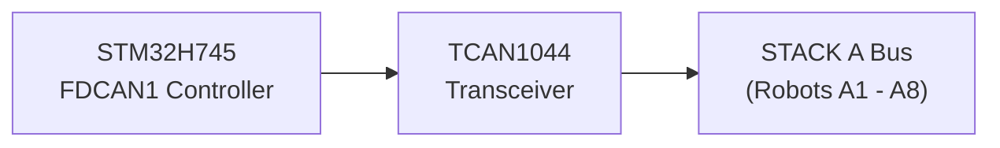
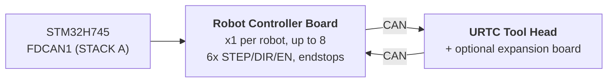

# Hardware specification (design)

**Copyright (C) 2026 JuanenRac (Electro Hobby 3D) <electrohobby3d@gmail.com>**
**License:** CC BY-SA 4.0 (documentation) - see LICENSE.md for the full licensing split.

This is the specification of the intended design of the board and its firmware, moved here from the README so that the README stays short. It describes what the design aims for; the README says what exists today.

## 2. 🖥️ HOST COMPUTING SUBSYSTEM (HMI & HIGH-LEVEL)

* 🧩 **Module:** Raspberry Pi Compute Module 5 (CM5)
* ⚙️ **Processor:** Broadcom BCM2712 Quad-Core ARM Cortex-A76 @ 2.4 GHz
* 🎮 **Graphics Engine:** VideoCore VII GPU (OpenGL ES 3.1, Vulkan 1.2)
* 💾 **System Memory:** 2 GB / 4 GB LPDDR4X (Integrated on CM5)
* 💽 **High-Speed Storage:** Integrated eMMC Flash
* 🐧 **Operating System:** Linux 64-bit (Raspberry Pi OS / Yocto patched with `PREEMPT_RT`)
* 📺 **Display Interface:** MIPI-DSI (2-lane / 4-lane) connected to high-resolution capacitive touch panel (Bambu Lab style UI at 60 FPS)
* 🌐 **Connectivity Suite:**
  * 🌐 1x Gigabit Ethernet (RJ45) for industrial LAN / RTSP video streaming / WebSockets / MQTT
  * 📶 Wi-Fi 6 & Bluetooth 5.4
  * 📷 **8x USB 3.0 / 2.0 Vision Ports:** Driven by onboard dual Genesys Logic GL3523 controllers.
  * 🎮 **2x USB 2.0 HID Ports:** Gamepad / mouse / keyboard - see section 4a.

## 3. 🧠 PCIE AI ACCELERATOR SUBSYSTEM (HAILO-8 + HAILO-10 DUAL NPU)

* 🔀 **PCIe Fan-Out:** The CM5 connector exposes only **one** PCIe Gen 2.0/3.0 x1 lane (confirmed against Table 5 of the CM5 datasheet, `docs/PINOUT_CM5_CARRIER.TXT`) - not enough to wire 2 M.2 AI accelerators directly. An onboard PCIe Gen3 packet switch (candidate: ASMedia ASM2806 family or equivalent, exact part TBD - Gen3 specifically, so the Hailo-10 link isn't bottlenecked below its own native speed) fans that single CM5-side lane out to 2 independent downstream PCIe x1 lanes, one per M.2 socket below.
* 🔌 **Physical Interfaces:** 2x onboard M.2 Key M sockets (2242 / 2280 form factor), each wired to its own downstream port of the PCIe switch above - not directly to the CM5.
* 🚀 **NPU Engine 1 - Hailo-8 (High-Speed Perception):** Hailo-8 Industrial AI Processor delivering **26 TOPS** (Tera Operations Per Second) at sub-5W power consumption. Drives multi-stream YOLOv8/YOLO11 (planned; no detector runs yet) object detection, defect inspection, and real-time PnP fiducial alignment across all 8 cameras (section 4) - the existing accelerator, unchanged in role.
* 🧠 **NPU Engine 2 - Hailo-10 (Cognitive Reasoning / Local GenAI):** Added alongside the Hailo-8, not a replacement. Delivering **40 TOPS**, it runs quantized LLM and Vision-Language-Action (VLA) models locally and privately - translating natural-language/voice operator instructions into kinematic trajectories, and handling semantic error recovery when a robot fails a task, without a round-trip to any external cloud service. Same cognitive role already established for the Hailo-10 across the rest of the HYDRA-UMC ecosystem (the sibling HYDRA-UMC-COGNITIVE-NODE project).
* ⚡ **Software Integration:** Official Hailo RT software suite integrated with Raspberry Pi OS for both accelerators, executing GStreamer/TAPPAS pipelines and OpenCV for the Hailo-8's zero-CPU-overhead vision inference; the Hailo-10's own LLM/VLA runtime integration is still design-stage (see `src/cm5_host/ai_inference/README.md`).
* ⚠️ **Open item:** the exact PCIe switch part number, and the Hailo-10's own real power draw, are both still TBD - see `hardware/PCB/kinematic_brain_stm32h745/BOM.TXT` items 05 and 09.

## 4. 📷 DUAL USB 3.0 VISION SUBSYSTEM (8x CAMERA PORTS)

* 🎛️ **Hub Controllers:** 2x Genesys Logic `GL3523` USB 3.0 / SuperSpeed Hub ICs integrated directly on the motherboard.
* 🔀 **Topology & Distribution:**
  * 🅰️ **Hub #1 (`GL3523-A`):** Connected to CM5's native USB3-0 SuperSpeed PHY (5 Gbps). Feeds USB Ports 1 to 4 (Cameras A1-A4).
  * 🅱️ **Hub #2 (`GL3523-B`):** Connected to CM5's native USB3-1 SuperSpeed PHY (5 Gbps). Feeds USB Ports 5 to 8 (Cameras A5-A8).
  * ℹ️ CM5 exposes these 2 SuperSpeed PHYs directly (BCM2712) - no RP1 companion chip is involved (RP1 is specific to the Raspberry Pi 5 board, not CM5). Full pin-level signal routing: `docs/PINOUT_CM5_CARRIER.TXT`.
* 🛡️ **Power Switch & Circuit Protection:** Individual USB VBUS protection via high-side current-limiting power switches (`TPS2065` / `SY6280`) configured for 500 mA - 1 A with fault reporting.
* ⚡ **High-Current VBUS Rail:** Powered by a dedicated 24V to 5V Step-Down Regulator (5V @ 6A continuous).

### 4a. 🎮 USB 2.0 HID SUBSYSTEM (2x GAMEPAD / MOUSE / KEYBOARD PORTS)

* 🎛️ **Hub Controller:** 1x small USB 2.0 hub IC (e.g. Genesys Logic `GL850G` / `FE1.1s`, TBD) fanning CM5's single native USB 2.0 PHY out to 2 physical ports.
* ℹ️ **Why a hub is needed:** the CM5 datasheet (`docs/datasheets/Raspberry Pi CM5.pdf`, §2.5) confirms BCM2712 exposes exactly **one** USB 2.0 (High Speed) port at the DF40 connector (`USB_N`/`USB_P`, pins 103/105) - separate and distinct from the 2x native USB 3.0 SuperSpeed PHYs already dedicated to the GL3523 camera hubs (section 4). A single physical pair cannot be split into 2 ports without a hub in between.
* 🔀 **Topology:** `USB_N`/`USB_P` (CM5) -> hub upstream port -> 2x downstream USB 2.0 Type-A ports (front/side panel, for a gamepad, mouse, or keyboard - manual jog/teach-pendant control and HMI input, independent of the touchscreen).
* 📌 Full pin-level signal routing: `docs/PINOUT_CM5_CARRIER.TXT` section 1.

## 5. ⚡ REAL-TIME CO-PROCESSING SUBSYSTEM (DESIGN)

* 🎛️ **Microcontroller:** STMicroelectronics **STM32H745ZIT6** (Cost-optimized dual-core MCU)
* 📦 **Package:** LQFP-144 (0.5 mm pin pitch)
* 🧠 **Architecture:** Dual-Core Asymmetric Multiprocessing (AMP)
  * 🚀 **Core 1 (Cortex-M7 @ 480 MHz):** Planned: real-time motion engine, hardware pulse generation, S-curve velocity profiles and PID control loops. Today its application is a GPIO-toggle smoke test.
  * 📡 **Core 2 (Cortex-M4 @ 240 MHz):** FDCAN1 protocol management in classic CAN mode and the inter-core mailbox exist (not run on a board); planned and not implemented: analog sensor filtering and safety interlocks.
* 💾 **Internal Memory Architecture:**
  * 💾 **2 MB** Dual-Bank Internal Flash
  * 🧠 **1 MB** Total Internal SRAM (512 KB AXI SRAM + 128 KB ITCM / 128 KB DTCM + SRAM1/SRAM2/SRAM3)
* 🧵 **RTOS:** **FreeRTOS**, one independent instance per core (AMP, not SMP - no shared scheduler state between Core 1 and Core 2). `src/mcu_stm32h745/`: Core 2 (CM4) already runs a real FDCAN1 "STACK A" master application (`CM4/STM32H745ZI_CM4_main.c`); Core 1 (CM7)'s own `main()` still calls the old do-nothing placeholder - see `docs/architecture.md` section 2.

## 6. 📡 DISTRIBUTED FIELDBUS COMMUNICATION (SINGLE CAN BUS; FDCAN PERIPHERAL IN CLASSIC MODE)

The motherboard acts as a master controller for up to 8 individual slave robotic modules distributed across a single physical CAN bus:

* 🔌 **Hardware Peripheral:** 1x Native Hardware FDCAN Controller (`FDCAN1`) built directly into the STM32H745, run in **Classic CAN mode** (`FDCAN_FRAME_CLASSIC`, `BRS_OFF`) by the real bootloader implementation - the peripheral is FD-capable silicon, but the CAN-OTA/SPI-OTA protocol this project actually speaks today (`docs/CANBUS_STM32H745.TXT`, `docs/CANBUS_STM32G474.TXT`) uses classic frames only (max DLC 8), same as every other tier (G474 Robot Controller Boards, URTC). CAN FD's larger 64-byte BRS payloads are real hardware headroom for later, not something the protocol uses yet.
* ⚡ **Physical Layer Transceiver:** 1x High-Speed CAN FD Transceiver (e.g., TI `TCAN1044AVD` / NXP `TJA1443`) - FD-capable hardware chosen for the same future-headroom reason as the peripheral above, even though today's traffic is classic frames.
* 🔀 **Bus Topology:**
  * 🅰️ **STACK A (`FDCAN1`):** Serves Slave Modules A1 through A8.
* ⏱️ **Protocol Specs:** ~1 Mbps nominal bitrate (Classic CAN, 8-byte max payload per frame). Auto-bus-off recovery is planned to be managed by the Cortex-M4 - not yet implemented; today's CM4 application (`src/mcu_stm32h745/CM4/STM32H745ZI_CM4_main.c`) already runs a real FDCAN1 "STACK A" master task (round-robin `AXIS_STATUS` queries across all 8 slots, see `KinematicBrainCan.c`) plus watchdog refresh, but bus-off recovery specifically is still real future work rather than a shipped capability.
* 🔌 **Physical Connector:** 40-pin, 2.54mm-pitch STACKING header/socket (+24V ×10 pins, GND ×10 pins, +5V ×4 pins auxiliary, FDCAN1 H/L, `BOARD_PRESENT_N`, 13 spare) - the 8 Robot Controller Boards physically STACK one on top of another on one side of this board (CONFIRMED topology, not a backplane), each board straight-through-passing all 40 signals to whatever mounts above it. Slot addressing is a LOCAL DIP switch per board (`BOARD_ID[2:0]`, README.md section 12), not derived from this connector. Full pin table and stack topology in `docs/PINOUT_STACKA_CONNECTOR.TXT`. Identical connector definition on the Kinematic Brain's own port and every Robot Controller Board's pair of ports.

## 7. 💾 ULTRA-FAST NON-VOLATILE MEMORY (SPI FRAM)

Design goal (not implemented yet): zero data loss and instant state recovery during emergency power disruptions:

* 🧪 **Memory IC:** Cypress/Infineon `FM25V05-G` / Fujitsu `MB85RS64` (64 KB SPI FRAM)
* ⚡ **Bus Interface:** Dedicated SPI2 bus up to 40 MHz.
* ♾️ **Durability:** Infinite endurance (10^14 cycles) with nanosecond write latencies.
* 🛡️ **Anti-Power Loss Sequence (PVD), planned:** The internal Power Voltage Detector (PVD) monitors the 3.3V rail. Upon voltage drop detection, a Non-Maskable Interrupt (NMI) dumps encoder vectors, active state machines, and coordinates to FRAM in under **5 microseconds** before supply shutdown.

## 8. 🦾 LOCAL MOTION, ACTUATION & SENSOR SUITE

### ⚙️ Motion Outputs
* 🎯 **Supported Axes:** 6-Axis Local Stage - dual-Y gantry + tool axes (`X`, `Y1`, `Y2`, `Z`, `E0`, `E1`), driven by 6x TMC5160A stepper drivers in an SPI daisy-chain.
* ⚡ **Signals:** 3.3V CMOS (`STEP`, `DIR`, `ENABLE`), shared SPI4 daisy-chain to all 6 drivers.
* ⏱️ **Timers:** Advanced-Control Timers (`TIM1` for X/Y1/Y2/Z, `TIM8` for E0/E1) with hardware pulse generation.
* 🛑 **Endstops:** 12x inputs, 2 per axis (MIN + MAX).
* 📌 Full pin-level allocation: `docs/PINOUT_STM32H745_KINEMATIC_BRAIN.TXT`.

### 🔌 Power & Fluidic Actuators
* 🔀 **20x Low-Side Switching Channels:** Industrial N-Channel MOSFET outputs with flyback protection.
  * 🧲 **8+2 Channels:** Vacuum Pumps / Venturi Pick-and-Place generators.
  * 💨 **8+2 Channels:** Electropneumatic Valves (5V/24V actuation).
* 💨 **Fans:** 3x 3-wire fans (PWM-switched supply via low-side MOSFET + tachometer sense per channel).
* 🌡️ **Thermal Management:**
  * 🔥 1x Solid-State Relay control output for the Heated Bed, switching **230VAC mains** - opto-isolated from the MCU/logic domains; this is a mains-voltage circuit and needs real creepage/clearance on the PCB, not a 24V-bus footprint.
  * 🌡️ 2x Precision NTC Thermistor analog inputs (heated bed) sampled by `ADC1`.

## 9. 🔌 POWER DISTRIBUTION & REGULATION

The board operates from a single industrial **24V DC** input supply bus:

* ⚡ **Main DC Input:** 24V DC ±10%
* 🔋 **5V Main Power Domain:** Step-down synchronous buck regulator supplying **5A continuous** for the CM5 module, touchscreen display backlight, and onboard logic.
* 📷 **5V USB VBUS Power Domain:** Dedicated synchronous buck regulator supplying **6A continuous** exclusively for the 8x USB 3.0 camera ports and GL3523 hub controllers.
* 🎛️ **3.3V Power Domain:** Low-noise regulator supplying **4A continuous** (dimensioned for STM32, FRAM, transceivers, the PCIe switch (section 3), and the 3.3V rails of both M.2 sockets - Hailo-8 + Hailo-10). This budget needs re-checking against the 4A figure once both M.2 modules' real power draw is confirmed (Hailo-8 is sub-5W; Hailo-10's own figure is still TBD) - may need to grow past 4A; see `hardware/PCB/kinematic_brain_stm32h745/BOM.TXT` item 09.

## 10. 🔄 INTER-PROCESSOR COMMUNICATION (IPC)

Communication between CM5 (Host) and STM32H745 (Co-Processor) utilizes a hardware-assisted, zero-copy SPI link:

* 🔗 **Physical Transport:** Full-Duplex SPI1, designed for up to 50 MHz in Slave Mode on STM32 and Master Mode on CM5 - the real CM5-side driver (`src/cm5_host/ipc_driver/src/ipc_driver.c`) defaults to a conservative 10 MHz today, since the STM32H745 SPI1 slave-side mode/bit-order config it needs to match hasn't been verified against real hardware yet.
* 🤝 **Handshake Line:** `HYDRA_DATA_READY` GPIO line.
* ⚡ **Execution Flow:** The Cortex-M4 prepares a 128-byte telemetry frame in shared AXI SRAM, asserts `HYDRA_DATA_READY`, and the CM5 fetches the packet via high-speed SPI DMA without polling overhead.

## 11. 🎛️ 4-LAYER PCB HARDWARE SPECIFICATIONS

* 📐 **Form Factor:** Monolithic Industrial Motherboard.
* 🥞 **Layer Stackup (4-Layer):**
  * 🟢 **Layer 1 (Top):** Component placement, high-frequency signals, 90-ohm USB SuperSpeed differential pairs, 85-ohm PCIe Gen 3.0 pairs.
  * 🛡️ **Layer 2 (Inner 1):** Continuous solid Ground Plane (`GND`).
  * ⚡ **Layer 3 (Inner 2):** Split Power Planes (`24V`, `5V_MAIN`, `5V_USB`, `3.3V`).
  * 🔴 **Layer 4 (Bottom):** Secondary signal traces and high-current power breakouts.
* 🛠️ **Connectors & Assembly:**
  * 🔲 LQFP-144 package (0.5 mm pitch) for STM32H745, QFN-88 packages for 2x GL3523 hubs, and 2x M.2 Key M 2242/2280 sockets (Hailo-8 + Hailo-10, section 3) fed by an onboard PCIe Gen3 switch.
  * 🔌 Dual Hirose DF40 mezzanine connectors for Compute Module 5.
  * 📌 40-pin, 2.54 mm-pitch STACKING header for STACK A bus connection (base of the physical Robot Controller Board stack) - `docs/PINOUT_STACKA_CONNECTOR.TXT`.
  * 🔌 8x USB 3.0 Type-A (or Hirose industrial latching) connectors for robot cameras.

## 12. 🦾 ROBOT CONTROLLER BOARDS & URTC TOOL HEAD (DISTRIBUTED TIER)

Each of the up to 8 slave modules on STACK A (section 6) is a **Robot
Controller Board**: one per robot, driving that robot's own 6 axes
(STEP/DIR/ENABLE), reading its endstops, and forwarding its own tool head's
traffic one hop further over a *second* CAN connection to a **URTC** board
(Universal Robot Tool Controller - see the sibling `URTC` repository) mounted
in the robot's head, optionally with its own expansion board.

* 🎛️ **MCU:** STMicroelectronics **STM32G474RET6** (Cortex-M4 @ 170 MHz,
  LQFP-64, 512 KB flash), using 2 of its 3 onboard FDCAN peripherals - one as
  the FDCAN uplink to the STM32H745, one as the CAN downlink to its own URTC
  head. See `docs/architecture.md` §1.
* 🔢 **Addressing:** `BOARD_ID[2:0]` - a local 3-position DIP switch on each
  board, manually set to 0-7 at install time, gives every board its own
  FDCAN1 slot base ID - not derived from the physical stack position or the
  STACK A connector (every board is the same interchangeable PCB). See
  `docs/PINOUT_STM32G474_ROBOT_CONTROLLER.TXT` §1c.
* 🧵 **RTOS:** **FreeRTOS** (its bootloader stays bare-metal - no scheduler
  needed to receive/verify/jump). Real application: `src/mcu_stm32g474/STM32G474RE_main.c`
  runs a real relay task (`RobotControllerRelay.c` - FDCAN2 downlink to the
  URTC Tool Head, an `AXIS_STATUS` responder, and the `RELAY_SEND`/`RELAY_RECV`
  tunnel) alongside the watchdog-refresh blink task.
* 📡 **CAN-OTA firmware updates, 4 tiers deep:** the STM32H745 itself (over **Signed image header and anti-rollback (bootloaders, host-tested):** the update carries a 64-byte header (full version major.minor.patch, hardware id, size, link address, vector words, CRC) and an Ed25519 signature covers the digest of header and image together, so an old signed image cannot declare a higher version; the three numbers of the version are compared and an older image is installed only with a token, itself a signature, bound to the nonce of that session, the two versions and that image (the old four-byte magic frame no longer allows anything). The decision (`image_header.h`, `update_verify.h`) is one file in the three bootloaders, tested against bytes made by `tools/image_header.py` and, for the G474, end to end from START_UPDATE to the new application. The board holds only the public key (`tools/image_header.py` makes the keys and signs; the private seed never goes on a board and the development seed is published, so a release build refuses the development public key); the curve arithmetic is the vendored TweetNaCl (public domain, `THIRD_PARTY_NOTICES.md`). Nothing here has been compiled for or run on a board.
  its existing SPI link to the CM5), this board, its URTC Tool Head
  (STM32F303CCT6), and - only when installed - that head's own Advanced
  Expansion Board (STM32F303CBT6, `expansion_board_type` 3 or 4, see URTC's
  own `docs/EXPANSION.TXT`) can all be flashed and diagnosed from
  HYDRA-UMC-STUDIO's Flasher/Tester with no JTAG/SWD probe and no USB-CAN
  dongle. Full addressing scheme, the relay tunnel that reaches the last two
  tiers without any new protocol design, and current implementation status:
  `docs/architecture.md`.

See `docs/architecture.md` for the complete tiered architecture (this section
is a summary), including what's confirmed hardware fact vs. still a proposed
design pending implementation. Section 8 of that document also tracks the
current bootloaders' known, accepted security limitations (no Read-Out
Protection yet, a shared anti-rollback bypass value, unauthenticated
readback) - deliberate pre-hardware gaps, not oversights.
