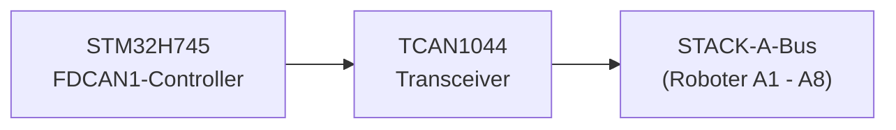
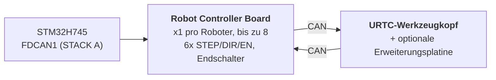

# Hardware-Spezifikation (Entwurf)

**Copyright (C) 2026 JuanenRac (Electro Hobby 3D) <electrohobby3d@gmail.com>**
**License:** CC BY-SA 4.0 (documentation) - see LICENSE.md for the full licensing split.

Dies ist die Spezifikation des geplanten Entwurfs der Platine und ihrer Firmware, aus der README hierher verschoben, damit die README kurz bleibt. Sie beschreibt, was der Entwurf anstrebt; die README sagt, was heute existiert.

## 2. 🖥️ HOST-COMPUTING-SUBSYSTEM (HMI & HOCHNIVEAU)

* 🧩 **Modul:** Raspberry Pi Compute Module 5 (CM5)
* ⚙️ **Prozessor:** Broadcom BCM2712 Quad-Core ARM Cortex-A76 mit 2.4 GHz
* 🎮 **Grafik-Engine:** VideoCore VII GPU (OpenGL ES 3.1, Vulkan 1.2)
* 💾 **Systemspeicher:** 2 GB / 4 GB LPDDR4X (integriert auf dem CM5)
* 💽 **High-Speed-Speicher:** Integrierter eMMC-Flash
* 🐧 **Betriebssystem:** 64-Bit-Linux (Raspberry Pi OS / Yocto, gepatcht mit `PREEMPT_RT`)
* 📺 **Display-Schnittstelle:** MIPI-DSI (2-Lane / 4-Lane), verbunden mit einem hochauflösenden kapazitiven Touch-Panel (Bambu-Lab-artige UI mit 60 FPS)
* 🌐 **Konnektivitäts-Suite:**
  * 🌐 1x Gigabit-Ethernet (RJ45) für industrielles LAN / RTSP-Videostreaming / WebSockets / MQTT
  * 📶 Wi-Fi 6 & Bluetooth 5.4
  * 📷 **8x USB-3.0/2.0-Vision-Ports:** Angesteuert von zwei Onboard-Genesys-Logic-GL3523-Controllern.
  * 🎮 **2x USB-2.0-HID-Ports:** Gamepad / Maus / Tastatur - siehe Abschnitt 4a.

## 3. 🧠 PCIE-KI-BESCHLEUNIGER-SUBSYSTEM (DOPPELTE HAILO-8+HAILO-10-NPU)

* 🔀 **PCIe-Fan-out:** Der CM5-Anschluss stellt nur **eine** PCIe-Gen-2.0/3.0-x1-Lane bereit (bestätigt anhand von Tabelle 5 des CM5-Datenblatts, `docs/PINOUT_CM5_CARRIER.TXT`) - nicht genug, um 2 M.2-KI-Beschleuniger direkt zu verkabeln. Ein Onboard-PCIe-Gen3-Paket-Switch (Kandidat: ASMedia-ASM2806-Familie oder gleichwertig, genaues Bauteil noch offen - explizit Gen3, damit die Hailo-10-Verbindung nicht unter ihrer eigenen nativen Geschwindigkeit gedrosselt wird) verteilt diese einzelne CM5-seitige Lane auf 2 unabhängige nachgelagerte PCIe-x1-Lanes, eine je M.2-Sockel unten.
* 🔌 **Physische Schnittstellen:** 2x Onboard-M.2-Key-M-Sockel (Formfaktor 2242 / 2280), jeweils mit einem eigenen nachgelagerten Port des obigen PCIe-Switches verbunden - nicht direkt mit dem CM5.
* 🚀 **NPU-Engine 1 - Hailo-8 (Hochgeschwindigkeits-Wahrnehmung):** Hailo-8-Industrie-KI-Prozessor mit **26 TOPS** (Tera Operations Per Second) bei einem Verbrauch unter 5W. Steuert Multi-Stream-YOLOv8/YOLO11 (geplant; läuft noch nicht)-Objekterkennung, Fehlerinspektion und Echtzeit-PnP-Fiducial-Ausrichtung über alle 8 Kameras (Abschnitt 4) - der bereits vorhandene Beschleuniger, unveränderte Rolle.
* 🧠 **NPU-Engine 2 - Hailo-10 (Kognitives Schlussfolgern / Lokale GenAI):** Zusätzlich zum Hailo-8, kein Ersatz. Mit **40 TOPS** führt er quantisierte LLM- und Vision-Language-Action-Modelle (VLA) lokal und privat aus - übersetzt natürlichsprachliche/sprachliche Bedienerbefehle in kinematische Trajektorien und übernimmt die semantische Fehlerbehebung, wenn ein Roboter eine Aufgabe nicht ausführen kann, ganz ohne Umweg über einen externen Cloud-Dienst. Dieselbe kognitive Rolle, die dem Hailo-10 bereits im restlichen HYDRA-UMC-Ökosystem zugewiesen ist (das Schwesterprojekt HYDRA-UMC-COGNITIVE-NODE).
* ⚡ **Software-Integration:** Offizielle Hailo-RT-Softwaresuite, integriert mit Raspberry Pi OS für beide Beschleuniger, die GStreamer-/TAPPAS-Pipelines und OpenCV für die neuronale Vision-Inferenz ohne CPU-Overhead des Hailo-8 ausführt; die eigene LLM-/VLA-Runtime-Integration des Hailo-10 befindet sich noch im Entwurfsstadium (siehe `src/cm5_host/ai_inference/README.md`).
* ⚠️ **Offener Punkt:** sowohl die genaue Teilenummer des PCIe-Switches als auch der reale Leistungsbedarf des Hailo-10 sind noch offen - siehe `hardware/PCB/kinematic_brain_stm32h745/BOM.TXT`, Positionen 05 und 09.

## 4. 📷 DOPPEL-USB-3.0-VISION-SUBSYSTEM (8x KAMERAPORTS)

* 🎛️ **Hub-Controller:** 2x Genesys-Logic-`GL3523`-USB-3.0/SuperSpeed-Hub-ICs, direkt auf der Hauptplatine integriert.
* 🔀 **Topologie und Verteilung:**
  * 🅰️ **Hub #1 (`GL3523-A`):** Verbunden mit dem nativen USB3-0-SuperSpeed-PHY des CM5 (5 Gbps). Versorgt USB-Ports 1 bis 4 (Kameras A1-A4).
  * 🅱️ **Hub #2 (`GL3523-B`):** Verbunden mit dem nativen USB3-1-SuperSpeed-PHY des CM5 (5 Gbps). Versorgt USB-Ports 5 bis 8 (Kameras A5-A8).
  * ℹ️ Der CM5 stellt diese 2 SuperSpeed-PHYs direkt bereit (BCM2712) - es ist kein RP1-Companion-Chip beteiligt (der RP1 ist spezifisch für das Raspberry-Pi-5-Board, nicht für das CM5). Vollständige Signalführung auf Pin-Ebene: `docs/PINOUT_CM5_CARRIER.TXT`.
* 🛡️ **Leistungsschalter und Schutzschaltung:** Individueller USB-VBUS-Schutz über High-Side-Strombegrenzungs-Leistungsschalter (`TPS2065` / `SY6280`), konfiguriert für 500 mA - 1 A mit Fehlermeldung.
* ⚡ **Hochstrom-VBUS-Schiene:** Versorgt von einem dedizierten 24V-zu-5V-Step-Down-Regler (5V @ 6A kontinuierlich).

### 4a. 🎮 USB-2.0-HID-SUBSYSTEM (2x PORTS FÜR GAMEPAD / MAUS / TASTATUR)

* 🎛️ **Hub-Controller:** 1x kleiner USB-2.0-Hub-IC (z. B. Genesys Logic `GL850G` / `FE1.1s`, noch zu bestätigen), der den einzigen nativen USB-2.0-PHY des CM5 auf 2 physische Ports auffächert.
* ℹ️ **Warum ein Hub benötigt wird:** Das Datenblatt des CM5 (`docs/datasheets/Raspberry Pi CM5.pdf`, §2.5) bestätigt, dass der BCM2712 genau **einen** USB-2.0-Port (High Speed) am DF40-Steckverbinder bereitstellt (`USB_N`/`USB_P`, Pins 103/105) - getrennt und unabhängig von den 2 nativen USB-3.0-SuperSpeed-PHYs, die bereits den GL3523-Kamera-Hubs zugeordnet sind (Abschnitt 4). Ein einzelnes physisches Paar kann ohne einen zwischengeschalteten Hub nicht in 2 Ports aufgeteilt werden.
* 🔀 **Topologie:** `USB_N`/`USB_P` (CM5) -> Upstream-Port des Hubs -> 2x Downstream-USB-2.0-Type-A-Ports (Front-/Seitenpanel, für Gamepad, Maus oder Tastatur - manuelle Jog-/Teach-Pendant-Steuerung und HMI-Eingabe, unabhängig vom Touchscreen).
* 📌 Vollständige Signalführung auf Pin-Ebene: `docs/PINOUT_CM5_CARRIER.TXT` Abschnitt 1.

## 5. ⚡ ECHTZEIT-CO-PROCESSING-SUBSYSTEM (ENTWURF)

* 🎛️ **Mikrocontroller:** STMicroelectronics **STM32H745ZIT6** (kostenoptimierte Dual-Core-MCU)
* 📦 **Gehäuse:** LQFP-144 (0.5 mm Pin-Abstand)
* 🧠 **Architektur:** Asymmetrisches Dual-Core-Multiprocessing (AMP)
  * 🚀 **Kern 1 (Cortex-M7 mit 480 MHz):** Geplant: Echtzeit-Bewegungs-Engine, hardwarebasierte Impulserzeugung, S-Kurven-Geschwindigkeitsprofile und PID-Regelkreise. Heute ist seine Anwendung nur ein GPIO-Toggle-Smoke-Test.
  * 📡 **Kern 2 (Cortex-M4 mit 240 MHz):** Die FDCAN1-Protokollverwaltung im klassischen CAN-Modus und die kernübergreifende Mailbox existieren (nicht auf einer Platine gelaufen); geplant und nicht implementiert: Filterung analoger Sensoren und Sicherheitsverriegelungen.
* 💾 **Interne Speicherarchitektur:**
  * 💾 **2 MB** interner Dual-Bank-Flash
  * 🧠 **1 MB** gesamte interne SRAM (512 KB AXI-SRAM + 128 KB ITCM / 128 KB DTCM + SRAM1/SRAM2/SRAM3)
* 🧵 **RTOS:** **FreeRTOS**, eine unabhängige Instanz pro Kern (AMP, nicht SMP - kein gemeinsamer Scheduler-Zustand zwischen Kern 1 und Kern 2). `src/mcu_stm32h745/`: Kern 2 (CM4) führt bereits eine echte FDCAN1-„STACK A“-Master-Anwendung aus (`CM4/STM32H745ZI_CM4_main.c`); Kern 1 (CM7)s eigenes `main()` ruft noch den alten, nichts tuenden Platzhalter auf - siehe `docs/architecture.md` Abschnitt 2.

## 6. 📡 VERTEILTE FELDBUS-KOMMUNIKATION (EIN CAN-BUS; FDCAN-PERIPHERIE IM KLASSISCHEN MODUS)

Die Hauptplatine fungiert als Master-Controller für bis zu 8 einzelne robotische Slave-Module, die über einen einzigen physischen CAN-Bus verteilt sind:

* 🔌 **Hardware-Peripherie:** 1x nativer Hardware-FDCAN-Controller (`FDCAN1`), direkt in den STM32H745 integriert, betrieben im **klassischen CAN-Modus** (`FDCAN_FRAME_CLASSIC`, `BRS_OFF`) durch die reale Bootloader-Implementierung - die Peripherie ist FD-fähiges Silizium, aber das CAN-OTA/SPI-OTA-Protokoll, das dieses Projekt heute tatsächlich spricht (`docs/CANBUS_STM32H745.TXT`, `docs/CANBUS_STM32G474.TXT`), verwendet nur klassische Rahmen (max. DLC 8), genau wie jede andere Ebene (G474-Robot-Controller-Boards, URTC). Die größeren 64-Byte-BRS-Payloads von CAN FD sind echter Hardware-Spielraum für später, nicht etwas, das das Protokoll bereits nutzt.
* ⚡ **Physical-Layer-Transceiver:** 1x High-Speed-CAN-FD-Transceiver (z. B. TI `TCAN1044AVD` / NXP `TJA1443`) - FD-fähige Hardware, aus demselben Zukunftsspielraum-Grund gewählt wie die obige Peripherie, auch wenn der heutige Verkehr aus klassischen Rahmen besteht.
* 🔀 **Bus-Topologie:**
  * 🅰️ **STACK A (`FDCAN1`):** Bedient die Slave-Module A1 bis A8.
* ⏱️ **Protokoll-Spezifikationen:** ~1 Mbps nominale Bitrate (klassisches CAN, max. 8-Byte-Payload pro Rahmen). Die automatische Bus-Off-Erholung ist geplant, vom Cortex-M4 verwaltet zu werden - noch nicht implementiert; die heutige Anwendung des CM4 (`src/mcu_stm32h745/CM4/STM32H745ZI_CM4_main.c`) führt bereits eine echte FDCAN1-„STACK A“-Master-Task aus (Round-Robin-`AXIS_STATUS`-Abfragen über alle 8 Slots, siehe `KinematicBrainCan.c`) plus Watchdog-Refresh, aber die Bus-Off-Erholung selbst bleibt reale zukünftige Arbeit, keine bereits gelieferte Fähigkeit.
* 🔌 **Physischer Steckverbinder:** 40-poliger STAPEL-Steckverbinder/Sockel mit 2.54mm-Abstand (+24V ×10 Pins, GND ×10 Pins, +5V ×4 Hilfspins, FDCAN1 H/L, `BOARD_PRESENT_N`, 13 Reserve) - die 8 Robot-Controller-Boards werden physisch aufeinander GESTAPELT, auf einer Seite dieses Boards (BESTÄTIGTE Topologie, kein Backplane), wobei jedes Board alle 40 Signale direkt an das durchreicht, was darüber montiert wird. Die Slot-Adressierung erfolgt über einen LOKALEN DIP-Schalter pro Board (`BOARD_ID[2:0]`, README.md Abschnitt 12), nicht abgeleitet von diesem Steckverbinder. Vollständige Pin-Tabelle und Stapel-Topologie in `docs/PINOUT_STACKA_CONNECTOR.TXT`. Identische Steckverbinder-Definition sowohl am eigenen Port des Kinematic Brain als auch an jedem Portpaar der Robot-Controller-Boards.

## 7. 💾 ULTRASCHNELLER NICHTFLÜCHTIGER SPEICHER (SPI FRAM)

Entwurfsziel (noch nicht implementiert): kein Datenverlust und sofortige Zustandswiederherstellung bei Notfall-Stromunterbrechungen:

* 🧪 **Speicher-IC:** Cypress/Infineon `FM25V05-G` / Fujitsu `MB85RS64` (64 KB SPI FRAM)
* ⚡ **Bus-Schnittstelle:** Dedizierter SPI2-Bus mit bis zu 40 MHz.
* ♾️ **Haltbarkeit:** Unendliche Ausdauer (10^14 Zyklen) mit Schreiblatenzen im Nanosekundenbereich.
* 🛡️ **Anti-Stromausfall-Sequenz (PVD), geplant:** Der interne Power Voltage Detector (PVD) überwacht die 3.3V-Schiene. Bei Erkennung eines Spannungsabfalls lädt ein nicht maskierbarer Interrupt (NMI) Encoder-Vektoren, aktive Zustandsmaschinen und Koordinaten in weniger als **5 Mikrosekunden** in das FRAM, bevor die Stromversorgung abgeschaltet wird.

## 8. 🦾 LOKALE BEWEGUNGS-, ANSTEUERUNGS- UND SENSOR-SUITE

### ⚙️ Bewegungsausgänge
* 🎯 **Unterstützte Achsen:** Lokale 6-Achsen-Stufe - Doppel-Y-Portal plus Werkzeugachsen (`X`, `Y1`, `Y2`, `Z`, `E0`, `E1`), angetrieben von 6x TMC5160A-Schrittmotortreibern in einer SPI-Daisy-Chain.
* ⚡ **Signale:** 3.3V-CMOS (`STEP`, `DIR`, `ENABLE`), gemeinsame SPI4-Daisy-Chain zu allen 6 Treibern.
* ⏱️ **Timer:** Advanced-Control-Timer (`TIM1` für X/Y1/Y2/Z, `TIM8` für E0/E1) mit hardwarebasierter Impulserzeugung.
* 🛑 **Endschalter:** 12x Eingänge, 2 pro Achse (MIN + MAX).
* 📌 Vollständige Pin-Zuordnung auf Pin-Ebene: `docs/PINOUT_STM32H745_KINEMATIC_BRAIN.TXT`.

### 🔌 Leistungs- und Fluidaktoren
* 🔀 **20x Low-Side-Schaltkanäle:** Industrielle N-Kanal-MOSFET-Ausgänge mit Flyback-Schutz.
  * 🧲 **8+2 Kanäle:** Vakuumpumpen / Venturi-Pick-and-Place-Generatoren.
  * 💨 **8+2 Kanäle:** Elektropneumatische Ventile (5V/24V-Ansteuerung).
* 💨 **Lüfter:** 3x 3-Draht-Lüfter (PWM-geschaltete Versorgung über Low-Side-MOSFET + Tachometer-Erfassung pro Kanal).
* 🌡️ **Wärmemanagement:**
  * 🔥 1x Halbleiterrelais-Steuerausgang für das Heizbett, der die **230-VAC-Netzspannung** schaltet - optoisoliert von den MCU-/Logikdomänen; dies ist ein Netzspannungskreis und benötigt echte Kriech-/Luftstrecken auf der Leiterplatte, keine 24V-Bus-Footprint.
  * 🌡️ 2x analoge Präzisions-NTC-Thermistor-Eingänge (Heizbett), abgetastet von `ADC1`.

## 9. 🔌 STROMVERTEILUNG UND -REGELUNG

Die Platine arbeitet mit einer einzigen industriellen **24V-DC**-Eingangsversorgungsschiene:

* ⚡ **Haupt-DC-Eingang:** 24V DC ±10%
* 🔋 **5V-Hauptversorgungsdomäne:** Synchroner Step-Down-Buck-Regler, der **5A kontinuierlich** für das CM5-Modul, die Touchscreen-Hintergrundbeleuchtung und die Onboard-Logik liefert.
* 📷 **5V-USB-VBUS-Versorgungsdomäne:** Dedizierter synchroner Buck-Regler, der **6A kontinuierlich** ausschließlich für die 8x USB-3.0-Kameraports und GL3523-Hub-Controller liefert.
* 🎛️ **3.3V-Versorgungsdomäne:** Rauscharmer Regler, der **4A kontinuierlich** liefert (dimensioniert für STM32, FRAM, Transceiver, den PCIe-Switch (Abschnitt 3) und die 3.3V-Schienen beider M.2-Sockel - Hailo-8 + Hailo-10). Dieses Budget muss neu geprüft werden, sobald der reale Leistungsbedarf beider M.2-Module bestätigt ist (Hailo-8 liegt unter 5W; die eigene Zahl des Hailo-10 ist noch offen) - könnte über 4A hinauswachsen müssen; siehe `hardware/PCB/kinematic_brain_stm32h745/BOM.TXT`, Position 09.

## 10. 🔄 INTERPROZESSOR-KOMMUNIKATION (IPC)

Die Kommunikation zwischen dem CM5 (Host) und dem STM32H745 (Co-Prozessor) nutzt eine hardwaregestützte Zero-Copy-SPI-Verbindung:

* 🔗 **Physischer Transport:** Vollduplex-SPI1, ausgelegt für bis zu 50 MHz im Slave-Modus auf dem STM32 und Master-Modus auf dem CM5 - der reale CM5-seitige Treiber (`src/cm5_host/ipc_driver/src/ipc_driver.c`) verwendet heute konservativ 10 MHz, da die dazu passende SPI1-Slave-Konfiguration des STM32H745 noch nicht an echter Hardware verifiziert wurde.
* 🤝 **Handshake-Leitung:** `HYDRA_DATA_READY`-GPIO-Leitung.
* ⚡ **Ausführungsablauf:** Der Cortex-M4 bereitet einen 128-Byte-Telemetrierahmen im gemeinsamen AXI-SRAM vor, aktiviert `HYDRA_DATA_READY`, und der CM5 holt das Paket über High-Speed-SPI-DMA ohne Polling-Overhead ab.

## 11. 🎛️ HARDWARE-SPEZIFIKATIONEN DER 4-LAGEN-LEITERPLATTE

* 📐 **Formfaktor:** Monolithische industrielle Hauptplatine.
* 🥞 **Lagenaufbau (4 Lagen):**
  * 🟢 **Lage 1 (Oben):** Bauteilplatzierung, Hochfrequenzsignale, 90-Ohm-USB-SuperSpeed-Differenzialpaare, 85-Ohm-PCIe-Gen-3.0-Paare.
  * 🛡️ **Lage 2 (Innen 1):** Durchgehende massive Masseebene (`GND`).
  * ⚡ **Lage 3 (Innen 2):** Geteilte Leistungsebenen (`24V`, `5V_MAIN`, `5V_USB`, `3.3V`).
  * 🔴 **Lage 4 (Unten):** Sekundäre Signalleiterbahnen und Hochstrom-Leistungsauskopplungen.
* 🛠️ **Steckverbinder und Montage:**
  * 🔲 LQFP-144-Gehäuse (0.5 mm Abstand) für den STM32H745, QFN-88-Gehäuse für die 2 GL3523-Hubs, und 2x M.2-Key-M-2242/2280-Sockel (Hailo-8 + Hailo-10, Abschnitt 3), versorgt über einen Onboard-PCIe-Gen3-Switch.
  * 🔌 Doppelte Hirose-DF40-Mezzanine-Steckverbinder für das Compute Module 5.
  * 📌 40-poliger STAPEL-Steckverbinder mit 2.54-mm-Abstand für die STACK-A-Busverbindung (Basis des physischen Robot-Controller-Board-Stapels) - `docs/PINOUT_STACKA_CONNECTOR.TXT`.
  * 🔌 8x USB-3.0-Type-A-Steckverbinder (oder industrielle Hirose-Rastverbinder) für die Roboterkameras.

## 12. 🦾 ROBOT-CONTROLLER-BOARDS UND URTC-WERKZEUGKOPF (VERTEILTE EBENE)

Jedes der bis zu 8 Slave-Module auf STACK A (Abschnitt 6) ist ein **Robot
Controller Board**: eines pro Roboter, das die eigenen 6 Achsen dieses
Roboters ansteuert (STEP/DIR/ENABLE), seine Endschalter liest und den
Verkehr seines eigenen Werkzeugkopfs einen weiteren Sprung über eine
*zweite* CAN-Verbindung an ein **URTC**-Board (Universal Robot Tool
Controller - siehe das Schwester-Repository `URTC`) weiterleitet, das im
Kopf des Roboters montiert ist, optional mit einer eigenen
Erweiterungsplatine.

* 🎛️ **MCU:** STMicroelectronics **STM32G474RET6** (Cortex-M4 mit 170 MHz,
  LQFP-64, 512 KB Flash), das 2 seiner 3 Onboard-FDCAN-Peripheriegeräte
  nutzt - eines als FDCAN-Uplink zum STM32H745, eines als CAN-Downlink zum
  eigenen URTC-Kopf. Siehe `docs/architecture.md` §1.
* 🔢 **Adressierung:** `BOARD_ID[2:0]` - ein lokaler 3-Positionen-DIP-Schalter
  an jedem Board, manuell bei der Installation auf 0-7 eingestellt, gibt
  jedem Board eine eigene FDCAN1-Slot-Basis-ID - nicht abgeleitet aus der
  physischen Stapelposition oder dem STACK-A-Steckverbinder (jedes Board
  ist dieselbe austauschbare Leiterplatte). Siehe
  `docs/PINOUT_STM32G474_ROBOT_CONTROLLER.TXT` §1c.
* 🧵 **RTOS:** **FreeRTOS** (dessen Bootloader bleibt bare-metal - kein
  Scheduler wird benötigt, um zu empfangen/verifizieren/zu springen).
  Echte Anwendung: `src/mcu_stm32g474/STM32G474RE_main.c` führt eine
  echte Relay-Task aus (`RobotControllerRelay.c` - FDCAN2-Downlink zum
  URTC Tool Head, ein `AXIS_STATUS`-Responder und der
  `RELAY_SEND`/`RELAY_RECV`-Tunnel) neben der Blink-Task mit
  Watchdog-Refresh.
* 📡 **CAN-OTA-Firmware-Updates, 4 Ebenen tief:** der STM32H745 selbst **Signierter Image-Header und Anti-Rollback (Bootloader, im Host getestet):** Das Update trägt einen 64-Byte-Header (vollständige Version Major.Minor.Patch, Hardware-ID, Größe, Link-Adresse, Vektorwörter, CRC), und eine Ed25519-Signatur deckt den Digest von Header und Image zusammen ab, sodass ein altes signiertes Image keine höhere Version vortäuschen kann; die drei Zahlen der Version werden verglichen, und ein älteres Image wird nur mit einem Token (selbst eine Signatur) installiert, das an die Nonce dieser Sitzung, die beiden Versionen und dieses Image gebunden ist (der alte Vier-Byte-Magic-Frame erlaubt nichts mehr). Die Entscheidung (`image_header.h`, `update_verify.h`) ist eine Datei in den drei Bootloadern, getestet mit Bytes von `tools/image_header.py` und für den G474 durchgängig von START_UPDATE bis zur neuen Anwendung. Die Platine trägt nur den öffentlichen Schlüssel (`tools/image_header.py` erzeugt die Schlüssel und signiert; der private Seed kommt nie auf eine Platine, und der Entwicklungs-Seed ist veröffentlicht, daher lehnt ein Release-Build den öffentlichen Entwicklungsschlüssel ab); die Kurvenarithmetik ist das mitgelieferte TweetNaCl (gemeinfrei, `THIRD_PARTY_NOTICES.md`). Nichts davon wurde für eine Platine kompiliert oder darauf ausgeführt.
  (über seine bestehende SPI-Verbindung zum CM5), dieses Board, sein
  URTC-Werkzeugkopf (STM32F303CCT6), und - nur wenn installiert - die
  eigene Advanced Expansion Board dieses Kopfes (STM32F303CBT6,
  `expansion_board_type` 3 oder 4, siehe URTCs eigene
  `docs/EXPANSION.TXT`) können alle vom Flasher/Tester von
  HYDRA-UMC-STUDIO ohne JTAG/SWD-Sonde und ohne USB-CAN-Dongle geflasht
  und diagnostiziert werden. Vollständiges Adressierungsschema, der
  Relay-Tunnel, der die letzten beiden Ebenen ohne jegliches neues
  Protokolldesign erreicht, und der aktuelle Implementierungsstatus:
  `docs/architecture.md`.

Siehe `docs/architecture.md` für die vollständige gestufte Architektur
(dieser Abschnitt ist eine Zusammenfassung), einschließlich dessen, was als
bestätigte Hardware-Tatsache gilt gegenüber dem, was noch ein
vorgeschlagenes Design ist, das auf die Implementierung wartet. Abschnitt 8
dieses Dokuments erfasst außerdem die bekannten, akzeptierten
Sicherheitseinschränkungen der aktuellen Bootloader (noch kein
Read-Out-Schutz, ein gemeinsam genutzter Anti-Rollback-Bypass-Wert,
nicht authentifiziertes Rücklesen) - bewusste Vor-Hardware-Lücken, keine
Versehen.
