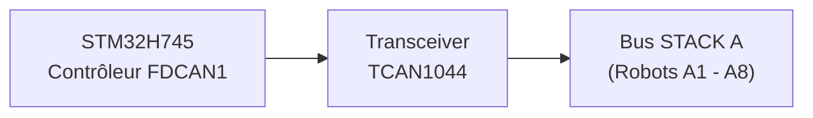
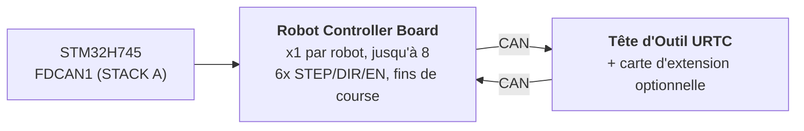

# Spécification matérielle (conception)

**Copyright (C) 2026 JuanenRac (Electro Hobby 3D) <electrohobby3d@gmail.com>**
**License:** CC BY-SA 4.0 (documentation) - see LICENSE.md for the full licensing split.

Voici la spécification de la conception prévue de la carte et de son firmware, déplacée ici depuis le README pour que celui-ci reste court. Elle décrit ce que vise la conception ; le README dit ce qui existe aujourd'hui.

## 2. 🖥️ SOUS-SYSTÈME DE CALCUL HÔTE (HMI ET HAUT NIVEAU)

* 🧩 **Module :** Raspberry Pi Compute Module 5 (CM5)
* ⚙️ **Processeur :** Broadcom BCM2712 Quad-Core ARM Cortex-A76 à 2.4 GHz
* 🎮 **Moteur Graphique :** GPU VideoCore VII (OpenGL ES 3.1, Vulkan 1.2)
* 💾 **Mémoire Système :** 2 Go / 4 Go LPDDR4X (intégrée sur le CM5)
* 💽 **Stockage Haute Vitesse :** Flash eMMC intégrée
* 🐧 **Système d'Exploitation :** Linux 64 bits (Raspberry Pi OS / Yocto patché avec `PREEMPT_RT`)
* 📺 **Interface d'Affichage :** MIPI-DSI (2 voies / 4 voies) connectée à un panneau tactile capacitif haute résolution (UI style Bambu Lab à 60 FPS)
* 🌐 **Suite de Connectivité :**
  * 🌐 1x Ethernet Gigabit (RJ45) pour LAN industriel / streaming vidéo RTSP / WebSockets / MQTT
  * 📶 Wi-Fi 6 et Bluetooth 5.4
  * 📷 **8x Ports de Vision USB 3.0 / 2.0 :** Pilotés par deux contrôleurs Genesys Logic GL3523 embarqués.
  * 🎮 **2x Ports HID USB 2.0 :** Manette / souris / clavier - voir section 4a.

## 3. 🧠 SOUS-SYSTÈME ACCÉLÉRATEUR IA PCIE (NPU DOUBLE HAILO-8 + HAILO-10)

* 🔀 **Répartition de la Voie PCIe :** Le connecteur du CM5 n'expose qu'**une seule** voie PCIe Gen 2.0/3.0 x1 (confirmé par le Tableau 5 de la fiche technique du CM5, `docs/PINOUT_CM5_CARRIER.TXT`) - insuffisant pour câbler directement 2 accélérateurs IA M.2. Un switch de paquets PCIe Gen3 embarqué (candidat : famille ASMedia ASM2806 ou équivalent, référence exacte TBD - Gen3 spécifiquement, pour que la liaison du Hailo-10 ne soit pas bridée en dessous de sa propre vitesse native) répartit cette unique voie côté CM5 en 2 voies PCIe x1 downstream indépendantes, une par emplacement M.2 ci-dessous.
* 🔌 **Interfaces Physiques :** 2x emplacements M.2 Key M embarqués (format 2242 / 2280), chacun câblé à son propre port downstream du switch PCIe ci-dessus - pas directement au CM5.
* 🚀 **Moteur NPU 1 - Hailo-8 (Perception Haute Vitesse) :** Processeur IA industriel Hailo-8 délivrant **26 TOPS** (Téra Opérations Par Seconde) avec une consommation inférieure à 5W. Assure la détection d'objets multi-flux YOLOv8/YOLO11 (prévu ; ne tourne pas encore), l'inspection de défauts et l'alignement de repères fiduciaires PnP en temps réel sur les 8 caméras (section 4) - l'accélérateur déjà existant, rôle inchangé.
* 🧠 **Moteur NPU 2 - Hailo-10 (Raisonnement Cognitif / GenAI Local) :** Ajouté aux côtés du Hailo-8, pas en remplacement. Avec **40 TOPS**, il exécute localement et en privé des modèles LLM et Vision-Language-Action (VLA) quantifiés - traduisant les instructions vocales/en langage naturel de l'opérateur en trajectoires cinématiques, et gérant la récupération sémantique d'erreurs lorsqu'un robot échoue une tâche, sans aucun aller-retour vers un service cloud externe. Le même rôle cognitif déjà établi pour le Hailo-10 dans le reste de l'écosystème HYDRA-UMC (le projet frère HYDRA-UMC-COGNITIVE-NODE).
* ⚡ **Intégration Logicielle :** Suite logicielle officielle Hailo RT intégrée à Raspberry Pi OS pour les deux accélérateurs, exécutant des pipelines GStreamer/TAPPAS et OpenCV pour l'inférence de vision sans surcharge CPU du Hailo-8 ; l'intégration du runtime LLM/VLA propre au Hailo-10 est encore au stade de conception (voir `src/cm5_host/ai_inference/README.md`).
* ⚠️ **Point ouvert :** la référence exacte du switch PCIe, ainsi que la consommation réelle propre du Hailo-10, restent toutes deux TBD - voir `hardware/PCB/kinematic_brain_stm32h745/BOM.TXT` éléments 05 et 09.

## 4. 📷 SOUS-SYSTÈME DE VISION DOUBLE USB 3.0 (8x PORTS CAMÉRA)

* 🎛️ **Contrôleurs de Hub :** 2x circuits intégrés hub USB 3.0 / SuperSpeed Genesys Logic `GL3523` intégrés directement sur la carte mère.
* 🔀 **Topologie et Distribution :**
  * 🅰️ **Hub #1 (`GL3523-A`) :** Connecté au PHY SuperSpeed USB3-0 natif du CM5 (5 Gbps). Alimente les ports USB 1 à 4 (Caméras A1-A4).
  * 🅱️ **Hub #2 (`GL3523-B`) :** Connecté au PHY SuperSpeed USB3-1 natif du CM5 (5 Gbps). Alimente les ports USB 5 à 8 (Caméras A5-A8).
  * ℹ️ Le CM5 expose ces 2 PHY SuperSpeed directement (BCM2712) - aucune puce compagnon RP1 n'est impliquée (le RP1 est spécifique à la carte Raspberry Pi 5, pas au CM5). Routage complet des signaux au niveau des broches : `docs/PINOUT_CM5_CARRIER.TXT`.
* 🛡️ **Interrupteur d'Alimentation et Protection de Circuit :** Protection VBUS individuelle par USB via des interrupteurs d'alimentation à limitation de courant côté haut (`TPS2065` / `SY6280`) configurés pour 500 mA - 1 A avec signalement de défaut.
* ⚡ **Rail VBUS Haute Intensité :** Alimenté par un régulateur Step-Down dédié de 24V vers 5V (5V @ 6A continus).

### 4a. 🎮 SOUS-SYSTÈME HID USB 2.0 (2x PORTS MANETTE / SOURIS / CLAVIER)

* 🎛️ **Contrôleur de Hub :** 1x petit circuit intégré hub USB 2.0 (p. ex. Genesys Logic `GL850G` / `FE1.1s`, à confirmer) répartissant l'unique PHY USB 2.0 natif du CM5 sur 2 ports physiques.
* ℹ️ **Pourquoi un hub est nécessaire :** la fiche technique du CM5 (`docs/datasheets/Raspberry Pi CM5.pdf`, §2.5) confirme que le BCM2712 expose exactement **un** port USB 2.0 (High Speed) sur le connecteur DF40 (`USB_N`/`USB_P`, broches 103/105) - séparé et distinct des 2 PHY SuperSpeed USB 3.0 natifs déjà dédiés aux hubs caméra GL3523 (section 4). Une seule paire physique ne peut pas être divisée en 2 ports sans un hub intermédiaire.
* 🔀 **Topologie :** `USB_N`/`USB_P` (CM5) -> port amont du hub -> 2x ports aval USB 2.0 Type-A (panneau avant/latéral, pour manette, souris, ou clavier - contrôle manuel jog/teach-pendant et entrée HMI, indépendant de l'écran tactile).
* 📌 Routage complet des signaux au niveau des broches : `docs/PINOUT_CM5_CARRIER.TXT` section 1.

## 5. ⚡ SOUS-SYSTÈME DE CO-TRAITEMENT TEMPS RÉEL (CONCEPTION)

* 🎛️ **Microcontrôleur :** STMicroelectronics **STM32H745ZIT6** (MCU double cœur optimisé en coût)
* 📦 **Boîtier :** LQFP-144 (pas de broches 0.5 mm)
* 🧠 **Architecture :** Multiprocessing Asymétrique Double Cœur (AMP)
  * 🚀 **Cœur 1 (Cortex-M7 à 480 MHz) :** Prévu : moteur de mouvement temps réel, génération d'impulsions matérielle, profils de vitesse en courbe en S et boucles de contrôle PID. Aujourd'hui son application n'est qu'un test de fumée qui bascule un GPIO.
  * 📡 **Cœur 2 (Cortex-M4 à 240 MHz) :** La gestion du protocole FDCAN1 en mode CAN classique et la boîte aux lettres inter-cœurs existent (jamais exécutées sur une carte) ; prévus et non implémentés : filtrage des capteurs analogiques et verrouillages de sécurité.
* 💾 **Architecture Mémoire Interne :**
  * 💾 **2 Mo** de flash interne double banque
  * 🧠 **1 Mo** de SRAM interne totale (512 Ko AXI SRAM + 128 Ko ITCM / 128 Ko DTCM + SRAM1/SRAM2/SRAM3)
* 🧵 **RTOS :** **FreeRTOS**, une instance indépendante par cœur (AMP, pas SMP - aucun état d'ordonnanceur partagé entre le Cœur 1 et le Cœur 2). `src/mcu_stm32h745/` : le Cœur 2 (CM4) exécute déjà une vraie application maître FDCAN1 « STACK A » (`CM4/STM32H745ZI_CM4_main.c`) ; le `main()` du Cœur 1 (CM7) appelle encore l'ancien placeholder qui ne fait rien - voir `docs/architecture.md` section 2.

## 6. 📡 COMMUNICATION BUS DE TERRAIN DISTRIBUÉ (BUS CAN UNIQUE ; PÉRIPHÉRIQUE FDCAN EN MODE CLASSIQUE)

La carte mère agit comme contrôleur maître pour jusqu'à 8 modules robotiques esclaves individuels distribués sur un unique bus physique CAN :

* 🔌 **Périphérique Matériel :** 1x Contrôleur FDCAN matériel natif (`FDCAN1`) intégré directement dans le STM32H745, exécuté en **mode CAN Classique** (`FDCAN_FRAME_CLASSIC`, `BRS_OFF`) par l'implémentation réelle du bootloader - le périphérique est un silicium compatible FD, mais le protocole CAN-OTA/SPI-OTA que ce projet parle réellement aujourd'hui (`docs/CANBUS_STM32H745.TXT`, `docs/CANBUS_STM32G474.TXT`) n'utilise que des trames classiques (DLC max 8), comme chaque autre niveau (Cartes Robot Controller Board G474, URTC). Les charges utiles BRS de 64 octets du CAN FD sont une marge matérielle réelle pour plus tard, pas quelque chose que le protocole utilise encore.
* ⚡ **Transceiver de Couche Physique :** 1x Transceiver CAN FD haute vitesse (p. ex. TI `TCAN1044AVD` / NXP `TJA1443`) - matériel compatible FD choisi pour la même raison de marge future que le périphérique ci-dessus, même si le trafic d'aujourd'hui reste des trames classiques.
* 🔀 **Topologie du Bus :**
  * 🅰️ **STACK A (`FDCAN1`) :** Dessert les Modules Esclaves A1 à A8.
* ⏱️ **Spécifications du Protocole :** ~1 Mbps de débit binaire nominal (CAN Classique, charge utile max de 8 octets par trame). La récupération automatique après bus-off est prévue pour être gérée par le Cortex-M4 - pas encore implémentée ; l'application actuelle du CM4 (`src/mcu_stm32h745/CM4/STM32H745ZI_CM4_main.c`) exécute déjà une vraie tâche maître FDCAN1 « STACK A » (requêtes `AXIS_STATUS` en round-robin sur les 8 slots, voir `KinematicBrainCan.c`) plus le rafraîchissement du watchdog, mais la récupération après bus-off en particulier reste un travail futur réel, pas une capacité déjà livrée.
* 🔌 **Connecteur Physique :** Connecteur/embase d'EMPILEMENT 40 broches, pas 2.54mm (+24V ×10 broches, GND ×10 broches, +5V ×4 broches auxiliaires, FDCAN1 H/L, `BOARD_PRESENT_N`, 13 de réserve) - les 8 Cartes Robot Controller Board s'EMPILENT physiquement l'une sur l'autre d'un côté de cette carte (topologie CONFIRMÉE, pas un backplane), chaque carte faisant passer directement les 40 signaux vers ce qui est monté au-dessus. L'adressage des emplacements est un commutateur DIP LOCAL par carte (`BOARD_ID[2:0]`, README.md section 12), non dérivé de ce connecteur. Table complète des broches et topologie d'empilement dans `docs/PINOUT_STACKA_CONNECTOR.TXT`. Définition de connecteur identique à la fois sur le propre port du Kinematic Brain et sur chaque paire de ports des Cartes Robot Controller Board.

## 7. 💾 MÉMOIRE NON VOLATILE ULTRA-RAPIDE (SPI FRAM)

Objectif de conception (pas encore implémenté) : zéro perte de données et récupération d'état instantanée lors d'interruptions d'urgence de l'alimentation :

* 🧪 **Circuit Mémoire :** Cypress/Infineon `FM25V05-G` / Fujitsu `MB85RS64` (64 Ko de SPI FRAM)
* ⚡ **Interface Bus :** Bus SPI2 dédié jusqu'à 40 MHz.
* ♾️ **Durabilité :** Endurance infinie (10^14 cycles) avec des latences d'écriture de l'ordre de la nanoseconde.
* 🛡️ **Séquence Anti-Perte d'Alimentation (PVD), prévue :** Le Détecteur de Tension d'Alimentation (PVD) interne surveille le rail 3.3V. Lors de la détection d'une chute de tension, une Interruption Non Masquable (NMI) décharge les vecteurs d'encodeur, les machines d'état actives, et les coordonnées vers la FRAM en moins de **5 microsecondes** avant la coupure de l'alimentation.

## 8. 🦾 SUITE LOCALE DE MOUVEMENT, ACTIONNEMENT ET CAPTEURS

### ⚙️ Sorties de Mouvement
* 🎯 **Axes Supportés :** Étage Local 6 Axes - portique double-Y plus axes d'outil (`X`, `Y1`, `Y2`, `Z`, `E0`, `E1`), pilotés par 6x drivers moteur pas-à-pas TMC5160A en chaîne SPI.
* ⚡ **Signaux :** CMOS 3.3V (`STEP`, `DIR`, `ENABLE`), chaîne SPI4 partagée vers les 6 drivers.
* ⏱️ **Timers :** Timers de Contrôle Avancé (`TIM1` pour X/Y1/Y2/Z, `TIM8` pour E0/E1) avec génération d'impulsions matérielle.
* 🛑 **Fins de Course :** 12x entrées, 2 par axe (MIN + MAX).
* 📌 Affectation complète des broches : `docs/PINOUT_STM32H745_KINEMATIC_BRAIN.TXT`.

### 🔌 Actionneurs de Puissance et Fluidiques
* 🔀 **20x Canaux de Commutation Côté Bas :** Sorties MOSFET industrielles canal N avec protection flyback.
  * 🧲 **8+2 Canaux :** Pompes à vide / générateurs venturi Pick-and-Place.
  * 💨 **8+2 Canaux :** Électrovannes pneumatiques (actionnement 5V/24V).
* 💨 **Ventilateurs :** 3x ventilateurs 3 fils (alimentation commutée PWM via MOSFET côté bas + détection tachymétrique par canal).
* 🌡️ **Gestion Thermique :**
  * 🔥 1x sortie de contrôle relais statique pour le Plateau Chauffant, commutant le **secteur 230VAC** - isolée optiquement des domaines MCU/logique ; c'est un circuit à tension secteur qui nécessite un véritable creepage/clearance sur le PCB, pas une empreinte de bus 24V.
  * 🌡️ 2x entrées analogiques thermistance NTC de précision (plateau chauffant) échantillonnées par `ADC1`.

## 9. 🔌 DISTRIBUTION ET RÉGULATION DE PUISSANCE

La carte fonctionne à partir d'un unique bus d'alimentation industriel **24V DC** :

* ⚡ **Entrée DC Principale :** 24V DC ±10%
* 🔋 **Domaine d'Alimentation Principal 5V :** Régulateur buck synchrone step-down fournissant **5A continus** pour le module CM5, le rétroéclairage de l'écran tactile, et la logique embarquée.
* 📷 **Domaine d'Alimentation VBUS USB 5V :** Régulateur buck synchrone dédié fournissant **6A continus** exclusivement pour les 8 ports caméra USB 3.0 et les contrôleurs de hub GL3523.
* 🎛️ **Domaine d'Alimentation 3.3V :** Régulateur bas bruit fournissant **4A continus** (dimensionné pour le STM32, la FRAM, les transceivers, le switch PCIe (section 3), et les rails 3.3V des deux emplacements M.2 - Hailo-8 + Hailo-10). Ce budget doit être revérifié par rapport aux 4A une fois la consommation réelle des deux modules M.2 confirmée (le Hailo-8 est inférieur à 5W ; la valeur propre du Hailo-10 reste TBD) - pourrait devoir dépasser 4A ; voir `hardware/PCB/kinematic_brain_stm32h745/BOM.TXT` élément 09.

## 10. 🔄 COMMUNICATION INTER-PROCESSEUR (IPC)

La communication entre le CM5 (Hôte) et le STM32H745 (Co-Processeur) utilise une liaison SPI zéro-copie assistée par matériel :

* 🔗 **Transport Physique :** SPI1 full-duplex, conçu pour aller jusqu'à 50 MHz en Mode Esclave sur le STM32 et Mode Maître sur le CM5 - le pilote réel côté CM5 (`src/cm5_host/ipc_driver/src/ipc_driver.c`) utilise aujourd'hui 10 MHz par prudence, la configuration SPI1 esclave du STM32H745 qui doit correspondre n'ayant pas encore été vérifiée sur du matériel réel.
* 🤝 **Ligne de Handshake :** Ligne GPIO `HYDRA_DATA_READY`.
* ⚡ **Flux d'Exécution :** Le Cortex-M4 prépare une trame de télémétrie de 128 octets dans la SRAM AXI partagée, active `HYDRA_DATA_READY`, et le CM5 récupère le paquet via DMA SPI haute vitesse sans surcharge de scrutation (polling).

## 11. 🎛️ SPÉCIFICATIONS MATÉRIELLES PCB 4 COUCHES

* 📐 **Facteur de Forme :** Carte Mère Industrielle Monolithique.
* 🥞 **Empilement des Couches (4 Couches) :**
  * 🟢 **Couche 1 (Supérieure) :** Placement des composants, signaux haute fréquence, paires différentielles USB SuperSpeed 90 ohms, paires PCIe Gen 3.0 85 ohms.
  * 🛡️ **Couche 2 (Interne 1) :** Plan de masse (`GND`) solide continu.
  * ⚡ **Couche 3 (Interne 2) :** Plans d'alimentation divisés (`24V`, `5V_MAIN`, `5V_USB`, `3.3V`).
  * 🔴 **Couche 4 (Inférieure) :** Pistes de signal secondaires et dérivations de puissance haute intensité.
* 🛠️ **Connecteurs et Assemblage :**
  * 🔲 Boîtier LQFP-144 (pas 0.5 mm) pour le STM32H745, boîtiers QFN-88 pour les 2 hubs GL3523, et 2x emplacements M.2 Key M 2242/2280 (Hailo-8 + Hailo-10, section 3) alimentés par un switch PCIe Gen3 embarqué.
  * 🔌 Double connecteur mezzanine Hirose DF40 pour le Compute Module 5.
  * 📌 Embase d'EMPILEMENT 40 broches, pas 2.54 mm, pour la connexion au bus STACK A (base de l'empilement physique des Cartes Robot Controller Board) - `docs/PINOUT_STACKA_CONNECTOR.TXT`.
  * 🔌 8x connecteurs USB 3.0 Type-A (ou verrouillage industriel Hirose) pour les caméras du robot.

## 12. 🦾 CARTES ROBOT CONTROLLER BOARD ET TÊTE D'OUTIL URTC (NIVEAU DISTRIBUÉ)

Chacun des jusqu'à 8 modules esclaves sur STACK A (section 6) est une **Robot
Controller Board** : une par robot, pilotant les 6 propres axes de ce robot
(STEP/DIR/ENABLE), lisant ses propres fins de course, et relayant le trafic
de sa propre tête d'outil un saut plus loin via une *seconde* connexion CAN
vers une carte **URTC** (Universal Robot Tool Controller - voir le
repository jumeau `URTC`) montée dans la tête du robot, optionnellement avec
sa propre carte d'extension.

* 🎛️ **MCU :** STMicroelectronics **STM32G474RET6** (Cortex-M4 à 170 MHz,
  LQFP-64, 512 Ko de flash), utilisant 2 de ses 3 périphériques FDCAN
  embarqués - un comme liaison montante FDCAN vers le STM32H745, l'autre
  comme liaison descendante CAN vers sa propre tête URTC. Voir
  `docs/architecture.md` §1.
* 🔢 **Adressage :** `BOARD_ID[2:0]` - un commutateur DIP local à 3
  positions sur chaque carte, réglé manuellement de 0 à 7 lors de
  l'installation, donne à chaque carte son propre emplacement de base
  FDCAN1 - non dérivé de la position physique dans l'empilement ni du
  connecteur STACK A (chaque carte est le même PCB interchangeable). Voir
  `docs/PINOUT_STM32G474_ROBOT_CONTROLLER.TXT` §1c.
* 🧵 **RTOS :** **FreeRTOS** (son bootloader reste bare-metal - aucun
  ordonnanceur n'est nécessaire pour recevoir/vérifier/sauter).
  Application réelle : `src/mcu_stm32g474/STM32G474RE_main.c` exécute
  une vraie tâche de relais (`RobotControllerRelay.c` - liaison
  descendante FDCAN2 vers l'URTC Tool Head, un répondeur `AXIS_STATUS`
  et le tunnel `RELAY_SEND`/`RELAY_RECV`) aux côtés de la tâche de
  clignotement avec rafraîchissement du watchdog.
* 📡 **Mises à jour firmware CAN-OTA, sur 4 niveaux de profondeur :** le **En-tête d'image signé et anti-rollback (bootloaders, testés sur l'hôte) :** la mise à jour porte un en-tête de 64 octets (version complète majeure.mineure.correctif, identifiant matériel, taille, adresse d'édition de liens, mots de vecteurs, CRC) et une signature Ed25519 couvre l'empreinte de l'en-tête et de l'image ensemble, si bien qu'une ancienne image signée ne peut pas déclarer une version plus haute ; les trois nombres de la version sont comparés et une image plus ancienne n'est installée qu'avec un jeton (lui-même une signature) lié au nonce de cette session, aux deux versions et à cette image (l'ancienne trame magique de quatre octets n'autorise plus rien). La décision (`image_header.h`, `update_verify.h`) est un seul fichier dans les trois bootloaders, testé avec des octets produits par `tools/image_header.py` et, pour la G474, de bout en bout de START_UPDATE à la nouvelle application. La carte ne porte que la clé publique (`tools/image_header.py` fabrique les clés et signe ; la graine privée n'est jamais sur une carte et la graine de développement est publiée, donc un build de version refuse la clé publique de développement) ; l'arithmétique de la courbe est TweetNaCl, embarqué (domaine public, `THIRD_PARTY_NOTICES.md`). Rien de cela n'a été compilé pour une carte ni exécuté dessus.
  STM32H745 lui-même (via sa liaison SPI existante vers le CM5), cette
  carte, sa Tête d'Outil URTC (STM32F303CCT6), et - seulement lorsqu'elle
  est installée - la propre Carte d'Extension Avancée de cette tête
  (STM32F303CBT6, `expansion_board_type` 3 ou 4, voir le propre
  `docs/EXPANSION.TXT` d'URTC) peuvent toutes être flashées et
  diagnostiquées depuis le Flasher/Tester de HYDRA-UMC-STUDIO sans sonde
  JTAG/SWD et sans dongle USB-CAN. Schéma d'adressage complet, le tunnel de
  relais qui atteint les 2 derniers niveaux sans aucune nouvelle conception
  de protocole, et l'état actuel de l'implémentation :
  `docs/architecture.md`.

Voir `docs/architecture.md` pour l'architecture complète à niveaux (cette
section est un résumé), y compris ce qui est confirmé comme un fait matériel
par rapport à ce qui reste une conception proposée en attente
d'implémentation. La section 8 de ce document répertorie également les
limitations de sécurité connues et acceptées des bootloaders actuels (pas
encore de Protection en Lecture, une valeur de contournement anti-rollback
partagée, lecture non authentifiée) - des lacunes délibérées pré-matériel,
pas des oublis.
