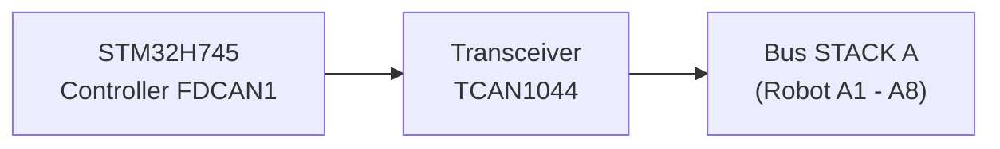
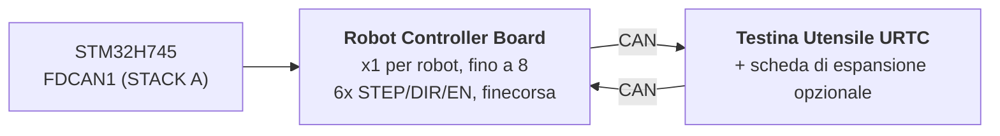

# Specifica hardware (progetto)

**Copyright (C) 2026 JuanenRac (Electro Hobby 3D) <electrohobby3d@gmail.com>**
**License:** CC BY-SA 4.0 (documentation) - see LICENSE.md for the full licensing split.

Questa è la specifica del progetto previsto della scheda e del suo firmware, spostata qui dal README perché resti breve. Descrive ciò a cui punta il progetto; il README dice cosa esiste oggi.

## 2. 🖥️ SOTTOSISTEMA DI COMPUTAZIONE HOST (HMI E ALTO LIVELLO)

* 🧩 **Modulo:** Raspberry Pi Compute Module 5 (CM5)
* ⚙️ **Processore:** Broadcom BCM2712 Quad-Core ARM Cortex-A76 a 2.4 GHz
* 🎮 **Motore Grafico:** GPU VideoCore VII (OpenGL ES 3.1, Vulkan 1.2)
* 💾 **Memoria di Sistema:** 2 GB / 4 GB LPDDR4X (integrata sul CM5)
* 💽 **Storage ad Alta Velocità:** Flash eMMC integrata
* 🐧 **Sistema Operativo:** Linux a 64 bit (Raspberry Pi OS / Yocto con patch `PREEMPT_RT`)
* 📺 **Interfaccia Display:** MIPI-DSI (2 lane / 4 lane) collegata a un pannello touch capacitivo ad alta risoluzione (UI in stile Bambu Lab a 60 FPS)
* 🌐 **Suite di Connettività:**
  * 🌐 1x Ethernet Gigabit (RJ45) per LAN industriale / streaming video RTSP / WebSocket / MQTT
  * 📶 Wi-Fi 6 e Bluetooth 5.4
  * 📷 **8x Porte di Visione USB 3.0 / 2.0:** Alimentate da due controller Genesys Logic GL3523 onboard.
  * 🎮 **2x Porte HID USB 2.0:** Gamepad / mouse / tastiera - vedi sezione 4a.

## 3. 🧠 SOTTOSISTEMA ACCELERATORE IA PCIE (NPU DOPPIO HAILO-8 + HAILO-10)

* 🔀 **Ripartizione della Lane PCIe:** Il connettore del CM5 espone solamente **una** lane PCIe Gen 2.0/3.0 x1 (confermato dalla Tabella 5 del datasheet del CM5, `docs/PINOUT_CM5_CARRIER.TXT`) - non sufficiente per collegare 2 acceleratori IA M.2 direttamente. Uno switch di pacchetti PCIe Gen3 onboard (candidato: famiglia ASMedia ASM2806 o equivalente, part number esatto TBD - Gen3 nello specifico, così il collegamento del Hailo-10 non viene limitato al di sotto della propria velocità nativa) ripartisce questa unica lane lato CM5 in 2 lane PCIe x1 downstream indipendenti, una per ciascuno zoccolo M.2 sottostante.
* 🔌 **Interfacce Fisiche:** 2x zoccoli M.2 Key M onboard (form factor 2242 / 2280), ciascuno collegato alla propria porta downstream dello switch PCIe di cui sopra - non direttamente al CM5.
* 🚀 **Motore NPU 1 - Hailo-8 (Percezione ad Alta Velocità):** Processore IA industriale Hailo-8 che eroga **26 TOPS** (Tera Operazioni Al Secondo) con un consumo inferiore a 5W. Esegue il rilevamento oggetti multi-stream YOLOv8/YOLO11 (previsto; non ancora in esecuzione), l'ispezione difetti e l'allineamento fiduciale PnP in tempo reale su tutte e 8 le camere (sezione 4) - l'acceleratore già esistente, ruolo invariato.
* 🧠 **Motore NPU 2 - Hailo-10 (Ragionamento Cognitivo / GenAI Locale):** Aggiunto accanto al Hailo-8, non in sostituzione. Con **40 TOPS**, esegue localmente e in modo privato modelli LLM e Vision-Language-Action (VLA) quantizzati - traducendo le istruzioni vocali/in linguaggio naturale dell'operatore in traiettorie cinematiche, e gestendo il recupero semantico degli errori quando un robot fallisce un compito, senza alcuna andata e ritorno verso un servizio cloud esterno. Lo stesso ruolo cognitivo già stabilito per il Hailo-10 nel resto dell'ecosistema HYDRA-UMC (il progetto gemello HYDRA-UMC-COGNITIVE-NODE).
* ⚡ **Integrazione Software:** Suite software ufficiale Hailo RT integrata con Raspberry Pi OS per entrambi gli acceleratori, eseguendo pipeline GStreamer/TAPPAS e OpenCV per l'inferenza di visione a zero overhead di CPU del Hailo-8; l'integrazione del runtime LLM/VLA proprio del Hailo-10 è ancora in fase di progettazione (vedi `src/cm5_host/ai_inference/README.md`).
* ⚠️ **Punto aperto:** il part number esatto dello switch PCIe e il reale consumo proprio del Hailo-10 restano entrambi TBD - vedi `hardware/PCB/kinematic_brain_stm32h745/BOM.TXT` voci 05 e 09.

## 4. 📷 SOTTOSISTEMA DI VISIONE DOPPIO USB 3.0 (8x PORTE CAMERA)

* 🎛️ **Controller Hub:** 2x circuiti integrati hub USB 3.0 / SuperSpeed Genesys Logic `GL3523` integrati direttamente sulla scheda madre.
* 🔀 **Topologia e Distribuzione:**
  * 🅰️ **Hub #1 (`GL3523-A`):** Collegato al PHY SuperSpeed USB3-0 nativo del CM5 (5 Gbps). Alimenta le porte USB da 1 a 4 (Camere A1-A4).
  * 🅱️ **Hub #2 (`GL3523-B`):** Collegato al PHY SuperSpeed USB3-1 nativo del CM5 (5 Gbps). Alimenta le porte USB da 5 a 8 (Camere A5-A8).
  * ℹ️ Il CM5 espone questi 2 PHY SuperSpeed direttamente (BCM2712) - non è coinvolto alcun chip companion RP1 (l'RP1 è specifico della scheda Raspberry Pi 5, non del CM5). Instradamento completo dei segnali a livello di pin: `docs/PINOUT_CM5_CARRIER.TXT`.
* 🛡️ **Interruttore di Potenza e Protezione del Circuito:** Protezione VBUS individuale per USB tramite interruttori di potenza a limitazione di corrente high-side (`TPS2065` / `SY6280`) configurati per 500 mA - 1 A con segnalazione di guasto.
* ⚡ **Rail VBUS ad Alta Corrente:** Alimentato da un regolatore Step-Down dedicato da 24V a 5V (5V @ 6A continui).

### 4a. 🎮 SOTTOSISTEMA HID USB 2.0 (2x PORTE PER GAMEPAD / MOUSE / TASTIERA)

* 🎛️ **Controller Hub:** 1x piccolo circuito integrato hub USB 2.0 (es. Genesys Logic `GL850G` / `FE1.1s`, da confermare) che distribuisce l'unico PHY USB 2.0 nativo del CM5 su 2 porte fisiche.
* ℹ️ **Perché serve un hub:** il datasheet del CM5 (`docs/datasheets/Raspberry Pi CM5.pdf`, §2.5) conferma che il BCM2712 espone esattamente **una** porta USB 2.0 (High Speed) sul connettore DF40 (`USB_N`/`USB_P`, pin 103/105) - separata e distinta dai 2 PHY SuperSpeed USB 3.0 nativi già dedicati agli hub camera GL3523 (sezione 4). Un'unica coppia fisica non può essere divisa in 2 porte senza un hub in mezzo.
* 🔀 **Topologia:** `USB_N`/`USB_P` (CM5) -> porta upstream dell'hub -> 2x porte downstream USB 2.0 Type-A (pannello anteriore/laterale, per gamepad, mouse o tastiera - controllo manuale jog/teach-pendant e input HMI, indipendente dal touchscreen).
* 📌 Instradamento completo dei segnali a livello di pin: `docs/PINOUT_CM5_CARRIER.TXT` sezione 1.

## 5. ⚡ SOTTOSISTEMA DI CO-PROCESSING REAL-TIME (PROGETTO)

* 🎛️ **Microcontroller:** STMicroelectronics **STM32H745ZIT6** (MCU dual-core ottimizzato in termini di costo)
* 📦 **Package:** LQFP-144 (passo pin 0.5 mm)
* 🧠 **Architettura:** Multiprocessing Asimmetrico Dual-Core (AMP)
  * 🚀 **Core 1 (Cortex-M7 a 480 MHz):** Previsto: motore di movimento real-time, generazione impulsi hardware, profili di velocità a curva a S e cicli di controllo PID. Oggi la sua applicazione è solo uno smoke test che commuta un GPIO.
  * 📡 **Core 2 (Cortex-M4 a 240 MHz):** La gestione del protocollo FDCAN1 in modalità CAN classico e la mailbox tra i core esistono (mai eseguite su una scheda); previsti e non implementati: filtraggio dei sensori analogici e interblocchi di sicurezza.
* 💾 **Architettura di Memoria Interna:**
  * 💾 **2 MB** di flash interna dual-bank
  * 🧠 **1 MB** di SRAM interna totale (512 KB AXI SRAM + 128 KB ITCM / 128 KB DTCM + SRAM1/SRAM2/SRAM3)
* 🧵 **RTOS:** **FreeRTOS**, un'istanza indipendente per core (AMP, non SMP - nessuno stato di scheduler condiviso tra Core 1 e Core 2). `src/mcu_stm32h745/`: il Core 2 (CM4) esegue già una vera applicazione master FDCAN1 "STACK A" (`CM4/STM32H745ZI_CM4_main.c`); il `main()` del Core 1 (CM7) chiama ancora il vecchio placeholder che non fa nulla - vedi `docs/architecture.md` sezione 2.

## 6. 📡 COMUNICAZIONE FIELDBUS DISTRIBUITA (BUS CAN UNICO; PERIFERICA FDCAN IN MODALITÀ CLASSICA)

La scheda madre agisce da controller master per fino a 8 singoli moduli robotici slave distribuiti su un unico bus fisico CAN:

* 🔌 **Periferica Hardware:** 1x Controller FDCAN hardware nativo (`FDCAN1`) integrato direttamente nell'STM32H745, eseguito in **modalità CAN Classico** (`FDCAN_FRAME_CLASSIC`, `BRS_OFF`) dall'implementazione reale del bootloader - la periferica è silicio con capacità FD, ma il protocollo CAN-OTA/SPI-OTA che questo progetto parla realmente oggi (`docs/CANBUS_STM32H745.TXT`, `docs/CANBUS_STM32G474.TXT`) usa solo frame classici (DLC massimo 8), come ogni altro livello (Schede Robot Controller Board G474, URTC). I payload BRS a 64 byte di CAN FD sono margine hardware reale per il futuro, non qualcosa che il protocollo usa ancora.
* ⚡ **Transceiver a Livello Fisico:** 1x Transceiver CAN FD ad alta velocità (es. TI `TCAN1044AVD` / NXP `TJA1443`) - hardware con capacità FD scelto per lo stesso motivo di margine futuro della periferica sopra, anche se il traffico odierno è composto da frame classici.
* 🔀 **Topologia del Bus:**
  * 🅰️ **STACK A (`FDCAN1`):** Serve i Moduli Slave da A1 a A8.
* ⏱️ **Specifiche di Protocollo:** ~1 Mbps di bitrate nominale (CAN Classico, payload massimo di 8 byte per frame). Il recupero automatico da bus-off è pianificato per essere gestito dal Cortex-M4 - non ancora implementato; l'attuale applicazione del CM4 (`src/mcu_stm32h745/CM4/STM32H745ZI_CM4_main.c`) esegue già un vero task master FDCAN1 "STACK A" (query `AXIS_STATUS` round-robin su tutti gli 8 slot, vedi `KinematicBrainCan.c`) più il refresh del watchdog, ma il recupero da bus-off in particolare resta lavoro futuro reale, non una capacità già consegnata.
* 🔌 **Connettore Fisico:** Header/socket di IMPILAMENTO a 40 pin, passo 2.54mm (+24V ×10 pin, GND ×10 pin, +5V ×4 pin ausiliari, FDCAN1 H/L, `BOARD_PRESENT_N`, 13 di riserva) - le 8 Schede Robot Controller Board si IMPILANO fisicamente una sopra l'altra su un lato di questa scheda (topologia CONFERMATA, non un backplane), ogni scheda passando direttamente tutti i 40 segnali a qualunque cosa venga montata sopra. L'indirizzamento dello slot è un DIP switch LOCALE per scheda (`BOARD_ID[2:0]`, README.md sezione 12), non derivato da questo connettore. Tabella pin completa e topologia di impilamento in `docs/PINOUT_STACKA_CONNECTOR.TXT`. Definizione di connettore identica sia sulla porta del Kinematic Brain sia su ogni coppia di porte delle Schede Robot Controller Board.

## 7. 💾 MEMORIA NON VOLATILE ULTRA-VELOCE (SPI FRAM)

Obiettivo di progetto (non ancora implementato): zero perdita di dati e recupero istantaneo dello stato durante interruzioni di emergenza dell'alimentazione:

* 🧪 **Circuito di Memoria:** Cypress/Infineon `FM25V05-G` / Fujitsu `MB85RS64` (64 KB di SPI FRAM)
* ⚡ **Interfaccia Bus:** Bus SPI2 dedicato fino a 40 MHz.
* ♾️ **Durata:** Resistenza infinita (10^14 cicli) con latenze di scrittura dell'ordine dei nanosecondi.
* 🛡️ **Sequenza Anti-Perdita di Alimentazione (PVD), prevista:** Il Power Voltage Detector (PVD) interno monitora il rail a 3.3V. Al rilevamento di un calo di tensione, un'Interruzione Non Mascherabile (NMI) scarica i vettori encoder, le macchine a stati attive e le coordinate sulla FRAM in meno di **5 microsecondi** prima dello spegnimento dell'alimentazione.

## 8. 🦾 SUITE LOCALE DI MOVIMENTO, ATTUAZIONE E SENSORI

### ⚙️ Uscite di Movimento
* 🎯 **Assi Supportati:** Stadio Locale a 6 Assi - gantry doppio-Y più assi utensile (`X`, `Y1`, `Y2`, `Z`, `E0`, `E1`), azionati da 6x driver per motore passo-passo TMC5160A in daisy-chain SPI.
* ⚡ **Segnali:** CMOS a 3.3V (`STEP`, `DIR`, `ENABLE`), daisy-chain SPI4 condivisa verso tutti e 6 i driver.
* ⏱️ **Timer:** Timer di Controllo Avanzato (`TIM1` per X/Y1/Y2/Z, `TIM8` per E0/E1) con generazione impulsi hardware.
* 🛑 **Finecorsa:** 12x ingressi, 2 per asse (MIN + MAX).
* 📌 Assegnazione completa dei pin: `docs/PINOUT_STM32H745_KINEMATIC_BRAIN.TXT`.

### 🔌 Attuatori di Potenza e Fluidici
* 🔀 **20x Canali di Commutazione Low-Side:** Uscite MOSFET industriali a canale N con protezione flyback.
  * 🧲 **8+2 Canali:** Pompe per vuoto / generatori venturi per Pick-and-Place.
  * 💨 **8+2 Canali:** Valvole elettropneumatiche (azionamento 5V/24V).
* 💨 **Ventole:** 3x ventole a 3 fili (alimentazione commutata PWM tramite MOSFET low-side + rilevamento tachimetrico per canale).
* 🌡️ **Gestione Termica:**
  * 🔥 1x uscita di controllo relè a stato solido per il Piano Riscaldato, che commuta la **rete elettrica a 230VAC** - isolata otticamente dai domini MCU/logica; questo è un circuito a tensione di rete e necessita di un vero creepage/clearance sulla PCB, non un footprint da bus a 24V.
  * 🌡️ 2x ingressi analogici per termistore NTC di precisione (piano riscaldato) campionati da `ADC1`.

## 9. 🔌 DISTRIBUZIONE E REGOLAZIONE DI POTENZA

La scheda opera da un unico bus di alimentazione industriale a **24V DC**:

* ⚡ **Ingresso DC Principale:** 24V DC ±10%
* 🔋 **Dominio di Potenza Principale a 5V:** Regolatore buck sincrono step-down che fornisce **5A continui** per il modulo CM5, la retroilluminazione del touchscreen e la logica onboard.
* 📷 **Dominio di Potenza VBUS USB a 5V:** Regolatore buck sincrono dedicato che fornisce **6A continui** esclusivamente per le 8 porte camera USB 3.0 e i controller hub GL3523.
* 🎛️ **Dominio di Potenza a 3.3V:** Regolatore a basso rumore che fornisce **4A continui** (dimensionato per STM32, FRAM, transceiver, lo switch PCIe (sezione 3), e i rail a 3.3V di entrambi gli zoccoli M.2 - Hailo-8 + Hailo-10). Questo budget va riverificato rispetto ai 4A non appena sia confermato il consumo reale di entrambi i moduli M.2 (il Hailo-8 è sotto i 5W; la cifra propria del Hailo-10 resta TBD) - potrebbe dover crescere oltre i 4A; vedi `hardware/PCB/kinematic_brain_stm32h745/BOM.TXT` voce 09.

## 10. 🔄 COMUNICAZIONE INTER-PROCESSORE (IPC)

La comunicazione tra il CM5 (Host) e l'STM32H745 (Co-Processore) utilizza un collegamento SPI zero-copy assistito da hardware:

* 🔗 **Trasporto Fisico:** SPI1 full-duplex, progettato per arrivare fino a 50 MHz in Modalità Slave sull'STM32 e Modalità Master sul CM5 - il driver reale lato CM5 (`src/cm5_host/ipc_driver/src/ipc_driver.c`) usa oggi 10 MHz in modo conservativo, poiché la configurazione SPI1 slave dell'STM32H745 che deve corrispondere non è ancora stata verificata su hardware reale.
* 🤝 **Linea di Handshake:** Linea GPIO `HYDRA_DATA_READY`.
* ⚡ **Flusso di Esecuzione:** Il Cortex-M4 prepara un frame di telemetria di 128 byte nella SRAM AXI condivisa, attiva `HYDRA_DATA_READY`, e il CM5 recupera il pacchetto tramite DMA SPI ad alta velocità senza overhead di polling.

## 11. 🎛️ SPECIFICHE HARDWARE PCB A 4 STRATI

* 📐 **Form Factor:** Scheda Madre Industriale Monolitica.
* 🥞 **Stackup degli Strati (4 Strati):**
  * 🟢 **Strato 1 (Superiore):** Posizionamento componenti, segnali ad alta frequenza, coppie differenziali USB SuperSpeed da 90 ohm, coppie PCIe Gen 3.0 da 85 ohm.
  * 🛡️ **Strato 2 (Interno 1):** Piano di massa (`GND`) solido continuo.
  * ⚡ **Strato 3 (Interno 2):** Piani di alimentazione divisi (`24V`, `5V_MAIN`, `5V_USB`, `3.3V`).
  * 🔴 **Strato 4 (Inferiore):** Tracce di segnale secondarie e derivazioni di potenza ad alta corrente.
* 🛠️ **Connettori e Assemblaggio:**
  * 🔲 Package LQFP-144 (passo 0.5 mm) per l'STM32H745, package QFN-88 per i 2 hub GL3523, e 2x zoccoli M.2 Key M 2242/2280 (Hailo-8 + Hailo-10, sezione 3) alimentati da uno switch PCIe Gen3 onboard.
  * 🔌 Doppio connettore mezzanine Hirose DF40 per il Compute Module 5.
  * 📌 Header di IMPILAMENTO a 40 pin, passo 2.54 mm, per il collegamento al bus STACK A (base dell'impilamento fisico delle Schede Robot Controller Board) - `docs/PINOUT_STACKA_CONNECTOR.TXT`.
  * 🔌 8x connettori USB 3.0 Type-A (o industriali a scatto Hirose) per le camere del robot.

## 12. 🦾 SCHEDE ROBOT CONTROLLER BOARD E TESTINA UTENSILE URTC (LIVELLO DISTRIBUITO)

Ognuno dei fino a 8 moduli slave su STACK A (sezione 6) è una **Robot
Controller Board**: una per robot, che aziona i propri 6 assi del robot
(STEP/DIR/ENABLE), legge i propri finecorsa, e inoltra il traffico della
propria testina utensile un ulteriore salto più avanti tramite una *seconda*
connessione CAN verso una scheda **URTC** (Universal Robot Tool Controller -
vedi il repository gemello `URTC`) montata sulla testina del robot,
opzionalmente con la propria scheda di espansione.

* 🎛️ **MCU:** STMicroelectronics **STM32G474RET6** (Cortex-M4 a 170 MHz,
  LQFP-64, 512 KB di flash), che usa 2 delle sue 3 periferiche FDCAN
  onboard - una come collegamento uplink FDCAN verso l'STM32H745, l'altra
  come collegamento downlink CAN verso la propria testina URTC. Vedi
  `docs/architecture.md` §1.
* 🔢 **Indirizzamento:** `BOARD_ID[2:0]` - un DIP switch locale a 3
  posizioni su ogni scheda, impostato manualmente da 0 a 7 al momento
  dell'installazione, assegna a ogni scheda il proprio slot base FDCAN1 -
  non derivato dalla posizione fisica nell'impilamento né dal connettore
  STACK A (ogni scheda è la stessa PCB intercambiabile). Vedi
  `docs/PINOUT_STM32G474_ROBOT_CONTROLLER.TXT` §1c.
* 🧵 **RTOS:** **FreeRTOS** (il suo bootloader resta bare-metal - nessuno
  scheduler necessario per ricevere/verificare/saltare). Applicazione
  reale: `src/mcu_stm32g474/STM32G474RE_main.c` esegue un vero task di
  relay (`RobotControllerRelay.c` - downlink FDCAN2 verso l'URTC Tool
  Head, un responder `AXIS_STATUS` e il tunnel `RELAY_SEND`/`RELAY_RECV`)
  insieme al task di lampeggio con refresh del watchdog.
* 📡 **Aggiornamenti firmware CAN-OTA, 4 livelli di profondità:** lo stesso **Intestazione di immagine firmata e anti-rollback (bootloader, testati sull'host):** l'aggiornamento porta un'intestazione di 64 byte (versione completa maggiore.minore.patch, id hardware, dimensione, indirizzo di link, parole dei vettori, CRC) e una firma Ed25519 copre il digest di intestazione e immagine insieme, così un'immagine firmata vecchia non può dichiarare una versione più alta; i tre numeri della versione vengono confrontati e un'immagine più vecchia si installa solo con un token (a sua volta una firma) legato al nonce di quella sessione, alle due versioni e a quell'immagine (il vecchio frame magico di quattro byte non permette più nulla). La decisione (`image_header.h`, `update_verify.h`) è un solo file nei tre bootloader, testato con byte prodotti da `tools/image_header.py` e, per la G474, da capo a fondo da START_UPDATE alla nuova applicazione. La scheda custodisce solo la chiave pubblica (`tools/image_header.py` crea le chiavi e firma; il seme privato non va mai su una scheda e il seme di sviluppo è pubblicato, quindi una build di rilascio rifiuta la chiave pubblica di sviluppo); l'aritmetica della curva è TweetNaCl incluso nel progetto (pubblico dominio, `THIRD_PARTY_NOTICES.md`). Nulla di tutto ciò è stato compilato per una scheda né eseguito su di essa.
  STM32H745 (tramite il suo collegamento SPI esistente verso il CM5),
  questa scheda, la sua Testina Utensile URTC (STM32F303CCT6), e - solo
  quando installata - la propria Scheda di Espansione Avanzata di quella
  testina (STM32F303CBT6, `expansion_board_type` 3 o 4, vedi il proprio
  `docs/EXPANSION.TXT` di URTC) possono essere tutte flashate e
  diagnosticate dal Flasher/Tester di HYDRA-UMC-STUDIO senza sonda
  JTAG/SWD e senza dongle USB-CAN. Schema di indirizzamento completo, il
  tunnel di relay che raggiunge gli ultimi 2 livelli senza alcun nuovo
  design di protocollo, e lo stato attuale di implementazione:
  `docs/architecture.md`.

Vedi `docs/architecture.md` per l'architettura completa a livelli (questa
sezione è un riassunto), incluso ciò che è confermato come fatto hardware
rispetto a ciò che resta un design proposto in attesa di implementazione. La
sezione 8 di quel documento traccia anche le limitazioni di sicurezza note e
accettate degli attuali bootloader (ancora nessuna Read-Out Protection, un
valore di bypass anti-rollback condiviso, lettura non autenticata) -
lacune deliberate pre-hardware, non svista.
