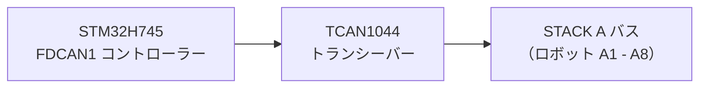
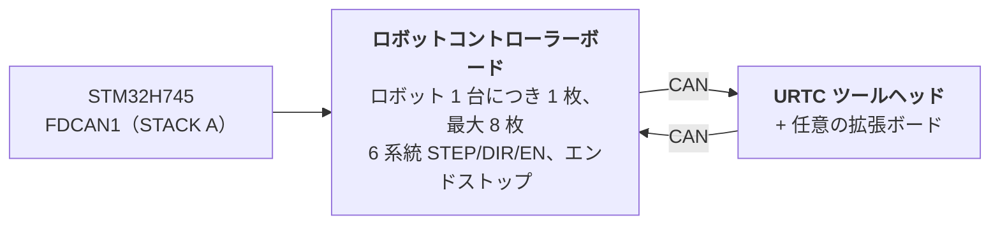

# ハードウェア仕様（設計）

**Copyright (C) 2026 JuanenRac (Electro Hobby 3D) <electrohobby3d@gmail.com>**
**License:** CC BY-SA 4.0 (documentation) - see LICENSE.md for the full licensing split.

これは基板とそのファームウェアの想定設計の仕様で、README を短く保つためにここへ移しました。設計が目指すものを述べており、現在存在するものは README に書かれています。

## 2. 🖥️ ホストコンピューティングサブシステム（HMI・上位処理系）

* 🧩 **モジュール：** Raspberry Pi Compute Module 5（CM5）
* ⚙️ **プロセッサ：** Broadcom BCM2712 クアッドコア ARM Cortex-A76 @ 2.4 GHz
* 🎮 **グラフィックスエンジン：** VideoCore VII GPU（OpenGL ES 3.1、Vulkan 1.2）
* 💾 **システムメモリ：** 2 GB / 4 GB LPDDR4X（CM5 に統合）
* 💽 **高速ストレージ：** 統合型 eMMC フラッシュ
* 🐧 **オペレーティングシステム：** Linux 64 ビット（Raspberry Pi OS / Yocto、`PREEMPT_RT` パッチ適用）
* 📺 **ディスプレイインターフェース：** MIPI-DSI（2 レーン／4 レーン）、高解像度静電容量式タッチパネルに接続（Bambu Lab 風 UI、60 FPS）
* 🌐 **接続機能：**
  * 🌐 ギガビットイーサネット（RJ45）×1 — 産業用 LAN／RTSP 映像配信／WebSocket／MQTT 向け
  * 📶 Wi-Fi 6・Bluetooth 5.4
  * 📷 **USB 3.0／2.0 ビジョンポート ×8：** 板載のデュアル Genesys Logic GL3523 コントローラーで駆動。
  * 🎮 **USB 2.0 HID ポート ×2：** ゲームパッド／マウス／キーボード — 第 4a 節参照。

## 3. 🧠 PCIE AI アクセラレータサブシステム（HAILO-8 + HAILO-10 デュアル NPU）

* 🔀 **PCIe ファンアウト：** CM5 コネクタが公開する PCIe Gen 2.0/3.0 レーンは **1 系統のみ**（CM5 データシートの Table 5、`docs/PINOUT_CM5_CARRIER.TXT` にて確認済み）— 2 基の M.2 AI アクセラレータを直接接続するには不足しています。板載の PCIe Gen3 パケットスイッチ（候補：ASMedia ASM2806 系列または同等品、型番未定 — Hailo-10 のリンク速度がネイティブ速度を下回らないよう、Gen3 対応であることが必須）が、CM5 側の単一レーンを、下記の各 M.2 ソケットに接続する 2 系統の独立した下流 PCIe x1 レーンへファンアウトします。
* 🔌 **物理インターフェース：** 板載の M.2 Key M ソケット ×2（2242／2280 フォームファクタ）。それぞれ CM5 に直接ではなく、上記 PCIe スイッチ自身の個別の下流ポートに接続されています。
* 🚀 **NPU エンジン 1 — Hailo-8（高速知覚処理）：** 消費電力 5W 未満で **26 TOPS**（Tera Operations Per Second）を発揮する Hailo-8 産業用 AI プロセッサ。8 台全カメラ（第 4 節）にわたるマルチストリームの YOLOv8/YOLO11 (計画中。まだ動作していません) 物体検出、欠陥検査、リアルタイム PnP フィデューシャルアライメントを担います — 既存のアクセラレータであり、その役割に変更はありません。
* 🧠 **NPU エンジン 2 — Hailo-10（認知推論・ローカル生成 AI）：** Hailo-8 の置き換えではなく、それに加えて搭載されます。**40 TOPS** を発揮し、量子化された LLM および Vision-Language-Action（VLA）モデルをローカルかつプライベートに実行します。オペレーターの自然言語／音声指示を運動学的軌道へと変換し、ロボットがタスクに失敗した際には外部クラウドサービスへの往復通信なしに、意味理解に基づくエラー復旧を行います。これは、HYDRA-UMC エコシステムの他の部分（同族プロジェクトである HYDRA-UMC-COGNITIVE-NODE）ですでに確立されている Hailo-10 の認知的役割と同一のものです。
* ⚡ **ソフトウェア統合：** 両アクセラレータ向けの公式 Hailo RT ソフトウェアスイートが Raspberry Pi OS に統合されており、Hailo-8 のゼロ CPU オーバーヘッドなビジョン推論のために GStreamer/TAPPAS パイプラインと OpenCV を実行します。Hailo-10 自身の LLM/VLA ランタイム統合は、まだ設計段階です（`src/cm5_host/ai_inference/README.md` 参照）。
* ⚠️ **未確定事項：** PCIe スイッチの正確な型番、および Hailo-10 自身の実際の消費電力は、いずれも未確定です — `hardware/PCB/kinematic_brain_stm32h745/BOM.TXT` の項目 05・09 を参照してください。

## 4. 📷 デュアル USB 3.0 ビジョンサブシステム（カメラポート ×8）

* 🎛️ **ハブコントローラー：** Genesys Logic `GL3523` USB 3.0／SuperSpeed ハブ IC ×2、マザーボードに直接統合。
* 🔀 **トポロジーと分配：**
  * 🅰️ **ハブ #1（`GL3523-A`）：** CM5 のネイティブ USB3-0 SuperSpeed PHY（5 Gbps）に接続。USB ポート 1〜4（カメラ A1〜A4）へ供給。
  * 🅱️ **ハブ #2（`GL3523-B`）：** CM5 のネイティブ USB3-1 SuperSpeed PHY（5 Gbps）に接続。USB ポート 5〜8（カメラ A5〜A8）へ供給。
  * ℹ️ CM5（BCM2712）はこの 2 系統の SuperSpeed PHY を直接公開しており、RP1 コンパニオンチップは関与しません（RP1 は Raspberry Pi 5 ボード専用で、CM5 には存在しません）。ピンレベルの完全な信号配線は `docs/PINOUT_CM5_CARRIER.TXT` を参照。
* 🛡️ **電源スイッチ・回路保護：** 各 USB VBUS は、ハイサイド電流制限電源スイッチ（`TPS2065`／`SY6280`）により個別に保護され、500 mA〜1 A に設定、故障報告機能付き。
* ⚡ **大電流 VBUS レール：** 専用の 24V→5V 降圧レギュレータにより給電（5V @ 連続 6A）。

### 4a. 🎮 USB 2.0 HID サブシステム（ゲームパッド／マウス／キーボードポート ×2）

* 🎛️ **ハブコントローラー：** CM5 の単一ネイティブ USB 2.0 PHY を 2 系統の物理ポートへファンアウトする、小型 USB 2.0 ハブ IC ×1（例：Genesys Logic `GL850G`／`FE1.1s`、型番未定）。
* ℹ️ **ハブが必要な理由：** CM5 データシート（`docs/datasheets/Raspberry Pi CM5.pdf`、§2.5）により、BCM2712 が DF40 コネクタ上に公開する USB 2.0（High Speed）ポートは **1 系統のみ**（`USB_N`／`USB_P`、ピン 103／105）であることが確認されています — これは GL3523 カメラハブ（第 4 節）にすでに専用割り当てされている 2 系統のネイティブ USB 3.0 SuperSpeed PHY とは別個のものです。単一の物理信号対は、間にハブを挟まない限り 2 ポートに分割できません。
* 🔀 **トポロジー：** `USB_N`／`USB_P`（CM5）→ ハブのアップストリームポート → 2 系統のダウンストリーム USB 2.0 Type-A ポート（フロント／サイドパネル、ゲームパッド・マウス・キーボード用 — タッチスクリーンとは独立した手動ジョグ／ティーチペンダント操作および HMI 入力）。
* 📌 ピンレベルの完全な信号配線は `docs/PINOUT_CM5_CARRIER.TXT` 第 1 節を参照。

## 5. ⚡ リアルタイムコプロセッシングサブシステム（設計）

* 🎛️ **マイクロコントローラー：** STMicroelectronics **STM32H745ZIT6**（コスト最適化デュアルコア MCU）
* 📦 **パッケージ：** LQFP-144（0.5 mm ピンピッチ）
* 🧠 **アーキテクチャ：** デュアルコア非対称マルチプロセッシング（AMP）
  * 🚀 **コア 1（Cortex-M7 @ 480 MHz）：** 計画中：リアルタイムモーションエンジン、ハードウェアパルス生成、S カーブ速度プロファイル、PID 制御ループ。現時点のアプリケーションは GPIO をトグルするだけのスモークテストです。
  * 📡 **コア 2（Cortex-M4 @ 240 MHz）：** クラシック CAN モードでの FDCAN1 プロトコル管理とコア間メールボックスは存在します（基板上では未実行）。計画中で未実装のもの：アナログセンサーフィルタリングと安全インターロック。
* 💾 **内蔵メモリアーキテクチャ：**
  * 💾 **2 MB** デュアルバンク内蔵フラッシュ
  * 🧠 **1 MB** 内蔵 SRAM 総容量（512 KB AXI SRAM + 128 KB ITCM／128 KB DTCM + SRAM1/SRAM2/SRAM3）
* 🧵 **RTOS：** **FreeRTOS**、コアごとに独立したインスタンスを実行（AMP であり SMP ではない — コア 1・コア 2 間でスケジューラの状態を共有しません）。`src/mcu_stm32h745/`:コア 2(CM4)はすでに実際の FDCAN1「STACK A」マスターアプリケーション(`CM4/STM32H745ZI_CM4_main.c`)を実行しています。コア 1(CM7)自身の `main()` は今も何もしない古いプレースホルダーを呼び出したままです — 詳細は `docs/architecture.md` 第 2 節を参照。

## 6. 📡 分散フィールドバス通信（単一 CAN バス、FDCAN ペリフェラルをクラシックモードで使用）

マザーボードは、単一の物理 CAN バス上に分散した最大 8 台の個別スレーブロボットモジュールに対するマスターコントローラーとして機能します。

* 🔌 **ハードウェアペリフェラル：** STM32H745 に直接内蔵されたネイティブハードウェア FDCAN コントローラー（`FDCAN1`）×1。実際のブートローダー実装により **クラシック CAN モード**（`FDCAN_FRAME_CLASSIC`、`BRS_OFF`）で動作しています — このペリフェラル自体は FD 対応シリコンですが、本プロジェクトが現時点で実際に使用している CAN-OTA/SPI-OTA プロトコル（`docs/CANBUS_STM32H745.TXT`、`docs/CANBUS_STM32G474.TXT`）は、他のすべての階層（G474 ロボットコントローラーボード、URTC）と同様、クラシックフレーム（最大 DLC 8）のみを使用します。CAN FD のより大きな 64 バイト BRS ペイロードは、将来のための実際のハードウェア余裕であり、現時点のプロトコルではまだ使用されていません。
* ⚡ **物理層トランシーバー：** 高速 CAN FD トランシーバー ×1（例：TI `TCAN1044AVD`／NXP `TJA1443`）— 現在のトラフィックがクラシックフレームであっても、上記ペリフェラルと同じ理由から FD 対応ハードウェアが選定されています。
* 🔀 **バストポロジー：**
  * 🅰️ **STACK A（`FDCAN1`）：** スレーブモジュール A1〜A8 に対応。
* ⏱️ **プロトコル仕様：** 公称ビットレート約 1 Mbps（クラシック CAN、フレームあたり最大 8 バイトペイロード）。自動バスオフ復旧は Cortex-M4 が管理する計画ですが、まだ実装されていません。現時点の CM4 のアプリケーション(`src/mcu_stm32h745/CM4/STM32H745ZI_CM4_main.c`)はすでに実際の FDCAN1「STACK A」マスタータスクを実行しており(全 8 スロットに対するラウンドロビンの `AXIS_STATUS` 問い合わせ、`KinematicBrainCan.c` 参照)、ウォッチドッグのリフレッシュも行っていますが、バスオフ復旧そのものは実際の将来対応事項のままで、すでに実装済みの機能ではありません。
* 🔌 **物理コネクタ：** 40 ピン、2.54mm ピッチのスタッキング型ヘッダー／ソケット（+24V ×10 ピン、GND ×10 ピン、補助 +5V ×4 ピン、FDCAN1 H/L、`BOARD_PRESENT_N`、予備 13 ピン）— 8 枚のロボットコントローラーボードは本ボードの片側に物理的に積み重なるように取り付けられます（確認済みのトポロジーであり、バックプレーン方式ではありません）。各ボードは 40 本の信号すべてを、その上に取り付けられるボードへストレートスルーで伝達します。スロットアドレスは各ボードごとのローカル DIP スイッチによって決まります（`BOARD_ID[2:0]`、README.md 第 12 節）— このコネクタから導出されるものではありません。完全なピン表とスタックトポロジーは `docs/PINOUT_STACKA_CONNECTOR.TXT` を参照。Kinematic Brain 自身のポートおよび各ロボットコントローラーボードの一対のポートも、すべて同一のコネクタ定義です。

## 7. 💾 超高速不揮発性メモリ（SPI FRAM）

設計目標(まだ実装されていません)：緊急停電時のデータ損失ゼロと即時状態復旧：

* 🧪 **メモリ IC：** Cypress/Infineon `FM25V05-G`／Fujitsu `MB85RS64`（64 KB SPI FRAM）
* ⚡ **バスインターフェース：** 専用 SPI2 バス、最大 40 MHz。
* ♾️ **耐久性：** 無制限の書き込み耐久性（10^14 サイクル）、ナノ秒オーダーの書き込みレイテンシ。
* 🛡️ **停電保護シーケンス（PVD）、計画中：** 内蔵の電圧監視回路（PVD）が 3.3V レールを常時監視。電圧低下を検知すると、電源遮断前の **5 マイクロ秒以内** に、ノンマスカブル割り込み（NMI）によりエンコーダのベクトル値、アクティブなステートマシン、座標情報を FRAM へダンプします。

## 8. 🦾 ローカルモーション・駆動・センサー系

### ⚙️ モーション出力
* 🎯 **対応軸数：** 6 軸ローカルステージ — デュアル Y ガントリー + ツール軸（`X`、`Y1`、`Y2`、`Z`、`E0`、`E1`）、SPI デイジーチェーン接続された TMC5160A ステッピングドライバー 6 基により駆動。
* ⚡ **信号：** 3.3V CMOS（`STEP`、`DIR`、`ENABLE`）、全 6 ドライバー共有の SPI4 デイジーチェーン。
* ⏱️ **タイマー：** 高機能制御タイマー（X/Y1/Y2/Z 用 `TIM1`、E0/E1 用 `TIM8`）、ハードウェアパルス生成対応。
* 🛑 **エンドストップ：** 入力 12 系統、各軸につき 2 系統（MIN + MAX）。
* 📌 ピンレベルの完全な割り当ては `docs/PINOUT_STM32H745_KINEMATIC_BRAIN.TXT` を参照。

### 🔌 電源・流体アクチュエータ
* 🔀 **ローサイドスイッチングチャンネル ×20：** フライバック保護付き産業用 N チャンネル MOSFET 出力。
  * 🧲 **8+2 チャンネル：** 真空ポンプ／ベンチュリ式 Pick-and-Place 発生器。
  * 💨 **8+2 チャンネル：** 電磁空圧バルブ（5V/24V 駆動）。
* 💨 **ファン：** 3 線式ファン ×3（ローサイド MOSFET による PWM 給電切替 + チャンネルごとのタコメーター検出）。
* 🌡️ **熱管理：**
  * 🔥 ヒートベッド用ソリッドステートリレー制御出力 ×1、**AC230V 電源** をスイッチング — MCU／ロジック領域からフォトカップラーで絶縁済み。これは商用電源電圧を扱う回路であり、PCB 上には 24V バス相当ではなく、実際の沿面距離／空間距離の設計が必要です。
  * 🌡️ 高精度 NTC サーミスタアナログ入力 ×2（ヒートベッド用）、`ADC1` によりサンプリング。

## 9. 🔌 電源分配・レギュレーション

本ボードは単一の産業用 **24V DC** 入力電源バスから動作します。

* ⚡ **主 DC 入力：** 24V DC ±10%
* 🔋 **5V メイン電源系統：** 同期降圧レギュレータにより、CM5 モジュール・タッチスクリーンディスプレイのバックライト・板載ロジック向けに **連続 5A** を供給。
* 📷 **5V USB VBUS 電源系統：** 専用の同期降圧レギュレータにより、8 系統の USB 3.0 カメラポートおよび GL3523 ハブコントローラー専用に **連続 6A** を供給。
* 🎛️ **3.3V 電源系統：** 低ノイズレギュレータにより **連続 4A** を供給（STM32、FRAM、トランシーバー、PCIe スイッチ（第 3 節）、および両方の M.2 ソケット（Hailo-8 + Hailo-10）の 3.3V レール向けに設計）。両 M.2 モジュールの実際の消費電力が確定した時点（Hailo-8 は 5W 未満、Hailo-10 自身の数値は未確定）で、この 4A という電力予算は再検証が必要です — 4A を超える可能性があります。`hardware/PCB/kinematic_brain_stm32h745/BOM.TXT` の項目 09 を参照。

## 10. 🔄 プロセッサ間通信（IPC）

CM5（ホスト）と STM32H745（コプロセッサ）間の通信には、ハードウェア支援によるゼロコピー SPI リンクを使用します。

* 🔗 **物理トランスポート：** 全二重 SPI1、最大 50 MHz を想定した設計 — STM32 側はスレーブモード、CM5 側はマスターモードで動作。ただし CM5 側の実際のドライバ(`src/cm5_host/ipc_driver/src/ipc_driver.c`)は現在、これに一致すべき STM32H745 の SPI1 スレーブ側設定が実機でまだ検証されていないため、保守的に 10 MHz を使用しています。
* 🤝 **ハンドシェイク信号線：** `HYDRA_DATA_READY` GPIO 信号線。
* ⚡ **実行フロー：** Cortex-M4 が共有 AXI SRAM 上に 128 バイトのテレメトリフレームを準備し、`HYDRA_DATA_READY` をアサートします。その後 CM5 は、ポーリング処理のオーバーヘッドなしに、高速 SPI DMA 経由でそのパケットを取得します。

## 11. 🎛️ 4 層 PCB ハードウェア仕様

* 📐 **フォームファクタ：** 一体型産業用マザーボード。
* 🥞 **層構成（4 層）：**
  * 🟢 **レイヤー 1（表層）：** 部品配置、高周波信号、90 オーム USB SuperSpeed 差動ペア、85 オーム PCIe Gen 3.0 差動ペア。
  * 🛡️ **レイヤー 2（内層 1）：** 連続したソリッドグラウンドプレーン（`GND`）。
  * ⚡ **レイヤー 3（内層 2）：** 分割型電源プレーン（`24V`、`5V_MAIN`、`5V_USB`、`3.3V`）。
  * 🔴 **レイヤー 4（裏層）：** 二次的な信号配線と大電流電源の分岐。
* 🛠️ **コネクタ・実装：**
  * 🔲 STM32H745 は LQFP-144 パッケージ（0.5 mm ピッチ）、GL3523 ハブ ×2 は QFN-88 パッケージ。加えて、板載 PCIe Gen3 スイッチから給電される M.2 Key M 2242/2280 ソケット ×2（Hailo-8 + Hailo-10、第 3 節）。
  * 🔌 Compute Module 5 用のデュアル Hirose DF40 メザニンコネクタ。
  * 📌 STACK A バス接続用（ロボットコントローラーボードの物理スタックのベース）の 40 ピン、2.54 mm ピッチスタッキングヘッダー — `docs/PINOUT_STACKA_CONNECTOR.TXT`。
  * 🔌 ロボットカメラ用の USB 3.0 Type-A（または Hirose 産業用ラッチ式）コネクタ ×8。

## 12. 🦾 ロボットコントローラーボードと URTC ツールヘッド（分散階層）

STACK A（第 6 節）上の最大 8 台のスレーブモジュールそれぞれは、**ロボットコントローラーボード** です。ロボット 1 台につき 1 枚配置され、そのロボット自身の 6 軸（STEP/DIR/ENABLE）を駆動し、そのエンドストップを読み取り、自身のツールヘッドの通信を *もう一段先* の別の CAN 接続を介して、ロボットの頭部に取り付けられた **URTC**（Universal Robot Tool Controller — 同族リポジトリ `URTC` 参照）ボードへ中継します。この URTC ボードには、任意で独自の拡張ボードを追加できます。

* 🎛️ **MCU：** STMicroelectronics **STM32G474RET6**（Cortex-M4 @ 170 MHz、LQFP-64、512 KB フラッシュ）、自身の 3 系統の FDCAN ペリフェラルのうち 2 系統を使用 — 1 系統は STM32H745 への FDCAN アップリンク、もう 1 系統は自身の URTC ヘッドへの CAN ダウンリンクとして機能します。詳細は `docs/architecture.md` §1 を参照。
* 🔢 **アドレッシング：** `BOARD_ID[2:0]` — 各ボード上のローカル 3 ビット DIP スイッチで、設置時に手動で 0〜7 に設定され、各ボードに固有の FDCAN1 スロットベース ID を割り当てます。物理的なスタック位置や STACK A コネクタから導出されるものではありません（すべてのボードは同一の互換 PCB です）。詳細は `docs/PINOUT_STM32G474_ROBOT_CONTROLLER.TXT` §1c を参照。
* 🧵 **RTOS：** **FreeRTOS**（ブートローダーはベアメタルのまま — 受信／検証／ジャンプにスケジューラは不要）。実際のアプリケーション:`src/mcu_stm32g474/STM32G474RE_main.c` は、ウォッチドッグをリフレッシュするブリンクタスクと並んで、実際のリレータスク(`RobotControllerRelay.c` — URTC Tool Head への FDCAN2 ダウンリンク、`AXIS_STATUS` レスポンダー、`RELAY_SEND`/`RELAY_RECV` トンネル)を実行しています。
* 📡 **4 階層に及ぶ CAN-OTA ファームウェア更新：** STM32H745 自身（CM5 との既存 SPI リンク経由）、本ボード、その URTC ツールヘッド（STM32F303CCT6）、そして —— 取り付けられている場合のみ —— そのヘッド自身の高度拡張ボード（STM32F303CBT6、`expansion_board_type` 3 または 4、URTC 自身の `docs/EXPANSION.TXT` 参照）まで、いずれも JTAG/SWD プローブや USB-CAN ドングルなしに、HYDRA-UMC-STUDIO のフラッシャー／テスターから書き込み・診断が可能です。完全なアドレッシング方式、新たなプロトコル設計を必要とせず最後の 2 階層まで到達する中継トンネル、および現在の実装状況は `docs/architecture.md` を参照してください。 **署名付きイメージヘッダーとアンチロールバック(ブートローダー、ホストでテスト済み):** アップデートは 64 バイトのヘッダー(完全なバージョン major.minor.patch、ハードウェア ID、サイズ、リンクアドレス、ベクターワード、CRC)を伴い、Ed25519 署名がヘッダーとイメージをまとめたダイジェストを対象とするので、古い署名済みイメージが高いバージョンを名乗ることはできません。バージョンの 3 つの数が比較され、古いイメージはそのセッションのノンス、2 つのバージョン、そのイメージに結び付いたトークン(これも署名)がある場合にのみインストールされます(以前の 4 バイトのマジックフレームは何も許可しません)。判断(`image_header.h`、`update_verify.h`)は 3 つのブートローダーで同一のファイルで、`tools/image_header.py` が作ったバイト列でテストされ、G474 では START_UPDATE から新しいアプリケーションまで通しでテストされています。ボードが持つのは公開鍵だけです(`tools/image_header.py` が鍵を作り署名します。秘密シードはボードに入れず、開発用シードは公開されているため、リリースビルドは開発用公開鍵を拒否します)。曲線演算は同梱の TweetNaCl(パブリックドメイン、`THIRD_PARTY_NOTICES.md`)です。ボード向けのコンパイルも実機での実行もまだありません。

完全な階層アーキテクチャ（本節はその要約）は `docs/architecture.md` を参照 — どこまでが確認済みのハードウェア事実で、どこからが実装待ちの提案設計であるかも含まれています。同ドキュメントの第 8 節では、現行のブートローダーが抱える既知かつ許容済みのセキュリティ上の制約（読み出し保護の未実装、共有の防ロールバック回避値、認証なしの読み戻し）も追跡しています —— これらは実機到着前の意図的な未対応事項であり、見落としではありません。
