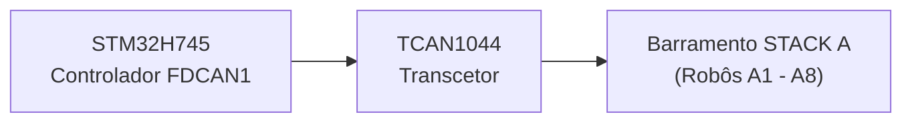
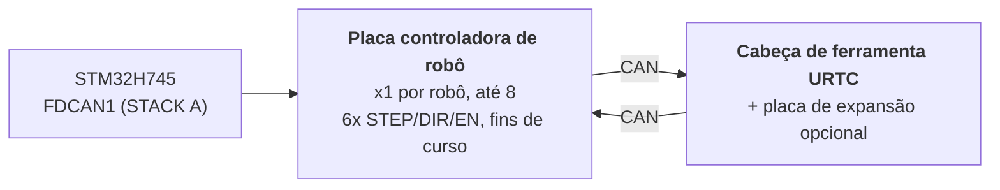

# Especificação de hardware (conceção)

**Copyright (C) 2026 JuanenRac (Electro Hobby 3D) <electrohobby3d@gmail.com>**
**License:** CC BY-SA 4.0 (documentation) - see LICENSE.md for the full licensing split.

Esta é a especificação do desenho previsto da placa e do seu firmware, passada para aqui a partir do README para que este fique curto. Descreve o que o desenho pretende; o README diz o que existe hoje.

## 2. 🖥️ SUBSISTEMA DE COMPUTAÇÃO ANFITRIÃO (HMI E ALTO NÍVEL)

* 🧩 **Módulo:** Raspberry Pi Compute Module 5 (CM5)
* ⚙️ **Processador:** Broadcom BCM2712 Quad-Core ARM Cortex-A76 @ 2.4 GHz
* 🎮 **Motor gráfico:** GPU VideoCore VII (OpenGL ES 3.1, Vulkan 1.2)
* 💾 **Memória do sistema:** 2 GB / 4 GB LPDDR4X (integrada no CM5)
* 💽 **Armazenamento de alta velocidade:** flash eMMC integrada
* 🐧 **Sistema operativo:** Linux de 64 bits (Raspberry Pi OS / Yocto com patch `PREEMPT_RT`)
* 📺 **Interface de ecrã:** MIPI-DSI (2 vias / 4 vias) ligada a um painel tátil capacitivo de alta resolução (interface ao estilo Bambu Lab a 60 FPS)
* 🌐 **Conjunto de conectividade:**
  * 🌐 1x Gigabit Ethernet (RJ45) para LAN industrial / transmissão de vídeo RTSP / WebSockets / MQTT
  * 📶 Wi-Fi 6 e Bluetooth 5.4
  * 📷 **8x portas de visão USB 3.0 / 2.0:** controladas por dois controladores Genesys Logic GL3523 a bordo.
  * 🎮 **2x portas HID USB 2.0:** gamepad / rato / teclado - ver a secção 4a.

## 3. 🧠 SUBSISTEMA DE ACELERADORES DE IA PCIE (DUPLO NPU HAILO-8 + HAILO-10)

* 🔀 **Distribuição PCIe:** o conector do CM5 expõe apenas **uma** via PCIe Gen 2.0/3.0 x1 (confirmado na Tabela 5 da folha de dados do CM5, `docs/PINOUT_CM5_CARRIER.TXT`), insuficiente para ligar 2 aceleradores de IA M.2 diretamente. Um comutador de pacotes PCIe Gen3 a bordo (candidato: família ASMedia ASM2806 ou equivalente, peça exata por definir; Gen3 especificamente, para que a ligação do Hailo-10 não fique limitada abaixo da sua velocidade nativa) reparte essa única via do lado do CM5 por 2 vias PCIe x1 independentes a jusante, uma por cada ranhura M.2 abaixo.
* 🔌 **Interfaces físicas:** 2x ranhuras M.2 Key M a bordo (formatos 2242 / 2280), cada uma ligada à sua própria porta a jusante do comutador PCIe acima, e não diretamente ao CM5.
* 🚀 **Motor NPU 1 - Hailo-8 (perceção de alta velocidade):** processador de IA industrial Hailo-8 que entrega **26 TOPS** (Tera Operações Por Segundo) com um consumo inferior a 5 W. Executa deteção de objetos YOLOv8/YOLO11 (previsto; ainda não em execução) em vários fluxos, inspeção de defeitos e alinhamento de fiduciais PnP em tempo real nas 8 câmaras (secção 4); é o acelerador já existente, sem mudar de papel.
* 🧠 **Motor NPU 2 - Hailo-10 (raciocínio cognitivo / GenAI local):** acrescentado ao lado do Hailo-8, não em substituição. Com **40 TOPS**, executa modelos LLM e Visão-Linguagem-Ação (VLA) quantizados de forma local e privada: traduz instruções do operador em linguagem natural/voz para trajetórias cinemáticas e trata da recuperação semântica de erros quando um robô falha uma tarefa, sem ida e volta a qualquer serviço externo na nuvem. É o mesmo papel cognitivo já estabelecido para o Hailo-10 no resto do ecossistema HYDRA-UMC (o projeto irmão HYDRA-UMC-COGNITIVE-NODE).
* ⚡ **Integração de software:** o conjunto de software oficial Hailo RT integrado com o Raspberry Pi OS para ambos os aceleradores, que executa pipelines GStreamer/TAPPAS e OpenCV para a inferência de visão do Hailo-8 sem custo de CPU; a integração do runtime LLM/VLA do Hailo-10 ainda está em fase de desenho (ver `src/cm5_host/ai_inference/README.md`).
* ⚠️ **Ponto em aberto:** o número de peça exato do comutador PCIe e o consumo real do Hailo-10 continuam por definir; ver os itens 05 e 09 de `hardware/PCB/kinematic_brain_stm32h745/BOM.TXT`.

## 4. 📷 SUBSISTEMA DE VISÃO USB 3.0 DUPLO (8x PORTAS DE CÂMARA)

* 🎛️ **Controladores de hub:** 2x CI de hub USB 3.0 / SuperSpeed Genesys Logic `GL3523` integrados diretamente na placa-mãe.
* 🔀 **Topologia e distribuição:**
  * 🅰️ **Hub n.º 1 (`GL3523-A`):** ligado ao PHY SuperSpeed USB3-0 nativo do CM5 (5 Gbps). Alimenta as portas USB 1 a 4 (câmaras A1-A4).
  * 🅱️ **Hub n.º 2 (`GL3523-B`):** ligado ao PHY SuperSpeed USB3-1 nativo do CM5 (5 Gbps). Alimenta as portas USB 5 a 8 (câmaras A5-A8).
  * ℹ️ O CM5 expõe diretamente estes 2 PHY SuperSpeed (BCM2712); não intervém nenhum chip RP1 auxiliar (o RP1 é específico da placa Raspberry Pi 5, não do CM5). Encaminhamento completo dos sinais ao nível dos pinos: `docs/PINOUT_CM5_CARRIER.TXT`.
* 🛡️ **Interruptor de potência e proteção de circuito:** proteção individual do VBUS USB com interruptores de potência high-side com limitação de corrente (`TPS2065` / `SY6280`) configurados para 500 mA - 1 A com comunicação de falhas.
* ⚡ **Linha VBUS de alta corrente:** alimentada por um regulador redutor dedicado de 24 V para 5 V (5 V @ 6 A contínuos).

### 4a. 🎮 SUBSISTEMA HID USB 2.0 (2x PORTAS PARA GAMEPAD / RATO / TECLADO)

* 🎛️ **Controlador de hub:** 1x pequeno CI de hub USB 2.0 (p. ex. Genesys Logic `GL850G` / `FE1.1s`, por definir) que reparte o único PHY USB 2.0 nativo do CM5 por 2 portas físicas.
* ℹ️ **Porque é preciso um hub:** a folha de dados do CM5 (`docs/datasheets/Raspberry Pi CM5.pdf`, §2.5) confirma que o BCM2712 expõe exatamente **uma** porta USB 2.0 (High Speed) no conector DF40 (`USB_N`/`USB_P`, pinos 103/105), separada e distinta dos 2 PHY USB 3.0 SuperSpeed nativos já dedicados aos hubs de câmaras GL3523 (secção 4). Um único par físico não se pode dividir em 2 portas sem um hub no meio.
* 🔀 **Topologia:** `USB_N`/`USB_P` (CM5) -> porta ascendente do hub -> 2x portas USB 2.0 Tipo-A a jusante (painel frontal/lateral, para um gamepad, rato ou teclado: controlo manual de jog/teach-pendant e entrada HMI, independentes do ecrã tátil).
* 📌 Encaminhamento completo dos sinais ao nível dos pinos: `docs/PINOUT_CM5_CARRIER.TXT`, secção 1.

## 5. ⚡ SUBSISTEMA DE COPROCESSAMENTO EM TEMPO REAL (DESENHO)

* 🎛️ **Microcontrolador:** STMicroelectronics **STM32H745ZIT6** (MCU de dois núcleos com custo otimizado)
* 📦 **Encapsulamento:** LQFP-144 (passo de pino de 0,5 mm)
* 🧠 **Arquitetura:** multiprocessamento assimétrico (AMP) de dois núcleos
  * 🚀 **Núcleo 1 (Cortex-M7 @ 480 MHz):** previsto: motor de movimento em tempo real, geração de pulsos por hardware, perfis de velocidade em curva S e laços de controlo PID. Hoje a sua aplicação é apenas um teste de fumo que comuta um GPIO.
  * 📡 **Núcleo 2 (Cortex-M4 @ 240 MHz):** a gestão do protocolo FDCAN1 em modo CAN clássico e a caixa de correio entre núcleos existem (nunca executadas numa placa); previstos e não implementados: filtragem de sensores analógicos e interlocks de segurança.
* 💾 **Arquitetura de memória interna:**
  * 💾 **2 MB** de flash interna de duplo banco
  * 🧠 **1 MB** de SRAM interna total (512 KB de SRAM AXI + 128 KB ITCM / 128 KB DTCM + SRAM1/SRAM2/SRAM3)
* 🧵 **RTOS:** **FreeRTOS**, uma instância independente por núcleo (AMP, não SMP: sem estado de escalonador partilhado entre o Núcleo 1 e o Núcleo 2). `src/mcu_stm32h745/`: o Núcleo 2 (CM4) já executa uma aplicação real de mestre FDCAN1 "STACK A" (`CM4/STM32H745ZI_CM4_main.c`); o `main()` do Núcleo 1 (CM7) ainda chama o antigo marcador sem função; ver `docs/architecture.md`, secção 2.

## 6. 📡 COMUNICAÇÃO DE BARRAMENTO DE CAMPO DISTRIBUÍDO (BARRAMENTO CAN ÚNICO; PERIFÉRICO FDCAN EM MODO CLÁSSICO)

A placa-mãe atua como controlador mestre de até 8 módulos robóticos escravos individuais distribuídos por um único barramento CAN físico:

* 🔌 **Periférico de hardware:** 1x controlador FDCAN nativo (`FDCAN1`) integrado no STM32H745, executado em **modo CAN clássico** (`FDCAN_FRAME_CLASSIC`, `BRS_OFF`) pela implementação real do bootloader: o periférico é silício compatível com FD, mas o protocolo CAN-OTA/SPI-OTA que este projeto fala hoje (`docs/CANBUS_STM32H745.TXT`, `docs/CANBUS_STM32G474.TXT`) usa apenas tramas clássicas (DLC máximo 8), como todos os outros níveis (placas controladoras de robô G474, URTC). As cargas BRS maiores, de 64 bytes, do CAN FD são folga real de hardware para mais tarde, não algo que o protocolo use já.
* ⚡ **Transcetor da camada física:** 1x transcetor CAN FD de alta velocidade (p. ex. TI `TCAN1044AVD` / NXP `TJA1443`); hardware compatível com FD escolhido pela mesma razão de folga futura que o periférico acima, mesmo que o tráfego de hoje sejam tramas clássicas.
* 🔀 **Topologia do barramento:**
  * 🅰️ **STACK A (`FDCAN1`):** serve os módulos escravos A1 a A8.
* ⏱️ **Especificações do protocolo:** taxa nominal de ~1 Mbps (CAN clássico, carga máxima de 8 bytes por trama). Está previsto que o Cortex-M4 gira a recuperação automática de bus-off, mas ainda não está implementada; a aplicação CM4 de hoje (`src/mcu_stm32h745/CM4/STM32H745ZI_CM4_main.c`) já executa uma tarefa de mestre FDCAN1 "STACK A" real (consultas `AXIS_STATUS` em rodízio por todas as 8 ranhuras, ver `KinematicBrainCan.c`) mais a renovação do watchdog, mas a recuperação de bus-off em concreto continua a ser trabalho futuro real e não uma capacidade entregue.
* 🔌 **Conector físico:** conector/ficha EMPILHÁVEL de 40 pinos e passo de 2,54 mm (+24 V ×10 pinos, GND ×10 pinos, +5 V ×4 pinos auxiliares, FDCAN1 H/L, `BOARD_PRESENT_N`, 13 de reserva): as 8 placas controladoras de robô EMPILHAM-SE fisicamente umas sobre as outras num dos lados desta placa (topologia CONFIRMADA, não um backplane), e cada placa passa diretamente os 40 sinais para o que se montar por cima. O endereçamento da ranhura é um interruptor DIP LOCAL por placa (`BOARD_ID[2:0]`, README.md secção 12), não derivado deste conector. Tabela completa de pinos e topologia da pilha em `docs/PINOUT_STACKA_CONNECTOR.TXT`. Definição de conector idêntica na porta do próprio Cérebro Cinemático e no par de portas de cada placa controladora de robô.

## 7. 💾 MEMÓRIA NÃO VOLÁTIL ULTRARRÁPIDA (FRAM SPI)

Objetivo de desenho (ainda não implementado): zero perda de dados e recuperação instantânea do estado durante falhas de energia de emergência:

* 🧪 **CI de memória:** Cypress/Infineon `FM25V05-G` / Fujitsu `MB85RS64` (FRAM SPI de 64 KB)
* ⚡ **Interface de barramento:** barramento SPI2 dedicado até 40 MHz.
* ♾️ **Durabilidade:** resistência infinita (10^14 ciclos) com latências de escrita de nanossegundos.
* 🛡️ **Sequência anti-perda de energia (PVD), prevista:** o detetor interno de tensão de alimentação (PVD) vigia a linha de 3,3 V. Ao detetar uma queda de tensão, uma interrupção não mascarável (NMI) guarda na FRAM os vetores dos codificadores, as máquinas de estados ativas e as coordenadas em menos de **5 microssegundos** antes de a alimentação se desligar.

## 8. 🦾 CONJUNTO LOCAL DE MOVIMENTO, ATUAÇÃO E SENSORES

### ⚙️ Saídas de movimento
* 🎯 **Eixos suportados:** estágio local de 6 eixos: pórtico de duplo Y + eixos de ferramenta (`X`, `Y1`, `Y2`, `Z`, `E0`, `E1`), acionados por 6x drivers de motor de passo TMC5160A numa cadeia daisy-chain SPI.
* ⚡ **Sinais:** CMOS de 3,3 V (`STEP`, `DIR`, `ENABLE`), cadeia daisy-chain SPI4 partilhada para os 6 drivers.
* ⏱️ **Temporizadores:** temporizadores de controlo avançado (`TIM1` para X/Y1/Y2/Z, `TIM8` para E0/E1) com geração de pulsos por hardware.
* 🛑 **Fins de curso:** 12x entradas, 2 por eixo (MIN + MAX).
* 📌 Atribuição completa de pinos: `docs/PINOUT_STM32H745_KINEMATIC_BRAIN.TXT`.

### 🔌 Atuadores de potência e fluídicos
* 🔀 **20x canais de comutação low-side:** saídas MOSFET de canal N industriais com proteção contra retorno (flyback).
  * 🧲 **8+2 canais:** bombas de vácuo / geradores Venturi de Pick-and-Place.
  * 💨 **8+2 canais:** eletroválvulas pneumáticas (atuação a 5 V/24 V).
* 💨 **Ventoinhas:** 3x ventoinhas de 3 fios (alimentação comutada por PWM através de MOSFET low-side + leitura de tacómetro por canal).
* 🌡️ **Gestão térmica:**
  * 🔥 1x saída de controlo de relé de estado sólido para a cama aquecida, que comuta a **rede de 230 V CA**, opto-isolada dos domínios de MCU/lógica; é um circuito de tensão de rede e exige distâncias reais de fuga e isolamento na PCB, não uma pegada de barramento de 24 V.
  * 🌡️ 2x entradas analógicas de termístor NTC de precisão (cama aquecida) amostradas pelo `ADC1`.

## 9. 🔌 DISTRIBUIÇÃO E REGULAÇÃO DE ENERGIA

A placa funciona a partir de um único barramento de alimentação industrial de **24 V CC**:

* ⚡ **Entrada principal CC:** 24 V CC ±10 %
* 🔋 **Domínio de energia principal de 5 V:** regulador buck síncrono redutor que fornece **5 A contínuos** ao módulo CM5, à retroiluminação do ecrã tátil e à lógica a bordo.
* 📷 **Domínio de energia VBUS USB de 5 V:** regulador buck síncrono dedicado que fornece **6 A contínuos** exclusivamente às 8 portas de câmara USB 3.0 e aos controladores de hub GL3523.
* 🎛️ **Domínio de energia de 3,3 V:** regulador de baixo ruído que fornece **4 A contínuos** (dimensionado para o STM32, a FRAM, os transcetores, o comutador PCIe (secção 3) e as linhas de 3,3 V de ambas as ranhuras M.2 - Hailo-8 + Hailo-10). Este orçamento tem de ser revisto contra o valor de 4 A quando se confirmar o consumo real de ambos os módulos M.2 (o Hailo-8 tem menos de 5 W; o valor do Hailo-10 continua por definir); pode ter de crescer acima de 4 A; ver o item 09 de `hardware/PCB/kinematic_brain_stm32h745/BOM.TXT`.

## 10. 🔄 COMUNICAÇÃO ENTRE PROCESSADORES (IPC)

A comunicação entre o CM5 (anfitrião) e o STM32H745 (coprocessador) usa uma ligação SPI assistida por hardware e sem cópias:

* 🔗 **Transporte físico:** SPI1 full-duplex, concebido até 50 MHz em modo escravo no STM32 e modo mestre no CM5; o controlador real do lado do CM5 (`src/cm5_host/ipc_driver/src/ipc_driver.c`) assume hoje por omissão um valor prudente de 10 MHz, porque a configuração de modo/ordem de bits do escravo SPI1 do STM32H745 com que tem de coincidir ainda não foi verificada em hardware real.
* 🤝 **Linha de handshake:** linha GPIO `HYDRA_DATA_READY`.
* ⚡ **Fluxo de execução:** o Cortex-M4 prepara uma trama de telemetria de 128 bytes na SRAM AXI partilhada, ativa `HYDRA_DATA_READY` e o CM5 obtém o pacote por SPI DMA de alta velocidade sem custo de polling.

## 11. 🎛️ ESPECIFICAÇÕES DE HARDWARE DA PCB DE 4 CAMADAS

* 📐 **Formato:** placa-mãe industrial monolítica.
* 🥞 **Empilhamento de camadas (4 camadas):**
  * 🟢 **Camada 1 (superior):** colocação de componentes, sinais de alta frequência, pares diferenciais USB SuperSpeed de 90 ohm, pares PCIe Gen 3.0 de 85 ohm.
  * 🛡️ **Camada 2 (interna 1):** plano de massa sólido contínuo (`GND`).
  * ⚡ **Camada 3 (interna 2):** planos de alimentação divididos (`24V`, `5V_MAIN`, `5V_USB`, `3.3V`).
  * 🔴 **Camada 4 (inferior):** pistas de sinal secundárias e saídas de potência de alta corrente.
* 🛠️ **Conectores e montagem:**
  * 🔲 Encapsulamento LQFP-144 (passo de 0,5 mm) para o STM32H745, encapsulamentos QFN-88 para os 2 hubs GL3523 e 2 ranhuras M.2 Key M 2242/2280 (Hailo-8 + Hailo-10, secção 3) alimentadas por um comutador PCIe Gen3 a bordo.
  * 🔌 Dois conectores mezanino Hirose DF40 para o Compute Module 5.
  * 📌 Conector EMPILHÁVEL de 40 pinos e passo de 2,54 mm para a ligação do barramento STACK A (base da pilha física de placas controladoras de robô): `docs/PINOUT_STACKA_CONNECTOR.TXT`.
  * 🔌 8x conectores USB 3.0 Tipo-A (ou Hirose industriais com trava) para as câmaras dos robôs.

## 12. 🦾 PLACAS CONTROLADORAS DE ROBÔ E CABEÇA DE FERRAMENTA URTC (NÍVEL DISTRIBUÍDO)

Cada um dos até 8 módulos escravos do STACK A (secção 6) é uma **placa controladora de robô**: uma por robô, que aciona os 6 eixos desse robô (STEP/DIR/ENABLE), lê os seus fins de curso e reencaminha o tráfego da sua própria cabeça de ferramenta mais um salto por uma *segunda* ligação CAN até uma placa **URTC** (Universal Robot Tool Controller; ver o repositório irmão `URTC`) montada na cabeça do robô, opcionalmente com a sua própria placa de expansão.

* 🎛️ **MCU:** STMicroelectronics **STM32G474RET6** (Cortex-M4 @ 170 MHz, LQFP-64, 512 KB de flash), que usa 2 dos seus 3 periféricos FDCAN a bordo: um como ligação FDCAN ascendente para o STM32H745 e outro como ligação CAN descendente para a sua própria cabeça URTC. Ver `docs/architecture.md` §1.
* 🔢 **Endereçamento:** `BOARD_ID[2:0]`, um interruptor DIP local de 3 posições em cada placa, ajustado manualmente de 0 a 7 na instalação, dá a cada placa o seu próprio ID base de ranhura FDCAN1; não se deriva da posição física na pilha nem do conector STACK A (todas as placas são a mesma PCB intercambiável). Ver `docs/PINOUT_STM32G474_ROBOT_CONTROLLER.TXT` §1c.
* 🧵 **RTOS:** **FreeRTOS** (o seu bootloader continua a ser bare-metal: não precisa de escalonador para receber/verificar/saltar). Aplicação real: `src/mcu_stm32g474/STM32G474RE_main.c` executa uma tarefa de relé real (`RobotControllerRelay.c`: ligação descendente FDCAN2 para a cabeça de ferramenta URTC, um respondedor de `AXIS_STATUS` e o túnel `RELAY_SEND`/`RELAY_RECV`) ao lado da tarefa que pisca e renova o watchdog.
* 📡 **Atualizações de firmware CAN-OTA, 4 níveis de profundidade:** o próprio STM32H745 (pela sua ligação SPI existente ao CM5), esta placa, a sua cabeça de ferramenta URTC (STM32F303CCT6) e, só quando está instalada, a placa de expansão avançada dessa cabeça (STM32F303CBT6, `expansion_board_type` 3 ou 4, ver o `docs/EXPANSION.TXT` do URTC) podem ser gravados e diagnosticados a partir do Flasher/Tester do HYDRA-UMC-STUDIO, sem sonda JTAG/SWD nem dongle USB-CAN. O esquema de endereçamento completo, o túnel de relé que chega aos dois últimos níveis sem nenhum desenho de protocolo novo e o estado atual da implementação estão em `docs/architecture.md`. **Cabeçalho de imagem assinado e anti-rollback (bootloaders, testados no anfitrião):** a atualização leva um cabeçalho de 64 bytes (versão completa maior.menor.patch, id de hardware, tamanho, endereço de ligação, palavras de vetores, CRC) e uma assinatura Ed25519 cobre o resumo de cabeçalho e imagem em conjunto, pelo que uma imagem assinada antiga não pode declarar uma versão mais alta; os três números da versão são comparados e uma imagem mais antiga só se instala com um token (ele próprio uma assinatura) ligado ao nonce dessa sessão, às duas versões e a essa imagem (a antiga trama mágica de quatro bytes já não permite nada). A decisão (`image_header.h`, `update_verify.h`) é um só ficheiro nos três bootloaders, testado com bytes feitos por `tools/image_header.py` e, na G474, de ponta a ponta desde START_UPDATE até à nova aplicação. A placa guarda apenas a chave pública (`tools/image_header.py` cria as chaves e assina; a semente privada nunca vai para uma placa e a semente de desenvolvimento é pública, por isso uma compilação de lançamento recusa a chave pública de desenvolvimento); a aritmética da curva é o TweetNaCl incluído (domínio público, `THIRD_PARTY_NOTICES.md`). Nada disto foi compilado para uma placa nem correu numa.

Ver `docs/architecture.md` para a arquitetura completa por níveis (esta secção é um resumo), incluindo o que é facto de hardware confirmado e o que ainda é um desenho proposto à espera de implementação. A secção 8 desse documento regista também as limitações de segurança conhecidas e aceites dos bootloaders atuais (ainda sem proteção de leitura, um valor de bypass de anti-rollback partilhado, leitura de volta sem autenticação): lacunas deliberadas antes do hardware, não descuidos.
