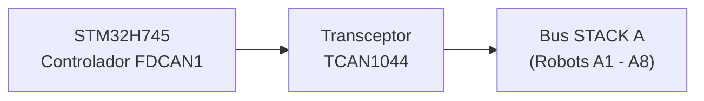
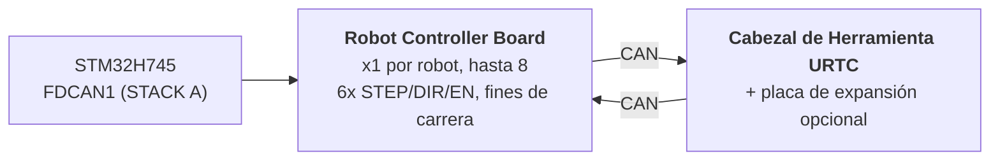

# Especificación del hardware (diseño)

**Copyright (C) 2026 JuanenRac (Electro Hobby 3D) <electrohobby3d@gmail.com>**
**License:** CC BY-SA 4.0 (documentation) - see LICENSE.md for the full licensing split.

Esta es la especificación del diseño previsto de la placa y su firmware, trasladada aquí desde el README para que este sea corto. Describe lo que el diseño persigue; el README dice lo que existe hoy.

## 2. 🖥️ SUBSISTEMA DE COMPUTACIÓN HOST (HMI Y ALTO NIVEL)

* 🧩 **Módulo:** Raspberry Pi Compute Module 5 (CM5)
* ⚙️ **Procesador:** Broadcom BCM2712 Quad-Core ARM Cortex-A76 a 2.4 GHz
* 🎮 **Motor Gráfico:** GPU VideoCore VII (OpenGL ES 3.1, Vulkan 1.2)
* 💾 **Memoria del Sistema:** 2 GB / 4 GB LPDDR4X (integrada en el CM5)
* 💽 **Almacenamiento de Alta Velocidad:** Flash eMMC integrada
* 🐧 **Sistema Operativo:** Linux de 64 bits (Raspberry Pi OS / Yocto parcheado con `PREEMPT_RT`)
* 📺 **Interfaz de Pantalla:** MIPI-DSI (2 carriles / 4 carriles) conectada a un panel táctil capacitivo de alta resolución (UI estilo Bambu Lab a 60 FPS)
* 🌐 **Suite de Conectividad:**
  * 🌐 1x Ethernet Gigabit (RJ45) para LAN industrial / streaming de vídeo RTSP / WebSockets / MQTT
  * 📶 Wi-Fi 6 y Bluetooth 5.4
  * 📷 **8x Puertos de Visión USB 3.0 / 2.0:** Alimentados por dos controladores Genesys Logic GL3523 a bordo.
  * 🎮 **2x Puertos HID USB 2.0:** Mando/ratón/teclado - ver sección 4a.

## 3. 🧠 SUBSISTEMA ACELERADOR DE IA POR PCIE (NPU DOBLE HAILO-8 + HAILO-10)

* 🔀 **Reparto del Carril PCIe:** El conector del CM5 expone únicamente **un** carril PCIe Gen 2.0/3.0 x1 (confirmado contra la Tabla 5 del datasheet del CM5, `docs/PINOUT_CM5_CARRIER.TXT`) - insuficiente para cablear 2 aceleradores de IA M.2 directamente. Un switch de paquetes PCIe Gen3 a bordo (candidato: familia ASMedia ASM2806 o equivalente, parte exacta TBD - Gen3 específicamente, para que el enlace del Hailo-10 no quede limitado por debajo de su propia velocidad nativa) reparte ese único carril del lado del CM5 en 2 carriles PCIe x1 downstream independientes, uno por cada zócalo M.2 de abajo.
* 🔌 **Interfaces Físicas:** 2x zócalos M.2 Key M a bordo (factor de forma 2242 / 2280), cada uno cableado a su propio puerto downstream del switch PCIe anterior - no directamente al CM5.
* 🚀 **Motor NPU 1 - Hailo-8 (Percepción de Alta Velocidad):** Procesador de IA industrial Hailo-8 que entrega **26 TOPS** (Tera Operaciones Por Segundo) con un consumo por debajo de 5W. Realiza detección de objetos multi-flujo YOLOv8/YOLO11 (previsto; todavía no se ejecuta), inspección de defectos y alineación de fiduciales PnP en tiempo real en las 8 cámaras (sección 4) - el acelerador ya existente, sin cambios en su rol.
* 🧠 **Motor NPU 2 - Hailo-10 (Razonamiento Cognitivo / GenAI Local):** Añadido junto al Hailo-8, no como sustituto. Con **40 TOPS**, ejecuta modelos LLM y Vision-Language-Action (VLA) cuantizados de forma local y privada - traduciendo instrucciones de voz/lenguaje natural del operario en trayectorias cinemáticas, y gestionando la recuperación semántica de errores cuando un robot falla una tarea, sin depender de ningún servicio en la nube externo. El mismo rol cognitivo ya establecido para el Hailo-10 en el resto del ecosistema HYDRA-UMC (el proyecto hermano HYDRA-UMC-COGNITIVE-NODE).
* ⚡ **Integración de Software:** Suite oficial de software Hailo RT integrada con Raspberry Pi OS para ambos aceleradores, ejecutando pipelines GStreamer/TAPPAS y OpenCV para la inferencia de visión sin sobrecarga de CPU del Hailo-8; la integración del runtime LLM/VLA propio del Hailo-10 sigue en fase de diseño (ver `src/cm5_host/ai_inference/README.md`).
* ⚠️ **Pendiente:** el número de parte exacto del switch PCIe y el consumo real propio del Hailo-10 siguen ambos TBD - ver `hardware/PCB/kinematic_brain_stm32h745/BOM.TXT` ítems 05 y 09.

## 4. 📷 SUBSISTEMA DE VISIÓN DOBLE USB 3.0 (8x PUERTOS DE CÁMARA)

* 🎛️ **Controladores de Hub:** 2x circuitos integrados de hub USB 3.0 / SuperSpeed Genesys Logic `GL3523` integrados directamente en la placa base.
* 🔀 **Topología y Distribución:**
  * 🅰️ **Hub #1 (`GL3523-A`):** Conectado al PHY SuperSpeed USB3-0 nativo del CM5 (5 Gbps). Alimenta los puertos USB 1 a 4 (Cámaras A1-A4).
  * 🅱️ **Hub #2 (`GL3523-B`):** Conectado al PHY SuperSpeed USB3-1 nativo del CM5 (5 Gbps). Alimenta los puertos USB 5 a 8 (Cámaras A5-A8).
  * ℹ️ El CM5 expone estos 2 PHY SuperSpeed directamente (BCM2712) - no interviene ningún chip complementario RP1 (el RP1 es específico de la placa Raspberry Pi 5, no del CM5). Enrutado completo de señales a nivel de pin: `docs/PINOUT_CM5_CARRIER.TXT`.
* 🛡️ **Interruptor de Potencia y Protección de Circuito:** Protección VBUS individual por USB mediante interruptores de potencia de limitación de corriente de lado alto (`TPS2065` / `SY6280`) configurados para 500 mA - 1 A con reporte de fallos.
* ⚡ **Riel VBUS de Alta Corriente:** Alimentado por un regulador Step-Down dedicado de 24V a 5V (5V @ 6A continuos).

### 4a. 🎮 SUBSISTEMA HID USB 2.0 (2x PUERTOS PARA MANDO / RATÓN / TECLADO)

* 🎛️ **Controlador de Hub:** 1x pequeño circuito integrado de hub USB 2.0 (p. ej. Genesys Logic `GL850G` / `FE1.1s`, por confirmar) que reparte el único PHY USB 2.0 nativo del CM5 en 2 puertos físicos.
* ℹ️ **Por qué se necesita un hub:** la hoja de datos del CM5 (`docs/datasheets/Raspberry Pi CM5.pdf`, §2.5) confirma que el BCM2712 expone exactamente **un** puerto USB 2.0 (High Speed) en el conector DF40 (`USB_N`/`USB_P`, pines 103/105) - separado y distinto de los 2 PHY SuperSpeed USB 3.0 nativos ya dedicados a los hubs de cámara GL3523 (sección 4). Un único par físico no puede dividirse en 2 puertos sin un hub de por medio.
* 🔀 **Topología:** `USB_N`/`USB_P` (CM5) -> puerto ascendente del hub -> 2x puertos descendentes USB 2.0 Type-A (panel frontal/lateral, para mando, ratón o teclado - control manual de jog/teach-pendant y entrada HMI, independiente de la pantalla táctil).
* 📌 Enrutado completo de señales a nivel de pin: `docs/PINOUT_CM5_CARRIER.TXT` sección 1.

## 5. ⚡ SUBSISTEMA DE COPROCESAMIENTO EN TIEMPO REAL (DISEÑO)

* 🎛️ **Microcontrolador:** STMicroelectronics **STM32H745ZIT6** (MCU de doble núcleo optimizado en coste)
* 📦 **Encapsulado:** LQFP-144 (paso de pin de 0.5 mm)
* 🧠 **Arquitectura:** Multiprocesamiento Asimétrico de Doble Núcleo (AMP)
  * 🚀 **Núcleo 1 (Cortex-M7 a 480 MHz):** Previsto: motor de movimiento en tiempo real, generación de pulsos por hardware, perfiles de velocidad en curva S y bucles de control PID. Hoy su aplicación es solo una prueba de humo que conmuta un GPIO.
  * 📡 **Núcleo 2 (Cortex-M4 a 240 MHz):** La gestión del protocolo FDCAN1 en modo CAN clásico y el buzón entre núcleos existen (sin ejecutar en una placa); previstos y sin implementar: filtrado de sensores analógicos y enclavamientos de seguridad.
* 💾 **Arquitectura de Memoria Interna:**
  * 💾 **2 MB** de flash interna de doble banco
  * 🧠 **1 MB** de SRAM interna total (512 KB AXI SRAM + 128 KB ITCM / 128 KB DTCM + SRAM1/SRAM2/SRAM3)
* 🧵 **RTOS:** **FreeRTOS**, una instancia independiente por núcleo (AMP, no SMP - sin estado de planificador compartido entre el Núcleo 1 y el Núcleo 2). `src/mcu_stm32h745/`: el Núcleo 2 (CM4) ya ejecuta una aplicación real de maestro FDCAN1 "STACK A" (`CM4/STM32H745ZI_CM4_main.c`); el propio `main()` del Núcleo 1 (CM7) todavía llama al viejo placeholder que no hace nada - ver `docs/architecture.md` sección 2.

## 6. 📡 COMUNICACIÓN DE BUS DE CAMPO DISTRIBUIDO (UN ÚNICO BUS CAN; PERIFÉRICO FDCAN EN MODO CLÁSICO)

La placa base actúa como controlador maestro para hasta 8 módulos robóticos esclavos individuales distribuidos a través de un único bus físico CAN:

* 🔌 **Periférico de Hardware:** 1x Controlador FDCAN por hardware nativo (`FDCAN1`) integrado directamente en el STM32H745, ejecutado en **modo CAN Clásico** (`FDCAN_FRAME_CLASSIC`, `BRS_OFF`) por la implementación real del bootloader - el periférico es un silicio con capacidad FD, pero el protocolo CAN-OTA/SPI-OTA que este proyecto realmente habla hoy (`docs/CANBUS_STM32H745.TXT`, `docs/CANBUS_STM32G474.TXT`) usa únicamente tramas clásicas (DLC máximo 8), igual que cualquier otro nivel (Placas Robot Controller Board G474, URTC). Los payloads BRS de 64 bytes de CAN FD son margen de hardware real para más adelante, no algo que el protocolo use todavía.
* ⚡ **Transceptor de Capa Física:** 1x Transceptor CAN FD de alta velocidad (p. ej., TI `TCAN1044AVD` / NXP `TJA1443`) - hardware con capacidad FD elegido por la misma razón de margen futuro que el periférico de arriba, aunque el tráfico de hoy sean tramas clásicas.
* 🔀 **Topología de Bus:**
  * 🅰️ **STACK A (`FDCAN1`):** Sirve a los Módulos Esclavos A1 a A8.
* ⏱️ **Especificaciones del Protocolo:** ~1 Mbps de bitrate nominal (CAN Clásico, payload máximo de 8 bytes por trama). La recuperación automática de bus-off está planificada para ser gestionada por el Cortex-M4 - todavía no implementada; la aplicación actual del CM4 (`src/mcu_stm32h745/CM4/STM32H745ZI_CM4_main.c`) ya ejecuta una tarea maestra real FDCAN1 "STACK A" (consultas `AXIS_STATUS` en round-robin sobre los 8 slots, ver `KinematicBrainCan.c`) más refresco de watchdog, pero la recuperación de bus-off en concreto sigue siendo trabajo futuro real, no una capacidad ya entregada.
* 🔌 **Conector Físico:** Cabecera/zócalo de APILAMIENTO de 40 pines, paso de 2.54mm (+24V ×10 pines, GND ×10 pines, +5V ×4 pines auxiliares, FDCAN1 H/L, `BOARD_PRESENT_N`, 13 de repuesto) - las 8 Placas Robot Controller Board se APILAN físicamente una sobre otra en un lado de esta placa (topología CONFIRMADA, no un backplane), cada placa pasando directamente las 40 señales a lo que se monte encima. El direccionamiento de slot es un interruptor DIP LOCAL por placa (`BOARD_ID[2:0]`, README.md sección 12), no derivado de este conector. Tabla completa de pines y topología de apilamiento en `docs/PINOUT_STACKA_CONNECTOR.TXT`. Definición de conector idéntica tanto en el propio puerto del Kinematic Brain como en cada par de puertos de las Placas Robot Controller Board.

## 7. 💾 MEMORIA NO VOLÁTIL ULTRA-RÁPIDA (SPI FRAM)

Objetivo de diseño (todavía sin implementar): cero pérdida de datos y recuperación instantánea de estado durante interrupciones de emergencia de energía:

* 🧪 **Circuito de Memoria:** Cypress/Infineon `FM25V05-G` / Fujitsu `MB85RS64` (64 KB de SPI FRAM)
* ⚡ **Interfaz de Bus:** Bus SPI2 dedicado de hasta 40 MHz.
* ♾️ **Durabilidad:** Resistencia infinita (10^14 ciclos) con latencias de escritura del orden de nanosegundos.
* 🛡️ **Secuencia Anti-Pérdida de Energía (PVD), prevista:** El Detector de Voltaje de Potencia (PVD) interno monitoriza el riel de 3.3V. Al detectar una caída de tensión, una Interrupción No Enmascarable (NMI) vuelca los vectores de encoder, las máquinas de estado activas y las coordenadas a la FRAM en menos de **5 microsegundos** antes del apagado de la alimentación.

## 8. 🦾 SUITE LOCAL DE MOVIMIENTO, ACTUACIÓN Y SENSORES

### ⚙️ Salidas de Movimiento
* 🎯 **Ejes Soportados:** Etapa Local de 6 Ejes - pórtico (gantry) de doble Y más ejes de herramienta (`X`, `Y1`, `Y2`, `Z`, `E0`, `E1`), accionados por 6x drivers de motor paso a paso TMC5160A en cadena margarita SPI.
* ⚡ **Señales:** CMOS 3.3V (`STEP`, `DIR`, `ENABLE`), cadena margarita SPI4 compartida a los 6 drivers.
* ⏱️ **Temporizadores:** Temporizadores de Control Avanzado (`TIM1` para X/Y1/Y2/Z, `TIM8` para E0/E1) con generación de pulsos por hardware.
* 🛑 **Fines de Carrera:** 12x entradas, 2 por eje (MIN + MAX).
* 📌 Asignación completa de pines: `docs/PINOUT_STM32H745_KINEMATIC_BRAIN.TXT`.

### 🔌 Actuadores de Potencia y Fluídicos
* 🔀 **20x Canales de Conmutación de Lado Bajo:** Salidas industriales de MOSFET canal N con protección flyback.
  * 🧲 **8+2 Canales:** Bombas de vacío / generadores venturi de Pick-and-Place.
  * 💨 **8+2 Canales:** Válvulas electroneumáticas (accionamiento 5V/24V).
* 💨 **Ventiladores:** 3x ventiladores de 3 hilos (alimentación conmutada por PWM vía MOSFET de lado bajo + detección de tacómetro por canal).
* 🌡️ **Gestión Térmica:**
  * 🔥 1x salida de control de relé de estado sólido para la Cama Caliente, conmutando **red eléctrica de 230VAC** - aislado ópticamente de los dominios del MCU/lógica; este es un circuito de tensión de red y necesita una separación/distancia de fuga real en la PCB, no una huella propia de bus de 24V.
  * 🌡️ 2x entradas analógicas de termistor NTC de precisión (cama caliente) muestreadas por `ADC1`.

## 9. 🔌 DISTRIBUCIÓN Y REGULACIÓN DE POTENCIA

La placa opera desde un único bus de alimentación industrial de **24V DC**:

* ⚡ **Entrada Principal DC:** 24V DC ±10%
* 🔋 **Dominio de Potencia Principal a 5V:** Regulador buck síncrono step-down que suministra **5A continuos** para el módulo CM5, la retroiluminación de la pantalla táctil y la lógica a bordo.
* 📷 **Dominio de Potencia VBUS USB a 5V:** Regulador buck síncrono dedicado que suministra **6A continuos** exclusivamente para los 8 puertos de cámara USB 3.0 y los controladores de hub GL3523.
* 🎛️ **Dominio de Potencia a 3.3V:** Regulador de bajo ruido que suministra **4A continuos** (dimensionado para el STM32, la FRAM, los transceptores, el switch PCIe (sección 3) y los rieles de 3.3V de ambos zócalos M.2 - Hailo-8 + Hailo-10). Este presupuesto necesita revisarse contra la cifra de 4A en cuanto se confirme el consumo real de ambos módulos M.2 (el Hailo-8 está por debajo de 5W; la cifra propia del Hailo-10 sigue TBD) - podría necesitar crecer por encima de 4A; ver `hardware/PCB/kinematic_brain_stm32h745/BOM.TXT` ítem 09.

## 10. 🔄 COMUNICACIÓN ENTRE PROCESADORES (IPC)

La comunicación entre el CM5 (Host) y el STM32H745 (Co-Procesador) utiliza un enlace SPI de copia cero asistido por hardware:

* 🔗 **Transporte Físico:** SPI1 full-duplex, diseñado para hasta 50 MHz en Modo Esclavo en el STM32 y Modo Maestro en el CM5 - el driver real del lado CM5 (`src/cm5_host/ipc_driver/src/ipc_driver.c`) usa hoy 10 MHz de forma conservadora, ya que la configuración SPI1 esclavo del STM32H745 que debe coincidir todavía no se ha verificado contra hardware real.
* 🤝 **Línea de Handshake:** Línea GPIO `HYDRA_DATA_READY`.
* ⚡ **Flujo de Ejecución:** El Cortex-M4 prepara una trama de telemetría de 128 bytes en la SRAM AXI compartida, activa `HYDRA_DATA_READY`, y el CM5 recoge el paquete vía DMA de SPI de alta velocidad sin sobrecarga de sondeo (polling).

## 11. 🎛️ ESPECIFICACIONES DE HARDWARE DE LA PCB DE 4 CAPAS

* 📐 **Factor de Forma:** Placa Base Industrial Monolítica.
* 🥞 **Apilamiento de Capas (4 Capas):**
  * 🟢 **Capa 1 (Superior):** Colocación de componentes, señales de alta frecuencia, pares diferenciales USB SuperSpeed de 90 ohmios, pares PCIe Gen 3.0 de 85 ohmios.
  * 🛡️ **Capa 2 (Interna 1):** Plano de Masa (`GND`) sólido continuo.
  * ⚡ **Capa 3 (Interna 2):** Planos de Potencia divididos (`24V`, `5V_MAIN`, `5V_USB`, `3.3V`).
  * 🔴 **Capa 4 (Inferior):** Pistas de señal secundarias y salidas de potencia de alta corriente.
* 🛠️ **Conectores y Ensamblaje:**
  * 🔲 Encapsulado LQFP-144 (paso 0.5 mm) para el STM32H745, encapsulados QFN-88 para los 2 hubs GL3523, y 2x zócalos M.2 Key M 2242/2280 (Hailo-8 + Hailo-10, sección 3) alimentados por un switch PCIe Gen3 a bordo.
  * 🔌 Doble conector mezzanine Hirose DF40 para el Compute Module 5.
  * 📌 Cabecera de APILAMIENTO de 40 pines, paso 2.54 mm, para la conexión al bus STACK A (base de la pila física de Placas Robot Controller Board) - `docs/PINOUT_STACKA_CONNECTOR.TXT`.
  * 🔌 8x conectores USB 3.0 Type-A (o de enganche industrial Hirose) para las cámaras de robot.

## 12. 🦾 PLACAS ROBOT CONTROLLER BOARD Y CABEZAL DE HERRAMIENTA URTC (NIVEL DISTRIBUIDO)

Cada uno de los hasta 8 módulos esclavos en STACK A (sección 6) es una **Robot
Controller Board**: una por robot, accionando los propios 6 ejes de ese robot
(STEP/DIR/ENABLE), leyendo sus fines de carrera, y reenviando el tráfico de su
propio cabezal de herramienta un salto más lejos a través de una *segunda*
conexión CAN hacia una placa **URTC** (Universal Robot Tool Controller - ver
el repositorio hermano `URTC`) montada en el cabezal del robot, opcionalmente
con su propia placa de expansión.

* 🎛️ **MCU:** STMicroelectronics **STM32G474RET6** (Cortex-M4 a 170 MHz,
  LQFP-64, 512 KB de flash), usando 2 de sus 3 periféricos FDCAN a bordo - uno
  como el enlace ascendente FDCAN hacia el STM32H745, otro como el enlace
  descendente CAN hacia su propio cabezal URTC. Ver `docs/architecture.md`
  §1.
* 🔢 **Direccionamiento:** `BOARD_ID[2:0]` - un interruptor DIP local de 3
  posiciones en cada placa, ajustado manualmente de 0 a 7 en el momento de la
  instalación, le da a cada placa su propia base de slot FDCAN1 - no derivado
  de la posición física en la pila ni del conector STACK A (cada placa es la
  misma PCB intercambiable). Ver
  `docs/PINOUT_STM32G474_ROBOT_CONTROLLER.TXT` §1c.
* 🧵 **RTOS:** **FreeRTOS** (su bootloader permanece bare-metal - no se
  necesita planificador para recibir/verificar/saltar). Aplicación real:
  `src/mcu_stm32g474/STM32G474RE_main.c` ejecuta una tarea de relay real
  (`RobotControllerRelay.c` - enlace descendente FDCAN2 al URTC Tool Head,
  un respondedor `AXIS_STATUS` y el túnel `RELAY_SEND`/`RELAY_RECV`) junto
  a la tarea de parpadeo con refresco de watchdog.
* 📡 **Actualizaciones de firmware CAN-OTA, 4 niveles de profundidad:** el **Cabecera de imagen firmada y anti-rollback (bootloaders, probado en el host):** la actualización lleva una cabecera de 64 bytes (versión completa mayor.menor.parche, id de hardware, tamaño, dirección de enlace, palabras de vectores, CRC) y una firma Ed25519 cubre el resumen de cabecera e imagen juntas, de modo que una imagen firmada antigua no puede declarar una versión más alta; se comparan los tres números de la versión y una imagen más antigua solo se instala con un token (a su vez una firma) ligado al nonce de esa sesión, las dos versiones y esa imagen (la antigua trama de cuatro bytes mágicos ya no permite nada). La decisión (`image_header.h`, `update_verify.h`) es un solo fichero en los tres bootloaders, probado con bytes hechos por `tools/image_header.py` y, en la G474, de principio a fin desde START_UPDATE hasta la nueva aplicación. La placa solo guarda la clave pública (`tools/image_header.py` crea las claves y firma; la semilla privada nunca va a una placa y la semilla de desarrollo es pública, así que una compilación de versión rechaza la clave pública de desarrollo); la aritmética de la curva es TweetNaCl incluido (dominio público, `THIRD_PARTY_NOTICES.md`). Nada de esto se ha compilado para una placa ni ejecutado en una.
  propio STM32H745 (a través de su enlace SPI existente hacia el CM5), esta
  placa, su Cabezal de Herramienta URTC (STM32F303CCT6), y - solo cuando está
  instalada - la propia Placa de Expansión Avanzada de ese cabezal
  (STM32F303CBT6, `expansion_board_type` 3 o 4, ver el propio
  `docs/EXPANSION.TXT` de URTC) pueden flashearse y diagnosticarse todos
  desde el Flasher/Tester de HYDRA-UMC-STUDIO sin sonda JTAG/SWD y sin
  dongle USB-CAN. Esquema completo de direccionamiento, el túnel de relevo
  que alcanza los últimos 2 niveles sin ningún diseño de protocolo nuevo, y
  el estado actual de la implementación: `docs/architecture.md`.

Ver `docs/architecture.md` para la arquitectura completa de niveles (esta
sección es un resumen), incluyendo lo que está confirmado como hecho de
hardware frente a lo que sigue siendo un diseño propuesto pendiente de
implementación. La sección 8 de ese documento también registra las
limitaciones de seguridad conocidas y aceptadas de los bootloaders actuales
(todavía sin Protección de Lectura, un valor de bypass anti-rollback
compartido, lectura sin autenticar) - vacíos deliberados previos al hardware,
no descuidos.
