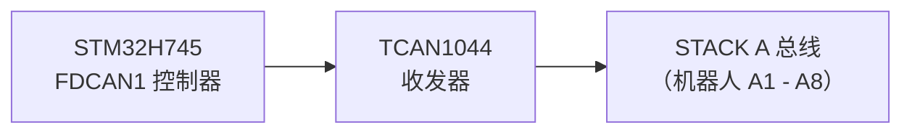
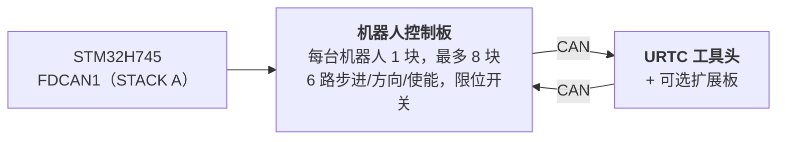

# 硬件规格（设计）

**Copyright (C) 2026 JuanenRac (Electro Hobby 3D) <electrohobby3d@gmail.com>**
**License:** CC BY-SA 4.0 (documentation) - see LICENSE.md for the full licensing split.

这是电路板及其固件预期设计的规格，为了让 README 保持简短而移到这里。它描述设计的目标；README 说明目前已有的内容。

## 2. 🖥️ 主机计算子系统（HMI 与高层处理）

* 🧩 **模块：** Raspberry Pi Compute Module 5（CM5）
* ⚙️ **处理器：** Broadcom BCM2712 四核 ARM Cortex-A76 @ 2.4 GHz
* 🎮 **图形引擎：** VideoCore VII GPU（OpenGL ES 3.1、Vulkan 1.2）
* 💾 **系统内存：** 2 GB / 4 GB LPDDR4X（CM5 集成）
* 💽 **高速存储：** 板载 eMMC 闪存
* 🐧 **操作系统：** Linux 64 位（Raspberry Pi OS / Yocto，打有 `PREEMPT_RT` 补丁）
* 📺 **显示接口：** MIPI-DSI（2 线 / 4 线），连接高分辨率电容触控面板（Bambu Lab 风格 UI，60 FPS）
* 🌐 **连接组件：**
  * 🌐 1 路千兆以太网（RJ45），用于工业局域网 / RTSP 视频流 / WebSocket / MQTT
  * 📶 Wi-Fi 6 与蓝牙 5.4
  * 📷 **8 路 USB 3.0 / 2.0 视觉接口：** 由板载双 Genesys Logic GL3523 控制器驱动。
  * 🎮 **2 路 USB 2.0 HID 接口：** 手柄 / 鼠标 / 键盘 —— 见第 4a 节。

## 3. 🧠 PCIE AI 加速子系统（HAILO-8 + HAILO-10 双 NPU）

* 🔀 **PCIe 扇出：** CM5 连接器仅暴露 **一条** PCIe Gen 2.0/3.0 x1 通道（已对照 CM5 数据手册 Table 5 确认，`docs/PINOUT_CM5_CARRIER.TXT`）——不足以直接连接 2 个 M.2 AI 加速器。板载 PCIe Gen3 数据包交换芯片（候选方案：ASMedia ASM2806 系列或同等产品，具体型号待定 —— 需为 Gen3 规格，以避免 Hailo-10 链路速率低于其原生速度）将 CM5 侧的单条通道扇出为 2 条独立的下游 PCIe x1 通道，分别连接下方的两个 M.2 插槽。
* 🔌 **物理接口：** 板载 2 个 M.2 Key M 插槽（2242 / 2280 尺寸），各自连接至上述 PCIe 交换芯片自身的一个下游端口 —— 而非直接连接 CM5。
* 🚀 **NPU 引擎 1 — Hailo-8（高速感知）：** Hailo-8 工业级 AI 处理器，功耗低于 5W，算力达 **26 TOPS**（每秒万亿次运算）。负责全部 8 路摄像头（第 4 节）的多路 YOLOv8/YOLO11 (计划中;尚未运行) 目标检测、缺陷检测及实时 PnP 基准点对齐 —— 沿用既有加速器，角色不变。
* 🧠 **NPU 引擎 2 — Hailo-10（认知推理 / 本地生成式 AI）：** 与 Hailo-8 并存，而非替代。算力达 **40 TOPS**，可在本地私密运行量化后的 LLM 与 Vision-Language-Action（VLA）模型 —— 将操作员的自然语言/语音指令转换为运动学轨迹，并在机器人执行任务失败时进行语义级错误恢复，全程无需连接任何外部云服务。这一认知角色与 HYDRA-UMC 生态系统其余部分（同族项目 HYDRA-UMC-COGNITIVE-NODE）中 Hailo-10 已确立的定位一致。
* ⚡ **软件集成：** 官方 Hailo RT 软件套件已针对两颗加速器与 Raspberry Pi OS 完成集成，执行 GStreamer/TAPPAS 管线与 OpenCV，实现 Hailo-8 的零 CPU 开销视觉推理；Hailo-10 自身的 LLM/VLA 运行时集成仍处于设计阶段（见 `src/cm5_host/ai_inference/README.md`）。
* ⚠️ **待定事项：** PCIe 交换芯片的具体型号，以及 Hailo-10 自身的真实功耗，均仍待确定 —— 见 `hardware/PCB/kinematic_brain_stm32h745/BOM.TXT` 第 05 项与第 09 项。

## 4. 📷 双 USB 3.0 视觉子系统（8 路摄像头接口）

* 🎛️ **集线器控制器：** 2 颗 Genesys Logic `GL3523` USB 3.0 / SuperSpeed 集线器芯片，直接集成于主板之上。
* 🔀 **拓扑与分配：**
  * 🅰️ **集线器 #1（`GL3523-A`）：** 连接至 CM5 原生 USB3-0 SuperSpeed PHY（5 Gbps）。为 USB 端口 1 至 4（摄像头 A1-A4）供电供数据。
  * 🅱️ **集线器 #2（`GL3523-B`）：** 连接至 CM5 原生 USB3-1 SuperSpeed PHY（5 Gbps）。为 USB 端口 5 至 8（摄像头 A5-A8）供电供数据。
  * ℹ️ CM5（BCM2712）直接暴露这两路 SuperSpeed PHY —— 无需 RP1 协处理芯片参与（RP1 是 Raspberry Pi 5 主板专属，CM5 上不存在）。完整引脚级信号走线见 `docs/PINOUT_CM5_CARRIER.TXT`。
* 🛡️ **电源开关与电路保护：** 每路 USB VBUS 均通过高边限流电源开关（`TPS2065` / `SY6280`）单独保护，配置为 500 mA - 1 A 并具备故障报告功能。
* ⚡ **大电流 VBUS 供电轨：** 由专用 24V 转 5V 降压稳压器供电（5V @ 持续 6A）。

### 4a. 🎮 USB 2.0 HID 子系统（2 路手柄 / 鼠标 / 键盘接口）

* 🎛️ **集线器控制器：** 1 颗小型 USB 2.0 集线器芯片（例如 Genesys Logic `GL850G` / `FE1.1s`，具体型号待定），将 CM5 单一原生 USB 2.0 PHY 扇出为 2 个物理端口。
* ℹ️ **为何需要集线器：** CM5 数据手册（`docs/datasheets/Raspberry Pi CM5.pdf`，§2.5）确认 BCM2712 在 DF40 连接器上仅暴露 **一路** USB 2.0（High Speed）端口（`USB_N`/`USB_P`，引脚 103/105）—— 与已专供 GL3523 摄像头集线器使用的两路原生 USB 3.0 SuperSpeed PHY（第 4 节）相互独立。单一物理信号对若不经过集线器，无法拆分为 2 个端口。
* 🔀 **拓扑：** `USB_N`/`USB_P`（CM5）→ 集线器上行端口 → 2 个下行 USB 2.0 Type-A 端口（前面板/侧面板，用于连接手柄、鼠标或键盘 —— 独立于触摸屏的手动点动/示教器控制及 HMI 输入）。
* 📌 完整引脚级信号走线见 `docs/PINOUT_CM5_CARRIER.TXT` 第 1 节。

## 5. ⚡ 实时协处理子系统（设计）

* 🎛️ **微控制器：** STMicroelectronics **STM32H745ZIT6**（成本优化型双核 MCU）
* 📦 **封装：** LQFP-144（0.5 mm 引脚间距）
* 🧠 **架构：** 双核非对称多处理（AMP）
  * 🚀 **核心 1（Cortex-M7 @ 480 MHz）：** 计划中：实时运动引擎、硬件脉冲生成、S 曲线速度曲线、PID 控制回路。目前其应用只是翻转 GPIO 的冒烟测试。
  * 📡 **核心 2（Cortex-M4 @ 240 MHz）：** 经典 CAN 模式下的 FDCAN1 协议管理和核间邮箱已存在（尚未在电路板上运行）；计划中且尚未实现：模拟传感器滤波与安全联锁。
* 💾 **内部存储架构：**
  * 💾 **2 MB** 双区内部闪存
  * 🧠 **1 MB** 内部 SRAM 总容量（512 KB AXI SRAM + 128 KB ITCM / 128 KB DTCM + SRAM1/SRAM2/SRAM3）
* 🧵 **RTOS：** **FreeRTOS**，每个核心运行独立实例（AMP 而非 SMP —— 核心 1 与核心 2 之间不共享调度器状态）。`src/mcu_stm32h745/`：核心 2（CM4）已经运行着真实的 FDCAN1 “STACK A” 主机应用（`CM4/STM32H745ZI_CM4_main.c`）；核心 1（CM7）自身的 `main()` 目前仍在调用那个什么都不做的旧占位实现——详见 `docs/architecture.md` 第 2 节。

## 6. 📡 分布式现场总线通信（单一 CAN 总线，FDCAN 外设以经典模式运行）

主板作为主控制器，通过单一物理 CAN 总线管理最多 8 个独立的从属机器人模块：

* 🔌 **硬件外设：** 1 路原生硬件 FDCAN 控制器（`FDCAN1`），直接内置于 STM32H745 中，由当前的真实引导加载程序实现以 **经典 CAN 模式** 运行（`FDCAN_FRAME_CLASSIC`，`BRS_OFF`）—— 该外设本身具备 FD 能力，但本项目目前实际采用的 CAN-OTA/SPI-OTA 协议（`docs/CANBUS_STM32H745.TXT`、`docs/CANBUS_STM32G474.TXT`）仅使用经典帧（最大 DLC 为 8），与其他各层级（G474 机器人控制板、URTC）保持一致。CAN FD 更大的 64 字节 BRS 载荷是为未来预留的真实硬件余量，目前协议尚未使用。
* ⚡ **物理层收发器：** 1 路高速 CAN FD 收发器（例如 TI `TCAN1044AVD` / NXP `TJA1443`）—— 出于与上述外设相同的未来余量考量而选用具备 FD 能力的硬件，尽管当前流量仍为经典帧。
* 🔀 **总线拓扑：**
  * 🅰️ **STACK A（`FDCAN1`）：** 服务于从属模块 A1 至 A8。
* ⏱️ **协议规格：** 标称比特率约 1 Mbps（经典 CAN，每帧最大 8 字节载荷）。自动总线关闭恢复计划由 Cortex-M4 管理 —— 目前尚未实现；当前 CM4 的应用（`src/mcu_stm32h745/CM4/STM32H745ZI_CM4_main.c`）已经运行着真实的 FDCAN1 “STACK A” 主机任务（对全部 8 个插槽轮询 `AXIS_STATUS`，见 `KinematicBrainCan.c`），并会刷新看门狗，但总线关闭恢复本身仍是真实的未来工作项，而非已交付的能力。
* 🔌 **物理连接器：** 40 针、2.54mm 间距的堆叠式排针/插座（+24V ×10 针，GND ×10 针，辅助 +5V ×4 针，FDCAN1 H/L，`BOARD_PRESENT_N`，13 针备用）—— 8 块机器人控制板在本板一侧依次物理堆叠（已确认为此拓扑，而非背板式），每块板都将全部 40 路信号直通传递给堆叠在其上方的下一块板。插槽地址由每块板自身的本地 DIP 开关决定（`BOARD_ID[2:0]`，README.md 第 12 节），而非由此连接器派生。完整引脚表与堆叠拓扑见 `docs/PINOUT_STACKA_CONNECTOR.TXT`。运动学大脑自身端口与每块机器人控制板的一对端口，均采用完全相同的连接器定义。

## 7. 💾 超高速非易失性存储器（SPI FRAM）

设计目标（尚未实现）：紧急断电时数据零丢失、状态即时恢复：

* 🧪 **存储芯片：** Cypress/Infineon `FM25V05-G` / Fujitsu `MB85RS64`（64 KB SPI FRAM）
* ⚡ **总线接口：** 专用 SPI2 总线，最高 40 MHz。
* ♾️ **耐久性：** 无限读写寿命（10^14 次循环），纳秒级写入延迟。
* 🛡️ **断电保护序列（PVD），计划中：** 内部电压检测器（PVD）持续监测 3.3V 供电轨。一旦检测到电压跌落，将触发不可屏蔽中断（NMI），在断电前 **5 微秒内** 将编码器向量、活动状态机及坐标数据写入 FRAM。

## 8. 🦾 本地运动、驱动与传感套件

### ⚙️ 运动输出
* 🎯 **支持轴数：** 6 轴本地工作台 —— 双 Y 龙门架 + 工具轴（`X`、`Y1`、`Y2`、`Z`、`E0`、`E1`），由 6 颗以 SPI 菊花链方式连接的 TMC5160A 步进驱动器驱动。
* ⚡ **信号：** 3.3V CMOS（`STEP`、`DIR`、`ENABLE`），全部 6 颗驱动器共享一条 SPI4 菊花链。
* ⏱️ **定时器：** 高级控制定时器（`TIM1` 用于 X/Y1/Y2/Z，`TIM8` 用于 E0/E1），支持硬件脉冲生成。
* 🛑 **限位开关：** 12 路输入，每轴 2 路（最小值 + 最大值）。
* 📌 完整引脚级分配见 `docs/PINOUT_STM32H745_KINEMATIC_BRAIN.TXT`。

### 🔌 电源与流体驱动器
* 🔀 **20 路低边开关通道：** 工业级 N 沟道 MOSFET 输出，带续流保护。
  * 🧲 **8+2 通道：** 真空泵 / 文丘里 Pick-and-Place 发生器。
  * 💨 **8+2 通道：** 电磁气动阀（5V/24V 驱动）。
* 💨 **风扇：** 3 路三线风扇（低边 MOSFET PWM 调速供电 + 每通道转速反馈）。
* 🌡️ **热管理：**
  * 🔥 1 路固态继电器控制输出，用于加热床，切换 **230VAC 市电** —— 与 MCU/逻辑域光电隔离；该电路涉及市电电压，PCB 上需要真实的爬电距离/电气间隙设计，而非按 24V 总线标准布板。
  * 🌡️ 2 路精密 NTC 热敏电阻模拟输入（加热床），由 `ADC1` 采样。

## 9. 🔌 电源分配与稳压

本板由单一工业级 **24V DC** 输入电源总线供电：

* ⚡ **主直流输入：** 24V DC ±10%
* 🔋 **5V 主电源域：** 同步降压稳压器，为 CM5 模块、触摸屏背光及板载逻辑电路提供 **持续 5A** 供电。
* 📷 **5V USB VBUS 电源域：** 专用同步降压稳压器，专门为 8 路 USB 3.0 摄像头接口及 GL3523 集线器控制器提供 **持续 6A** 供电。
* 🎛️ **3.3V 电源域：** 低噪声稳压器，提供 **持续 4A** 供电（预算涵盖 STM32、FRAM、收发器、PCIe 交换芯片（第 3 节），以及两个 M.2 插槽的 3.3V 供电轨 —— Hailo-8 + Hailo-10）。待两颗 M.2 模块的真实功耗确认后（Hailo-8 低于 5W；Hailo-10 自身数值仍待定），该 4A 预算需要重新核算 —— 可能需要超过 4A；见 `hardware/PCB/kinematic_brain_stm32h745/BOM.TXT` 第 09 项。

## 10. 🔄 处理器间通信（IPC）

CM5（主机）与 STM32H745（协处理器）之间的通信，采用硬件辅助的零拷贝 SPI 链路：

* 🔗 **物理传输层：** 全双工 SPI1，设计上限为 50 MHz —— STM32 端为从机模式，CM5 端为主机模式;不过 CM5 端的真实驱动(`src/cm5_host/ipc_driver/src/ipc_driver.c`)目前保守地使用 10 MHz,因为与之匹配的 STM32H745 SPI1 从机配置尚未在真实硬件上验证。
* 🤝 **握手信号线：** `HYDRA_DATA_READY` GPIO 信号线。
* ⚡ **执行流程：** Cortex-M4 在共享的 AXI SRAM 中准备一个 128 字节的遥测数据帧，拉高 `HYDRA_DATA_READY` 信号，随后 CM5 通过高速 SPI DMA 获取该数据包，全程无需轮询开销。

## 11. 🎛️ 四层 PCB 硬件规格

* 📐 **外形：** 一体式工业主板。
* 🥞 **层叠结构（4 层）：**
  * 🟢 **第 1 层（顶层）：** 元件布局、高频信号、90 欧姆 USB SuperSpeed 差分对、85 欧姆 PCIe Gen 3.0 差分对。
  * 🛡️ **第 2 层（内层 1）：** 连续实心接地层（`GND`）。
  * ⚡ **第 3 层（内层 2）：** 分割式电源层（`24V`、`5V_MAIN`、`5V_USB`、`3.3V`）。
  * 🔴 **第 4 层（底层）：** 次级信号走线及大电流电源分支。
* 🛠️ **连接器与装配：**
  * 🔲 STM32H745 采用 LQFP-144 封装（0.5 mm 间距），2 颗 GL3523 集线器芯片采用 QFN-88 封装，另有 2 个由板载 PCIe Gen3 交换芯片供电的 M.2 Key M 2242/2280 插槽（Hailo-8 + Hailo-10，第 3 节）。
  * 🔌 双 Hirose DF40 夹层连接器，用于 Compute Module 5。
  * 📌 40 针、2.54 mm 间距堆叠式排针，用于 STACK A 总线连接（机器人控制板物理堆叠的底座）—— `docs/PINOUT_STACKA_CONNECTOR.TXT`。
  * 🔌 8 路 USB 3.0 Type-A（或 Hirose 工业锁扣型）连接器，用于机器人摄像头。

## 12. 🦾 机器人控制板与 URTC 工具头（分布式层级）

STACK A（第 6 节）上最多 8 个从属模块中的每一个，都是一块 **机器人控制板**：每台机器人配备一块，驱动该机器人自身的 6 个轴（步进/方向/使能），读取其限位开关状态，并将其自身工具头的通信数据经由 *另一条* CAN 连接再转发一跳，传递给安装在机器人头部的 **URTC** 板（Universal Robot Tool Controller —— 详见同族仓库 `URTC`），该 URTC 板可选配自身的扩展板。

* 🎛️ **MCU：** STMicroelectronics **STM32G474RET6**（Cortex-M4 @ 170 MHz，LQFP-64，512 KB 闪存），使用其自带 3 路 FDCAN 外设中的 2 路 —— 一路作为连接 STM32H745 的 FDCAN 上行链路，另一路作为连接自身 URTC 头部的 CAN 下行链路。详见 `docs/architecture.md` §1。
* 🔢 **地址分配：** `BOARD_ID[2:0]` —— 每块板上的本地 3 位 DIP 开关，安装时手动设置为 0-7，为每块板赋予自己的 FDCAN1 插槽基础地址 —— 并非由物理堆叠位置或 STACK A 连接器派生（每块板都是完全相同、可互换的 PCB）。详见 `docs/PINOUT_STM32G474_ROBOT_CONTROLLER.TXT` §1c。
* 🧵 **RTOS：** **FreeRTOS**（其引导加载程序保持裸机运行 —— 接收/校验/跳转无需调度器）。真实应用：`src/mcu_stm32g474/STM32G474RE_main.c` 运行着真实的中继任务（`RobotControllerRelay.c`——通往 URTC Tool Head 的 FDCAN2 下行链路、一个 `AXIS_STATUS` 响应器，以及 `RELAY_SEND`/`RELAY_RECV` 隧道），与带看门狗刷新的闪烁任务并行运行。
* 📡 **CAN-OTA 固件更新，深达 4 个层级：** STM32H745 自身（通过其与 CM5 之间既有的 SPI 链路）、本板、其 URTC 工具头（STM32F303CCT6），以及 —— 仅当已安装时 —— 该工具头自身的高级扩展板（STM32F303CBT6，`expansion_board_type` 为 3 或 4，详见 URTC 自身的 `docs/EXPANSION.TXT`），均可从 HYDRA-UMC-STUDIO 的烧录器/测试器中完成烧录与诊断，全程无需 JTAG/SWD 探针，也无需 USB-CAN 转接器。完整地址方案、无需任何新协议设计即可触达最后两个层级的中继隧道，以及当前实现状态：详见 `docs/architecture.md`。 **带签名的镜像头与防回滚(引导程序,已在主机上测试):** 更新带有 64 字节的头(完整版本 主.次.补丁、硬件 ID、大小、链接地址、向量字、CRC),Ed25519 签名覆盖头与镜像合在一起的摘要,因此旧的已签名镜像无法声称更高的版本;版本的三个数字会被比较,更旧的镜像只有在带有绑定该会话随机数、两个版本和该镜像的令牌时才会安装(令牌本身也是签名;旧的四字节魔术帧不再允许任何事)。该判定(`image_header.h`、`update_verify.h`)在三个引导程序中是同一个文件,用 `tools/image_header.py` 生成的字节测试,并且对 G474 从 START_UPDATE 到新应用做了端到端测试。板子上只有公钥(`tools/image_header.py` 生成密钥并签名;私钥种子永远不放到板子上,开发用种子是公开的,因此发布构建会拒绝开发用公钥);曲线运算使用内置的 TweetNaCl(公有领域,见 `THIRD_PARTY_NOTICES.md`)。这些都还没有为板子编译或在板子上运行过。

完整的分层架构详见 `docs/architecture.md`（本节仅为摘要），其中包括哪些内容是已确认的硬件事实、哪些仍是尚待实现的提议方案。该文档第 8 节还记录了当前引导加载程序已知且已被接受的安全局限（尚无读出保护、共享的防回滚绕过值、未经身份验证的回读）——这些均是硬件到位前的刻意留白，而非疏漏。
